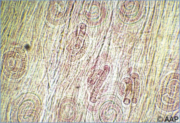
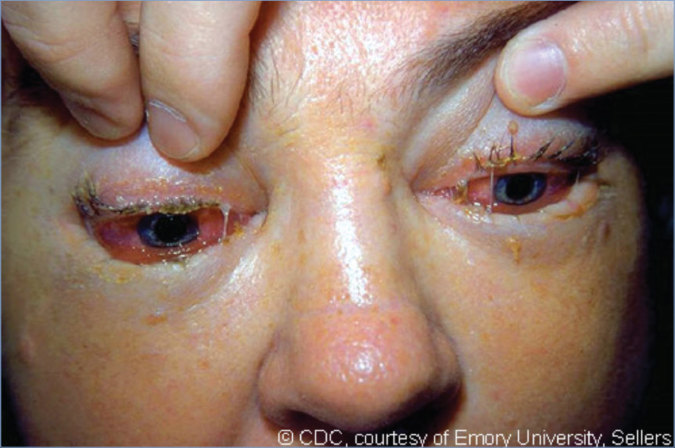
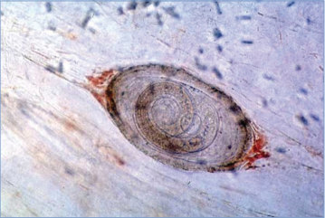
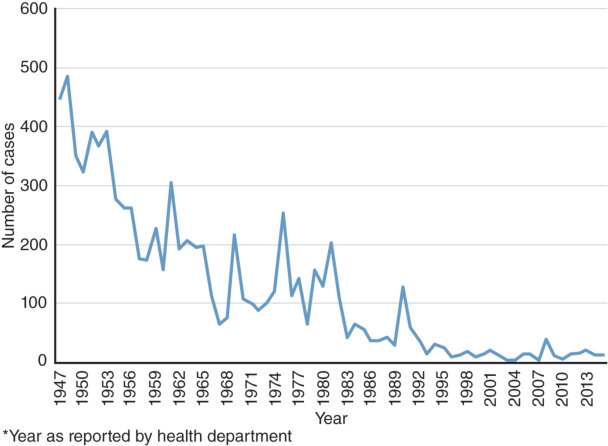

# 152. Trichinellosis (Trichinella spiralis and Other Species)
> Private study reference ([source credits](../../SOURCE_CREDITS.md)). PDF pages 989-992; printed pages 975-978.

## PDF page 989 | printed page 975

(Trichinella spiralis and Other Species)

### CLINICAL MANIFESTATIONS

The clinical spectrum of Trichinella infection ranges from inapparent infection to fulminant and fatal illness; most infections are asymptomatic. Severity of disease is proportional to the infective dose and varies with the causative species of Trichinella. During the first week after ingesting infected meat, a person may experience abdominal discomfort, nausea, vomiting, and/or diarrhea as excysted larvae penetrate the intestinal mucosa. Two to 8 weeks later, as progeny larvae migrate into tissues, fever, myalgia, periorbital edema, urticarial rash, and conjunctival and subungual hemorrhages may develop. Other findings may correlate with organ system involvement, for example arrhythmia and myocarditis (cardiac), meningitis and encephalitis (central nervous system), myositis (musculoskeletal), and proteinuria or hematuria (renal). Larvae may remain viable in tissues for years; calcification of some larvae in skeletal muscle usually occurs within 6 to 24 months and may be detected using various imaging modalities.

### ETIOLOGY

Infection is caused by nematodes (roundworms) of the genus Trichinella. Trichinella spiralis is the most common of the 7 species that cause human infection.

### EPIDEMIOLOGY

Animal infections occur worldwide in carnivores and omnivores, especially scavengers. Humans acquire the infection following ingestion of raw or insufficiently cooked meat containing larvae of Trichinella species. Commercial and home-raised pork remain a source of human infections, but meats other than pork, such as venison, horse meat, and particularly meats from wild carnivorous or omnivorous game (especially bear, boar, seal, and walrus) now are the most common sources of infection. U.S. cases have occurred after ingestion of homemade jerky and sausage. The disease is not transmitted from person to person.

The incubation period usually is less than 1 month.

### DIAGNOSTIC TESTS

Eosinophilia of up to 70% in the setting of compatible symptoms and dietary history suggests the diagnosis. Increases in concentrations of muscle enzymes, such as creatinine phosphokinase and lactic dehydrogenase, may occur but are not always present. Larvae can be detected in suspect meat, but this is not often feasible. Encapsulated larvae in a skeletal muscle biopsy specimen (particularly deltoid and gastrocnemius) are visible under light microscopy beginning 2 weeks after infection by examining hematoxylin-eosin–stained slides or sediment from digested muscle tissue. Serologic testing is available through the Centers for Disease Control and Prevention, some state reference laboratories, and commercial laboratories. Serum antibodies are detectable at 3 or more weeks postinfection and may remain for years. Testing of paired acute and convalescent serum specimens showing an increase in titer is diagnostic, but a single positive test result in the appropriate clinical setting makes the diagnosis likely.

### TREATMENT

Albendazole and mebendazole are each recommended for treatment of acute trichinellosis, although anthelmintics typically do not kill larvae that have already encysted within muscles. Administration of corticosteroids with or without anthelmintics is recommended when systemic symptoms are severe. Corticosteroids can be lifesaving when the central nervous system or heart is involved.

### INFECTION PREVENTION AND CONTROL MEASURES IN HEALTH CARE SETTINGS

Standard precautions are recommended. There is no person-to-person spread.

### CONTROL MEASURES

Transmission to pigs can be prevented by not feeding them garbage, by preventing cannibalism among animals, and by effective rat control. The public should be educated about the importance of cooking pork and wild game meat thoroughly. Curing, drying, smoking, and microwaving do not kill Trichinella worms reliably. Specific recommendations include the following:

• For whole cuts of meat (excluding poultry and wild game): cook to at least 145°F (63°C) as

## PDF page 990 | printed page 976

measured with a food thermometer placed in the thickest part of the meat, then allow the meat to rest for 3 minutes before carving or consuming.

• For ground meat (including wild game, excluding poultry): cook to at least 160°F (71°C); ground meats do not require a rest time. Clean meat grinders thoroughly after each use.

• For all wild game (whole cuts and ground): cook to at least 160°F (71°C).

Freezing pork less than 6 inches thick at 5°F (–15°C) for 20 days kills T spiralis. Trichinella

Image 152.1 Larvae of Trichinella spiralis in skeletal muscle biopsy. This disease is acquired by eating undercooked meat, usually pork, containing encysted Trichinella larvae.

Image 152.2 This patient with trichinosis had periorbital swelling, muscle pain, diarrhea, and 28% (0.28) eosinophils. Courtesy of Centers for Disease Control and Prevention/Dr Thomas F. Sellers, Emory University.

organisms in wild animals, such as bears and raccoons, are resistant to freezing. For people who have ingested undercooked meat known to be contaminated with Trichinella organisms, preemptive therapy with albendazole or mebendazole may be considered if initiated within 6 days of exposure.

Public Health Reporting

Trichinellosis is a notifiable disease.

## PDF page 991 | printed page 977

Image 152.3 The parasitic disease trichinosis is manifested by splinter hemorrhages under the fingernails as shown. Trichinosis, or trichinellosis, is caused by eating raw or undercooked pork infected with the larvae of a species of worm called Trichinella. Initial symptoms include nausea, diarrhea, vomiting, fatigue, fever, and abdominal discomfort. Courtesy of Centers for Disease Control and Prevention/ Dr Thomas F. Sellers, Emory University.

Image 152.5 Number of reported cases of trichinellosis, by year, 1947–2015, in the United States. Courtesy of Centers for Disease Control and Prevention.

Image 152.4 Trichinella larvae in a sample of infected meat (light microscopy, magnification ×100). Courtesy of Emerging Infectious Diseases.

## PDF page 992 | printed page 978

Image 152.6 Life cycle. Trichinosis is acquired by ingesting meat containing cysts (encysted larvae) (1) of Trichinella. After exposure to gastric acid and pepsin, the larvae are released (2) from the cysts and invade the small bowel mucosa, where they develop into adult worms (3) (females, 2.2 mm in length; males, 1.2 mm in length; life span in the small bowel, 4 weeks). After 1 week, the females release larvae (4) that migrate to the striated muscles, where they encyst (5). Trichinella pseudospiralis, however, do not encyst. Encystment is completed in 4 to 5 weeks, and the encysted larvae may remain viable for several years. Ingestion of the encysted larvae perpetuates the cycle. Rats and rodents are primarily responsible for maintaining the endemicity of this infection. Carnivorous or omnivorous animals, such as pigs or bears, feed on infected rodents or meat from other animals. Different animal hosts are implicated in the life cycle of the different species of Trichinella. Humans are unintentionally infected when eating improperly processed meat of these carnivorous animals (or eating food contaminated with such meat). Courtesy of Centers for Disease Control and Prevention.

![Image 152.6 Life cycle. Trichinosis is acquired by ingesting meat containing cysts (encysted larvae) (1) of Trichinella. After exposure to gastric acid and pepsin, the larvae are released (2) from the cysts and invade the small bowel mucosa, where they develop into adult worms (3) (females, 2.2 mm in length; males, 1.2 mm in length; life span in the small bowel, 4 weeks). After 1 week, the females release larvae (4) that migrate to the striated muscles, where they encyst (5). Trichinella pseudospiralis, however, do not encyst. Encystment is completed in 4 to 5 weeks, and the encysted larvae may remain viable for several years. Ingestion of the encysted larvae perpetuates the cycle. Rats and rodents are primarily responsible for maintaining the endemicity of this infection. Carnivorous or omnivorous animals, such as pigs or bears, feed on infected rodents or meat from other animals. Different animal hosts are implicated in the life cycle of the different species of Trichinella. Humans are unintentionally infected when eating improperly processed meat of these carnivorous animals (or eating food contaminated with such meat). Courtesy of Centers for Disease Control and Prevention.](../../figures/ch152_p0992_01.jpg)
