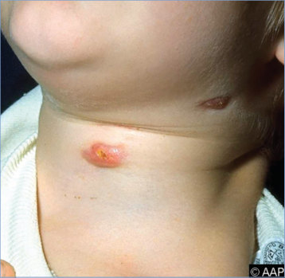
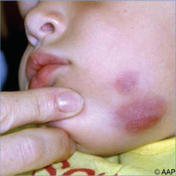
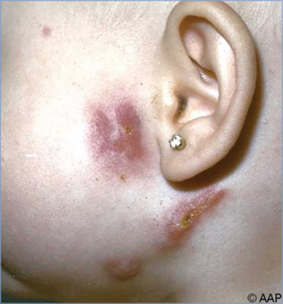
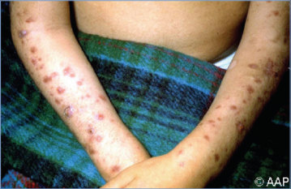
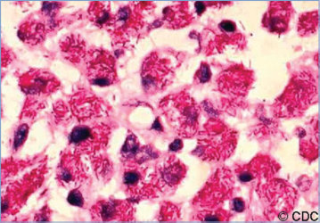
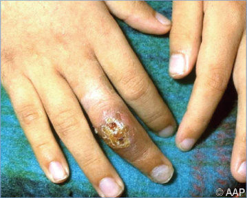
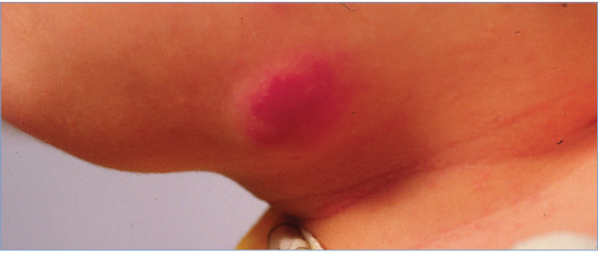

# 158. Nontuberculous Mycobacteria (Environmental Mycobacteria, Mycobacteria Other Than Mycobacterium tuberculosis)
> Private study reference ([source credits](../../SOURCE_CREDITS.md)). PDF pages 1043-1053; printed pages 1029-1039.

## PDF page 1043 | printed page 1029

(Environmental Mycobacteria, Mycobacteria Other Than Mycobacterium tuberculosis)

### CLINICAL MANIFESTATIONS

Several syndromes are caused by nontuberculous mycobacteria (NTM).

• In children, the most common of these syndromes is cervical lymphadenitis.

• Cutaneous infection may follow soil- or watercontaminated traumatic wounds, surgeries, or cosmetic procedures (eg, tattoos, pedicures, body piercings).

• Less common syndromes include skin and softtissue infection, osteomyelitis, otitis media, central catheter-associated bloodstream infections, and pulmonary infections, especially in adolescents with cystic fibrosis.

• NTM, especially Mycobacterium avium complex (MAC [including Mycobacterium avium and Mycobacterium avium-intracellulare]) and Mycobacterium abscessus, can be recovered from sputum in 10% to 20% of adolescents and young adults with cystic fibrosis and can be associated with fever and declining clinical status.

• Disseminated infections almost always are associated with impaired cell-mediated immunity, as found in children with congenital immune defects (eg, interleukin 12 deficiency, cytokine–JAK–STAT pathway abnormalities, NF-κB essential modulator mutation and related disorders, and interferon-γ receptor defects), hematopoietic cell transplants, or advanced HIV infection. Disseminated NTM infection, most commonly MAC, is rare in children living with HIV during the first year of life. The frequency of disseminated MAC increases with increasing age and declining CD4+ T-lymphocyte counts, typically less than 50 cells/mm3, in children 6 years or older.1 Manifestations of disseminated NTM infections depend on the species and route of infection and include fever, night sweats, weight loss, abdominal pain, fatigue, diarrhea, and anemia.

These signs and symptoms also are found in advanced cases of immunosuppressed children living with HIV infection without disseminated MAC. For children living with HIV infection who have disseminated MAC, respiratory symptoms and isolated pulmonary disease are uncommon. In patients living with HIV infection who develop immune restoration with initiation of antiretroviral therapy, local NTM symptoms can worsen temporarily. This immune reconstitution syndrome usually occurs 2 to 4 weeks after initiation of antiretroviral therapy. Symptoms can include worsening fever, swollen lymph nodes, local pain, and laboratory abnormalities.

### ETIOLOGY

Of the close to 200 species of NTM that have been identified, only a few species cause most human infections. The species most commonly infecting children in the United States are MAC, Mycobacterium fortuitum, M abscessus, and Mycobacterium marinum (Table 158.1). Several new species, which can be detected by nucleic acid amplification tests but cannot be grown by routine culture methods, have been identified in lymph nodes of children with cervical adenitis. NTM disease in patients living with HIV infection usually is caused by MAC. M fortuitum, Mycobacterium chelonae, Mycobacterium smegmatis, and M abscessus are referred to as “rapidly growing” mycobacteria, because visible growth can be detected in subculture usually within 7 days on solid media, whereas MAC, M marinum, and Mycobacterium szulgai require several weeks before sufficient growth occurs and are referred to as “slowly growing” mycobacteria. Rapidly growing mycobacteria have been implicated most often in wound, soft-tissue, bone, pulmonary, central venous catheter, and middle ear infections. Other mycobacterial species that usually are not pathogenic have caused infections in immunocompromised hosts or have been associated with the presence of a foreign body.

### EPIDEMIOLOGY

NTM are ubiquitous in nature, being found in soil, food, water, and animals. Tap water is the major reservoir for M avium (included in MAC), Mycobacterium chimaera (belonging to MAC),

## PDF page 1044 | printed page 1030

Table 158.1 Diseases Caused by Nontuberculous Mycobacteria Species

Clinical Disease Cutaneous infection

Lymphadenitis

Otologic infection Pulmonary infection

Catheter-associated infection Prosthetic valve endocarditis Skeletal infection

Disseminated

a Not endemic in the United States. b Found primarily in Northern Europe.

Mycobacterium kansasii, Mycobacterium lentiflavum, Mycobacterium xenopi, Mycobacterium simiae, and health care-associated infections attributable to M abscessus and M fortuitum. Outbreaks have been associated with contaminated water used for acupuncture and pedicures and inks used for tattooing. Health care-associated outbreaks have occurred among children

Species Mycobacterium marinum Mycobacterium chelonae Mycobacterium fortuitum Mycobacterium abscessus Mycobacterium ulceransa

Mycobacterium avium complex (MAC) Mycobacterium haemophilum Mycobacterium lentiflavum Mycobacterium kansasii M fortuitum M abscessus Mycobacterium malmoenseb

M abscessus M fortuitum MAC M kansasii M abscessus Mycobacterium xenopi M malmoenseb

Mycobacterium szulgai M fortuitum Mycobacterium simiae M chelonae M fortuitum M abscessus M chelonae M fortuitum Mycobacterium chimaera MAC M kansasii M fortuitum M chelonae M marinum M abscessus M ulceransa

MAC M kansasii Mycobacterium genavense M haemophilum M chelonae

undergoing pulpotomy or other dental procedures associated with improperly maintained dental unit water lines. Outbreaks of otitis media caused by M abscessus have been associated with polyethylene ear tubes and use of contaminated equipment or water. Health care-associated outbreaks of M chelonae have been associated with the use of commercial-grade misting humidifiers and

### Geometry-detected table

|Clinical Disease|Species|
|---|---|
|Cutaneous infection|_Mycobacterium marinum_ _Mycobacterium chelonae_ _Mycobacterium fortuitum_ _Mycobacterium abscessus Mycobacterium ulcerans_a|
|Lymphadenitis|_Mycobacterium avium_ complex (MAC) _Mycobacterium haemophilum_ _Mycobacterium lentifavum Mycobacterium kansasii_ _M fortuitum_ _M abscessus_ _Mycobacterium malmoense_b|
|Otologic infection|_M abscessus_ _M fortuitum_|
|Pulmonary infection|MAC _M kansasii_ _M abscessus_ _Mycobacterium xenopi_ _M malmoense_b _Mycobacterium szulgai_ _M fortuitum_ _Mycobacterium simiae_|
|Catheter-associated infection|_M chelonae_ _M fortuitum_ _M abscessus_|
|Prosthetic valve endocarditis|_M chelonae_ _M fortuitum_ _Mycobacterium chimaera_|
|Skeletal infection|MAC _M kansasii_ _M fortuitum_ _M chelonae_ _M marinum_ _M abscessus_ _M ulcerans_a|
|Disseminated|MAC _M kansasii_ _Mycobacterium genavense_ _M haemophilum_ _M chelonae_|

[View original table](../../tables/ch158_p1044_1.jpg)

## PDF page 1045 | printed page 1031

nonsterile ice for invasive procedures. For M marinum, water in a fish tank or aquarium and injury in a saltwater environment are the major sources of infection. A waterborne route of transmission has been implicated for MAC infection in some immunocompromised hosts. A variety of other outbreaks associated with contaminated medical equipment, inoculation through injections, surgery, and other procedures have been reported, particularly in settings of poor infection control practices. Pseudo-outbreaks associated with contamination of specimens or reagents have also been reported.

An international outbreak of M chimaera infection (including prosthetic valve endocarditis, vascular graft infection, and disseminated infection) has been associated with heater-cooler devices used in heart surgery requiring cardiopulmonary bypass and is attributable to aerosolization of M chimaera from contaminated devices. Clinical presentation is indolent and includes fever, myalgia, arthralgia, fatigue, and weight loss, with diagnosis in patients often occurring up to several years after exposure. The U.S. Food and Drug Administration (FDA) has determined that all heater-cooler devices have common design features that could lead to bioaerosol formation.

Although many people are exposed to NTM, it is unknown why some exposures result in acute or chronic infection. Usual portals of entry for NTM infection are believed to be abrasions in the skin, such as cutaneous lesions caused by M marinum; penetrating trauma such as needles and organic material most often associated with M abscessus and M fortuitum; surgical sites, especially for cosmetic surgery and central vascular or peritoneal dialysis catheters; oropharyngeal mucosa, which is the presumed portal of entry for cervical lymphadenitis; tooth eruption, which is the presumed portal of entry for submandibular lymphadenitis; gastrointestinal or respiratory tract, for disseminated MAC; and respiratory tract, including tympanostomy tubes for otitis media. Pulmonary disease and rare cases of mediastinal adenitis and endobronchial disease occur. NTM are important pathogens in patients with cystic fibrosis and are emerging pathogens in individuals receiving biologic response modifiers, such as antitumor necrosis factor-α agents. Most infections remain localized at the portal of entry or in regional

lymph nodes. Dissemination to distal sites primarily occurs in severely immunocompromised hosts.

No definitive evidence of person-to-person transmission of NTM exists outside of reports of possible occurrence in cystic fibrosis care centers.

Buruli ulcer disease is a skin and bone infection caused by Mycobacterium ulcerans, an emerging disease causing significant morbidity and disability in tropical areas such as Africa, Asia, South America, Australia, and the western Pacific.

The incubation periods for NTM are variable.

### DIAGNOSTIC TESTS

Routine screening of respiratory or gastrointestinal tract specimens for NTM is not recommended except in the setting of cystic fibrosis, where respiratory specimens should be cultured for mycobacteria annually in those with a stable course who are spontaneously expectorating. Definitive diagnosis of NTM disease generally requires isolation of the organism, although molecular diagnostic tests are becoming more widely available. Consultation with the laboratory should occur to ensure that cultures and other specimens are handled correctly. For example, isolation of Mycobacterium haemophilum requires that the culture is maintained at 30°C and that heme-containing medium is added for isolation. Because NTM commonly are found in the environment, contamination of cultures or transient colonization can occur. Caution must be exercised in interpretation of cultures obtained from nonsterile sites, such as gastric washing specimens, endoscopy material, a single expectorated sputum sample, or urine specimens, and when the species cultured usually is nonpathogenic (eg, Mycobacterium terrae complex or Mycobacterium gordonae). An acid-fast bacilli (AFB) smear-positive sample and repeated isolation on culture media of a single species from any site are more likely to indicate disease rather than culture contamination or transient colonization. Diagnostic criteria for NTM lung disease in adults include 2 or more separate sputum samples or 1 bronchial alveolar lavage or bronchial wash specimen that grows NTM. These criteria have not been validated in children and apply best to MAC, M kansasii, and M abscessus. NTM isolates from draining sinus tracts or wounds almost

## PDF page 1046 | printed page 1032

always are clinically significant. Recovery of NTM from sites that usually are sterile, such as cerebrospinal fluid, pleural fluid, bone marrow, blood, lymph node aspirates, middle ear or mastoid aspirates, or surgically excised tissue, is very likely to be clinically significant. However, rare instances of sample or laboratory contamination leading to a false-positive culture result have been reported. With radiometric or nonradiometric broth techniques, blood cultures are highly sensitive in recovery of MAC and other bloodborne NTM species. If disseminated MAC disease is confirmed, the patient should be evaluated for underlying immunodeficiency conditions. Polymerase chain reaction-based assays for some NTM have been developed but are not yet widely available in commercial diagnostic laboratories. Matrixassisted laser desorption/ionization–time-of-flight instruments have been approved for the identification of mycobacteria species and may allow for more NTM isolates to get species identification faster than traditional methods.

Patients with NTM infections can have positive tuberculin skin test (TST) results, because the purified protein derivative preparation, derived from Mycobacterium tuberculosis, shares a number of antigens with these NTM species. These TST reactions usually measure less than 10 mm of induration but can measure more than 15 mm. The interferon-γ release assays use 2 or 3 antigens more specific to M tuberculosis complex and result in less cross-reactivity from MAC and most other NTM species compared with TST. However, cross-reactions can occur with infection caused by M kansasii, M marinum, and M szulgai.

### TREATMENT2,3

NTM are relatively resistant in vitro to antimycobacterial drugs, but this does not necessarily correlate with clinical response, especially with MAC infections. Only limited controlled trials of drug treatment have been performed in adults with NTM infections, and none have been conducted in children. The approach to initial therapy for an NTM infection should be directed by the following: (1) the species causing the infection; (2) the results of drug-susceptibility testing, especially to macrolides and amikacin; (3) the site(s) of infection; (4) the patient’s immune status; and (5) the need to treat a patient presumptively for

tuberculosis while awaiting culture reports that subsequently reveal NTM.

For NTM lymphadenitis in otherwise healthy children, especially when the disease is caused by MAC, complete surgical excision is curative and limits scar formation. Published reports of antimicrobial therapy without surgical incision have had variable success rates. Therapy with azithromycin or clarithromycin combined with either a rifamycin (eg, rifampin or rifabutin) or ethambutol may be beneficial for children in whom surgical excision is not possible or is incomplete and for children with recurrent disease; use of a 3-drug regimen consisting of a macrolide, a rifamycin, and ethambutol can be considered for children with more extensive disease (see Table 158.2). The natural history of NTM lymphadenitis without curative surgical excision is slow resolution but with a high risk of spontaneous drainage through the skin and resulting scarring, even when antimicrobial management is used. Joint decision-making with the parent(s) and possibly the child, depending on age, and the surgeon and pediatric infectious disease consultant are important in developing the best treatment plan for each patient.

The choice of drugs, dosages, and duration should be reviewed with a consultant experienced in the management of NTM infections but always includes 2 or more drugs to which the organism is susceptible (see Table 158.2). Infected indwelling foreign bodies must be removed, and surgical débridement for serious localized disease is optimal, especially for infections caused by M abscessus. Clinical isolates of MAC usually are resistant to many of the approved antituberculosis drugs, including isoniazid, but generally are susceptible to azithromycin and clarithromycin with variable susceptibility to ethambutol, rifabutin or rifampin, amikacin, or streptomycin. Secondary agents include moxifloxacin and linezolid; susceptibility testing to these other agents has not been correlated with clinical outcomes, so they are not recommended routinely. Isolates of rapidly growing mycobacteria (M fortuitum, M abscessus, and M chelonae) should be tested in vitro against drugs to which they commonly are susceptible and that have been used with some therapeutic success (eg, amikacin, imipenem, sulfamethoxazole or trimethoprim-sulfamethoxazole, cefoxitin, ciprofloxacin, clarithromycin, linezolid, clofazimine,

## PDF page 1047 | printed page 1033

Table 158.2 Treatment of Nontuberculous Mycobacteria Infections in Childrena

Organism Disease Slowly Growing Speciesa

Lymphadenitis Complete excision of lymph nodes; if excision incomplete or disease recurs, azithromycin or clarithromycin plus either a rifamycin (rifampin or rifabutin) or ethambutol; children with more extensive disease may require a 3-drug regimen consisting of a macrolide, a rifamycin, and ethambutol. Pulmonary infection Azithromycin or clarithromycin plus ethambutol and rifampin (or rifabutin); pulmonary resection may be needed in some patients who fail to respond to drug therapy. For severe disease, an initial course of amikacin or streptomycin often is included. Clinical data in adults with mild to moderate disease support that 3-times-weekly therapy is as effective as daily therapy, with less toxicity. For patients with advanced or cavitary disease, or those with cystic fibrosis, drugs should be given daily. Mycobacterium chimaera (belonging to MAC)

Mycobacterium avium complex (MAC); Mycobacterium haemophilum; Mycobacterium lentiflavum

Prosthetic valve endocarditis Valve removal, prolonged antimicrobial therapy based on susceptibility testing, but generally azithromycin or clarithromycin, ethambutol, and rifampin (or rifabutin). Additional drugs including amikacin and/or clofazimine are often used. Disseminated See text. Mycobacterium kansasii Pulmonary infection Azithromycin or clarithromycin plus rifampin and ethambutol daily or three times a week. Alternatively, isoniazid plus rifampin and ethambutol daily. If rifampin resistance is detected, a 3-drug regimen based on drug susceptibility testing should be used. Osteomyelitis Surgical débridement and prolonged antimicrobial therapy using the regimen above. Mycobacterium marinum

Cutaneous infection None, if minor; rifampin, trimethoprim-sulfamethoxazole, clarithromycin, or doxycyclineb for moderate disease; extensive lesions may require surgical débridement. Susceptibility testing not routinely required. Mycobacterium ulcerans

Cutaneous and bone infections

Rifampin and clarithromycin for 8 weeks; excision to remove necrotic tissue, if present; potential response to thermotherapy. Rapidly Growing Speciesa

Cutaneous infection Initial therapy for serious disease is amikacin plus imipenem (or meropenem), IV. When starting oral therapy, options often include doxycycline,b trimethoprim-sulfamethoxazole, or ciprofloxacin. Antimicrobial selection should be based on in vitro susceptibility testing. May require surgical excision. Catheter infection Catheter removal; amikacin plus meropenem, IV; oral options often include trimethoprim-sulfamethoxazole or ciprofloxacin. Antimicrobial selection should be based on in vitro susceptibility testing. Mycobacterium abscessus

Mycobacterium fortuitum complex

Otitis media; cutaneous infection For macrolide-susceptible isolates, 3 or more drugs guided by drug susceptibility test results. Example regimens include azithromycin or clarithromycin plus initial course of amikacin, imipenem or meropenem, cefoxitin, or tigecyclinec for at least 2 months, followed by 2 or more oral drugs guided by drug susceptibility test results. For macrolideresistant (mutational or inducible) isolates, 4 or more drugs guided by drug susceptibility test results. May require surgical débridement; expert consultation is advised. Pulmonary infection (in cystic fibrosis)

Regimen options as above; may include inhaled drugs; may require surgical resection although rarely performed in people with cystic fibrosis; expert consultation advised.

Initial Treatment

(continues)

### Geometry-detected table

|Organism|Disease|Initial Treatment|
|---|---|---|
|**Slowly Growing Species**a|**Slowly Growing Species**a|**Slowly Growing Species**a|
|_Mycobacterium_ _avium_ complex (MAC); _Mycobacterium_ _haemophilum_;  _Mycobacterium_ _lentifavum_|Lymphadenitis|Complete excision of lymph nodes; if excision incomplete or disease recurs, azithromycin or clarithromycin plus either a rifamycin (rifampin or rifabutin) or ethambutol; children with more extensive disease may require a 3-drug regimen consisting of a macrolide, a rifamycin, and ethambutol.|
|_Mycobacterium_ _avium_ complex (MAC); _Mycobacterium_ _haemophilum_;  _Mycobacterium_ _lentifavum_|Pulmonary infection|Azithromycin or clarithromycin plus ethambutol and rifampin (or rifabu- tin); pulmonary resection may be needed in some patients who fail to respond to drug therapy. For severe disease, an initial course of amikacin or streptomycin often is included. Clinical data in adults with mild to moderate disease support that 3-times-weekly therapy is as effective as daily therapy, with less toxicity. For patients with advanced or cavitary disease, or those with cystic fbrosis, drugs should begiven daily.|
|_Mycobacterium_ _chimaera_ (belonging to MAC)|Prosthetic valve endocarditis|Valve removal, prolonged antimicrobial therapy based on susceptibility testing, but generally azithromycin or clarithromycin, ethambutol, and rifampin (or rifabutin). Additional drugs including amikacin and/or clofazimine are often used.|
|_Mycobacterium_ _chimaera_ (belonging to MAC)|Disseminated|See text.|
|_Mycobacterium_ _kansasii_|Pulmonary infection|Azithromycin or clarithromycin plus rifampin and ethambutol daily or three times a week. Alternatively, isoniazid plus rifampin and ethambu- tol daily. If rifampin resistance is detected, a 3-drug regimen based on drug susceptibility testing should be used.|
|_Mycobacterium_ _kansasii_|Osteomyelitis|Surgical débridement and prolonged antimicrobial therapy using the regimen above.|
|_Mycobacterium_ _marinum_|Cutaneous infection|None, if minor; rifampin, trimethoprim-sulfamethoxazole, clarithromy- cin, or doxycyclineb for moderate disease; extensive lesions may require surgical débridement. Susceptibility testing not routinely required.|
|_Mycobacterium_ _ulcerans_|Cutaneous and bone infections|Rifampin and clarithromycin for 8 weeks; excision to remove necrotic tissue, ifpresent;potential response to thermotherapy.|
|**Rapidly Growing Speciesa**|**Rapidly Growing Speciesa**|**Rapidly Growing Speciesa**|
|_Mycobacterium_ _fortuitum_ complex|Cutaneous infection|Initial therapy for serious disease is amikacin plus imipenem (or merope- nem), IV. When starting oral therapy, options often include doxycycline,b trimethoprim-sulfamethoxazole, or ciprofoxacin. Antimi- crobial selection should be based on in vitro susceptibility testing. May require surgical excision.|
|_Mycobacterium_ _fortuitum_ complex|Catheter infection|Catheter removal; amikacin plus meropenem, IV; oral options often include trimethoprim-sulfamethoxazole or ciprofoxacin. Antimicrobial selection should be based on in vitro susceptibility testing.|
|_Mycobacterium_ _abscessus_|Otitis media; cutaneous infection|For macrolide-susceptible isolates, 3 or more drugs guided by drug susceptibility test results. Example regimens include azithromycin or clarithromycin plus initial course of amikacin, imipenem or meropenem, cefoxitin, or tigecyclinec for at least 2 months, followed by 2 or more oral drugs guided by drug susceptibility test results. For macrolide- resistant (mutational or inducible) isolates, 4 or more drugs guided by drug susceptibility test results. May require surgical débridement; expert consultation is advised.|
|_Mycobacterium_ _abscessus_|Pulmonary infection (in cystic fibrosis)|Regimen options as above; may include inhaled drugs; may require surgical resection although rarely performed in people with cystic fbrosis; expert consultation advised.|

[View original table](../../tables/ch158_p1047_1.jpg)

## PDF page 1048 | printed page 1034

Table 158.2 (continued)

Organism Disease Rapidly Growing Speciesa (continued) Mycobacterium chelonae

Catheter infection, prosthetic valve endocarditis

Catheter removal; débridement, removal of infected foreign material; valve replacement; and tobramycin (initially), imipenem or meropenem, plus azithromycin or clarithromycin, and linezolid or clofazimine. Disseminated cutaneous infection

Tobramycin (initially), imipenem or meropenem, plus azithromycin or clarithromycin, and linezolid or clofazimine.

IV indicates intravenously.

a Treatment always includes 2 or more drugs. b Doxycycline can be used without regard to patient age. c Experience with using tigecycline in children is limited; it should not be used in children younger than 8 years if there are effective alternatives, because there may be reversible inhibition of bone growth and adverse effects on tooth development. Tigecycline also has a black box warning for an increase in all-cause mortality and should be reserved for situations where alternative agents are not suitable.

doxycycline, and tigecycline, although tigecycline has a black box warning for an increase in all-cause mortality and should be reserved for situations in which alternative agents are not suitable). Additionally, evidence of inducible macrolide resistance should be investigated by extending the culture incubation to 14 days or identifying the erm gene with sequencing or line-probe assay.

Patients receiving therapy should be monitored for evidence of treatment response and adverse drug reactions. Patients receiving clarithromycin plus rifabutin or high-dose rifabutin (with another drug) should be observed for rifabutin-related development of leukopenia, uveitis, polyarthralgia, and pseudojaundice.

The duration of therapy for NTM infections depends on host status, site(s) of involvement, severity of disease, and response to therapy. Most patients who respond ultimately show substantial clinical improvement in the first 4 to 6 weeks of therapy. Elimination of the organisms from blood cultures can take longer, often up to 12 weeks. Most experts recommend a minimum treatment duration of 3 to 6 months, but longer therapy is often required. In patients with cystic fibrosis who have NTM pulmonary disease, the duration of therapy is 12 months beyond achievement of culture negativity.

For patients with cystic fibrosis and isolation of MAC species, treatment is suggested only for those with clinical symptoms not attributable to other causes, worsening lung function, and chest radiographic progression. The decision to initiate therapy should take into consideration susceptibility testing results and should involve consultation with a specialist in cystic fibrosis care.

Initial Treatment

In children with living with HIV infection and in other immunocompromised patients with disseminated MAC infection, multidrug therapy is recommended. Treatment of disseminated MAC infection should be undertaken in consultation with an expert because the infections are lifethreatening and drug-drug interactions may occur between medications used to treat disseminated MAC and HIV.

The optimal time to initiate antiretroviral therapy in a child in whom HIV infection and disseminated MAC are newly diagnosed is not established. Many experts provide treatment of disseminated MAC for 2 weeks before initiating antiretroviral therapy in an attempt to minimize occurrence of the immune reconstitution syndrome and minimize confusion relating to the cause of drug-associated toxicity.

Chemoprophylaxis

The most effective way to prevent disseminated MAC in children living with HIV infection is to preserve their immune function through use of antiretroviral therapy. Children living with HIV infection who have advanced immunosuppression should be offered prophylaxis against disseminated MAC with azithromycin or clarithromycin based on their CD4+ T-lymphocyte counts, provided disseminated MAC has been excluded by a negative blood culture in AFB-specific blood culture bottles.4 Combination therapy for prophylaxis should be avoided in children, if possible, because it has not been shown to be cost-effective and increases rates of adverse events. Children with a history of disseminated MAC and continued immunosuppression should receive lifelong

### Geometry-detected table

|Organism|Disease|Initial Treatment|
|---|---|---|
|**Rapidly Growing Speciesa **(_continued_)|**Rapidly Growing Speciesa **(_continued_)|**Rapidly Growing Speciesa **(_continued_)|
|_Mycobacterium_ _chelonae_|Catheter infection, prosthetic valve endocarditis|Catheter removal; débridement, removal of infected foreign material; valve replacement; and tobramycin (initially), imipenem or meropenem, plus azithromycin or clarithromycin, and linezolid or clofazimine.|
|_Mycobacterium_ _chelonae_|Disseminated cuta- neous infection|Tobramycin (initially), imipenem or meropenem, plus azithromycin or clarithromycin, and linezolid or clofazimine.|

[View original table](../../tables/ch158_p1048_1.jpg)

## PDF page 1049 | printed page 1035

prophylaxis to prevent recurrence. Prophylaxis can be discontinued in some children living with HIV infection after immune reconstitution as detailed in the guidelines for opportunistic infections in children.5 For adolescents who are diagnosed with HIV infection, MAC prophylaxis does not need to be started if antiretroviral therapy is immediately started after the HIV diagnosis. Adolescents who are not receiving antiretroviral therapy or are viremic on antiretroviral therapy with no current options for a fully suppressive antiretroviral therapy regimen should receive MAC prophylaxis if they have CD4+ T-lymphocyte counts <50 cells/ mm3. MAC prophylaxis can be discontinued for adolescents after immune reconstitution, as detailed in the HIV guidelines for opportunistic infections.6

### INFECTION PREVENTION AND CONTROL MEASURES IN HEALTH CARE SETTINGS

Standard precautions are recommended. For patients with cystic fibrosis, see recommendations from the Cystic Fibrosis Foundation.7

### CONTROL MEASURES

Control measures include chemoprophylaxis for high-risk patients living with HIV infection and avoidance of tap water contamination of central venous catheters, dental procedures, surgical procedures and wounds, injections and injectable medications, skin, or endoscopic equipment and other medical devices.

FDA instructions are available regarding the use of filtered water (not tap water) for heater-cooler devices and other recommendations related to these devices (www.fda.gov/medical-devices/ what-heater-cooler-device/recommendationsuse-any-heater-cooler-device). If heater-cooler devices are implicated in M chimaera infection or have been or are to be used in cardiac surgeries, patients should be informed (preferably before their surgery) of the risk and monitored after surgery for signs and symptoms suggestive of infection. These devices are also used for extracorporeal

membrane oxygenation, but to date no cases related to use in this setting have been reported. If M chimaera or any NTM is suspected or documented to be potentially associated with a device, an FDA medical device report should be filed with MedWatch.

1 Panel on Opportunistic Infections in Children With and

Exposed to HIV. Guidelines for the Prevention and Treatment of Opportunistic Infections in Children With and Exposed to HIV. Department of Health and Human Services. Available at: https://clinicalinfo.hiv.gov/en/guidelines/pediatricopportunistic-infection 2 Daley CL, Iaccarino JM, Lange C, et al. Treatment of nontuberculous mycobacterial pulmonary disease: an official ATS/ERS/ ESCMID/IDSA clinical practice guideline: executive summary. Clin Infect Dis. 2020;71(4):e1–e36 3 Floto RA, Olivier KN, Saiman L, et al. US Cystic Fibrosis Foundation and European Cystic Fibrosis Society consensus recommendations for the management of non-tuberculous mycobacteria in individuals with cystic fibrosis. Thorax. 2016;71:i1–i22. Available at: https://thorax.bmj.com/ content/thoraxjnl/71/Suppl_1/i1.full.pdf 4 Panel on Opportunistic Infections in Children With and

Exposed to HIV. Guidelines for the Prevention and Treatment of Opportunistic Infections in Children With and Exposed to HIV. Department of Health and Human Services. Available at: https://clinicalinfo.hiv.gov/en/guidelines/pediatricopportunistic-infection 5 Panel on Opportunistic Infections in Children With and

Exposed to HIV. Guidelines for the Prevention and Treatment of Opportunistic Infections in Children With and Exposed to HIV. Department of Health and Human Services. Available at: https://clinicalinfo.hiv.gov/en/guidelines/pediatricopportunistic-infection 6 Panel on Guidelines for the Prevention and Treatment of

Opportunistic Infections in Adults and Adolescents With HIV. Guidelines for the Prevention and Treatment of Opportunistic Infections in Adults and Adolescents With HIV. National Institutes of Health, Centers for Disease Control and Prevention, HIV Medicine Association, and Infectious Diseases Society of America. Available at: https://clinicalinfo.hiv.gov/ en/guidelines/adult-andadolescent-opportunisticinfection 7 The Cystic Fibrosis Foundation has additional recommendations for infection prevention and control in patients with cystic fibrosis, regardless of respiratory tract culture results: Saiman L, Seigel JD, LiPuma JJ, et al. Infection prevention and control guideline for cystic fibrosis: 2013 update. Infect Control Hosp Epidemiol. 2014;35(suppl 1):S1–S67. Available at: www.cff.org/Care/Clinical-Care-Guidelines/Infection- Prevention-and-Control-Clinical-Care-Guidelines/ Infection-Prevention-and-Control-Clinical-Care- Guidelines/

## PDF page 1050 | printed page 1036

Image 158.1 Atypical mycobacterial tuberculous infection (lymphadenitis) with ulceration.

Image 158.2 Skin and soft-tissue infections caused by nontuberculous mycobacteria (NTM) usually occur after traumatic injury, surgery, or cosmetic procedures, which may expose a wound to soil, water, or medical devices occasionally contaminated with environmental mycobacteria. Although the epidemiological factors and clinical manifestations of NTM responsible for skin and soft-tissue infections differ, some species (Mycobacterium avium complex, Mycobacterium kansasii, Mycobacterium xenopi, and Mycobacterium marinum) have been reported worldwide, whereas others (Mycobacterium ulcerans) have limited geographic distribution. This figure shows M marinum infection of the arm of a fish-tank worker. M marinum causes diseases in many fish species and is distributed worldwide. It is an opportunistic pathogen of humans, in whom infection is infrequent and occurs by direct injury from fish fins or bites or after cutaneous trauma and subsequent exposure to contaminated water or other sources of infection (shrimp, shellfish, frogs, turtles, dolphins, eels, and oysters). Courtesy of Centers for Disease Control and Prevention/Emerging Infectious Diseases.

![Image 158.2 Skin and soft-tissue infections caused by nontuberculous mycobacteria (NTM) usually occur after traumatic injury, surgery, or cosmetic procedures, which may expose a wound to soil, water, or medical devices occasionally contaminated with environmental mycobacteria. Although the epidemiological factors and clinical manifestations of NTM responsible for skin and soft-tissue infections differ, some species (Mycobacterium avium complex, Mycobacterium kansasii, Mycobacterium xenopi, and Mycobacterium marinum) have been reported worldwide, whereas others (Mycobacterium ulcerans) have limited geographic distribution. This figure shows M marinum infection of the arm of a fish-tank worker. M marinum causes diseases in many fish species and is distributed worldwide. It is an opportunistic pathogen of humans, in whom infection is infrequent and occurs by direct injury from fish fins or bites or after cutaneous trauma and subsequent exposure to contaminated water or other sources of infection (shrimp, shellfish, frogs, turtles, dolphins, eels, and oysters). Courtesy of Centers for Disease Control and Prevention/Emerging Infectious Diseases.](../../figures/ch158_p1050_02.jpg)

## PDF page 1051 | printed page 1037

A

Image 158.3 An 18-year-old young woman presented with a large, fluctuant, violaceous plaque on her right cheek (A). Her right tragus had been professionally pierced 6 months earlier, and streaking had developed along the angle of her jaw 1 month after the piercing. A biopsy specimen showed granulomatous inflammation. The tissue culture grew Mycobacterium fortuitum. Copyright New England Journal of Medicine.

Image 158.4 Computed tomographic scan of the neck of a 3-year-old girl showing right lateral retropharyngeal abscess (white arrows) and enlarged bilateral posterior cervical lymph nodes with low attenuation of a right cervical lymph node (black arrow), consistent with atypical mycobacterium adenitis. Courtesy of Emerging Infectious Diseases.

B

Image 158.5 Atypical mycobacterial tuberculosis (lymphadenitis) with ulceration.

## PDF page 1052 | printed page 1038

Image 158.6 Atypical mycobacterial lymphadenitis.

Image 158.8 The same patient as in Image 158.7 with atypical mycobacterial tuberculosis osteomyelitis of the right middle finger.

Image 158.7 Disseminated atypical mycobacterial tuberculosis with generalized cutaneous lesions in a boy with acute lymphoblastic leukemia in remission.

Image 158.9 Mycobacterium avium intracellulare infection of the lymph node in a patient with AIDS (Ziehl-Neelsen stain). Courtesy of Centers for Disease Control and Prevention.

## PDF page 1053 | printed page 1039

A B

Image 158.10 A, Hematoxylin-eosin stain of a lesion specimen showing definitive Buruli ulcer disease in the pre-ulcerative stage (original magnification ×50). Notice the psoriasiform epidermal hyperplasia (H), superficial dermal lichenoid inflammatory infiltrate (I), and necrosis of subcutaneous tissues (N). B, Ziehl-Neelsen stain of the same nodule showing abundant colonies of acid-fast bacilli in the necrotic subcutaneous tissues (original magnification ×100). Courtesy of Emerging Infectious Diseases.

Image 158.12 A 2-year-old boy with a Mycobacterium marinum infection of submandibular lymphoid tissue. Courtesy of Larry Frenkel, MD.

Image 158.11 An 18-month-old with culture- and polymerase chain reaction–confirmed Buruli ulcer of the right ear. She had briefly visited St Leonards, Australia. The initial lesion resembled a mosquito or other insect bite. Courtesy of Centers for Disease Control and Prevention/Emerging Infectious Diseases and Paul D. R. Johnson.

![Image 158.10 A, Hematoxylin-eosin stain of a lesion specimen showing definitive Buruli ulcer disease in the pre-ulcerative stage (original magnification ×50). Notice the psoriasiform epidermal hyperplasia (H), superficial dermal lichenoid inflammatory infiltrate (I), and necrosis of subcutaneous tissues (N). B, Ziehl-Neelsen stain of the same nodule showing abundant colonies of acid-fast bacilli in the necrotic subcutaneous tissues (original magnification ×100). Courtesy of Emerging Infectious Diseases.](../../figures/ch158_p1053_02.jpg)

