# 163. Varicella-Zoster Virus Infections
> Private study reference ([source credits](../../SOURCE_CREDITS.md)). PDF pages 1071-1088; printed pages 1057-1074.

## PDF page 1071 | printed page 1057

### CLINICAL MANIFESTATIONS

Primary infection results in varicella (chickenpox), manifesting in unvaccinated people as a generalized, pruritic, erythematous vesicular rash typically consisting of 250 to 500 lesions in varying stages of development (papules, vesicles) and resolution (crusting), low-grade fever, and other systemic symptoms. Complications include bacterial superinfection of skin lesions with or without bacterial sepsis, pneumonia, central nervous system involvement (acute cerebellar ataxia, encephalitis, stroke/vasculopathy), thrombocytopenia, and rarer complications such as glomerulonephritis, arthritis, and hepatitis. Primary viral pneumonia is uncommon among immunocompetent children but is the most common complication in adults. Varicella tends to be more severe in adults, infants, and adolescents than in other children. Breakthrough cases can occur in immunized children, but usually are mild and rash presentation is modified. Reye syndrome may follow varicella, although this outcome has become very rare with the recommendation not to use salicylatecontaining compounds (eg, aspirin, bismuthsubsalicylate) in children with chickenpox. In immunocompromised children, progressive, severe varicella may occur with continuing eruption of lesions (sometimes including hemorrhagic skin lesions) along with high fever persisting into the second week of illness and visceral dissemination (ie, encephalitis, hepatitis, and pneumonia). Severe and even fatal varicella has been reported in otherwise healthy children on high-dose corticosteroids (greater than 2 mg/kg/day of prednisone or equivalent) for treatment of asthma and other illnesses.

Varicella-zoster virus (VZV) establishes latency in sensory (dorsal root, cranial nerve, and autonomic including enteric) ganglia during primary VZV infection. This latency occurs with both wild-type VZV and the varicella vaccine strain. Reactivation results in herpes zoster (shingles), typically characterized by grouped vesicular skin lesions on an erythematous base in the unilateral distribution of 1 to 3 contiguous sensory dermatomes, most commonly in the thoracic and lumbar regions,

frequently accompanied by localized pain and/or itching. Zoster may also result in cranial neuropathy, particularly in the fifth, seventh, and eighth cranial nerve distributions. Postherpetic neuralgia, pain that persists after resolution of the zoster rash, may last for weeks to months but is unusual in children. Zoster occasionally becomes disseminated in immunocompromised patients, with lesions appearing outside the primary dermatomes and/or visceral complications. Uncommonly, VZV reactivation occurs in the absence of skin rash (zoster sine herpete); these patients may present with aseptic meningitis, encephalitis, stroke, acute retinal necrosis, or gastrointestinal tract involvement (visceral zoster). Recurrent zoster is rare and should prompt a consideration for an evaluation for immunodeficiency or consideration of an alternative diagnosis. A vesicular rash, especially in the distribution of the trigeminal ganglion or sacral sensory roots, may represent herpes simplex virus infection (so-called zosteriform HSV) and should be assessed virologically (eg, by a nucleic acid amplification test [NAAT] of swabbed material from the base of an unroofed vesicle) to distinguish this from zoster attributable to VZV.

Fetal infection after a pregnant person is infected with varicella during the first or early second trimester of pregnancy occasionally results in fetal death or varicella embryopathy, characterized by limb hypoplasia, cutaneous scarring, eye abnormalities, and damage to the central nervous system (congenital varicella syndrome). The incidence of the congenital varicella syndrome among infants born to persons who experience gestational varicella is approximately 2% when infection occurs between 8 and 20 weeks of gestation. Rarely, cases of congenital varicella syndrome have been reported in infants born to persons infected after 20 weeks of pregnancy, the latest occurring at 28 weeks’ gestation. Children infected with VZV in utero may develop zoster early in life without having had extrauterine varicella.

Varicella infection has a higher case fatality rate in infants when varicella infection occurs in the birthing parent from 5 days before to 2 days after delivery, because there is little opportunity for development and transfer of antibody across the placenta prior to delivery, and the infant’s cellular immune system is immature.

## PDF page 1072 | printed page 1058

### ETIOLOGY

VZV (also known as human herpesvirus 3) is a member of the Herpesviridae family, the subfamily Alphaherpesvirinae, and the genus Varicellovirus.

### EPIDEMIOLOGY

Humans are the only source of infection for this highly contagious virus. Infection occurs when the virus comes in contact with the mucosa of the upper respiratory tract or the conjunctiva of a susceptible person. Person-to-person transmission occurs from contact with lesions from varicella or herpes zoster or from airborne spread. Varicella is more contagious than herpes zoster. There is no evidence of VZV spread from fomites; the virus is extremely labile and is unable to survive for long in the environment. Varicella infection in a household member usually results in infection of almost all susceptible people in that household. Children who acquire their infection at home (secondary family cases) often have more skin lesions than the index case. Health care-associated transmission is well documented.

In temperate climates in the prevaccine era, varicella was a disease with a marked seasonal distribution, with peak incidence during winter and spring mainly among children younger than 10 years. In tropical climates, acquisition of varicella often occurs later, resulting in a significant proportion of susceptible adults. High rates of vaccine coverage in the United States have eliminated discernible seasonality of varicella. Following implementation of universal immunization in the United States in 1995, varicella incidence declined by approximately 98% in all age groups as a result of personal and herd immunity.

The age of peak varicella incidence has shifted from children younger than 10 years to children 10 through 14 years of age. Immunity to wild-type varicella generally is lifelong. Symptomatic reinfection is uncommon. Asymptomatic primary infection is unusual.

Immunocompromised people with primary (varicella) or reactivated (herpes zoster) infection are at increased risk of severe disease. Severe varicella and disseminated zoster are more likely to develop in children with congenital T-lymphocyte defects or AIDS than in people with B-lymphocyte abnormalities. Other groups of pediatric patients who

may experience more severe or complicated varicella include infants, adolescents, patients with chronic cutaneous or pulmonary disorders, and patients receiving systemic corticosteroids or other immunosuppressive therapy or long-term salicylate therapy.

Patients are considered contagious from 1 to 2 days before onset of the rash until all lesions have dried/crusted.

The incubation period usually is 14 to 16 days, with a range of 10 to 21 days after exposure to rash. The incubation period may be prolonged for as long as 28 days after receipt of varicellazoster immunoglobulin or immunoglobulin intravenous (IGIV) and may be shortened in immunocompromised patients. Varicella can develop after birth in infants born to people with active varicella around the time of delivery; the usual interval from onset of rash in a birthing parent to onset in the neonate is 9 to 15 days.

### DIAGNOSTIC TESTS

Diagnostic tests for VZV are summarized in Table 163.1. Vesicular fluid or a scab can be used to identify VZV using a NAAT, which currently is the diagnostic method of choice. During the acute phase of illness, VZV also can be identified by a NAAT of saliva or buccal swab specimens, although viral DNA is more likely to be detected in vesicular fluid or scabs. VZV can be demonstrated by direct fluorescent antibody (DFA) assay, using scrapings of a vesicle base early in the eruption, or by viral isolation in cell culture from vesicular fluid. Viral culture and DFA assay both are much less sensitive than a NAAT. NAATs that discriminate between vaccine-strain and wild-type VZV are available free of charge through the specialized reference laboratory at the Centers for Disease Control and Prevention (CDC), through a safety research program sponsored by Merck & Co, and through the Association of Public Health Laboratories/CDC Vaccine Preventable Diseases Reference Centers (www.aphl.org/programs/ infectious_disease/Pages/VPD.aspx).

A significant increase (fourfold rise in titer) in serum varicella immunoglobulin (Ig) G antibody between acute and convalescent samples by any standard serologic assay can confirm a diagnosis retrospectively, but this may not reliably occur in immunocompromised people. However, diagnosis

## PDF page 1073 | printed page 1059

Table 163.1 Diagnostic Tests for Varicella-Zoster Virus (VZV) Infection

Test Specimen NAAT Vesicular swabs or scrapings, scabs from crusted lesions, biopsy tissue, CSF

Very sensitive method. Specific for VZV. Methods have been designed that distinguish vaccine strain from wild-type (see text). DFA Vesicle scraping, swab of lesion base (must include cells) Specific for VZV. More rapid and more sensitive than culture, less sensitive than NAAT. Viral culture Vesicular fluid, CSF, biopsy tissue Distinguishes VZV from HSV. Limited availability, requires up to a week for result. Least sensitive. Serology (IgG) Acute and convalescent serum specimens for IgG Specific for VZV. Commercial assays generally have low sensitivity to reliably detect vaccine-induced immunity. Serology (IgM) Acute serum specimens for IgM IgM serology is less specific than IgG serology. IgM inconsistently detected. Not reliable method for routine confirmation.

CSF indicates cerebrospinal fluid; DFA, direct fluorescent antibody; HSV, herpes simplex virus; IgG, immunoglobulin G; IgM, immunoglobulin M; NAAT, nucleic acid amplification test.

of varicella by serologic testing seldom is indicated. Commercially available enzyme immunoassay tests usually are not sufficiently sensitive to reliably demonstrate a vaccine-induced antibody response, and therefore, routine postvaccination serologic testing is not recommended. Commercial IgM tests are not reliable for routine confirmation or ruling out of acute infection because of potential false-negative and false-positive results.

### TREATMENT

Nonspecific therapies for varicella include keeping fingernails short to prevent trauma and secondary bacterial infection from scratching, frequent bathing, application of lotion to reduce pruritus, and acetaminophen for fever. Children with varicella should not receive salicylates or salicylatecontaining products (eg, aspirin, bismuthsubsalicylate), because these products increase the risk of Reye syndrome. Salicylate therapy should be stopped, if possible, in an unimmunized child who is exposed to varicella. Treatment with ibuprofen is controversial, because some data suggest an association with life-threatening streptococcal skin infections, perhaps because of delays in recognition, and should be avoided if possible.

The decision to use antiviral therapy and the route and duration of therapy should be determined by host factors and extent of infection. Antiviral drugs have a limited window of opportunity to affect the outcome of VZV infection. In immunocompetent hosts, most virus replication has

Comments

stopped by 72 hours after onset of rash; the duration of replication may be extended in immunocompromised hosts. Oral acyclovir and valacyclovir are not routinely recommended for otherwise healthy younger children with varicella, because their use results in only a modest decrease in symptoms. Antiviral therapy should be considered for otherwise healthy people at increased risk of moderate to severe varicella, such as unvaccinated people older than 12 years, those with chronic cutaneous or pulmonary disorders, those receiving long-term salicylate therapy, or those receiving short or intermittent courses of corticosteroids. Some experts also recommend use of oral acyclovir or valacyclovir for secondary household cases in which the disease usually is more severe than in the primary case or in children who have immunocompromised household contacts. Acyclovir or valacyclovir therapy should also be considered for children with zoster and the continuing development of new lesions.

The American College of Obstetricians and Gynecologists recommends that pregnant people with varicella should be considered for treatment to minimize morbidity. No controlled data are available that treatment will impact the likelihood or severity of congenital varicella syndrome. Intravenous acyclovir is recommended for pregnant people with serious complications of varicella.

Intravenous acyclovir therapy is recommended for immunocompromised patients, including patients

### Geometry-detected table

|Test|Specimen|Comments|
|---|---|---|
|NAAT|Vesicular swabs or scrapings, scabs from crusted lesions, biopsy tissue, CSF|Very sensitive method. Specifc for VZV. Methods have been designed that distinguish vaccine strain from wild-type (see text).|
|DFA|Vesicle scraping, swab of lesion base (must include cells)|Specifc for VZV. More rapid and more sensitive than culture, less sensitive than NAAT.|
|Viral culture|Vesicular fuid, CSF, biopsy tissue|Distinguishes VZV from HSV. Limited availability, requires up to a week for result. Least sensitive.|
|Serology (IgG)|Acute and convalescent serum speci- mens for IgG|Specifc for VZV. Commercial assays generally have low sensi- tivity to reliably detect vaccine-induced immunity.|
|Serology (IgM)|Acute serum specimens for IgM|IgM serology is less specifc than IgG serology. IgM inconsis- tently detected. Not reliable method for routine confrmation.|

[View original table](../../tables/ch163_p1073_1.jpg)

## PDF page 1074 | printed page 1060

being treated with high-dose corticosteroid therapy for more than 14 days. Therapy initiated early in the course of the illness, especially within 24 hours of rash onset, maximizes benefit. Oral acyclovir should not be used to treat immunocompromised children with varicella because of poor oral bioavailability. In the event of national shortages of intravenous acyclovir (as occurred in 2011–2012 and 2019), intravenous ganciclovir or foscarnet may be reasonable alternatives. Information on current drug shortages in the United States can be found at www.ashp.org/shortages. Valacyclovir (20 mg/kg per dose, with a maximum dose of 1,000 mg, administered orally 3 times daily for 5 days) is licensed for treatment of varicella in children 2 through 17 years of age. Some experts have used valacyclovir, with its improved bioavailability compared with oral acyclovir, in selected immunocompromised patients perceived to be at low to moderate risk of developing severe varicella, such as HIV-infected patients with relatively normal concentrations of CD4+ T-lymphocytes and children with leukemia in whom careful follow-up is ensured. Famciclovir is available for treatment of VZV infections in adults, but its effectiveness and safety have not been established for children. Although varicellazoster immunoglobulin or IGIV, administered shortly after exposure, can prevent or modify the course of disease, immunoglobulin preparations are not effective treatment once disease is established.

Antiviral susceptibility testing is not validated but can be considered in cases of poor response to standard therapy; susceptibility testing requires growth of the virus in cell culture, however, which is challenging with VZV. Infections caused by acyclovir-resistant VZV strains, which generally are rare and limited to immunocompromised hosts with prior prolonged exposure to antiviral therapy or prophylaxis, have been successfully treated with parenteral foscarnet.

### CONTROL MEASURES

Evidence of Immunity to Varicella

Evidence of immunity to varicella includes any of the following:

1. Documentation of age-appropriate immunization

• Preschool-aged children (ie, age 12 months through 3 years): 1 dose

• School-aged children, adolescents, and adults: 2 doses

2. Laboratory evidence of immunity or laboratory confirmation of disease1

3. Birth in the United States before 1980 (should not be considered evidence of immunity for health care personnel, pregnant people, and immunocompromised people)

4. Diagnosis or verification of a history of varicella or zoster by a health care provider

Isolation and Exclusions

Child Care and School

Children with uncomplicated varicella who have been excluded from school or child care may return when the rash has crusted or, in immunized people without crusts, until no new lesions appear within a 24-hour period. Exclusion of children with zoster whose lesions cannot be covered is based on similar criteria. Zoster lesions that are covered pose little risk to susceptible people, although transmission has been reported.

Hospitalized Patients

VARICELLA. In addition to standard precautions, airborne and contact precautions are recommended for patients with varicella until all lesions are dry and crusted, typically at least 5 days after onset of rash but a week or longer in immunocompromised patients. In patients with varicella pneumonia, precautions are maintained for the duration of illness. For previously immunized patients with breakthrough varicella with only maculopapular lesions, isolation is recommended until no new such lesions appear within a 24-hour period, even if lesions have not resolved completely. For exposed patients without evidence of immunity, airborne and contact precautions from 8 until 21 days after exposure to the index patient also are indicated; these precautions should be maintained until 28 days after exposure for those who received varicella-zoster immunoglobulin or IGIV.

ZOSTER. Airborne and contact precautions are recommended for both immunocompetent and immunocompromised patients with disseminated zoster for the duration of illness. Immunocompromised patients with localized disease require airborne and contact precautions until disseminated infection is ruled out. For

## PDF page 1075 | printed page 1061

immunocompetent patients with localized zoster, standard precautions and complete covering of the lesions (if possible) are indicated until all lesions are crusted.

NEWBORN INFANTS. For neonates born to persons with varicella or disseminated zoster, airborne and contact precautions are recommended until 21 days of age or until 28 days of age if varicellazoster immunoglobulin or IGIV was administered to the infant. To minimize risk of transmission to the infant, the birthing parent and the infant should be isolated separately until the parent’s vesicles have dried, even if the infant has received varicella-zoster immunoglobulin. Neither wildtype VZV nor Oka vaccine-strain virus has been shown to be transmitted by human milk; expressed/pumped milk from a parent with varicella or zoster can be fed to the infant, provided no lesions are evident on the breast. If the infant develops clinical varicella, the birthing parent may care for the infant. If the neonate is born with varicella, the parent and her newborn infant should be isolated together and discharged home when clinically stable. Infants whose birthing parent has localized zoster may be in contact with the parent as long as the lesions can be covered. The birthing parent should be advised to practice good hand hygiene before holding the infant.

If an infant is clinically stable for discharge during the potential incubation period and has not yet developed varicella, quarantine to complete the 21- or 28-day period may continue at home after ensuring that all relatives and contacts have evidence of immunity to varicella. If the infant needs to see the health care provider during that period, the office should be notified of the need for airborne and contact precautions.

Infants with congenital varicella do not require isolation if they do not have active skin lesions.

Care of Exposed People

Potential interventions for people without evidence of immunity exposed to a person with varicella or herpes zoster include: (1) varicella vaccine, administered ideally within 3 days but up to 5 days after exposure; (2) when indicated, varicella-zoster immunoglobulin; or (3) if the child cannot be immunized, preemptive oral valacyclovir or acyclovir starting day 7 after exposure.

These options and their use in different settings are discussed in detail below.

Postexposure Immunization

Varicella vaccine should be administered to healthy people without evidence of immunity who are 12 months or older, including adults, as soon as possible, preferably within 3 days and up to 5 days after exposure. This approach may prevent or modify disease. Patients should be counseled that not all close exposures result in infection, so vaccination even after 3 to 5 days following exposure is still warranted.

Passive Immunoprophylaxis

The decision to administer varicella-zoster immunoglobulin depends on 3 factors: (1) the likelihood that the exposed person is susceptible to varicella; (2) the probability that a given exposure to varicella or zoster will result in infection; (3) the likelihood that complications of varicella will develop if the person is infected. Figure 163.1 identifies what constitutes a significant exposure and people without evidence of immunity who should receive varicella-zoster immunoglobulin if exposed, including immunocompromised people, pregnant people, and certain newborn infants. Varicellazoster immunoglobulin is commercially available in the United States from a broad network of specialty distributors (list available at www.varizig. com).

Data are not available regarding the sensitivity and specificity of serologic tests in immunocompromised patients. Detection of VZV IgG after 1 dose of varicella vaccine might not correspond to adequate protection in immunocompromised people, and false-positive results can occur. Therefore, regardless of serologic test results, careful questioning of the child and parents about potential past disease or exposure to disease can be helpful in determining immunity. Administration of varicella-zoster immunoglobulin is recommended as soon as possible within 10 days to immunocompromised children without evidence of immunity (see Fig 163.1 for dosing). However, the degree and type of immunosuppression should be considered in making this decision, and consultation with pediatric infectious disease or immunology specialists can assist in decision-making.

## PDF page 1076 | printed page 1062

Patients receiving monthly high-dose IGIV (400 mg/kg or greater) at regular intervals are likely to be protected if the last dose of IGIV was administered 3 weeks or fewer before exposure.

Any patient to whom varicella-zoster immunoglobulin is administered to prevent varicella subsequently should receive age-appropriate varicella vaccine, provided that receipt of live vaccines is not contraindicated. Administration of varicella vaccine; measles, mumps, and rubella (MMR) vaccine; and measles, mumps, rubella, and varicella (MMRV) vaccine should be delayed until 5 months after varicella-zoster immunoglobulin administration. Varicella vaccine is not needed if the patient develops varicella despite receipt of varicella-zoster immunoglobulin.

Chemoprophylaxis

For immunocompromised patients without evidence of immunity or for immunocompetent patients for whom varicella prevention is desired (eg, healthy older adolescent or adult contacts for whom vaccination is not possible) who have been exposed to varicella or herpes zoster (Fig 163.1), valacyclovir (20 mg/kg per dose, administered orally 3 times per day, with a maximum daily dose of 3,000 mg), if available and dosage form is tolerable, or acyclovir (20 mg/kg per dose, administered orally 4 times per day, with a maximum daily dose of 3,200 mg) may be used as chemoprophylaxis if passive immunoprophylaxis is not utilized. Antiviral treatment should begin 7 days after exposure and should continue for a total of 7 days. No studies of oral prophylaxis have been performed for adults. VZV-seropositive patients receiving intensive and/or myeloablative chemotherapy should routinely receive antiviral prophylaxis; children receiving antiviral prophylaxis or treatment with valganciclovir, ganciclovir, or foscarnet do not require additional antiviral prophylaxis against VZV.

Postexposure Passive Immunization of Children Living With HIV

Children living with HIV who lack evidence of immunity to varicella (eg, serologic evidence of immunity to varicella, or documentation of receipt of 2 doses of varicella vaccine after initiation of ART, or health care provider-confirmed clinical

diagnosis of varicella) or who have severe immunosuppression (for people ≤5 years of age, defined as a CD4+ T-lymphocyte percentage <15%; for people >5 years of age, defined as a CD4+ T-lymphocyte percentage <15% or a CD4+ T-lymphocyte count <200 lymphocytes/ mm3) should receive varicella-zoster immunoglobulin, if available, ideally within 96 hours but potentially beneficial up to 10 days, after close contact with a person who has chickenpox or shingles. An alternative to varicella-zoster immunoglobulin for passive immunization is oral valacyclovir or acyclovir beginning 7 days after exposure, and if this is not available, then IGIV, 400 mg/kg, administered once within 10 days after exposure (see Fig 163.1). Children who have received IGIV for other reasons within 3 weeks of exposure do not require additional passive immunization.

Hospital Exposures

The CDC recommends health care institutions evaluate employees proactively for evidence of immunity to varicella and establish protocols and recommendations for vaccinating and managing health care personnel following workplace exposures. If exposure to an infected person occurs in the hospital, the following control measures are recommended:

• Health care professionals, patients, and visitors who have been exposed (see Fig 163.1) and who lack evidence of immunity to varicella should be identified.

• Varicella immunization is recommended for people without evidence of immunity, provided there are no contraindications to vaccine use.

• Varicella-zoster immunoglobulin should be administered to appropriate candidates (see Fig 163.1) up to day 10 after exposure.

• If vaccine cannot be administered, varicellazoster immunoglobulin or preemptive oral valaciclovir or acyclovir can be considered.

• All exposed patients without evidence of immunity should be discharged as soon as possible. Patients who remain hospitalized should be isolated from day 8 through 21 after exposure or through day 28 if they received varicellazoster immunoglobulin.

## PDF page 1077 | printed page 1063

Figure 163.1 Management of Exposures to Varicella-Zoster Virus

(continues)

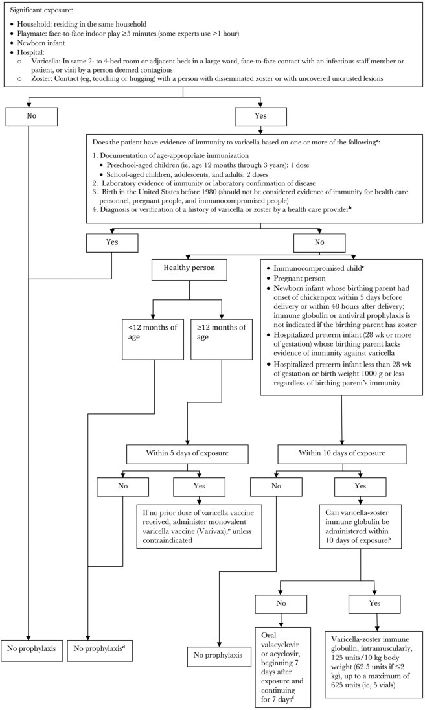

## PDF page 1078 | printed page 1064

Figure 163.1 (continued)

IGIV indicates immunoglobulin intravenous. a People who receive hematopoietic cell transplants should be considered nonimmune regardless of previous history of varicella disease or varicella vaccination in themselves or in their donors. b To verify a history of varicella in an immunocompromised child, health care providers should inquire about an epidemiologic link to another typical varicella case or to a laboratory confirmed case, or evidence of laboratory confirmation. Immunocompromised children who have neither an epidemiologic link nor laboratory confirmation of varicella should not be considered as having a valid history of disease. c Immunocompromised children include those with congenital or acquired T-lymphocyte immunodeficiency, including leukemia, lymphoma, and other malignant neoplasms affecting the bone marrow or lymphatic system; children receiving immunosuppressive therapy, including ≥2 mg/kg/day of systemic prednisone (or its equivalent) for ≥14 days, and certain biologic response modifiers; all children with HIV infection regardless of CD4+ T-lymphocyte percentage; and all hematopoietic cell transplant patients regardless of pretransplant immunity status. d If the exposed person is an adolescent or adult, has chronic illness, or there are other compelling reasons to try to avert varicella, some experts recommend preemptive therapy with oral valacyclovir or acyclovir (see Chemoprophylaxis, below, for dosing). For exposed people ≥12 months of age, vaccination is recommended for protection against subsequent exposures. e If 1 prior dose of varicella vaccine has been received, a second dose should be administered at ≥4 years of age. If the exposure occurred during an outbreak, a second dose is recommended for preschool-aged children younger than 4 years for outbreak control if at least 3 months have passed after the first dose. f See Chemoprophylaxis, below, for dosing. If varicella-zoster immunoglobulin and either valacyclovir or acyclovir are not available, IGIV may be administered (400 mg/kg).

• Health care professionals who have received 2 doses of vaccine and who are exposed to VZV should self-monitor or be monitored daily during days 8 through 21 after exposure through the employee health program or by infection-control staff to determine clinical status. They should be restricted from work immediately if symptoms such as fever, headache, other constitutional symptoms, or any suspicious skin lesions occur.

• Health care professionals who have received only 1 dose of vaccine and who are exposed to VZV should receive the second dose with a single-antigen live attenuated varicella vaccine (ie, not given in combination as in MMRV vaccine), preferably within 3 to 5 days of exposure, provided at least 4 weeks have elapsed after the first dose. After immunization, management is similar to that of 2-dose vaccine recipients.

• Health care professionals who lack evidence of immunity should receive varicella vaccine as soon as possible and be restricted from work from day 8 through 21 after exposure or through day 28 if they received varicella-zoster immunoglobulin.

• Previously immunized health care professionals who develop breakthrough infection should be considered infectious until vesicular lesions have crusted or, if they had maculopapular lesions, until no new lesions appear within a 24-hour period.

Exposure of Newborn Infants

Preterm infants and term infants whose birthing parent had varicella in the immediate peripartum period may need varicella-zoster immunoglobulin (see Fig 163.1). For healthy term infants exposed postnatally to varicella or zoster outside of the immediate perinatal period, varicellazoster immunoglobulin is not indicated. However, some experts advise use of varicellazoster immunoglobulin for exposed newborn infants within the first 2 weeks of life whose birthing parent does not have evidence of immunity to varicella.

Active Immunization2

Vaccine

Varicella vaccine is a live attenuated vaccine developed in Japan in the early 1970s by Professor Michiaki Takahashi and licensed in 1995 by the U.S. Food and Drug Administration (FDA) for use in healthy people 12 months or older who have not had varicella illness. Quadrivalent MMRV vaccine was licensed in September 2005 by the FDA for use in healthy children 12 months through 12 years of age.

Dose and Administration

The recommended dose of monovalent or quadrivalent varicella-containing vaccines is 0.5 mL, administered subcutaneously or intramuscularly.

## PDF page 1079 | printed page 1065

Immunogenicity

Approximately 76% to 85% of immunized healthy children older than 12 months develop a humoral immune response to VZV at levels considered associated with protection after a single dose of varicella vaccine. Seroresponse rates and cellmediated immune responses approach 100% after 2 doses.

Effectiveness

The effectiveness of 1 dose of varicella vaccine is about 82% against any clinical varicella and 98% against severe disease. Two doses of vaccine demonstrated 92% to 95% effectiveness against any clinical varicella.

Simultaneous Administration With Other Vaccines or Antiviral Agents

Varicella-containing vaccines may be administered simultaneously with other childhood immunizations recommended for children 12 through 15 months of age and 4 through 6 years of age (https://publications.aap.org/redbook/ pages/Immunization-Schedules). If not administered at the same visit or as MMRV vaccine, the interval between administration of a varicella-containing vaccine and MMR vaccine should be at least 28 days. The minimal interval between MMRV vaccine doses is 3 months. Because of susceptibility of vaccine virus to acyclovir, valacyclovir, or famciclovir, these antiviral agents may interfere with immunogenicity and, thus, should be avoided from 1 day before to 21 days (the outer limit of likely viral replication) after receipt of a varicella-containing vaccine.

Adverse Events

Reactions to varicella vaccine generally are mild and occur with an overall frequency of approximately 5% to 35%. Approximately 20% to 25% of immunized children will experience minor injection site reactions (eg, pain, redness, swelling). In approximately 1% to 3% of immunized children, a localized rash develops, and in an additional 3% to 5%, a generalized varicella-like rash develops. These rashes typically consist of 2 to 5 lesions and may be maculopapular rather than vesicular; lesions usually appear 5 to 26 days after immunization, usually at or near the injection site when localized. After MMRV or monovalent varicella vaccine plus MMR, a measles-like rash was

reported in 2% to 3% of recipients. Fever was reported in a higher proportion after the first dose of MMRV than after the first dose of monovalent varicella vaccine plus MMR (22% vs 15%, respectively) in young children. Both fever and measleslike rash usually occurred within 5 to 12 days of immunization, were of short duration, and resolved without sequelae.

A slightly increased risk of febrile seizures is associated with the higher likelihood of fever following the first dose of MMRV compared with MMR and monovalent varicella vaccine. One additional febrile seizure is expected to occur per approximately 2,300 to 2,600 young children immunized with a first dose of MMRV compared with a first dose of MMR and monovalent varicella vaccine. After the second vaccine dose administered in older children (4 to 6 years of age), there were no differences in incidence of fever, rash, or febrile seizures among recipients of MMRV vaccine compared with recipients of simultaneous MMR and varicella vaccines.3

Breakthrough Disease

Breakthrough disease is defined as a case of infection with wild-type VZV occurring more than 42 days after immunization. Varicella in vaccine recipients usually is very mild, with rash frequently atypical (predominantly maculopapular) with a median of fewer than 50 lesions, a lower rate of fever, and faster recovery than disease in unimmunized children. It may be mistaken for other conditions, such as insect bites or poison ivy.

Herpes Zoster After Immunization

Vaccine-strain VZV can cause herpes zoster in immunocompetent and immunocompromised people. However, data from postlicensure surveillance indicate that the age-specific risk of herpes zoster is much lower among immunocompetent children immunized with varicella vaccine than among children who have had natural varicella infection.

Transmission of Vaccine-Strain VZV

Vaccine-strain VZV transmission to contacts is rare. In all cases in which transmission has occurred, the immunized person had a rash following vaccine. Some experts believe that

## PDF page 1080 | printed page 1066

immunocompromised people with skin lesions that are presumed to be attributable to vaccine virus should receive acyclovir or valacyclovir treatment.

Recommendations for Immunization.

Children 12 Months Through 12 Years of Age

Both monovalent varicella vaccine and MMRV have been licensed for use for healthy children 12 months through 12 years of age.4 Children in this age group should receive two 0.5-mL doses of monovalent varicella vaccine or MMRV administered subcutaneously or intramuscularly, separated by at least 3 months. However, provided the second dose is administered a minimum 28 days after the first dose, it does not need to be repeated.

All healthy children should receive the first dose of varicella-containing vaccine at 12 through 15 months of age. The second dose of vaccine is recommended routinely when children are 4 through 6 years of age (ie, before a child enters kindergarten or first grade) but can be administered at an earlier age. The American Academy of Pediatrics expresses no preference between MMR plus monovalent varicella vaccine or MMRV for toddlers receiving their first immunization of this kind. Parents should be counseled about the rare possibility of their child developing a febrile seizure 1 to 2 weeks after immunization with MMRV for the first immunizing dose. For the second dose at 4 through 6 years of age, MMRV generally is preferred over MMR plus monovalent varicella to minimize the number of injections. A catch-up second dose of varicella vaccine should be offered to all children 7 years and older who have received only 1 dose.

People 13 Years or Older

Immunocompetent individuals 13 years or older without evidence of varicella immunity should receive two 0.5-mL doses of monovalent varicella vaccine, separated by at least 28 days. For people who previously received only 1 dose of varicella vaccine, a second dose is necessary. Only monovalent varicella vaccine is licensed for use in this age group.

Contraindications and Precautions.

Allergy to Vaccine Components

Varicella vaccine should not be administered to people who have had an anaphylactic or severe

allergic reaction to any component of the vaccine, including gelatin and neomycin, or to a previous dose of a varicella-containing vaccine.

Immunization of Immunocompromised Patients.

GENERAL RECOMMENDATIONS.5 Varicella vaccine (as a 2-dose regimen if there is sufficient time) should be administered to immunocompetent patients without evidence of varicella immunity, if it can be administered ≥4 weeks before initiating immunosuppressive therapy. Varicella vaccine should not be administered to highly immunocompromised patients. This includes persons receiving certain immune response mediators (eg, monoclonal antibodies, interleukins, tumor necrosis factor a inhibitors), who either should be immunized before starting therapy or should wait at least 3 months after such therapies to be immunized. Given the increasing number of such therapies, decisions about immunization with live-virus vaccines should be made in consultation with an infectious disease or immunology specialist.

Certain categories of patients (eg, patients with HIV without severe immunosuppression [see HIV Infection, below] or with a primary immunodeficiency disorder without defective T-lymphocyte– mediated immunity, such as primary complement component deficiency disorder, isolated impairment of humoral immunity, or chronic granulomatous disease) should receive varicella vaccine. Immunodeficiency should be excluded before immunization in children with a family history of hereditary immunodeficiency.

In people with possible altered immunity, only monovalent varicella vaccine (not MMRV) should be used for immunization against varicella. The Oka vaccine strain remains susceptible to acyclovir, and if a high-risk patient develops vaccinerelated rash then acyclovir or valacyclovir may be used as treatment.

MALIGNANCY.6 The interval until immune reconstitution varies with the intensity and type of immunosuppressive therapy, radiation therapy, underlying disease, and other factors, complicating the ability to make a broadly applicable recommendation for an interval after cessation of immunosuppressive therapy when live-virus vaccines can be administered safely and effectively. Current recommendations are for patients to be

## PDF page 1081 | printed page 1067

vaccinated with varicella vaccine when in remission and at least 3 months after cancer chemotherapy, with evidence of restored immunocompetence. In regimens that included anti–B-lymphocyte antibodies, vaccinations should be delayed at least 6 months.

TRANSPLANT RECIPIENTS.7 A 2-dose series of varicella vaccine should be administered a minimum of 24 months after hematopoietic cell transplant to varicella-seronegative patients who do not have graft-versus-host disease, are considered immunocompetent, and whose last dose of IGIV was 8 to 11 months previously. Varicella reimmunization generally is not recommended for solid organ transplant recipients after transplantation, although this is an evolving area, especially for certain organs.8,9

HIV INFECTION.10 The live-virus MMR vaccine and monovalent varicella vaccine can be administered to children and adolescents living with HIV without severe immunosuppression. Severely immunocompromised infants, children, adolescents, and young adults living with HIV (for people ≤5 years of age, defined as a CD4+ T-lymphocyte percentage <15%; for people >5 years of age, defined as a CD4+ T-lymphocyte percentage <15% or a CD4+ T-lymphocyte count <200 lymphocytes/ mm3) should not receive measles virus-containing vaccine, because vaccine-related pneumonia has been reported. Eligible children should receive 2 doses of single-antigen varicella vaccine at the appropriate intervals. The quadrivalent MMRV vaccine should not be administered to any infant or child living with HIV, regardless of degree of immunosuppression, because of lack of safety data in this group.

CHILDREN RECEIVING CORTICOSTEROIDS. Varicella vaccine should not be administered to people who are receiving high doses of systemic corticosteroids (2 mg/kg per day or more of prednisone or its equivalent or 20 mg/day of prednisone or its equivalent) for 14 days or more. The recommended interval between discontinuation of highdose corticosteroid therapy and immunization with varicella vaccine is at least 1 month. Varicella vaccine may be administered to individuals receiving only inhaled, nasal, or topical steroids.

HOUSEHOLDS WITH POTENTIAL CONTACT WITH

IMMUNOCOMPROMISED PEOPLE. Household contacts

of immunocompromised people should be immunized if they have no evidence of immunity to decrease the likelihood that wild-type VZV will be introduced into the household. No precautions are needed following immunization of healthy people who do not develop a rash. Immunized people in whom a postimmunization rash develops should avoid direct contact with an immunocompromised host who lacks evidence of immunity for the duration of the rash.

Pregnancy and Lactation

Varicella vaccine should not be administered to pregnant people, because the possible effects on fetal development are unknown, although no cases of congenital varicella syndrome or patterns of malformation have been identified after inadvertent immunization of pregnant people. Pregnancy should be avoided for at least 1 month after immunization. A pregnant person or other household member is not a contraindication for immunization of a child in the household. Breastfeeding is not a contraindication to immunization.

Immunoglobulin

Whether immunoglobulin (IG) can interfere with varicella vaccine-induced immunity is unknown, although IG can interfere with immunity induction by measles vaccine. Pending additional data, varicella vaccine should be withheld for the same intervals after receipt of any form of IG or other blood product as for measles vaccine. Additionally, IG should be withheld for at least 2 weeks after receipt of varicella vaccine.

Salicylates

No cases of Reye syndrome have been reported following varicella vaccination, with more than 140 million doses distributed in the United States. However, because use of salicylates during varicella infection is associated with Reye syndrome, the vaccine manufacturer recommends that salicylates be avoided for 6 weeks after administration of varicella vaccine.

1 Commercial assays can be used to assess disease-induced immunity, but they lack sensitivity to detect vaccine-induced immunity (ie, they might yield false-negative results). 2 Centers for Disease Control and Prevention. Prevention of varicella: recommendations of the Advisory Committee on Immunization Practices (ACIP). MMWR Recomm Rep. 2007;56(RR-4):1–40

## PDF page 1082 | printed page 1068

3 Centers for Disease Control and Prevention. Use of combination measles, mumps, rubella, and varicella vaccine: recommendations of the Advisory Committee on Immunization Practices (ACIP). MMWR Recomm Rep. 2010;59(RR-3):1–12 4 Centers for Disease Control and Prevention. Use of combination measles, mumps, rubella, and varicella vaccine: recommendations of the Advisory Committee on Immunization Practices (ACIP). MMWR Recomm Rep. 2010;59(RR-3):1–12 5 Rubin LG, Levin MJ, Ljungman P, et al. 2013 IDSA clinical practice guideline for vaccination of the immunocompromised host. Clin Infect Dis. 2014;58(3):e44–e100 6 Rubin LG, Levin MJ, Ljungman P, et al. 2013 IDSA clinical practice guideline for vaccination of the immunocompromised host. Clin Infect Dis. 2014;58(3):e44–e100 7 Rubin LG, Levin MJ, Ljungman P, et al. 2013 IDSA clinical practice guideline for vaccination of the immunocompromised host. Clin Infect Dis. 2014;58(3):e44–e100

Image 163.1 Congenital varicella with short-limb syndrome and scarring of the skin. The mother had varicella during the first trimester of pregnancy. Courtesy of David Clark, MD.

Image 163.3 Herpes zoster in an 18-year-old young woman, known to use illicit drugs, who also had an anaerobic lung abscess. Courtesy of Larry Frenkel, MD.

8 Danziger-Isakov L, Kumar D, AST ID Community of Practice. Vaccination of solid organ transplant candidates and recipients: guidelines from the American Society of Transplantation Infectious Diseases Community of Practice. Clin Transplant. 2019;33(9):e13563 9 Suresh S, Upton J, Green M, et al. Live vaccines after solid organ transplant: proceedings of a consensus meeting, 2018. Pediatr Transplant. 2019;23(7):e13571 10 Panel on Opportunistic Infections in Children With and Exposed to HIV. Guidelines for the Prevention and Treatment of Opportunistic Infections in Children With and Exposed to HIV. Department of Health and Human Services. Available at: https://clinicalinfo.hiv.gov/en/guidelines/pediatricopportunistic-infection

Image 163.2 A male toddler with hemorrhagic varicella complicating acute lymphocytic leukemia. Courtesy of Larry Frenkel, MD.

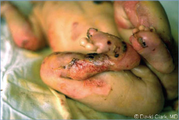

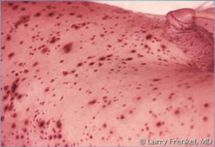

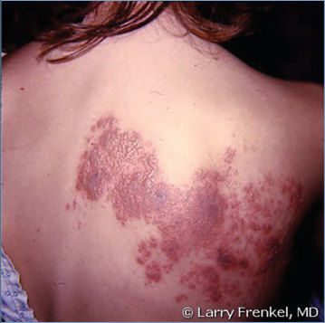

## PDF page 1083 | printed page 1069

Image 163.4 School-aged girl with varicella who acquired it from a younger sibling, who had a milder clinical course with fewer lesions.

Image 163.6 School-aged child with varicella who acquired it from a younger sibling. This is the same child as in Images 163.4 and 163.5 who had calamine lotion applied by the parents for itching. She recovered without incident.

Image 163.5 This child acquired her varicella-zoster virus infection from a younger sibling. Varicella lesions are apparent on the palate. This is the same child as in Image 163.4.

Image 163.7 Varicella with scleral lesions and bulbar conjunctivitis.

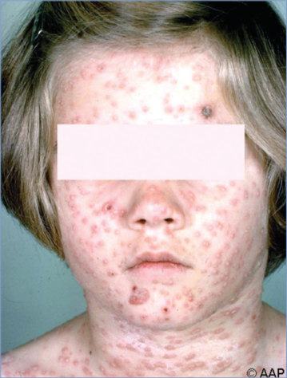

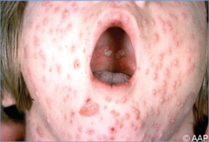

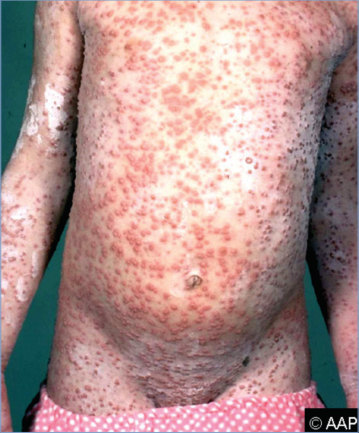

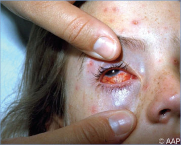

## PDF page 1084 | printed page 1070

Image 163.8 An adolescent girl with varicella lesions in various stages. This is the same patient as in Image 163.7.

Image 163.10 Varicella with erythema multiforme.

Image 163.9 An adolescent girl with varicella lesions in various stages. This is the same patient as in Images 163.7 and 163.8.

Image 163.11 Varicella with bullous lesions. Blood culture results were negative for bacteria. Cellulitis at sites of bullous lesions resolved while the patient was receiving oral dicloxacillin sodium. The child did not appear very ill.

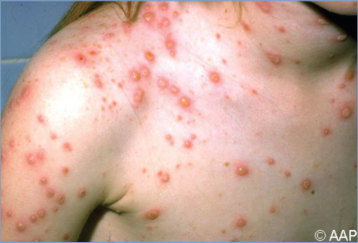

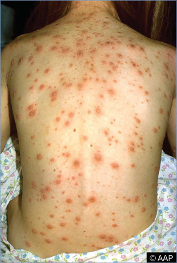

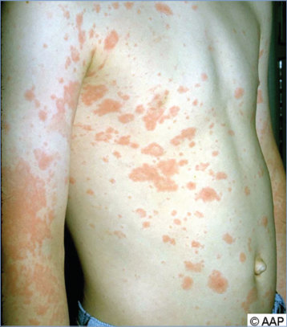

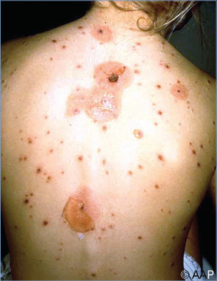

## PDF page 1085 | printed page 1071

Image 163.12 Varicella with bullous lesions. Culture results of vesicle fluid were negative for bacteria.

Image 163.14 A neonate with hemorrhagic varicella with cellulitis. This newborn contracted varicella at birth from his mother, who was infected. Copyright Immunization Action Coalition.

Image 163.13 Bullous varicella. Staphylococcus aureus organisms may be present in these large bullae.

Image 163.15 Varicella (interstitial) pneumonia. Although rare in otherwise healthy children, this complication of varicellazoster virus infection in adults accounts for much of the morbidity and mortality caused by the infection. Courtesy of Edgar O. Ledbetter, MD, FAAP.

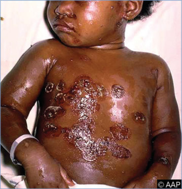

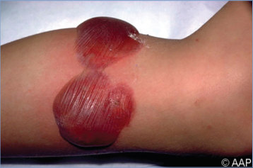

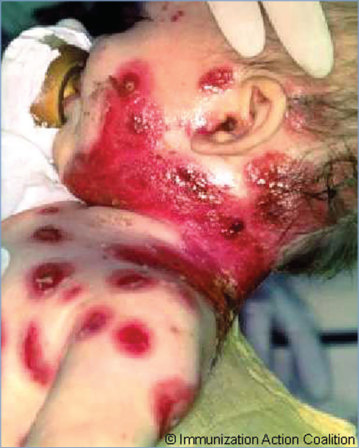

## PDF page 1086 | printed page 1072

Image 163.16 Disseminated varicella in a 17-year-old girl with Hodgkin disease and failure to respond to intravenous acyclovir. Courtesy of George Nankervis, MD.

Image 163.18 Varicella complicated by necrotizing fasciitis. A blood culture result was positive for group A streptococci. The disease responded to antibiotics and surgical débridement followed by primary surgical closure.

Image 163.20 A school-aged girl with bilateral periorbital cellulitis and necrotizing fasciitis caused by a group A b-hemolytic streptococcal infection complicating varicella. Courtesy of George Nankervis, MD.

Image 163.17 Diffuse varicella pneumonia bilaterally shown in the chest radiograph of the patient with Hodgkin disease in Image 163.16. Courtesy of George Nankervis, MD.

Image 163.19 Varicella and necrotizing fasciitis in the same patient as in Image 163.18 shortly after surgical débridement.

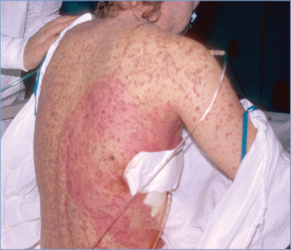

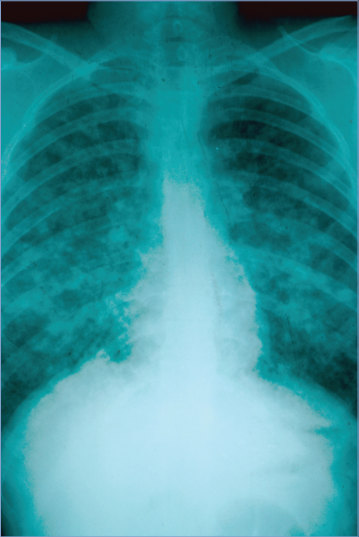

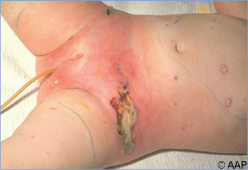

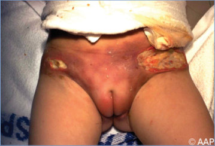

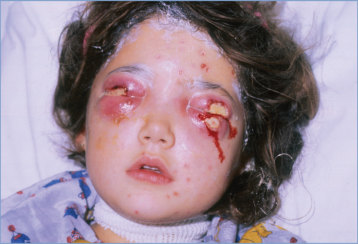

## PDF page 1087 | printed page 1073

Image 163.21 Herpes zoster in an otherwise healthy child. Multiple dermatomes are involved.

Image 163.23 Herpes zoster (shingles). Courtesy of C. W. Leung.

Image 163.22 Herpes zoster in an otherwise healthy child.

Image 163.24 Bullous varicella (uncomplicated) in a 1-year-old. Courtesy of George Nankervis, MD.

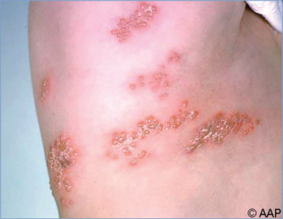

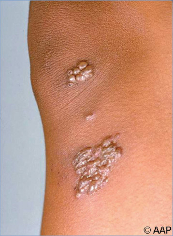

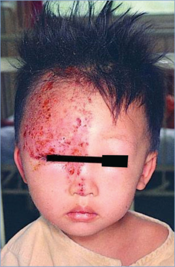

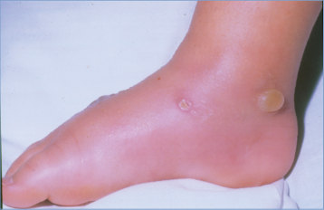

## PDF page 1088 | printed page 1074

Image 163.25 Percentage of children and teens aged 4 to 17 years who had ever had varicella (chickenpox), by age group—National Health Interview Survey, 2007–2016. From 2007 to 2016, the percentage of children and teens aged 4 to 17 years who had ever had chickenpox decreased among both younger children (aged 4–11 years) and older children (aged 12–17 years). Among younger children, the percentage of children who had ever had chickenpox declined by 73.9%, from 16.1% in 2007 to 4.2% in 2016. Among older children, the percentage who had ever had chickenpox declined by 76.9%, from 61.4% in 2007 to 14.2% in 2016. From 2007 to 2016, older children were more likely than younger children to have ever had chickenpox. Courtesy of Morbidity and Mortality Weekly Report.

![Image 163.25 Percentage of children and teens aged 4 to 17 years who had ever had varicella (chickenpox), by age group—National Health Interview Survey, 2007–2016. From 2007 to 2016, the percentage of children and teens aged 4 to 17 years who had ever had chickenpox decreased among both younger children (aged 4–11 years) and older children (aged 12–17 years). Among younger children, the percentage of children who had ever had chickenpox declined by 73.9%, from 16.1% in 2007 to 4.2% in 2016. Among older children, the percentage who had ever had chickenpox declined by 76.9%, from 61.4% in 2007 to 14.2% in 2016. From 2007 to 2016, older children were more likely than younger children to have ever had chickenpox. Courtesy of Morbidity and Mortality Weekly Report.](../../figures/ch163_p1088_01.jpg)
