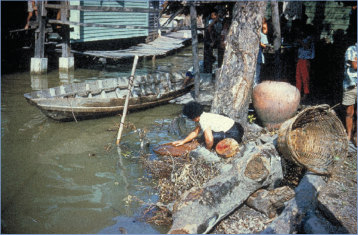
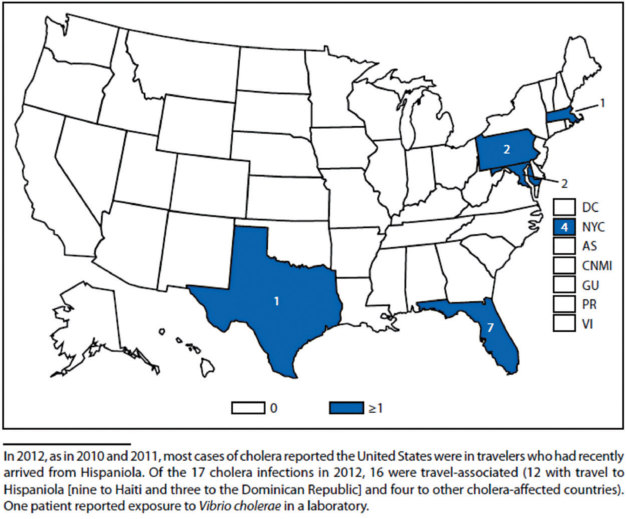
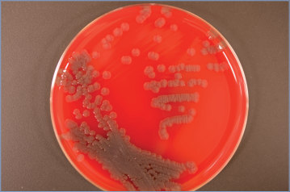

# 164. Cholera (Vibrio cholerae)
> Private study reference ([source credits](../../SOURCE_CREDITS.md)). PDF pages 1089-1094; printed pages 1075-1080.

## PDF page 1089 | printed page 1075

(Vibrio cholerae)

### CLINICAL MANIFESTATIONS

Cholera is characterized by voluminous watery diarrhea and rapid onset of life-threatening dehydration. Hypovolemic shock may occur within hours of the onset of diarrhea. Stools have a characteristic rice-water appearance, are white-tinged with small flecks of mucus, and contain high concentrations of sodium, potassium, chloride, and bicarbonate. Vomiting is a common feature of cholera. Fever and abdominal cramps usually are absent. In addition to dehydration and hypovolemia, common complications of cholera include hypokalemia, metabolic acidosis, and hypoglycemia, particularly in children. Although severe cholera is a distinctive illness characterized by profuse diarrhea and rapid dehydration, people infected with toxigenic Vibrio cholerae may have no symptoms or mild to moderate diarrhea lasting 3 to 7 days.

### ETIOLOGY

V cholerae is a curved or comma-shaped motile gram-negative rod. There are more than 200 V cholerae serogroups, some of which carry the cholera toxin (CT) gene and other virulence factors. Although those serogroups with the CT gene and others without the CT gene can cause acute watery diarrhea, only toxin-producing serogroups O1 and O139 have caused epidemic cholera, with the currently circulating 7th pandemic strain of O1 causing the vast majority of cases worldwide. V cholerae O1 is classified into 2 biotypes, classical and El Tor, and 2 major serotypes, Ogawa and Inaba. All other serogroups of V cholerae are known collectively as V cholerae non-O1/ non-O139. Toxin-producing strains of V cholerae non-O1/non-O139 can cause sporadic cases of severe dehydrating diarrheal illness but have not caused large outbreaks of cholera. Non–toxinproducing strains of V cholerae non-O1/non-O139 are associated with sporadic cases of gastroenteritis, sepsis, and rare cases of wound infection.

### EPIDEMIOLOGY

Cholera is an underreported infection, and estimates of the global burden are imprecise. In areas

where the disease is endemic, cholera disproportionately affects young children. Cholera also causes explosive epidemics across all age groups in vulnerable populations. These outbreaks occur frequently in the setting of natural or manmade humanitarian disasters. Examples include large epidemics that occurred after the introduction of pandemic V cholerae into Haiti in 2010 and into Yemen in 2017. In the United States, cholera is a sporadic disease. Cases resulting from travel to or ingestion of contaminated food transported from regions with endemic cholera have been reported. Domestically acquired cases in the United States have been reported from eating Gulf Coast seafood.

Humans are the only documented natural host, but free-living V cholerae organisms can persist in the aquatic environment. Infection primarily is acquired by ingestion of large numbers of organisms from contaminated water or food (particularly raw or undercooked shellfish, raw or partially dried fish, or moist grains or vegetables held at ambient temperature). People with low gastric acidity and those with blood group O are at increased risk of severe cholera infection.

The median incubation period usually is 1 to 2 days, with a range of a few hours to 5 days.

### DIAGNOSTIC TESTS

V cholerae can be cultured from fecal specimens (preferred) or vomitus plated on thiosulfate citrate bile salts sucrose agar. Because most laboratories in the United States do not culture routinely for V cholerae or other Vibrio organisms, clinicians should request appropriate cultures for clinically suspected cases. Isolates of V cholerae should be sent to a state health department laboratory for confirmation and then forwarded to the Centers for Disease Control and Prevention (CDC) for species identification using DNA-based methods, serotyping, and detection of the CT gene (www. cdc.gov/laboratory/specimen-submission/ detail.html?CDCTestCode=CDC-10119). Tests to detect serum antibodies to V cholerae, such as the vibriocidal assay and an anticholera toxin enzyme-linked immunoassay, are available at the CDC, subject to preapproval. Both assays require submission of acute and convalescent serum specimens and, thus, provide a retrospective diagnosis. A fourfold increase in vibriocidal antibody

## PDF page 1090 | printed page 1076

titers between acute and convalescent sera suggests the diagnosis of cholera. Several commercial tests for rapid antigen detection of V cholerae O1 and O139 in stool specimens have been developed. These V cholerae O1 and O139 rapid diagnostic tests have sensitivities ranging from approximately 80% to 97% and specificities of approximately 70% to 90% compared with culture on thiosulfate citrate bile salts sucrose agar. Rapid diagnostic tests are not a substitute for stool culture but might provide an indication of a suspect cholera outbreak in regions where stool culture is not immediately available. Multiplex molecular panels have been cleared by the U.S. Food and Drug Administration for detection of various bacteria, parasites, and viruses associated with gastrointestinal tract infections, and some can specifically detect V cholerae from unpreserved stool specimens and/or stool specimens preserved in Cary Blair transport media. Culture confirmation is recommended following a positive result from these culture-independent diagnostic testing panels, as low levels of contaminating nucleic acid from media have been reported.

### TREATMENT

Timely and appropriate rehydration therapy is the cornerstone of management of cholera and reduces the mortality of severe cholera from

Table 164.1 Antibiotics for Suspected Cholera

Antibiotic Pediatric Dosea Doxycycline 4.4 mg/kg, single dose 300 mg, single dose Ciprofloxacinb 15 mg/kg, twice daily for 3 days (single dose 20 mg/kg has been used)

500 mg, twice daily for 3 days Azithromycin 20 mg/kg, single dose 1 g, single dose Erythromycin 12.5 mg/kg, 4 times/day for 3 days 250 mg, 4 times/day for 3 days

Tetracyclinec 12.5 mg/kg, 4 times/day for 3 days 500 mg, 4 times/day for 3 days

a Not to exceed adult dose. b Fluoroquinolones are not approved for children younger than 18 years for this indication. c For use in children ≥8 y.

more than 10% to less than 0.5%. Rehydration therapy should be based on World Health Organization (WHO) standards, with the goal of replacing the estimated fluid deficit within 3 to 4 hours of initial presentation. In patients with severe dehydration, isotonic intravenous fluids should be used, and lactated Ringer solution is the preferred commercially available option.1 For patients without severe dehydration, oral rehydration therapy using the WHO’s reduced-osmolality oral rehydration solution (ORS) has been the standard, but data suggest that rice-based ORS or amylase-resistant starch ORS is more effective.

Antimicrobial therapy decreases the duration and volume of diarrhea as well as the shedding of viable bacteria. Antimicrobial therapy should be considered for people who are moderately to severely ill. The choice of antimicrobial therapy should be made based on the age of the patient (Table 164.1) as well as prevailing patterns of antimicrobial resistance. When local patterns of resistance are unknown, antimicrobial susceptibility testing should be performed on isolates and monitored. Zinc supplementation should be considered as an adjunct to rehydration in children (www.cdc. gov/cholera/treatment/zinc-treatment. html).

Adult Dose Comment(s) Use should be in epidemics caused by susceptible isolates. Can be used without regard to patient age, but is not recommended for pregnant people.

Decreased susceptibility to fluoroquinolones is associated with treatment failure.

### Geometry-detected table

|Antibiotic|Pediatric Dosea|Adult Dose|Comment(s)|
|---|---|---|---|
|Doxycycline|4.4 mg/kg, single dose|300 mg, single dose|Use should be in epidemics caused by susceptible isolates. Can be used with- out regard to patient age, but is not recommended forpregnantpeople.|
|Ciprofoxacinb|15 mg/kg, twice daily for 3 days (single dose 20 mg/kg has been used)|500 mg, twice daily for 3 days|Decreased susceptibility to fuoroquinolones is associ- ated with treatment failure.|
|Azithromycin|20 mg/kg, single dose|1 g, single dose||
|Erythromycin|12.5 mg/kg, 4 times/day for 3 days|250 mg, 4 times/day for 3 days||
|Tetracyclinec|12.5 mg/kg, 4 times/day for 3 days|500 mg, 4 times/day for 3 days||

[View original table](../../tables/ch164_p1090_1.jpg)

## PDF page 1091 | printed page 1077

### INFECTION PREVENTION AND CONTROL MEASURES IN HEALTH CARE SETTINGS

In addition to standard precautions, contact precautions are indicated for diapered children or incontinent people for the duration of illness.

### CONTROL MEASURES

Hygiene

Disinfection of drinking water through chlorination or boiling prevents waterborne transmission of V cholerae. Thoroughly cooking crabs, oysters, and other shellfish from the Gulf Coast before eating is recommended to decrease the likelihood of illness. Foods such as fish, rice, or grain gruels should be refrigerated promptly and thoroughly reheated before eating, and fruits and vegetables should be peeled before eating. The use of latrines or burying feces is recommended, and defecation should be avoided near any body of water. Appropriate hand hygiene after defecating and before preparing or eating food is important for preventing transmission.

Treatment of Contacts

Although administration of appropriate antimicrobial agents within 24 hours of identification of the index case may prevent additional cases of cholera among household contacts, chemoprophylaxis of contacts currently is not recommended.

Vaccine

A single-dose, live attenuated monovalent oral vaccine (CVD 103-HgR; Vaxchora), has been approved by the U.S. Food and Drug Administration and is available in the United States for use for travelers 2 through 64 years of age who are traveling to areas where cholera is a risk. In addition to following safe food and water precautions, the Advisory Committee on Immunization Practices of the CDC recommends cholera vaccine for immunocompetent pediatric and adult travelers 2 through 64 years of age to an area of active cholera transmission.2 No data exist on use of the currently licensed CVD 103-HgR formulation in immunocompromised populations. An area of active cholera transmission is defined as a province, state, or other administrative subdivision within a country with endemic or epidemic

cholera caused by toxigenic V cholerae and includes areas with cholera activity within the past year that are prone to recurrence of cholera epidemics; it does not include areas where only rare sporadic cases have been reported. Information about destinations with active cholera transmission is available at wwwnc.cdc.gov/ travel/.

Three non-live oral vaccines are approved by the WHO and available outside the United States. Dukoral is a monovalent inactivated vaccine based on heat-killed whole cells of serogroup O1 plus recombinant CT B subunit. The vaccine also may provide some protection against heat-labile enterotoxigenic Escherichia coli infection and is primarily used by travelers to areas with endemic cholera. Children between 2 and 6 years of age require 3 doses, and adults and children 6 years and older require 2 doses at least 1 week apart. Two bivalent (O1 and O139) vaccines, Shanchol and Euvichol, provide durable protection in older children and adults but do not provide significant protection in young children. In 2011, the WHO initiated a global oral cholera vaccine stockpile, comprised of bivalent vaccine, to allow for its rapid deployment during cholera epidemics and other emergencies. Instructions regarding access to the stockpile are available at www.who.int/ groups/Icg/cholera/stockpiles.

Cholera immunization is not required for travelers entering the United States from cholera-affected areas, and the WHO no longer recommends immunization for travel to or from areas with cholera transmission. No country requires cholera vaccine for entry.

Public Health Reporting

Confirmed cases of cholera must be reported to health authorities in any country in which they occur and were contracted. Local and state health departments should be notified immediately of presumed or known cases of cholera.

1 World Health Organization. The Treatment of Diarrhoea: A Manual for Physicians and Other Senior Health Workers. 4th Rev. World Health Organization; 2005 2 Collins JP, Ryan ET, Wong KK, et al. Cholera vaccine: recommendations of the Advisory Committee on Immunization Practices, 2022. MMWR Recomm Rep. 2022;71(RR-2):1–8

## PDF page 1092 | printed page 1078

Image 164.1 An adult patient with cholera demonstrating “washerwoman’s hand” sign. Because of severe dehydration, cholera manifests itself in decreased skin turgor, which produces the so-called washerwoman’s hand sign. Courtesy of Centers for Disease Control and Prevention.

Image 164.3 A cup of typical rice-water stool from a patient with cholera shows flecks of mucus that have settled to the bottom. These stools are inoffensive, with a faint fishy odor. They are isotonic with plasma and contain high levels of sodium, potassium, and bicarbonate. They also contain extraordinary quantities of Vibrio cholerae bacterial organisms. Courtesy of Centers for Disease Control and Prevention.

Image 164.2 Intestinal biopsy showing Vibrio cholerae causing increased mucus production. V cholerae is transmitted to humans through the ingestion of contaminated food or water and produces a cholera toxin that acts on the intestinal mucosa and causes severe diarrhea. Courtesy of Centers for Disease Control and Prevention.

Image 164.4 Crabs have been a repeated source of cholera in the United States and elsewhere, even though they are rarely eaten raw. Crabs artificially inoculated with Vibrio cholerae O1 that have been boiled for <10 minutes or steamed for <30 minutes may still harbor viable vibrios, which can then multiply to high counts if the crabs are left at room temperature for several hours. Courtesy of Centers for Disease Control and Prevention.

## PDF page 1093 | printed page 1079

Image 164.5 Typical Vibrio cholerae–contaminated water supply. Ingestion of V cholerae–contaminated water is a typical mode of pathogen transmission. Courtesy of Centers for Disease Control and Prevention.

Image 164.6 Number of reported cholera cases—United States and U.S. territories, 2012. Courtesy of Morbidity and Mortality Weekly Report.

## PDF page 1094 | printed page 1080

Image 164.7 Vibrio cholerae on blood agar. Colonies are nonhemolytic and opaque with a greenish cast. Courtesy of Julia Rosebush, DO; Robert Jerris, PhD; and Theresa Stanley, M(ASCP).

