# 168. Zika
> Private study reference ([source credits](../../SOURCE_CREDITS.md)). PDF pages 1110-1120; printed pages 1096-1106.

## PDF page 1110 | printed page 1096

### CLINICAL MANIFESTATIONS

Most Zika virus infections are asymptomatic or result in mild clinical disease with symptoms lasting a few days to a week. Commonly reported signs and symptoms include fever, pruritic maculopapular rash, arthralgia, and conjunctival hyperemia. Other findings include myalgia, headache, edema of the extremities, vomiting, retro-orbital pain, and lymphadenopathy. Clinical laboratory abnormalities are observed uncommonly in symptomatic patients but can include thrombocytopenia, leukopenia, and increased liver aminotransferase concentrations. Severe disease requiring hospitalization and deaths are rare. However, Guillain-Barré syndrome and rare reports of other neurologic complications (eg, meningoencephalitis, myelitis, and uveitis) have been associated with Zika virus infection.

Congenital Zika virus infection can cause fetal loss, intrauterine growth restriction, premature delivery, microcephaly, and other serious neurologic anomalies. Clinical findings most specific for congenital Zika syndrome include severe microcephaly with partially collapsed skull, cortical hypoplasia with abnormal gyral patterns, intracranial calcifications between the cortex and subcortex, congenital contractures (arthrogryposis), and ocular abnormalities (eg, chorioretinal scarring and pigmentary mottling). Other abnormalities have been reported among infants with congenital infection including other structural brain abnormalities (eg, ventriculomegaly, corpus callosum agenesis, cerebellar hypoplasia, mild microcephaly), other structural eye abnormalities (eg, microphthalmia, cataracts, chorioretinal atrophy, or optic nerve hypoplasia), and neurologic sequelae associated with structural brain abnormalities (eg, hypertonia, dystonia, swallowing dysfunction, seizures, hearing loss). Approximately 5% of infants in the U.S. Zika Pregnancy and Infant Registry had any Zikaassociated brain or eye defect; one-third of those infants had more than 1 defect reported. The frequency of Zika-associated birth defects in infants was similar among those born to symptomatic (5.3%) and asymptomatic (4.2%) pregnant people. Among pregnancies with confirmed Zika

infection, the frequency of any Zika-associated birth defect was higher among those with first (8.0%) and second (6.0%) trimester infections compared with third trimester infections (3.8%). Rare cases of perinatal transmission from birthing parents who were viremic at delivery have been reported. These perinatal transmissions generally result in asymptomatic or mildly symptomatic illness in the neonate.

### ETIOLOGY

Zika virus is a single-stranded, RNA virus in the genus Flavivirus that is most closely related antigenically to dengue. Two major lineages, African and Asian, have been identified through phylogenetic analyses.

### EPIDEMIOLOGY

Zika virus is transmitted to humans primarily by Aedes aegypti mosquitoes and less commonly by Aedes albopictus and possibly other Aedes (Stegomyia) species (eg, Aedes polynesiensis and Aedes hensilli). In the United States, Ae aegypti mosquitoes are found primarily in southern states. Ae albopictus mosquitoes have a wider distribution (see map at www.cdc.gov/zika/vector/ range.html). Both Aedes species bite humans primarily during the daytime hours. These are the same vectors that transmit dengue, chikungunya, and yellow fever viruses. Human and nonhuman primates are the main reservoirs of the virus, with humans acting as the primary host in which the virus multiplies, allowing spread to additional mosquitoes and then other humans. Additional modes of transmission have been identified, including perinatal, in utero, sexual, blood transfusion, and laboratory exposure. Although Zika virus has been detected in human milk, and a few possible cases of transmission of Zika virus by breastfeeding have been reported, to date there is no consistent evidence that infants acquire Zika virus through breastfeeding.

Prior to 2007, only sporadic human Zika virus disease cases were reported from countries in Africa and Asia. In 2007, the first documented Zika virus disease outbreak was reported in the Federated States of Micronesia. In subsequent years, outbreaks of Zika virus disease were identified in countries in Southeast Asia and the western Pacific. In 2015, Zika virus was identified for the

## PDF page 1111 | printed page 1097

first time in the Western Hemisphere and subsequently spread throughout much of the Americas, with 48 countries and territories in the Americas reporting local transmission. During 2016, large outbreaks occurred in Puerto Rico and the U.S. Virgin Islands, and limited local transmission was identified in parts of Florida and Texas. In 2017, Zika virus disease cases started to decline worldwide. Since 2018, there have been no locally acquired cases reported from U.S. states. Current information on Zika virus transmission and travel guidance can be found at www.cdc.gov/zika/ geo/index.html and wwwnc.cdc.gov/travel/ page/zika-travel-information, respectively.

The incubation period is 3 to 14 days after the bite of an infected mosquito.

### DIAGNOSTIC TESTS

Zika virus infection should be considered in patients with acute onset of fever, maculopapular rash, arthralgia, or conjunctivitis who live in or have traveled to or had sex with someone who lived in or recently traveled to an area with ongoing transmission in the 2 weeks preceding illness onset. Because dengue and chikungunya virus infections share a similar geographic distribution and symptoms with Zika virus infection, patients with suspected Zika virus infection also should be evaluated and managed for possible dengue or chikungunya virus infection. Other considerations in the differential diagnosis include malaria, rubella, measles, parvovirus, adenovirus, enterovirus, leptospirosis, rickettsiosis, group A streptococcal infections, and COVID-19.

Nucleic acid amplification tests (NAATs) are the preferred method of diagnosis. Zika virus RNA is likely to be detected in serum from approximately 2 days before to 1 week after illness onset; RNA also can be detected in other body fluids (eg, whole blood, urine, saliva, amniotic fluid, semen, and breast milk). Immunoglobulin (Ig) M and neutralizing antibody testing also can be used to identify Zika virus infections, particularly in patients who present after viral nucleic acid is no longer detectable. IgM antibody assays can be conducted on serum, plasma, whole blood, or cerebrospinal fluid (CSF). IgM antibodies develop during the first week of illness and may be detectable for months to years following infection, making it difficult to distinguish the timing of Zika

virus infection. Cross-reactivity of the Zika virus IgM antibody tests with other flaviviruses can result in a false-positive test result making it difficult to differentiate between flavivirus infections. Recent epidemiologic data indicate a declining prevalence of Zika virus infection in the Americas; this lower prevalence will result in a lower pretest probability of infection and a higher probability of false-positive test results for both molecular and serologic testing.

Although neutralizing antibody titers can yield cross-reactive results in people with previous flavivirus infections or who were vaccinated against a related flavivirus, they may differentiate flavivirus infections, particularly in individuals who were flavivirus-naïve before their infection. Testing guidance is updated as new information is obtained; for the most recent guidance, visit www.cdc. gov/Zika.

Zika Laboratory Testing in Nonpregnant Symptomatic Individuals

Given the current global arboviral epidemiology, Zika virus testing is currently not recommended for this group unless people live in or have traveled to a country with a current Zika outbreak (wwwnc.cdc.gov/travel/page/zika-travelinformation). For individuals traveling to or living in an area with a current Zika virus outbreak, both Zika and dengue virus NAATs should be performed as soon as possible on serum collected ≤7 days after onset of symptoms (Fig 168.1). IgM antibody testing for Zika and dengue should be performed in NAAT-negative serum specimens and serum collected >7 after onset of symptoms. For individuals traveling to or living in areas not experiencing a Zika virus outbreak, refer to testing guidance for dengue.

Zika Laboratory Testing in Pregnant People

Current recommendations from the Centers for Disease Control and Prevention (CDC; www.cdc. gov/zika/hc-providers/testing-guidance. html) take into account the decreasing prevalence of Zika virus disease cases globally, current dengue outbreaks in many areas of the world, and current knowledge of diagnostic limitations.1,2 For asymptomatic pregnant people with recent travel to areas with risk of Zika (wwwnc.cdc.gov/travel/ page/zika-travel-information), Zika virus

## PDF page 1112 | printed page 1098

Figure 168.1 Dengue and Zika virus testing recommendations for nonpregnant persons with a clinically compatible illness and risk for infection with both virusesa

Figure illustrates dengue and Zika virus testing recommendations for nonpregnant persons with a clinically compatible illness and risk for infection with both viruses. Diagnostic testing recommendations include immunoglobulin M assays, nucleic acid amplification tests, and plaque reduction neutralization tests. IgM indicates immunoglobulin M; NAAT, nucleic acid amplification test; PRNT, plaque reduction neutralization test.

a Specimen and test selection: Dengue and Zika virus NAATs, IgM antibody testing, and PRNTs should be performed on serum. Some NAATs also can be performed on plasma, whole blood, cerebrospinal fluid, or urine, and some antibody tests can be performed on plasma, whole blood, or cerebrospinal fluid. Laboratories might choose to perform dengue and Zika virus NAATs and IgM antibody testing simultaneously rather than sequentially, or to perform dengue virus nonstructural protein-1 testing instead of dengue virus NAAT. Indications to repeat assay(s): If the patient’s illness has epidemiologic or clinical significance (eg, first case of local transmission in area, new transmission mode, or unusual clinical syndrome), repeat a positive NAAT on newly extracted RNA from the same specimen. For indeterminate IgM antibody test results, repeat IgM antibody testing or perform PRNT on the same specimen. In areas where PRNTs are not performed, report the indeterminate results and request a second serum specimen for IgM antibody testing. Interpretation of results: Dengue and Zika virus IgM antibodies can be detected in serum for months following infection. The specific timing of infection cannot be determined. Data on the epidemiology of viruses known to be circulating at the location of exposure and clinical findings should be considered when interpreting the results of serologic diagnostic testing. From Sharp TM, Fischer M, Muñoz-Jordán JL, et al. Dengue and Zika virus diagnostic testing for patients with a clinically compatible illness and risk for infection with both viruses. MMWR Recomm Rep. 2019;68(1):1–10.

testing is not routinely recommended because of its inability to differentiate between recent and remote infections and risk of false-positive results. Testing recommendations for symptomatic pregnant people who had recent travel to areas with active dengue transmission and risk of Zika virus transmission can be found at www.cdc.gov/ zika/hc-providers/testing-guidance.html.

Zika Laboratory Testing for Congenital Infection

Zika virus testing is recommended for infants with clinical findings consistent with congenital Zika

syndrome and possible in utero Zika virus exposure, regardless of the birthing parent’s testing results, and for infants without clinical findings consistent with congenital Zika syndrome who are born to persons with laboratory evidence of possible infection during pregnancy. Recommended laboratory testing for possible congenital Zika virus infection includes evaluation for Zika virus RNA in infant serum, urine and CSF, if available. Zika virus IgM antibodies testing should be performed in serum and CSF, if available.

Laboratory testing of infants should be performed as soon as possible after birth (within the first few

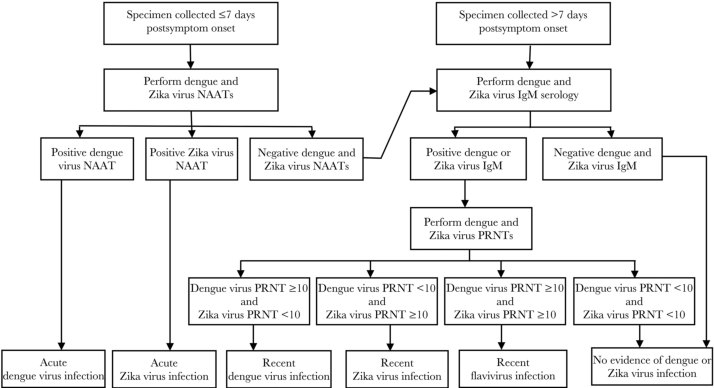

## PDF page 1113 | printed page 1099

days of life), although testing specimens within the first few weeks to months after birth might still be useful. Diagnosis of congenital Zika virus infection is confirmed by a positive Zika virus NAAT or by a positive Zika virus IgM and neutralizing antibody result. If neither Zika virus RNA nor Zika IgM antibodies are detected on the appropriate specimens obtained within the first few days after birth, congenital Zika virus infection is unlikely (Table 168.1).

If the infant’s initial sample is IgM nonnegative (nonnegative serologic terminology varies by assay and might include “positive,” “equivocal,” “presumptive positive,” or “possible positive”) and the NAAT result is negative, and a plaque reduction neutralization test (PRNT) was not performed on the birthing parent’s sample, PRNTs for Zika and dengue viruses should be performed on the infant’s initial sample. If the Zika virus PRNT result is negative, this suggests that the infant’s Zika virus IgM test result is a false positive. For infants with clinical findings consistent with congenital Zika syndrome or evidence in the birthing parent of possible Zika virus infection during pregnancy but with no testing near the time of delivery, a PRNT at age ≥18 months (after transplacentally acquired antibodies have dissipated

Table 168.1 Interpretation of Results of Laboratory Testing of Infant’s Blood, Urine, and/or Cerebrospinal Fluid for Evidence of Congenital Zika Virus Infectiona

Infant Test Resultb Interpretation

NAAT IgM Positive Any result Confirmed congenital Zika virus infection

Distinguishing between congenital and postnatal infection is difficult in infants who live in areas where there is ongoing transmission of Zika virus and who are not tested soon after birth. If the timing of infection cannot be determined, infants should be evaluated as if they had congenital Zika virus infection. Negative Nonnegativec Probable congenital Zika virus infectiond If Zika virus PRNT result is negative, this suggests that the infant’s Zika virus IgM test is a false positive. Negative Negative Congenital Zika virus infection unlikelyd

Congenital Zika virus infection is unlikely if specimens are collected within the first few days after birth and the clinical evaluation is normal; however, health care providers should remain alert for any new findings of congenital Zika virus infection.

NAAT indicates nucleic acid amplification test; IgM, immunoglobulin M, PRNT, plaque reduction neutralization test. a Adapted from Adebanjo T, Godfred-Cato S, Viens L, et al. Update: interim guidance for the diagnosis, evaluation, and management of infants with possible congenital Zika virus infection—United States, October 2017. MMWR Morb Mortal Wkly Rep. 2017;66(41):1089–1099. b Infant serum, urine, or cerebrospinal fluid. c Nonnegative serologic terminology varies by assay and might include “positive,” “equivocal,” “presumptive positive,” or “possible positive.” d Laboratory results should be interpreted in the context of timing of infection during pregnancy, serology results in birthing parent, clinical findings consistent with congenital Zika syndrome, and any confirmatory testing with PRNT.

from the infant’s system) might help confirm or rule out congenital Zika virus infection.

Figure 168.2 outlines the current recommended evaluation of infants with possible congenital Zika virus from exposure during pregnancy.3

### TREATMENT

No specific antiviral treatment currently is available for Zika virus disease. Supportive care is indicated, including rest, fluids, and symptomatic treatment (acetaminophen to relieve fever and antihistamines to treat pruritus). Aspirin and nonsteroidal anti-inflammatory drugs should be avoided until dengue can be ruled out to reduce the risk of hemorrhagic complications.

Clinical Management of Infants With Clinical Findings Consistent With Congenital Zika Infection

Zika virus testing is recommended, ultrasonography of the head should be performed, and a comprehensive ophthalmologic examination should be performed by age 1 month by an ophthalmologist experienced in assessment of infants. Referrals to a developmental specialist and early intervention are recommended. Additional consultation should be considered by

Comments

### Geometry-detected table

|Infant Test Resultb|Col2|Interpretation|Comments|
|---|---|---|---|
|**NAAT**|**IgM**|||
|Positive|Any result|Confrmed congeni- tal Zika virus infection|Distinguishing between congenital and postnatal infection is diffcult in infants who live in areas where there is ongoing trans- mission of Zika virus and who are not tested soon after birth. If the timing of infection cannot be determined, infants should be evaluated as if they had congenital Zika virus infection.|
|Negative|Nonnegativec|Probable congenital Zika virus infectiond|If Zika virus PRNT result is negative, this suggests that the infant’s Zika virus IgM test is a falsepositive.|
|Negative|Negative|Congenital Zika virus infection unlikelyd|Congenital Zika virus infection is unlikely if specimens are col- lected within the frst few days after birth and the clinical evalu- ation is normal; however, health care providers should remain alert for any new fndings of congenital Zika virus infection.|

[View original table](../../tables/ch168_p1113_1.jpg)

## PDF page 1114 | printed page 1100

Figure 168.2 Recommendations for the evaluation of infants with possible congenital Zika virus infection based on infant clinical findings,a,b test results in birthing parent,c,d and infant test resultse,f

ABR indicates auditory brainstem response; CSF, cerebrospinal fluid; CZS, congenital Zika syndrome; IgM, immunoglobulin M; NAAT, nucleic acid amplification test; PRNT, plaque reduction neutralization test. Adapted from Adebanjo T, Godfred-Cato S, Viens L, et al. Update: interim guidance for the diagnosis, evaluation, and management of infants with possible congenital Zika virus infection—United States, October 2017. MMWR Morb Mortal Wkly Rep. 2017;66(41):1089–1099. a All infants should receive a standard evaluation at birth and at each subsequent well-child visit by their health care providers, including (1) comprehensive physical examination, including growth parameters; and (2) age-appropriate vision screening and developmental monitoring and screening using validated tools. Infants should receive a standard newborn hearing screen at birth, preferably using auditory brainstem response (ABR). b Automated ABR by age 1 month if newborn hearing screen passed but performed with otoacoustic emission methodology.

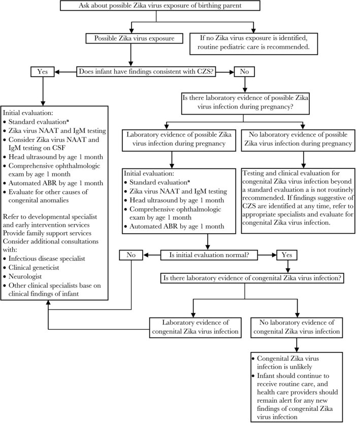

## PDF page 1115 | printed page 1101

Figure 168.2 (continued)

c Laboratory evidence of possible Zika virus infection during pregnancy is defined as (1) Zika virus infection detected by a Zika virus RNA NAT on any maternal, placental, or fetal specimen (referred to as NAAT-confirmed), or (2) diagnosis of Zika virus infection, timing of infection cannot be determined or unspecified flavivirus infection, timing of infection cannot be determined by serologic tests on a maternal specimen (ie, positive/equivocal Zika virus IgM and Zika virus PRNT titer ≥10, regardless of dengue virus PRNT value; or negative Zika virus IgM, and positive or equivocal dengue virus IgM, and Zika virus PRNT titer ≥10, regardless of dengue virus PRNT titer). The use of PRNT for confirmation of Zika virus infection, including in pregnant people, is not routinely recommended in Puerto Rico (www.cdc.gov/zika/laboratories/lab-guidance.html). d This group includes people who were never tested during pregnancy as well as those whose test result was negative because of issues related to timing or sensitivity and specificity of the test. Because the latter issues are not easily discerned, all birthing parents with possible exposure to Zika virus during pregnancy who do not have laboratory evidence of possible Zika virus infection, including those who tested negative with currently available technology, should be considered in this group. e Laboratory testing of infants for Zika virus should be performed as early as possible, preferably within the first few days after birth, and includes concurrent Zika virus NAAT in infant serum and urine, and Zika virus IgM testing in serum. If CSF is obtained for other purposes, Zika virus NAAT and Zika virus IgM testing should be performed on CSF. f Laboratory evidence of congenital Zika virus infection includes a positive Zika virus NAAT or a nonnegative Zika virus IgM with confirmatory neutralizing antibody testing, if PRNT confirmation is performed.

infectious diseases (for evaluation of other congenital infections and assistance with Zika virus diagnosis and testing), clinical genetics (for evaluation for other causes of microcephaly or congenital anomalies), and neurology by age 1 month (for comprehensive neurologic examination and consideration for other evaluations, such as advanced neuroimaging and electroencephalography). Infants should be referred for automated auditory brainstem response (ABR) testing by age 1 month if the newborn hearing screen was passed using only otoacoustic emission (OAE) methodology.

Clinical Management of Infants Without Clinical Findings Consistent With Congenital Zika Infection but Laboratory Evidence of Possible Zika Virus Infection of the Birthing Parent During Pregnancy

Zika virus testing is recommended, and ultrasonography of the head should be performed by age 1 month to detect subclinical brain findings. All infants should have a comprehensive ophthalmologic examination by age 1 month to detect subclinical eye findings. Infants should be referred for automated ABR testing by 1 month of age if newborn screen was passed using only OAE methodology. Infants should be monitored for findings consistent with congenital Zika syndrome that could develop over time (eg, impaired visual acuity/function, hearing problems, developmental delay, delay in head growth).

Clinical Management of Infants Without Clinical Findings Consistent With Congenital Zika Infection Whose Birthing Parent Had Possible Zika Virus Infection During Pregnancy but Without Laboratory Evidence of Zika Virus During Pregnancy

Zika virus testing is not routinely recommended, and specialized clinical evaluation or follow-up is not routinely indicated. Health care providers can consider additional evaluation in consultation with families. If findings suggestive of congenital Zika virus disease are identified at any time, referrals to the appropriate specialists should be made.

### INFECTION PREVENTION AND CONTROL MEASURES IN HEALTH CARE SETTINGS

Standard precautions are recommended. People infected with Zika virus should be protected from further mosquito exposure, especially during the first week of illness, to reduce the risk of local transmission to others.

### CONTROL MEASURES

No vaccines or preventive drugs are available, but a number of candidate vaccines are under evaluation in clinical trials. Prevention and control measures rely on personal prevention measures to avoid mosquito bites and community-level programs to reduce vector densities in areas with endemic infection. Personal measures include

## PDF page 1116 | printed page 1102

using insect repellent; wearing long pants, socks, and long-sleeved shirts while outdoors; and staying in air-conditioned buildings or buildings with window and door screens. Permethrin-treated clothing and gear can repel mosquitoes. Travelers returning to the United States from an area with risk of Zika, even if asymptomatic, should take steps to prevent mosquito bites for 3 weeks to minimize spread to local mosquito populations (www.cdc.gov/zika/prevention/preventmosquito-bites.html).

Insect repellents registered by the U.S. Environmental Protection Agency can be used according to directions on the product labels. Products containing N,N-diethyl-meta-toluamide, picaridin, oil of lemon eucalyptus, IR3535, paramenthane-diol, and 2-undecanone provide protection from mosquito bites. More information about these ingredients can be found at www. epa.gov/insect-repellents/skin-appliedrepellent-ingredients. All travelers should take precautions to avoid mosquito bites to prevent Zika virus infection and other mosquito-borne diseases.

Sexual Transmission

Zika virus can be transmitted sexually. Couples in which the man or woman has had possible Zika virus exposure who want to maximally reduce their risk for sexually transmitting Zika virus to the uninfected partner should use condoms or abstain from sex for at least 3 months for men or 2 months for women after symptom onset (if symptomatic) or last possible Zika virus exposure (if asymptomatic) (www.cdc. gov/zika/prevention/sexual-transmissionprevention.html).4 Sperm should not be donated for at least 3 months from infection or last exposure.

People Who Are Pregnant or Seeking to Become Pregnant

Pregnant people should not travel to areas with ongoing Zika outbreaks (wwwnc.cdc.gov/ travel/page/zika-travel-information). Before traveling to areas with current or past transmission of Zika, pregnant people should discuss their travel plans with their health care provider. In deciding whether to travel, pregnant people

should consider the destination, reasons for traveling, and ability to prevent mosquito bites. There is no restriction on the use of insect repellents by pregnant women if used in accordance with the instructions on the product label. Male partners of pregnant people who have traveled to areas with local transmission of Zika virus should abstain from sex or use condoms for the duration of the pregnancy to avoid sexual transmission to their pregnant partners (www.cdc.gov/zika/ prevention/sexual-transmission-prevention. html).

For couples who have possible Zika virus exposure and who are considering pregnancy, the CDC recommends postponing pregnancy for 3 months following potential exposure or diagnosis of Zika infection (www.cdc.gov/zika/prevention/ sexual-transmission-prevention.html).

Blood and Tissue Donation

Following the decrease in incidence of Zika virus in the United States and its territories, the U.S. Food and Drug Administration removed the requirement for routine Zika virus NAAT screening of blood donations. However, it is recommended that individuals who were infected with Zika virus infection defer blood donations for 120 days following symptom resolution or their last positive test, whichever is longer, to reduce the risk for transfusion-associated transmission of Zika virus. It is also recommended that individuals should be ineligible to donate human cells, tissues, and cellular and tissue-based products if they had a diagnosis of Zika virus infection within the past 6 months. Individuals suspected of having Zika virus infection at any point during a pregnancy should not be eligible to donate umbilical cord blood, placenta tissue, or other gestational tissues.

Breastfeeding

The World Health Organization and CDC recommend infants born to a person with suspected, probable, or confirmed Zika virus infection, or to a person who lives in or has traveled to areas with Zika virus, should be fed according to local infant feeding guidelines. Breastfeeding is encouraged even in areas where Zika virus is found because of the benefits of breastfeeding.

## PDF page 1117 | printed page 1103

Public Health Reporting

Health care professionals should report suspected Zika virus infection to their state or local health departments to facilitate diagnosis and mitigate the risk of local transmission. Zika virus disease and congenital infections were added to the list of nationally notifiable diseases in 2016. State health departments should then report cases to the CDC through ArboNET, the national surveillance system for arboviral diseases.

1 Oduyebo T, Polen KD, Walke HT, et al. Update: interim guidance for health care providers caring for pregnant women with possible zika virus exposure-United States (including U.S. territories), July 2017. MMWR Morb Mortal Wkly Rep. 2017;66(29):781–793

Image 168.1 Zika virus particles (red) shown in African green monkey kidney cells. Courtesy of National Institute of Allergy and Infectious Diseases.

2 Sharp TM, Fischer M, Muñoz-Jordán JL, et al. Dengue and Zika virus diagnostic testing for patients with a clinically compatible illness and risk for infection with both viruses. MMWR Recomm Rep. 2019;68(1):1–10 3 Adebanjo T, Godfred-Cato S, Viens L, et al. Update: interim guidance for the diagnosis, evaluation, and management of infants with possible congenital Zika virus infection-United States, October 2017. MMWR Morb Mortal Wkly Rep. 2017;66(41):1089–1099 4 The terms man, men, male, woman, and women refer to sex assigned at birth.

Image 168.2 Transmission electron microscope image of negativestained, Fortaleza-strain Zika virus (red), isolated from a microcephaly case in Brazil. Courtesy of National Institute of Allergy and Infectious Diseases.

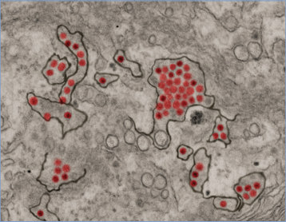

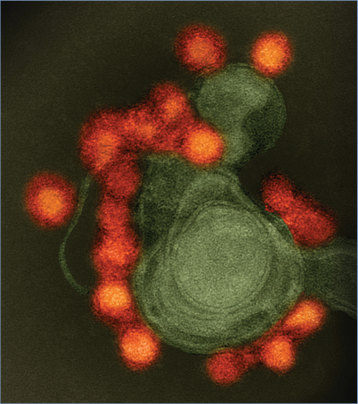

## PDF page 1118 | printed page 1104

Image 168.3 Congenital Zika syndrome is a pattern of birth defects in babies infected with Zika virus during pregnancy. Courtesy of Centers for Disease Control and Prevention.

Image 168.5 An Aedes mosquito. This species can transmit multiple diseases. Courtesy of National Institute of Allergy and Infectious Diseases.

Image 168.4 Transmission electron micrograph of Zika virus, a member of the Flaviviridae family.

Image 168.6 A female Aedes aegypti mosquito takes flight as she leaves her host’s skin surface. Courtesy of Centers for Disease Control and Prevention/James Gathany.

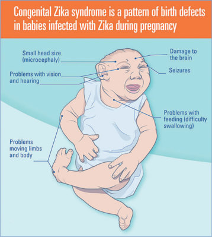

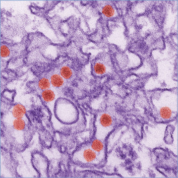

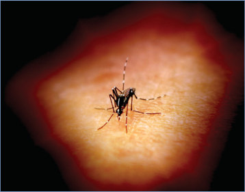

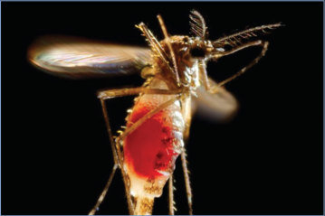

## PDF page 1119 | printed page 1105

Image 168.7 Estimated range of Aedes aegypti and Aedes albopictus in the United States, 2017. Courtesy of Centers for Disease Control and Prevention.

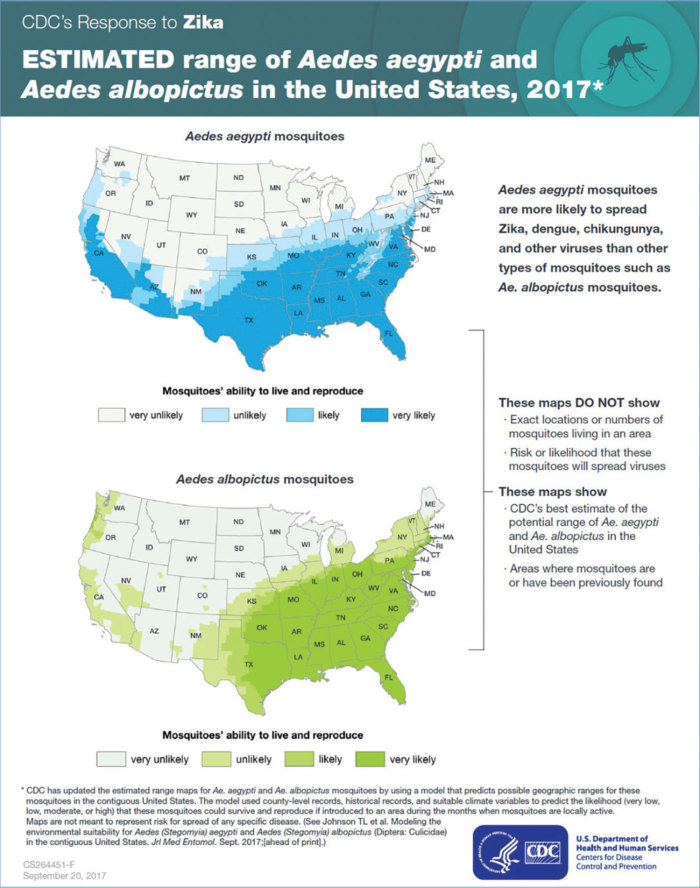

## PDF page 1120 | printed page 1106

Image 168.8 Baby with microcephaly. Courtesy of Pan American Health Organization and World Health Organization.

A

Image 168.9 A and B, This full-term newborn girl was delivered to a mother with a history of a positive result from serum Zika virus polymerase chain reaction assay at 23 weeks’ gestation. At 29 weeks’ gestation, the fetal head circumference was noted to be 203 mm (4–5 SD below the mean). Coarse calcifications at 37 weeks’ gestation were noted at ultrasonography. Postnatal testing results for other TORCH infections were negative. Head circumference at birth was 26.5 cm (6.23 SD below the mean). Physical examination was significant for craniofacial disproportion with narrow and laterally depressed frontal bone, upper wrist contractures, and redundant scalp skin with multiple rugae. Magnetic resonance imaging of the brain was significant for microcephaly with enlarged extra-axial spaces, smooth gyral pattern, dysgenesis of the corpus callosum, large bilateral posterior parietal and occipital lobe parenchymal cysts, and 5 small bilateral choroid plexus cysts. Copyright Ashley Howard, DO.

B

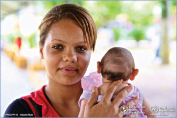

![Image 168.9 A and B, This full-term newborn girl was delivered to a mother with a history of a positive result from serum Zika virus polymerase chain reaction assay at 23 weeks’ gestation. At 29 weeks’ gestation, the fetal head circumference was noted to be 203 mm (4–5 SD below the mean). Coarse calcifications at 37 weeks’ gestation were noted at ultrasonography. Postnatal testing results for other TORCH infections were negative. Head circumference at birth was 26.5 cm (6.23 SD below the mean). Physical examination was significant for craniofacial disproportion with narrow and laterally depressed frontal bone, upper wrist contractures, and redundant scalp skin with multiple rugae. Magnetic resonance imaging of the brain was significant for microcephaly with enlarged extra-axial spaces, smooth gyral pattern, dysgenesis of the corpus callosum, large bilateral posterior parietal and occipital lobe parenchymal cysts, and 5 small bilateral choroid plexus cysts. Copyright Ashley Howard, DO.](../../figures/ch168_p1120_02.jpg)

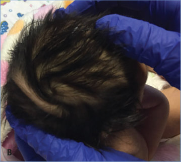
