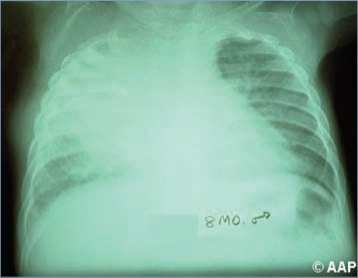
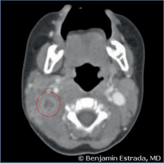
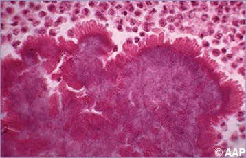
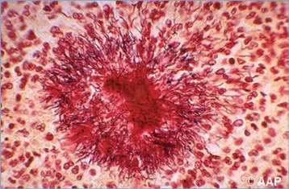

# 1. Actinomycosis
> Reference: [source credits](../../SOURCE_CREDITS.md). Printed pp. 1-3; PDF pp. 15-17.
> Editorial study pathway: Bacterial infections (not a part division in the source).
[Flashcards](../flashcards/001_flashcards.md) · [Quiz](../mcqs/001_mcqs.md) · [Full extraction](../../raw/chapters/001.md)

## Five study pillars

### Etiology and transmission
A israelii and at least 5 other Actinomyces species cause human disease. All are slow-growing, microaerophilic or facultative anaerobic, gram-positive, filamentous branching bacilli.
*Printed p. 1 / PDF p. 15*

### Clinical recognition
Actinomycosis results from pathogen introduction following a breakdown in mucocutaneous protective barriers. Spread within the host is by direct invasion of adjacent tissues, typically forming sinus tracts that cross tissue planes.
*Printed p. 1 / PDF p. 15*

### Diagnostic workup
Microscopic demonstration of beaded, branched, gram-positive bacilli in purulent material or tissue specimens suggests the diagnosis. Only specimens from normally sterile sites should be submitted for culture.
*Printed p. 1 / PDF p. 15*

### Treatment in the atlas
Management of actinomycosis is informed exclusively by case reports, case series, and in vitro susceptibility testing. Initial therapy should include intravenous penicillin G or ampicillin for 4 to 6 weeks followed by high doses of oral penicillin (up to 2 g/day for adults), usually for a total of 6 to 12 months depending on the extent of disease and success of surgical management (when indicated).
*Printed p. 2 / PDF p. 16*

### Prevention and infection control
Standard precautions are recommended. Person-to-person spread does not occur.
*Printed p. 2 / PDF p. 16*

## Clinical search tags
Pharyngitis, Pneumonia, Abscess / soft tissue, Congenital / neonatal, Immunocompromised host

## Full text, original tables, and images

# 1. Actinomycosis
> Private study reference ([source credits](../../SOURCE_CREDITS.md)). PDF pages 15-17; printed pages 1-3.

## PDF page 15 | printed page 1

### CLINICAL MANIFESTATIONS

Actinomycosis results from pathogen introduction following a breakdown in mucocutaneous protective barriers. Spread within the host is by direct invasion of adjacent tissues, typically forming sinus tracts that cross tissue planes. The most common species causing human disease is Actinomyces israelii.

There are 3 common anatomic sites of infection. Cervicofacial is most common, often occurring after tooth extraction, oral surgery, or other oral/ facial trauma or even from carious teeth. Localized pain and induration may progress to cervical abscess and “woody hard” nodular lesions (“lumpy jaw”), which can develop draining sinus tracts, usually at the angle of the jaw or in the submandibular region. Infection may contribute to recurrent or persistent tonsillitis. Thoracic disease most commonly is secondary to aspiration of oropharyngeal secretions but can be an extension of cervicofacial infection. It occurs rarely after esophageal disruption secondary to surgery or nonpenetrating trauma. Thoracic presentation includes pneumonia, which can be complicated by abscesses, empyema, and rarely, pleurodermal sinuses. Focal or multifocal mediastinal and pulmonary masses may be mistaken for tumors. Abdominal actinomycosis usually is attributable to penetrating trauma or intestinal perforation. The appendix and cecum are the most common sites; signs and symptoms can mimic appendicitis. Slowly developing masses may simulate abdominal or retroperitoneal neoplasms. Intra-abdominal abscesses and peritoneal-dermal draining sinuses occur eventually. Chronic localized disease often forms draining sinus tracts with purulent discharge. Other sites of infection include the liver, pelvis (in some cases, linked to use of intrauterine devices), heart, testicles, and brain (usually associated with a primary pulmonary focus). Noninvasive primary cutaneous actinomycosis has occurred. Actinomyces infections have been associated with adverse pregnancy outcomes and cases of neonatal bacteremia have been described.

### ETIOLOGY

A israelii and at least 5 other Actinomyces species cause human disease. All are slow-growing, microaerophilic or facultative anaerobic, gram-positive, filamentous branching bacilli. They can be part of normal oral, gastrointestinal tract, or vaginal flora. Actinomyces species frequently are copathogens in tissues harboring multiple anaerobic and/or aerobic species. Isolation of Aggregatibacter (Actinobacillus) actinomycetemcomitans, frequently detected with Actinomyces species, may predict the presence of actinomycosis.

### EPIDEMIOLOGY

Actinomyces species occur worldwide, being components of endogenous oral and gastrointestinal tract flora. Actinomyces species are opportunistic pathogens in the setting of disrupted mucosal barriers. Infection is uncommon in infants and children, with 80% of cases occurring in adults. The male-to-female ratio in children is 1.5:1. Although microbiologically confirmed infections caused by Actinomyces species now are less common, there are reports in patients who have undergone transplantation or are receiving biologics.

The incubation period varies from several days to several years.

### DIAGNOSTIC TESTS

Microscopic demonstration of beaded, branched, gram-positive bacilli in purulent material or tissue specimens suggests the diagnosis. Only specimens from normally sterile sites should be submitted for culture. Specimens must be obtained, transported, and cultured anaerobically on semiselective (kanamycin/vancomycin) media such as the modified Thayer-Martin agar or buffered charcoal yeast extract agar. Acid-fast testing can distinguish Actinomyces species, which are acid-fast negative, from Nocardia species, which are variably acid-fast positive staining. Yellow “sulfur granules” visualized microscopically or macroscopically in drainage or loculations of purulent material suggest the diagnosis. A Gram stain of “sulfur granules” discloses a dense aggregate of bacterial filaments mixed with inflammatory

## PDF page 16 | printed page 2

debris. A israelii forms “spiderlike” microcolonies on culture medium after 48 hours. Actinomyces species can be identified in tissue specimens using a nucleic acid amplification test, matrix-assisted laser desorption/ionization time-of-flight mass spectrometry, or sequencing of the 16s rRNA.

### TREATMENT

Management of actinomycosis is informed exclusively by case reports, case series, and in vitro susceptibility testing. Initial therapy should include intravenous penicillin G or ampicillin for 4 to 6 weeks followed by high doses of oral penicillin (up to 2 g/day for adults), usually for a total of 6 to 12 months depending on the extent of disease and success of surgical management (when indicated). Surgical drainage often is a necessary adjunct to medical management and may shorten duration of antimicrobial therapy. Treatment for mild disease can be initiated with oral therapy and

Image 1.1 An 8-month-old boy with pulmonary actinomycosis, an uncommon infection in infancy that may follow aspiration. As in this infant, most cases of actinomycosis are caused by Actinomyces israelii.

may not require as long a treatment duration. Amoxicillin and doxycycline are alternative choices. Amoxicillin/clavulanate, piperacillin/ tazobactam, ceftriaxone, clarithromycin, linezolid, and imipenem/meropenem also show high activity in vitro but may be unnecessarily broad-spectrum. All Actinomyces species appear to be resistant to ciprofloxacin and metronidazole.

### INFECTION PREVENTION AND CONTROL MEASURES IN HEALTH CARE SETTINGS

Standard precautions are recommended. Person-to-person spread does not occur.

### CONTROL MEASURES

Appropriate oral hygiene, regular dental care, and careful cleansing of wounds, including human bite wounds, can prevent infection.

Image 1.2 Periosteal reaction along the left humeral shaft (diaphysis) in the 8-month-old boy in Image 1.1, with pulmonary actinomycosis. The presence of clubbing with this chronic suppurative pulmonary infection and the absence of heart disease suggest that pulmonary fibrosis contributed to this infant’s pulmonary hypertrophic osteoarthropathy. Courtesy of Edgar O. Ledbetter, MD, FAAP.

## PDF page 17 | printed page 3

Image 1.3 Clubbing of the thumb and fingers of the 8-month-old boy in images 1.1 and 1.2, with chronic pulmonary actinomycosis. Results from blood cultures were repeatedly negative without clinical signs of endocarditis. Courtesy of Edgar O. Ledbetter, MD, FAAP.

Image 1.5 A sulfur granule from an actinomycotic abscess (hematoxylin-eosin stain). While pathognomonic of actinomycosis, granules are not always present. A Gram stain of sulfur granules shows a dense reticulum of filaments.

Image 1.4 Actinomyces cervical abscess (circled) in a 6-month-old girl. Courtesy of Benjamin Estrada, MD.

Image 1.6 Tissue showing filamentous branching rods of Actinomyces israelii (Brown-Brenn tissue Gram stain). Actinomyces species have fastidious growth requirements. Staining of a crushed sulfur granule reveals branching bacilli.

