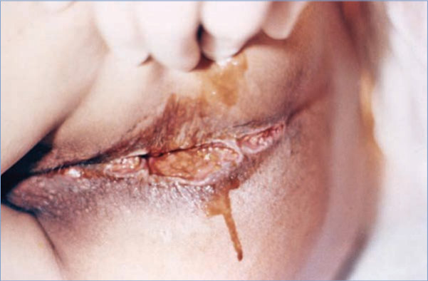
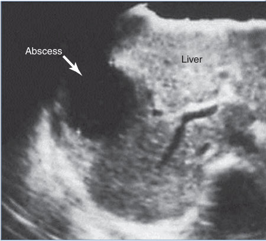
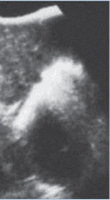
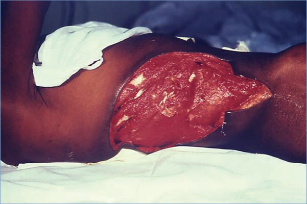
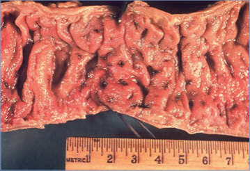
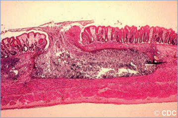

# 3. Amebiasis
> Reference: [source credits](../../SOURCE_CREDITS.md). Printed pp. 8-14; PDF pp. 22-28.
> Editorial study pathway: Protozoal infections (not a part division in the source).
[Flashcards](../flashcards/003_flashcards.md) · [Quiz](../mcqs/003_mcqs.md) · [Full extraction](../../raw/chapters/003.md)

## Five study pillars

### Etiology and transmission
The genus Entamoeba includes 6 species that live in the human intestine. Four of these species are identical morphologically: E histolytica, Entamoeba dispar, Entamoeba moshkovskii, and Entamoeba bangladeshi.
*Printed p. 8 / PDF p. 22*

### Clinical recognition
Most individuals infected with Entamoeba histolytica have asymptomatic noninvasive intestinal tract carriage. When present, symptoms associated with E histolytica infection generally include cramps, watery or bloody diarrhea, and weight loss.
*Printed p. 8 / PDF p. 22*

### Diagnostic workup
Intestinal amebiasis can be diagnosed by molecular tests, direct microscopy, and antigen detection tests. Stool nucleic acid amplification tests (NAATs) have the highest sensitivity and specificity, are available in U.S.
*Printed p. 9 / PDF p. 23*

### Treatment in the atlas
Treatment should be provided to all patients with E histolytica, including those who are asymptomatic, given the propensity of this organism to spread among family members and other contacts and to cause invasive infection. In settings where tests to distinguish species are not available, treatment should be administered to symptomatic people based on positive results of microscopic examination.
*Printed p. 9 / PDF p. 23*

### Prevention and infection control
Standard precautions are considered adequate for hospitalized patients; health care-associated transmission is rare.
*Printed p. 10 / PDF p. 24*

## Clinical search tags
Fever, Ulcers / eschar, Diarrhea, Dysentery, Hepatosplenomegaly, Abscess / soft tissue, Travel / endemic setting

## Full text, original tables, and images

# 3. Amebiasis
> Private study reference ([source credits](../../SOURCE_CREDITS.md)). PDF pages 22-28; printed pages 8-14.

## PDF page 22 | printed page 8

### CLINICAL MANIFESTATIONS

Most individuals infected with Entamoeba histolytica have asymptomatic noninvasive intestinal tract carriage. When present, symptoms associated with E histolytica infection generally include cramps, watery or bloody diarrhea, and weight loss. Occasionally, the parasite may spread to other organs, most commonly the liver (liver abscess), in which case fever and right upper quadrant pain are common. Disease is more severe in the very young, the elderly, malnourished people, pregnant individuals, and people who receive corticosteroids. People with symptomatic intestinal amebiasis generally have gradual onset of symptoms over 1 to 3 weeks. The mildest form of intestinal tract disease is nondysenteric colitis. Amebic dysentery is the most common clinical manifestation of amebiasis and generally includes diarrhea with either gross or microscopic blood or mucus in the stool, lower abdominal pain, and tenesmus. Weight loss is common because of the gradual onset, but fever occurs only in a minority of patients (8%–38%). Symptoms may be chronic, with periods of diarrhea and intestinal spasms alternating with periods of constipation. The presentation may mimic that of inflammatory bowel disease. Progressive involvement of the colon may produce toxic megacolon, fulminant colitis, ulceration of the colon and perianal area, and rarely, perforation. Colonic perforation may occur at multiple sites and has a high fatality rate. Progression may occur in patients treated inappropriately with corticosteroids or antimotility drugs. An amebic granuloma (ameboma) may form as an annular lesion of the colon and may present as a palpable mass on physical examination. Amebomas can occur in any area of the colon but are most common in the cecum and may be mistaken for colonic carcinoma. Amebomas usually resolve with antiamebic therapy and do not require surgery.

Extraintestinal disease occurs in a small proportion of patients. The liver is the most common extraintestinal site, and infection may spread from there to the pleural space, lungs, and pericardium. Liver abscess may be acute, with fever, abdominal pain, tachypnea, liver tenderness, and

hepatomegaly, or may be chronic, with weight loss and vague abdominal symptoms. Liver abscess can also be asymptomatic and only discovered on abdominal imaging performed for other reasons. Rupture of abscesses into the abdomen or chest may lead to death. Infection also may spread directly from the colon to the genitourinary tract and the skin. The organism may spread hematogenously to the brain and other areas of the body. Evidence of recent or concurrent intestinal tract infection usually is absent in extraintestinal disease.

### ETIOLOGY

The genus Entamoeba includes 6 species that live in the human intestine. Four of these species are identical morphologically: E histolytica, Entamoeba dispar, Entamoeba moshkovskii, and Entamoeba bangladeshi. Dientamoeba fragilis also can lead to asymptomatic infection and intraluminal intestinal disease. Not all Entamoeba species are virulent. E dispar and Entamoeba coli generally are recognized as commensals. Although E moshkovskii generally was believed to be nonpathogenic, it may be associated with diarrhea in infants. The pathogenic potential of E bangladeshi is not clear. Entamoeba and Dientamoeba organisms are excreted as cysts or trophozoites in stool of infected people.

### EPIDEMIOLOGY

E histolytica can be found worldwide but is more prevalent in people of lower socioeconomic status who live in resource-limited countries, where prevalence of amebic infection may be as high as 50% in some communities. Groups at increased risk of infection in industrialized countries include immigrants from or long-term visitors to areas with endemic infection, institutionalized people, and men who have sex with men. Intestinal and asymptomatic infection are distributed equally across the sexes, but incidence of invasive disease, especially liver abscess, is significantly higher in male adults, possibly because of a male susceptibility to invasive disease.

E histolytica is transmitted via ingestion of infective amebic cysts, through fecally contaminated food or water, or oral-anal sexual practices. Transmission also can occur via direct rectal inoculation through colonic irrigation devices.

## PDF page 23 | printed page 9

Ingested cysts, which are unaffected by gastric acid, undergo excystation in the alkaline small intestine and produce trophozoites that can cause invasive disease in the colon. Cysts that develop subsequently are the source of transmission, especially from asymptomatic cyst excreters. Infected patients excrete cysts intermittently, sometimes for years if untreated. Cysts can remain viable in the environment for weeks to months and are relatively resistant to chlorine. Ingestion of a single cyst is sufficient to cause disease.

The incubation period is variable, ranging from a few days to months or years, but commonly is 2 to 4 weeks for colitis and longer for amebic liver abscess.

### DIAGNOSTIC TESTS

Intestinal amebiasis can be diagnosed by molecular tests, direct microscopy, and antigen detection tests. Stool nucleic acid amplification tests (NAATs) have the highest sensitivity and specificity, are available in U.S. Food and Drug Administration (FDA)-approved multiplex assays, and can differentiate E histolytica from other Entamoeba species. Traditionally, diagnosis of intestinal tract infection was made by identifying trophozoites or cysts in stool specimens, either on wet mount or after fixing and staining. This technique is still used in some laboratories, but it is labor intensive, its sensitivity is lower than for NAATs, and it requires review of multiple stool samples. Microscopy also does not differentiate between E histolytica and less pathogenic species, although trophozoites containing ingested red blood cells are more likely to be E histolytica. Antigen test kits are available in some clinical laboratories for testing of E histolytica directly from stool specimens. Examination of biopsy specimens, endoscopy scrapings (not swabs), and abscess aspirates using microscopy or antigen detection typically is not fruitful; a NAAT is preferred, when available but is only FDA approved for stool specimens. Some monoclonal antibodybased antigen detection assays also can differentiate E histolytica from other Entamoeba species. D fragilis is diagnosed by microscopy.

The indirect hemagglutination test has been replaced by commercially available enzyme immunoassay (EIA) kits for routine serodiagnosis of amebiasis, especially in countries without endemic

disease. The EIA detects antibody specific for E histolytica in ≥95% of patients with extraintestinal amebiasis, 70% of patients with active intestinal tract infection, and 10% of asymptomatic people who are passing cysts of E histolytica. Patients may continue to have positive serologic test results even after adequate therapy. In countries without endemic disease, diagnosis of an E histolytica liver abscess or other extraintestinal infections typically is made by a combination of serologic testing and radiologic evaluation, because stool testing by microscopy or NAAT is often negative.

Ultrasonography, computed tomography, and magnetic resonance imaging can identify liver abscesses presumptively; those caused by E histolytica typically are solitary, homogenous, and hypoechoic on ultrasonography. Imaging also can identify other extraintestinal sites of infection.

### TREATMENT

Treatment should be provided to all patients with E histolytica, including those who are asymptomatic, given the propensity of this organism to spread among family members and other contacts and to cause invasive infection. In settings where tests to distinguish species are not available, treatment should be administered to symptomatic people based on positive results of microscopic examination. Corticosteroids and antimotility drugs should not be used, because they can worsen symptoms and aggravate the disease process. The following treatment regimens and follow-up are recommended:

• Asymptomatic cyst excreters (intraluminal infections): Treat with an intraluminal amebicide alone (paromomycin, iodoquinol [also known as diiodohydroxyquinoline], or diloxanide furoate). Metronidazole and tinidazole are not effective against cysts and these agents are not necessary for asymptomatic excreters.

• Patients with invasive colitis manifesting as mild, moderate, or severe intestinal tract symptoms or extraintestinal disease (including liver abscess): Treat with a tissue agent, metronidazole or tinidazole, followed by an intraluminal amebicide at the same doses as for asymptomatic infection. Nitazoxanide or secnidazole also may be effective as tissue

## PDF page 24 | printed page 10

agents for mild to moderate intestinal amebiasis, although they are not approved by the FDA for this indication.

• Additional considerations in patients with hepatic abscess, pleural or pericardial abscess, or other severe complications: In most cases of liver abscess, drainage is not required and does not speed recovery. Percutaneous or surgical aspiration of large liver abscesses occasionally may be required when response of the abscess to medical therapy is unsatisfactory or there is risk of rupture. Although patients typically improve symptomatically within days, it may take months for a liver abscess to resolve on ultrasonography. Rupture into the peritoneal or pleural space usually requires drainage. For patients who have peritonitis attributable to intestinal perforation, broad-spectrum antibacterial therapy should be used in addition to an amebicide. In cases with toxic megacolon, colectomy may be necessary.

Follow-up stool examination is recommended after completion of therapy for intestinal disease, because no pharmacologic regimen is completely effective in eradicating intestinal tract infection. Household members and other suspected contacts should have stool examinations performed and should be treated if results are positive for E histolytica.

Image 3.1 This patient with amebiasis presented with tissue destruction and granulation of the anoperineal region caused by an Entamoeba histolytica infection. Courtesy of Centers for Disease Control and Prevention.

E dispar and E coli generally are considered nonpathogenic and do not necessarily require treatment. The pathogenic significance of E moshkovskii and E bangladeshi is unclear; treatment of symptomatic infection is reasonable. D fragilis is treated with iodoquinol, paromomycin, or metronidazole.

### INFECTION PREVENTION AND CONTROL MEASURES IN HEALTH CARE SETTINGS

Standard precautions are considered adequate for hospitalized patients; health care-associated transmission is rare.

### CONTROL MEASURES

Careful hand hygiene after defecation, sanitary disposal of fecal material, and treatment of drinking water will control spread of infection. Sexual transmission may be controlled by use of condoms and avoidance of sexual activity with those who have diarrhea or recently recovered from diarrhea. Because of the risk of shedding infectious cysts, people diagnosed with amebiasis should refrain from using recreational water venues (eg, swimming pools, water parks) until after their course of luminal chemotherapy is completed and diarrhea has resolved. Some states prohibit return to work or school for food handlers or children until symptoms have resolved.

## PDF page 25 | printed page 11

Image 3.2 Computed tomographic scan of the abdomen showing a peripherally enhancing low-density lesion in the posterior aspect of the right hepatic lobe. Amebic liver abscess amebiasis, caused by the intestinal protozoal parasite Entamoeba histolytica, remains a global health problem, infecting about 50 million people and resulting in 40,000–100,000 deaths per year. Prevalence may be as high as 50% in tropical and subtropical countries where overcrowding and poor sanitation are common. In the United States, E histolytica infection is found most commonly in immigrants from developing countries, long-term travelers to endemic areas (most frequently, Mexico or Southeast Asia), individuals in institutions, and men who have sex with men. In 1993, the previously known species E histolytica was reclassified into 2 genetically and biochemically distinct but morphologically identical species: the pathogenic E histolytica and the nonpathogenic commensal Entamoeba dispar. Courtesy of Pediatrics in Review.

Abscess Liver

Image 3.3 Abdominal ultrasound showing a liver abscess caused by Entamoeba histolytica.

![Image 3.2 Computed tomographic scan of the abdomen showing a peripherally enhancing low-density lesion in the posterior aspect of the right hepatic lobe. Amebic liver abscess amebiasis, caused by the intestinal protozoal parasite Entamoeba histolytica, remains a global health problem, infecting about 50 million people and resulting in 40,000–100,000 deaths per year. Prevalence may be as high as 50% in tropical and subtropical countries where overcrowding and poor sanitation are common. In the United States, E histolytica infection is found most commonly in immigrants from developing countries, long-term travelers to endemic areas (most frequently, Mexico or Southeast Asia), individuals in institutions, and men who have sex with men. In 1993, the previously known species E histolytica was reclassified into 2 genetically and biochemically distinct but morphologically identical species: the pathogenic E histolytica and the nonpathogenic commensal Entamoeba dispar. Courtesy of Pediatrics in Review.](../../figures/ch003_p0025_01.jpg)

## PDF page 26 | printed page 12

Image 3.4 This patient presented with invasive extraintestinal amebiasis affecting the cutaneous region of the right flank. Courtesy of Centers for Disease Control and Prevention.

Image 3.5 This patient, also shown in Image 3.4, presented with invasive extraintestinal amebiasis affecting the cutaneous region of the right flank and causing severe tissue necrosis. Photographed is the site of tissue destruction, pre-debridement. Courtesy of Centers for Disease Control and Prevention/Kerrison Juniper, MD, and George Healy, PhD, DPDx.

Image 3.6 Gross pathological features of intestinal ulcers caused by amebiasis. Courtesy of Centers for Disease Control and Prevention.

## PDF page 27 | printed page 13

Image 3.7 Gross pathological features of amebic (Entamoeba histolytica) abscess of liver; tube of chocolate-like pus from abscess. Amebic liver abscesses are usually singular and large and in the right lobe of the liver. Bacterial hepatic abscesses are more likely to be multiple. Courtesy of Centers for Disease Control and Prevention.

Image 3.9 This micrograph of a brain tissue specimen reveals the presence of Entamoeba histolytica amoebae (magnification ×500). In more serious cases of amebiasis, amoebae can cause an infection of tissue outside the intestinal tract. Courtesy of Centers for Disease Control and Prevention.

Image 3.10 Trophozoites of Entamoeba histolytica with ingested erythrocytes (trichrome stain). The ingested erythrocytes appear as dark inclusions. Erythrophagocytosis is the only characteristic that can be used to morphologically differentiate E histolytica from the nonpathogenic Entamoeba dispar. In these specimens, the parasite nuclei have the typical small, centrally located karyosome and thin, uniform peripheral chromatin. Courtesy of Centers for Disease Control and Prevention.

Image 3.8 Histopathologic features of a typical flask-shaped ulcer of intestinal amebiasis in a kitten. Courtesy of Centers for Disease Control and Prevention.

## PDF page 28 | printed page 14

i

= Infective stage

2

= Diagnostic stage d

Mature cysts ingested

1

Passed in feces

= Noninvasive colonization

A

= Intestinal disease

B

= Extraintestinal disease

C

Multiplication

Excystation Trophozoites

4

3

d

5

d

Cysts

Image 3.11 Cysts are passed in feces (1). Infection by Entamoeba histolytica occurs by ingestion of mature cysts (2) in fecally contaminated food, water, or hands. Excystation (3) occurs in the small intestine and trophozoites (4) are released, which migrate to the large intestine. The trophozoites multiply by binary fission and produce cysts (5), which are passed in feces (1). Because of the protection conferred by their walls, the cysts can survive days to weeks in the external environment and are responsible for transmission. (Trophozoites can also be passed in diarrheal stools but are rapidly destroyed once outside the body and, if ingested, would not survive exposure to the gastric environment.) In many cases, trophozoites remain confined to the intestinal lumen (A, noninvasive colonization) of individuals who are asymptomatic carriers, passing cysts in their stool. In some patients, trophozoites invade the intestinal mucosa (B, intestinal disease) or, through the bloodstream, extraintestinal sites, such as the liver, brain, and lungs (C, extraintestinal disease), with resultant pathological manifestations. It has been established that invasive and noninvasive forms represent 2 separate species, E histolytica and Entamoeba dispar, respectively; however, not all people infected with E histolytica have invasive disease. These 2 species are morphologically indistinguishable. Transmission can also occur through fecal exposure during sexual contact (from which not only cysts but also trophozoites could prove infective). Courtesy of Centers for Disease Control and Prevention.

i

d

C

A d

d

B

d

i

d

4

Trophozoites

d

Exits host

d d

d

![Image 3.11 Cysts are passed in feces (1). Infection by Entamoeba histolytica occurs by ingestion of mature cysts (2) in fecally contaminated food, water, or hands. Excystation (3) occurs in the small intestine and trophozoites (4) are released, which migrate to the large intestine. The trophozoites multiply by binary fission and produce cysts (5), which are passed in feces (1). Because of the protection conferred by their walls, the cysts can survive days to weeks in the external environment and are responsible for transmission. (Trophozoites can also be passed in diarrheal stools but are rapidly destroyed once outside the body and, if ingested, would not survive exposure to the gastric environment.) In many cases, trophozoites remain confined to the intestinal lumen (A, noninvasive colonization) of individuals who are asymptomatic carriers, passing cysts in their stool. In some patients, trophozoites invade the intestinal mucosa (B, intestinal disease) or, through the bloodstream, extraintestinal sites, such as the liver, brain, and lungs (C, extraintestinal disease), with resultant pathological manifestations. It has been established that invasive and noninvasive forms represent 2 separate species, E histolytica and Entamoeba dispar, respectively; however, not all people infected with E histolytica have invasive disease. These 2 species are morphologically indistinguishable. Transmission can also occur through fecal exposure during sexual contact (from which not only cysts but also trophozoites could prove infective). Courtesy of Centers for Disease Control and Prevention.](../../figures/ch003_p0028_01.jpg)
