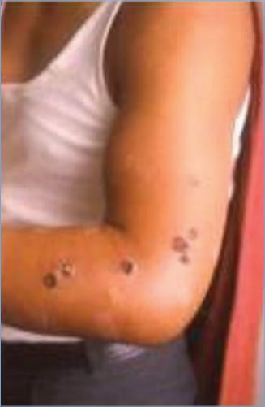
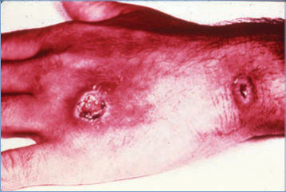
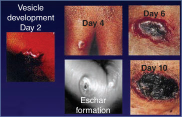
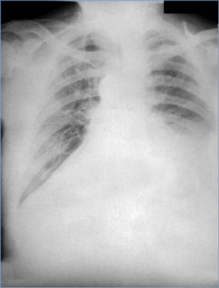
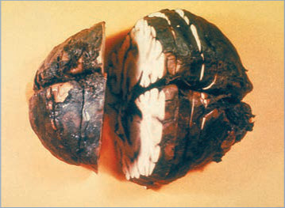
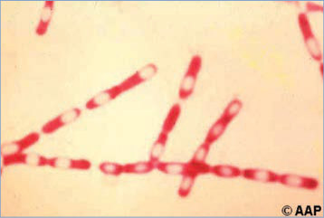

# 5. Anthrax
> Reference: [source credits](../../SOURCE_CREDITS.md). Printed pp. 20-27; PDF pp. 34-41.
> Editorial study pathway: Bacterial infections (not a part division in the source).
[Flashcards](../flashcards/005_flashcards.md) · [Quiz](../mcqs/005_mcqs.md) · [Full extraction](../../raw/chapters/005.md)

## Five study pillars

### Etiology and transmission
Bacillus anthracis is an aerobic, gram-positive, encapsulated, spore-forming, nonhemolytic, nonmotile rod. B anthracis has 3 major virulence factors: an antiphagocytic capsule and 2 exotoxins, called lethal toxin and edema toxin.
*Printed p. 20 / PDF p. 34*

### Clinical recognition
Anthrax resulting from wild-type infection or secondary to a bioterror event can occur in multiple forms, depending on the route of infection: cutaneous, inhalation, ingestion, or injection.
*Printed p. 20 / PDF p. 34*

### Diagnostic workup
B anthracis is readily isolated on routine agar media (eg, sheep’s blood agar) used in clinical laboratories and can be presumptively identified through traditional microbiological methods. Depending on the clinical presentation, Gram stain and culture should be performed on blood, pleural fluid, cerebrospinal fluid, swabs from lesions, and other clinical specimens.
*Printed p. 21 / PDF p. 35*

### Treatment in the atlas
No controlled trials in humans have been performed to validate current treatment recommendations for anthrax. A high index of suspicion and rapid administration of appropriate antibiotic therapy to people suspected of being infected, along with access to critical care support, are essential for effective treatment of anthrax.
*Printed p. 22 / PDF p. 36*

### Prevention and infection control
Standard precautions are recommended. In addition, contact precautions should be implemented when draining cutaneous lesions are present.
*Printed p. 23 / PDF p. 37*

## Clinical search tags
Fever, Vesicles, Ulcers / eschar, Lymphadenopathy, Pharyngitis, Cough, Diarrhea, Vomiting, Meningitis, Encephalitis / seizures, Sepsis / shock, Animal exposure

## Full text, original tables, and images

# 5. Anthrax
> Private study reference ([source credits](../../SOURCE_CREDITS.md)). PDF pages 34-41; printed pages 20-27.

## PDF page 34 | printed page 20

### CLINICAL MANIFESTATIONS

Anthrax resulting from wild-type infection or secondary to a bioterror event can occur in multiple forms, depending on the route of infection: cutaneous, inhalation, ingestion, or injection.

Manifestations of anthrax are mainly from the 2 primary toxins, lethal toxin and edema toxin. Cutaneous anthrax accounts for 95% of all human infections and begins as a pruritic papule or vesicle that progresses over 2 to 6 days to an ulcerated lesion with subsequent formation of a central black eschar. The lesion characteristically is painless and has surrounding edema and hyperemia; there can be associated regional lymphadenopathy and lymphangitis. Some patients may have fever, malaise, and headache. Up to 30% of adults with cutaneous anthrax will progress to invasive, systemic disease.

Inhalation anthrax is a frequently lethal form of the disease and is a medical emergency. The initial presentation is nonspecific and usually includes fever, malaise, and nonproductive cough. Many patients also complain of chest pain, headache, nausea, vomiting, and abdominal pain; sweating may be profuse. Illness usually progresses to the fulminant phase within 2 to 5 days. Illness has been noted to sometimes be biphasic, with a period of improvement between prodromal symptoms and overwhelming illness. Significant vital sign abnormalities are often present early, and fulminant manifestations include hypotension, dyspnea, hypoxia, cyanosis, and shock. Most patients with inhalation anthrax fulfill sepsis criteria, and up to half develop meningitis. Imaging abnormalities noted at presentation include pleural effusions in most, widened mediastinum in up to half, and pulmonary infiltrates in many.

Ingestion anthrax usually presents as one of 2 clinical syndromes: gastrointestinal or oropharyngeal. Patients with the gastrointestinal form often have nausea, anorexia, vomiting, and fever that progresses to severe abdominal pain, often accompanied by marked ascites. Vomiting and diarrhea, which are not always present, may be bloody. Although gastrointestinal tract involvement at multiple sites may occur following hematogenous

spread, the cecum and terminal ileum often are involved when the disease is primary. Patients with oropharyngeal anthrax may have dysphagia accompanied by posterior oropharyngeal necrotic ulcers. There may be marked, often unilateral neck swelling, regional lymphadenopathy, fever, and sepsis. Evidence of coagulopathy is common.

Injection anthrax occurs primarily among adult injection drug users, associated with anthraxcontaminated heroin, and has not been reported in children. Smoking and snorting contaminated heroin also have been identified as exposure routes.

Any route of infection can lead to bacteremia and sepsis. Patients with inhalation, ingestion, or injection anthrax should be considered to have systemic illness. Patients with cutaneous anthrax should be considered to have systemic illness if they develop tachycardia, tachypnea, hypotension, hyperthermia, hypothermia, or leukocytosis or have lesions that involve the head, neck, or upper torso or that are large, bullous, multiple, or surrounded by edema. Anthrax meningitis or hemorrhagic meningoencephalitis can occur in any patient with systemic illness and in patients without another apparent route of infection. With appropriate treatment and supportive care, case fatality rates range from <2% for cutaneous anthrax to 45% for inhalation anthrax and 92% for anthrax meningitis.

### ETIOLOGY

Bacillus anthracis is an aerobic, gram-positive, encapsulated, spore-forming, nonhemolytic, nonmotile rod. B anthracis has 3 major virulence factors: an antiphagocytic capsule and 2 exotoxins, called lethal toxin and edema toxin. The toxins are responsible for most of the morbidity associated with anthrax and clinical manifestations of hemorrhage, edema, and necrosis.

### EPIDEMIOLOGY

Anthrax is a zoonotic disease that most commonly affects domestic and wild herbivores and occurs in many rural regions of the world. B anthracis spores can remain viable in the soil for decades, representing a potential source of infection for livestock or wildlife through ingestion of spore-contaminated vegetation or water. In exposed susceptible hosts, spores germinate to become vegetative bacteria. Wild-type infection

## PDF page 35 | printed page 21

of humans occurs through contact with infected animals or contaminated animal products, including carcasses, hides, hair, wool, meat, and bone meal. Outbreaks of ingestion anthrax have occurred after consumption of meat from infected animals. Historically, more than 95% of anthrax cases in the United States were cutaneous infections among animal handlers or mill workers. The incidence of wild-type human anthrax decreased in the United States from an estimated 130 cases annually in the early 1900s to 0 to 2 cases per year from 1979 through 2011. Only 2 anthrax cases (both cutaneous) were confirmed in the United States from 2012–2021. Cases of inhalation, cutaneous, and ingestion (gastrointestinal) anthrax have occurred in drum makers working with animal hides contaminated with B anthracis spores and in people participating in events where sporecontaminated drums were played. Severe soft tissue infections among injection heroin users, including cases with disseminated systemic infection, have been reported in Europe.

B anthracis is one of the agents most likely to be used as a biological weapon, because (1) its spores are highly stable; (2) spores can infect via the respiratory route; and (3) the resulting disease, inhalation anthrax, has a high fatality rate, even with appropriate treatment. In 1979, an accidental release of B anthracis spores from a military microbiology facility in the former Soviet Union resulted in at least 68 deaths. In 2001, 22 cases of anthrax (11 inhalation, 11 cutaneous) were identified in the United States after intentional contamination of the mail; 5 (45%) of the inhalation anthrax cases were fatal. In addition to aerosolization, B anthracis spores introduced into food products or water supplies could theoretically pose a risk to the public’s health. Use of B anthracis in a biological attack would require immediate response and mobilization of public health resources (www.cdc.gov/anthrax/ bioterrorism/index.html).1

Although the incubation periods for both cutaneous and ingestion anthrax are typically less than 1 week, rare cases for both have been reported more than 2 weeks after exposure. Because of spore dormancy (persistence of viable spores that have not yet germinated) and slow clearance of spores from the lungs, the incubation period for inhalation anthrax may be prolonged and has

been reported to range from 2 days to 6 weeks in humans and up to 2 months in experimental nonhuman primates. Discharge from cutaneous lesions is potentially infectious, but person-toperson transmission has only rarely been reported, and other forms of anthrax have not been associated with person-to person transmission. Both inhalation and cutaneous anthrax have occurred in laboratory workers.

### DIAGNOSTIC TESTS

B anthracis is readily isolated on routine agar media (eg, sheep’s blood agar) used in clinical laboratories and can be presumptively identified through traditional microbiological methods. Depending on the clinical presentation, Gram stain and culture should be performed on blood, pleural fluid, cerebrospinal fluid, swabs from lesions, and other clinical specimens. Whenever possible, specimens for these tests should be obtained before initiating antimicrobial therapy, because previous treatment with antimicrobial agents lessens the sensitivity of isolation by culture and visualization of the organism by Gram stain.

B anthracis isolates can be definitively identified using tests such as a nucleic acid amplification test (NAAT) via the Laboratory Response Network in each state, accessed through state and local health departments. Additional diagnostic tests for anthrax are available through state health departments and the Centers for Disease Control and Prevention (CDC), including bacterial DNA detection in specimens by NAAT, tissue immunohistochemistry, an enzyme immunoassay that measures immunoglobulin G antibodies against B anthracis protective antigen in paired sera, and a matrix-assisted laser desorption/ionization– time-of-flight mass spectrometry assay measuring lethal factor activity in acute sera (www.cdc. gov/anthrax/lab-testing/index.html).

Clinical evaluation of patients with suspected inhalation anthrax should include a chest radiograph and/or computed tomography scan to evaluate for pleural effusion, widened mediastinum, and/or pulmonary infiltrates. Because hemorrhagic meningitis is a common complication of systemic anthrax, cranial imaging followed by lumbar punctures should be performed whenever feasible to guide therapy on systemically ill patients with any type of anthrax.

## PDF page 36 | printed page 22

For mass-exposure bioterrorism events, the CDC will provide current information on diagnosis, susceptibility, and suggestions for management at www.cdc.gov/anthrax/bioterrorism/index. html.

### TREATMENT2,3

No controlled trials in humans have been performed to validate current treatment recommendations for anthrax. A high index of suspicion and rapid administration of appropriate antibiotic therapy to people suspected of being infected, along with access to critical care support, are essential for effective treatment of anthrax. Consultation with an expert in infectious diseases is recommended.

For localized cutaneous anthrax (ie, lacking systemic systems), monotherapy may be used with oral first-line agents including ciprofloxacin, levofloxacin, doxycycline, or minocycline. If the isolate is known to be penicillin susceptible, amoxicillin and penicillin VK are alternatives. If the strain is beta-lactamase positive, amoxicillin/clavulanate may be used. Details on dosing, alternative antibiotics, and use of antitoxins are available.4 If the localized cutaneous disease was naturally acquired, the regimen should continue for 7 to 10 days or until the patient is clinically stable; following this, if an aerosol exposure might have occurred (eg, bioterrorism-related or drum-incident) then patients should transition to a postexposure prophylaxis (PEP) regimen. The total duration of treatment plus PEP should be 42 to 60 days from illness onset, depending on the patient’s age and anthrax vaccine status (see Control Measures).

First-line treatment for systemic anthrax with or without meningitis includes combination intravenous therapy with 2 first-line agents from different antibiotic classes plus a protein synthesis (preferred if available) or RNA synthesis inhibitor. Empiric regimens can include ciprofloxacin (or levofloxacin) plus meropenem plus either linezolid or minocycline; or ciprofloxacin (or levofloxacin) plus meropenem plus rifampin. If the isolate is known to be susceptible to penicillin, ampicillin or penicillin G may be used plus a protein synthesis inhibitor (eg, linezolid, minocycline, or doxycycline). These patients are at high risk for meningitis. However, if it has been determined that meningitis is not present, the regimen can be simplified to be a first-line

agent (eg, meropenem or ciprofloxacin) plus a protein synthesis inhibitor (eg, linezolid or doxycycline). Additional details on regimens, including first-line antibiotics, alternative antibiotics, and recommendations in cases of antibiotic shortages, are available.5 Because of intrinsic resistance, cephalosporins and trimethoprimsulfamethoxazole should not be used.

An anthrax antitoxin should be added when available. There are 3 antitoxins approved by the U.S. Food and Drug Administration (FDA): the monoclonal antibodies raxibacumab and obiltoxaximab, and polyclonal anthrax immunoglobulin intravenous (AIGIV).6 When available, raxibacumab or obiltoxaximab is preferred over AIGIV. Consult with state or local public health authorities and the CDC to discuss antitoxin use and release from the strategic national stockpile.

Adjunctive corticosteroids should be considered for edema involving the head and neck, evidence of anthrax meningitis (started at the time of initial antibiotic therapy), and vasopressor-resistant shock.7

For patients with systemic disease, antibiotic therapy should continue for 14 days or longer. However, intravenous treatment may be transitioned to oral therapy on the basis of patient improvement and clinical judgment. Whether patients should receive PEP following treatment for systemic anthrax depends on whether there was an aerosol exposure and whether the patient is immunocompetent. PEP is not needed in patients with naturally acquired (not in a bioterror event) noninhalation anthrax. Following an aerosol exposure to B anthracis spores, immunocompetent patients will develop immunity, making PEP unnecessary. However, immunocompromised patients with aerosol exposures should transition to an oral PEP regimen and be vaccinated. The total duration of treatment plus PEP is 60 days from illness onset.

Anthrax can progress rapidly, making access to critical care essential for many patients. If pleural fluid or ascites is present, aggressive drainage may improve survival. The edema that may complicate cutaneous anthrax of the face or neck can obstruct the airway, and aggressive monitoring for airway compromise is indicated in these patients. Anthrax hemorrhagic meningoencephalitis

## PDF page 37 | printed page 23

management requires neurologic critical care because of the profound brain injury, hemorrhage, and swelling documented in animal models and humans.

### INFECTION PREVENTION AND CONTROL MEASURES IN HEALTH CARE SETTINGS

Standard precautions are recommended. In addition, contact precautions should be implemented when draining cutaneous lesions are present. Cutaneous lesions become sterile within 24 hours of starting appropriate antimicrobial therapy. Patients with cutaneous illness pose minimal risk for transmission if the wound is kept covered during the first day of antimicrobial therapy. Contaminated dressings and bedclothes should be incinerated or steam sterilized (121°C for 30 minutes) to destroy spores. Terminal cleaning of the patient’s room can be accomplished with an Environmental Protection Agency-registered hospital-grade disinfectant and should follow standard facility practices typically used for all patients. Autopsies performed on patients with systemic anthrax require special precautions.

### CONTROL MEASURES8

BioThrax (anthrax vaccine adsorbed [AVA]) and Cyfendus (AVA Adjuvanted) are the only anthrax vaccines currently licensed in the United States for use in humans. Both are non-live vaccines prepared from a cell-free culture filtrate. AVA’s effectiveness for prevention of anthrax is based on animal studies, a single placebo-controlled human trial of the alum-precipitated precursor of the current AVA, observational data from humans, and immunogenicity data from humans and other mammals. In a human trial in adult mill workers, the alum-precipitated precursor to AVA demonstrated 93% effectiveness for preventing cutaneous and inhalation anthrax. AVA Adjuvanted was approved by the FDA in July 2023 for postexposure prophylaxis. Multiple reviews and publications evaluating AVA safety have found adverse events usually are local injection site reactions, with rare systemic symptoms, including fever, chills, muscle aches, and hypersensitivity.

PEP for exposure to aerosolized B anthracis spores includes 2 components: antimicrobials and vaccine. Symptom monitoring and PEP are critical for

preventing wild-type anthrax in people. Options for PEP antimicrobials include ciprofloxacin, levofloxacin, doxycycline, moxifloxacin, clindamycin, and for penicillin-susceptible strains, amoxicillin or penicillin. In the event of a bioterrorism event, information for health care professionals and the public relevant to that exposure will be posted on the CDC anthrax website (www.cdc.gov/ anthrax/index.html).

PEP for previously unvaccinated people 18 years or older who have been exposed to aerosolized B anthracis spores consists of up to 60 days of appropriate antimicrobial prophylaxis combined with 3 subcutaneous doses of anthrax vaccine. The anthrax vaccines are not licensed for use in pregnant people; however, in a postevent setting that poses a high risk of exposure to aerosolized B anthracis spores, pregnancy is neither a precaution nor a contraindication to their use as PEP vaccination. Similarly, they are not licensed for use in pediatric populations and have not been studied prospectively in children. However, anthrax vaccine is likely to be made available for children at the time of an event as an investigational vaccine under an appropriate regulatory mechanism that will include informed consent. Information on the process required for use of anthrax vaccines in children will be available on the CDC website at the time of an event (www.cdc.gov/anthrax/ index.html) as well as through the American Academy of Pediatrics and the FDA. All exposed children 6 weeks and older should receive anthrax vaccine postexposure in addition to 60 days of antimicrobial chemoprophylaxis. Children younger than 6 weeks of age should immediately begin antimicrobial prophylaxis, but initiation of the vaccine series should be delayed until they reach 6 weeks of age.

Until information becomes available about antimicrobial susceptibility of the implicated strain of B anthracis, oral ciprofloxacin, doxycycline, and levofloxacin are equivalent first-line antimicrobial agents for initial PEP for all people ≥1 month of age.9 If the antimicrobial susceptibility profile of isolated strains demonstrates appropriate sensitivity to amoxicillin, public health authorities may recommend changing PEP antimicrobial therapy for children either to oral amoxicillin at 75 mg/kg per day, divided into 3 daily doses administered every 8 hours (each dose not to exceed 500 mg),

## PDF page 38 | printed page 24

or to penicillin VK at 50–75 mg/kg/day divided into 4 doses (each dose not to exceed 500 mg). Additional agents and dosing are available.10 Because of intrinsic resistance, cephalosporins and trimethoprim-sulfamethoxazole should not be used for prophylaxis.

Public Health Reporting

Anthrax is a nationally and immediately notifiable condition, as specified by the U.S. Council of State and Territorial Epidemiologists; therefore, every suspected case should be reported immediately to the state or local health department.

1 Centers for Disease Control and Prevention. Clinical framework and medical countermeasure use during an anthrax mass-casualty incident: CDC recommendations. MMWR Recomm Rep. 2015;64(RR-4):1–22 2 Bower WA, Yu Y, Person MK, et al. CDC guidelines for the prevention and treatment of anthrax, 2023. MMWR Recomm Rep. 2023;72(RR-6):1–47 3 Bower WA, Schiffer J, Atmar RL, et al. Use of anthrax vaccine in the United States: recommendations of the Advisory Committee on Immunization Practices, 2019. MMWR Recomm Rep. 2019;68(4):1–14

Image 5.1 Cutaneous anthrax. Notice edema and typical lesions. Courtesy of Centers for Disease Control and Prevention.

4 Bower WA, Yu Y, Person MK, et al. CDC guidelines for the prevention and treatment of anthrax, 2023. MMWR Recomm Rep. 2023;72(RR-6):1–47 5 Bower WA, Yu Y, Person MK, et al. CDC guidelines for the prevention and treatment of anthrax, 2023. MMWR Recomm Rep. 2023;72(RR-6):1–47 6 Bower WA, Yu Y, Person MK, et al. CDC guidelines for the prevention and treatment of anthrax, 2023. MMWR Recomm Rep. 2023;72(RR-6):1–47 7 Hendricks KA, Wright ME, Shadomy SV, et al. Centers for Disease Control and Prevention expert panel meetings on prevention and treatment of anthrax in adults. Emerg Infect Dis. 2014;20(2) 8 Bower WA, Schiffer J, Atmar RL, et al. Use of anthrax vaccine in the United States: recommendations of the Advisory Committee on Immunization Practices, 2019. MMWR Recomm Rep. 2019;68(4):1–14 9 Bower WA, Schiffer J, Atmar RL, et al. Use of anthrax vaccine in the United States: recommendations of the Advisory Committee on Immunization Practices, 2019. MMWR Recomm Rep. 2019;68(4):1–14 10 Bower WA, Schiffer J, Atmar RL, et al. Use of anthrax vaccine in the United States: recommendations of the Advisory Committee on Immunization Practices, 2019. MMWR Recomm Rep. 2019;68(4):1–14

Image 5.2 Generalized cutaneous anthrax infection acquired from an ill cow. The infection began as a papule and was thought to be a simple furuncle. Following an attempt at drainage, the infection aggressively spread. Antibiotic therapy was started, and the patient survived. Courtesy of Mariam Svanidze, MD.

## PDF page 39 | printed page 25

Image 5.3 Generalized cutaneous anthrax infection acquired from an ill cow. The infection began as a papule and was thought to be a simple furuncle. Following an attempt at drainage, the infection aggressively spread. Antibiotic therapy was started, and the patient survived. Courtesy of Mariam Svanidze, MD.

Image 5.5 Anthrax ulcers on the hand and wrist of an adult. The cutaneous eschar of anthrax had been misdiagnosed as a brown recluse spider bite. Edema is common and suppuration is absent.

Image 5.4 Generalized cutaneous anthrax infection acquired from an ill cow. The infection began as a papule and was thought to be a simple furuncle. Following an attempt at drainage, the infection aggressively spread. Antibiotic therapy was started, and the patient survived. Courtesy of Mariam Svanidze, MD.

Vesicle development Day 2

Day 4 Day 6

Day 10

Eschar formation

Image 5.6 Cutaneous anthrax. Vesicle development occurs from day 2–day 10 of progression. Courtesy of Centers for Disease Control and Prevention.

## PDF page 40 | printed page 26

Image 5.7 Posteroanterior chest radiograph taken on the fourth day of illness, which shows a large pleural effusion and marked widening of the mediastinal shadow. Courtesy of Centers for Disease Control and Prevention.

Image 5.9 Gross pathological features of fixed, cut brain showing hemorrhagic meningitis secondary to inhalational anthrax. Courtesy of Centers for Disease Control and Prevention.

Image 5.8 This micrograph reveals submucosal hemorrhage in the small intestine in a case of fatal human anthrax (hematoxylin-eosin stain, magnification ×240). The first symptoms of gastrointestinal tract anthrax are nausea, loss of appetite, bloody diarrhea, and fever, followed by severe stomach pain. One-fourth to more than half of gastrointestinal anthrax cases lead to death. Note the associated arteriolar degeneration. Courtesy of Centers for Disease Control and Prevention.

Image 5.10 This is a brain section through the ventricles revealing an interventricular hemorrhage. The 3 virulence factors of Bacillus anthracis are edema toxin, lethal toxin, and an antiphagocytic capsular antigen. The toxins are responsible for the primary clinical manifestations of hemorrhage, edema, and necrosis. Courtesy of Centers for Disease Control and Prevention.

## PDF page 41 | printed page 27

Image 5.11 Sporulation of Bacillus anthracis, a gram-positive, nonmotile, encapsulated bacillus.

Image 5.13 Anthrax. Number of naturally occurring and biological terrorism–related cases reported, by year—United States, 1959-2014. There have been ≤2 cases of naturally occurring anthrax per year in the United States over the past 30 years. Courtesy of Morbidity and Mortality Weekly Report.

Image 5.12 Bacillus anthracis tenacity positively reacting on sheep blood agar. B anthracis colony characteristics: consistency, sticky (tenacious). When teased with loop, colony stands up like a beaten egg white. Courtesy of Centers for Disease Control and Prevention.

