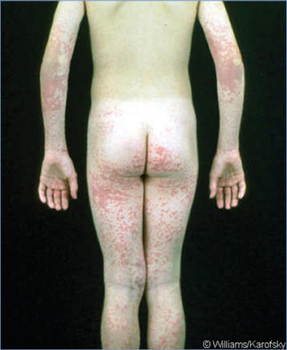
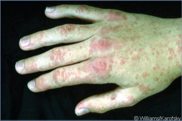
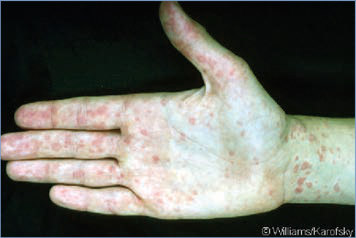
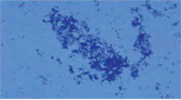
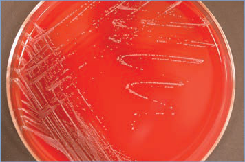

# 7. Arcanobacterium haemolyticum Infections
> Reference: [source credits](../../SOURCE_CREDITS.md). Printed pp. 39-40; PDF pp. 53-54.
> Editorial study pathway: Bacterial infections (not a part division in the source).
[Flashcards](../flashcards/007_flashcards.md) · [Quiz](../mcqs/007_mcqs.md) · [Full extraction](../../raw/chapters/007.md)

## Five study pillars

### Etiology and transmission
A haemolyticum is a catalase-negative, weakly acid-fast, facultatively anaerobic, hemolytic, gram-positive to gram-variable, slender, sometimes club-shaped bacillus.
*Printed p. 39 / PDF p. 53*

### Clinical recognition
Acute pharyngitis attributable to Arcanobacterium haemolyticum often is indistinguishable from group A streptococcal pharyngitis. A haemolyticum has been associated with fever, pharyngeal erythema and exudates, cervical lymphadenopathy, and rash, but palatal petechiae and strawberry tongue are typically absent.
*Printed p. 39 / PDF p. 53*

### Diagnostic workup
A haemolyticum grows on blood-enriched agar, but colonies are small, have narrow bands of beta hemolysis, and may not be visible for 48 to 72 hours. The organism is not detected by rapid antigen tests for group A streptococci.
*Printed p. 39 / PDF p. 53*

### Treatment in the atlas
Optimal management of patients with A haemolyticum pharyngitis has not been determined, and symptoms can resolve without antibiotic treatment. Erythromycin and azithromycin are drugs of choice for A haemolyticum tonsillopharyngitis, but no controlled trials have been performed.
*Printed p. 39 / PDF p. 53*

### Prevention and infection control
Standard precautions are recommended.
*Printed p. 39 / PDF p. 53*

## Clinical search tags
Fever, Petechiae / purpura, Maculopapular rash, Ulcers / eschar, Lymphadenopathy, Pharyngitis, Arthritis / bone pain, Abscess / soft tissue, Sepsis / shock, Immunocompromised host

## Full text, original tables, and images

# 7. Arcanobacterium haemolyticum Infections
> Private study reference ([source credits](../../SOURCE_CREDITS.md)). PDF pages 53-54; printed pages 39-40.

## PDF page 53 | printed page 39

### CLINICAL MANIFESTATIONS

Acute pharyngitis attributable to Arcanobacterium haemolyticum often is indistinguishable from group A streptococcal pharyngitis. A haemolyticum has been associated with fever, pharyngeal erythema and exudates, cervical lymphadenopathy, and rash, but palatal petechiae and strawberry tongue are typically absent. A morbilliform or scarlatiniform exanthem is present in half of cases, usually beginning on extensor surfaces of the distal extremities, spreading to the torso, back, and neck, sparing the face, palms, and soles. Rash typically develops 1 to 4 days after onset of sore throat, although the rash may precede pharyngitis. Desquamation can occur. Respiratory tract infections that mimic diphtheria, including membranous pharyngitis, and peritonsillar and pharyngeal abscesses occasionally occur. Skin and soft tissue infections, including chronic ulcers, cellulitis, paronychia, and wound infection, have been attributed to A haemolyticum. Rarely, invasive infections have been reported, including Lemierre syndrome, bacteremia, sepsis, endocarditis, brain abscess, orbital cellulitis, and pyogenic arthritis.

### ETIOLOGY

A haemolyticum is a catalase-negative, weakly acid-fast, facultatively anaerobic, hemolytic, gram-positive to gram-variable, slender, sometimes club-shaped bacillus.

### EPIDEMIOLOGY

Humans are the primary reservoir of A haemolyticum. Household studies suggest that spread occurs from person to person, presumably via droplet respiratory secretions. Severe disease occurs almost exclusively among immunocompromised people; invasive cases have been reported rarely in previously healthy people. Arcanobacterium pharyngitis occurs primarily in adolescents and young adults and only rarely in young children. A haemolyticum accounts for approximately 0.5% of pharyngeal infections overall and up to 2.5% of pharyngeal infections in 15- to 25-year-olds. Isolation of the bacterium from the nasopharynx of asymptomatic people is rare.

The incubation period is unknown.

### DIAGNOSTIC TESTS

A haemolyticum grows on blood-enriched agar, but colonies are small, have narrow bands of beta hemolysis, and may not be visible for 48 to 72 hours. The organism is not detected by rapid antigen tests for group A streptococci. Detection is enhanced by culture on rabbit or human blood agar, which yields larger colony size and wider zones of hemolysis compared with sheep blood agar. Presence of 5% carbon dioxide enhances growth, and pits characteristically form under colonies on blood agar plates. A haemolyticum may be missed in routine throat cultures on sheep blood agar if laboratory personnel are not trained specifically to identify the organism. Two biotypes of A haemolyticum have been identified: a rough biotype predominates in respiratory tract infections and a smooth biotype typically is found in skin and soft tissue infections.

### TREATMENT

Optimal management of patients with A haemolyticum pharyngitis has not been determined, and symptoms can resolve without antibiotic treatment. Erythromycin and azithromycin are drugs of choice for A haemolyticum tonsillopharyngitis, but no controlled trials have been performed. A haemolyticum generally is susceptible in vitro to macrolides, clindamycin, cephalosporins, ciprofloxacin, vancomycin, and gentamicin. Treatment failures with penicillin despite predicted susceptibility from in vitro testing occur and may be attributable to tolerance. Resistance to trimethoprim-sulfamethoxazole is common. In rare cases of invasive infection, susceptibility tests should be performed, and treatment should be individualized. While awaiting results, initial empiric combination therapy can be initiated using a parenteral beta lactam agent, with or without gentamicin or a macrolide, and with consideration of metronidazole if Fusobacterium infection is suspected, such as in cases of Lemierre syndrome.

### INFECTION PREVENTION AND CONTROL MEASURES IN HEALTH CARE SETTINGS

Standard precautions are recommended.

### CONTROL MEASURES

None.

## PDF page 54 | printed page 40

Image 7.1 Arcanobacterium haemolyticum was isolated on pharyngeal culture from this 12-year-old boy with an erythematous rash that was followed by mild desquamation. Copyright Williams/Karofsky.

Image 7.3 Note that the palms are affected in this patient, although they are often spared. Copyright Williams/Karofsky.

Image 7.5 Arcanobacterium haemolyticum (Gram stain). A haemolyticum appears strongly gram positive in young cultures but becomes more gram variable after 24 hours of incubation. Copyright Noni MacDonald, MD, FAAP.

Image 7.2 Arcanobacterium haemolyticum–associated rash on dorsal surface of the hand in the 12-year-old boy in images 7.1, 7.3, and 7.4. Copyright Williams/Karofsky.

Image 7.4 Although not present in this patient with facial skin lesions associated with Arcanobacterium haemolyticum pharyngitis, a pharyngeal membrane similar to that of diphtheria may occur with A haemolyticum pharyngeal infection. Copyright Williams/Karofsky.

Image 7.6 Arcanobacterium haemolyticum on blood agar. Colonies are small and produce beta hemolysis on blood agar. Courtesy of Julia Rosebush, DO; Robert Jerris, PhD; and Theresa Stanley, M(ASCP).

