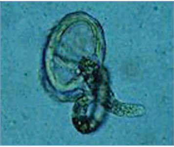
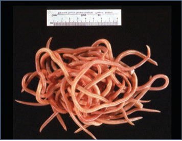

# 8. Ascaris lumbricoides Infections
> Reference: [source credits](../../SOURCE_CREDITS.md). Printed pp. 41-44; PDF pp. 55-58.
> Editorial study pathway: Helminths and ectoparasites (not a part division in the source).
[Flashcards](../flashcards/008_flashcards.md) · [Quiz](../mcqs/008_mcqs.md) · [Full extraction](../../raw/chapters/008.md)

## Five study pillars

### Etiology and transmission
After embryonated eggs are ingested, larvae hatch in the small intestine, penetrate the mucosa, and are transported passively by portal blood to the liver and lungs. After migrating from alveolar capillaries into the small airways, larvae ascend through the tracheobronchial tree to the pharynx, are swallowed, and mature into adults in the small intestine.
*Printed p. 41 / PDF p. 55*

### Clinical recognition
Most infections with Ascaris lumbricoides are asymptomatic, although moderate to heavy infections may lead to nonspecific gastrointestinal tract symptoms, malnutrition, and growth delay. During the larval migratory phase, an acute transient pneumonitis (Löffler syndrome) associated with cough, wheezing, substernal discomfort, shortness of breath, fever, and marked eosinophilia may occur.
*Printed p. 41 / PDF p. 55*

### Diagnostic workup
Ascariasis is diagnosed by examining a fresh or preserved stool specimen for eggs using light microscopy. Concentration techniques and examination of multiple specimens may be needed.
*Printed p. 41 / PDF p. 55*

### Treatment in the atlas
Albendazole and mebendazole are first-line agents for treatment of ascariasis, with cure rates from 90% to 100% with albendazole. Ivermectin, nitazoxanide, and pyrantel pamoate are alternative therapies.
*Printed p. 41 / PDF p. 55*

### Prevention and infection control
Standard precautions are recommended.
*Printed p. 42 / PDF p. 56*

## Clinical search tags
Fever, Cough, Pneumonia, Wheeze / bronchiolitis, Eosinophilia

## Full text, original tables, and images

# 8. Ascaris lumbricoides Infections
> Private study reference ([source credits](../../SOURCE_CREDITS.md)). PDF pages 55-58; printed pages 41-44.

## PDF page 55 | printed page 41

### CLINICAL MANIFESTATIONS

Most infections with Ascaris lumbricoides are asymptomatic, although moderate to heavy infections may lead to nonspecific gastrointestinal tract symptoms, malnutrition, and growth delay. During the larval migratory phase, an acute transient pneumonitis (Löffler syndrome) associated with cough, wheezing, substernal discomfort, shortness of breath, fever, and marked eosinophilia may occur. Acute intestinal obstruction has been associated with heavy infections. Children are prone to this complication because of the small diameter of the intestinal lumen and their propensity to acquire large worm burdens. Heavy worm burdens also can affect nutritional status, intellectual development, cognitive performance, and growth. Worm migration can cause peritonitis secondary to intestinal wall perforation as well as appendicitis or common bile duct obstruction resulting in biliary colic, cholangitis, or pancreatitis. Adult worms can be stimulated to migrate by stressful conditions (eg, fever, illness, or anesthesia) and by some anthelmintic drugs.

### ETIOLOGY

After embryonated eggs are ingested, larvae hatch in the small intestine, penetrate the mucosa, and are transported passively by portal blood to the liver and lungs. After migrating from alveolar capillaries into the small airways, larvae ascend through the tracheobronchial tree to the pharynx, are swallowed, and mature into adults in the small intestine. Female worms produce approximately 200,000 eggs per day, which are excreted in stool and must incubate in soil to become infectious. Adult worms can live in the lumen of the small intestine for up to 18 months. Female worms are longer than male worms and can measure 40 cm in length and 6 mm in diameter.

### EPIDEMIOLOGY

A lumbricoides is the most prevalent of all human intestinal nematodes (roundworms), with more than 800 million people infected worldwide. Infection is acquired by ingestion of Ascaris eggs in feces-contaminated food or dirt. Direct

person-to-person transmission does not occur. Infection is most common in resource-limited countries, including rural and urban communities characterized by poor sanitation. Ascaris suum, a pig roundworm similar to A lumbricoides, also causes human disease. Sporadic clusters of ascariasis attributable to A suum associated with pig farming or use of pig stool for fertilizer have been reported in the United States.

The incubation period (interval between ingestion of eggs and development of egg-laying adults) is approximately 9 to 11 weeks.

### DIAGNOSTIC TESTS

Ascariasis is diagnosed by examining a fresh or preserved stool specimen for eggs using light microscopy. Concentration techniques and examination of multiple specimens may be needed. Patients who harbor only male Ascaris worms will have negative test results on stool microscopy. Adult worms also may be passed from the rectum, through the nares, or from the mouth, usually in vomitus. Imaging of the gastrointestinal tract or biliary tree using computed tomography or ultrasonography may detect adult Ascaris worms, which can cause filling defects following administration of oral contrast.

### TREATMENT

Albendazole and mebendazole are first-line agents for treatment of ascariasis, with cure rates from 90% to 100% with albendazole. Ivermectin, nitazoxanide, and pyrantel pamoate are alternative therapies. Albendazole, pyrantel pamoate, ivermectin, and nitazoxanide are not approved by the U.S. Food and Drug Administration for treatment of ascariasis, although albendazole has become the drug of choice for most soil-transmitted nematode infections, including ascariasis. Reexamination of stool specimens may be performed at approximately 2 weeks after deworming to document cure and again at 2 to 3 months to account for migrating larvae present at the time of treatment that may now be mature adults, because these anthelmintic agents are not effective against larvae. Patients who remain infected should be retreated, preferably with albendazole or the multidose regimen of mebendazole, and the reasons for the repeated infections should be explored and addressed.

## PDF page 56 | printed page 42

Conservative management of small bowel obstruction, including nasogastric suction, intravenous fluids, and repletion of electrolytes, may alleviate symptoms before administration of anthelmintic therapy. Diatrizoate meglumine and diatrizoate sodium solution or careful use of mineral oil (cases of lipoid pneumonia have been reported after this use), administered orally or by nasogastric tube, may cause relaxation of a bolus of worms. Endoscopic retrograde cholangiopancreatography has been used successfully for extraction of worms from the biliary tree. Surgical intervention (eg, laparotomy) is indicated for intestinal or biliary tract obstruction that does not resolve with conservative therapy or for patients with volvulus or peritonitis secondary to perforation.

### INFECTION PREVENTION AND CONTROL MEASURES IN HEALTH CARE SETTINGS

Standard precautions are recommended.

Image 8.1 This micrograph reveals a fertilized egg of the roundworm Ascaris lumbricoides (magnification ×400). Fertilized eggs are round with a thick shell, whereas unfertilized eggs are elongate with a larger, thinner shell, and covered by a more visible mammillated layer, which is sometimes covered by protuberances. Courtesy of Centers for Disease Control and Prevention/Mae Melvin, MD.

### CONTROL MEASURES

Sanitary disposal of human feces prevents transmission. Vegetables cultivated in areas where human feces are used as fertilizer must be washed thoroughly and cooked before eating.

Preventive chemotherapy (once or twice annually with albendazole or mebendazole) targeting highrisk groups, most notably preschool and schoolaged children and pregnant people (after the first trimester), is recommended by the World Health Organization for control of A lumbricoides and other soil-transmitted nematodes in high prevalence communities. Reinfection is common in these areas, and additional public health measures, including improved sanitation, safe drinking water, and health education, likely will be required to eliminate these infections.

Image 8.2 A fertilized ascaris egg, still at the unicellular stage, which is the usual stage when the eggs are passed in the stool (complete development of the larva requires 18 days under favorable conditions). Courtesy of Centers for Disease Control and Prevention.

## PDF page 57 | printed page 43

Image 8.3 Larva hatching from an ascaris egg. Hatching occurs in the small intestine. Courtesy of Centers for Disease Control and Prevention.

Image 8.5 A mass of large roundworms (Ascaris lumbricoides) from infestation in a human.

Image 8.4 An adult ascaris. Diagnostic characteristics: tapered ends; length, 15–35 cm (females tend to be larger). This worm is a female, as evidenced by the size and genital girdle (the dark circular groove at the left side of the image). Courtesy of Centers for Disease Control and Prevention.

Image 8.6 This micrograph reveals an unfertilized egg of the roundworm Ascaris lumbricoides (magnification ×400). Fertilized eggs are round with a thick shell, whereas unfertilized eggs are elongate with a larger, thinner shell, and covered by a more visible mammillated layer, which is sometimes covered by protuberances, as in this case. Courtesy of Centers for Disease Control and Prevention/ Mae Melvin, MD.

## PDF page 58 | printed page 44

4

i

3

6

5

2

Fertilized egg

Image 8.7 Adult worms (1) live in the lumen of the small intestine. A female may produce approximately 200,000 eggs per day, which are passed with the feces (2). Unfertilized eggs may be ingested but are noninfective. Fertile eggs embryonate and become infective after 18 days to several weeks (3), depending on the environmental conditions (optimum: moist, warm, shaded soil). After infective eggs are swallowed (4), the larvae hatch (5), invade the intestinal mucosa, and are carried via the portal and then via systemic circulation to the lungs (6). The larvae mature further in the lungs (10–14 days), penetrate the alveolar walls, ascend the bronchial tree to the throat, and are swallowed (7). On reaching the small intestine, they develop into adult worms. Between 2 and 3 months is required from ingestion of the infective eggs to oviposition by the adult female. Adult worms can live 1–2 years. Courtesy of Centers for Disease Control and Prevention.

i = Infective stage

d

= Diagnostic stage

7

1 d

Feces

2

Unfertilized egg will not undergo biological development

d d

![Image 8.7 Adult worms (1) live in the lumen of the small intestine. A female may produce approximately 200,000 eggs per day, which are passed with the feces (2). Unfertilized eggs may be ingested but are noninfective. Fertile eggs embryonate and become infective after 18 days to several weeks (3), depending on the environmental conditions (optimum: moist, warm, shaded soil). After infective eggs are swallowed (4), the larvae hatch (5), invade the intestinal mucosa, and are carried via the portal and then via systemic circulation to the lungs (6). The larvae mature further in the lungs (10–14 days), penetrate the alveolar walls, ascend the bronchial tree to the throat, and are swallowed (7). On reaching the small intestine, they develop into adult worms. Between 2 and 3 months is required from ingestion of the infective eggs to oviposition by the adult female. Adult worms can live 1–2 years. Courtesy of Centers for Disease Control and Prevention.](../../figures/ch008_p0058_01.jpg)
