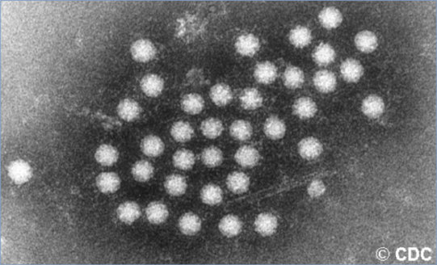

# 10. Astrovirus Infections
> Reference: [source credits](../../SOURCE_CREDITS.md). Printed pp. 51-52; PDF pp. 65-66.
> Editorial study pathway: Viral infections (not a part division in the source).
[Flashcards](../flashcards/010_flashcards.md) · [Quiz](../mcqs/010_mcqs.md) · [Full extraction](../../raw/chapters/010.md)

## Five study pillars

### Etiology and transmission
Members of the family Astroviridae, astroviruses are nonenveloped, single-stranded RNA viruses with viral particles having a characteristic starlike appearance when visualized by electron microscopy. Astroviruses are classified into 2 genera: Mamastrovirus (MAstV) and Avastrovirus, which infect mammals and birds, respectively.
*Printed p. 51 / PDF p. 65*

### Clinical recognition
Astrovirus illness most commonly manifests as 2 to 5 days of acute watery diarrhea accompanied by low-grade fever, malaise, and nausea, and less commonly, vomiting and mild dehydration. Illness in an immunocompetent host is self-limited, lasting a median of 5 to 6 days.
*Printed p. 51 / PDF p. 65*

### Diagnostic workup
Food and Drug Administration approved multiplex nucleic acid-based assays for the detection of gastrointestinal tract pathogens, at least 2 of which include astrovirus (MAstV 1). Similar to tests for other gastroenteritis viruses, interpretation of assay results may be complicated by the detection of multiple gastrointestinal tract pathogens in a single sample, particularly in young children.
*Printed p. 51 / PDF p. 65*

### Treatment in the atlas
No specific antiviral therapy is available. Oral or parenteral fluids and electrolytes are given to prevent and correct dehydration.
*Printed p. 51 / PDF p. 65*

### Prevention and infection control
In addition to standard precautions, contact precautions are recommended for diapered children or incontinent people for the duration of illness or to control institutional outbreaks.
*Printed p. 51 / PDF p. 65*

## Clinical search tags
Fever, Diarrhea, Vomiting, Meningitis, Encephalitis / seizures, Immunocompromised host

## Full text, original tables, and images

# 10. Astrovirus Infections
> Private study reference ([source credits](../../SOURCE_CREDITS.md)). PDF pages 65-66; printed pages 51-52.

## PDF page 65 | printed page 51

### CLINICAL MANIFESTATIONS

Astrovirus illness most commonly manifests as 2 to 5 days of acute watery diarrhea accompanied by low-grade fever, malaise, and nausea, and less commonly, vomiting and mild dehydration. Illness in an immunocompetent host is self-limited, lasting a median of 5 to 6 days. Asymptomatic infections are common. Astrovirus infections also have been associated with respiratory illness, encephalitis, and meningitis, particularly in immunocompromised individuals.

### ETIOLOGY

Members of the family Astroviridae, astroviruses are nonenveloped, single-stranded RNA viruses with viral particles having a characteristic starlike appearance when visualized by electron microscopy. Astroviruses are classified into 2 genera: Mamastrovirus (MAstV) and Avastrovirus, which infect mammals and birds, respectively. Four MAstV species have been identified in humans: MAstV 1, MAstV 6, MAstV 8, and MAstV 9. MAstV 1 includes the 8 antigenic types of classic human astroviruses (HAstV types 1–8), whereas MAstV 6, MAstV 8, and MAstV 9 are novel astroviruses that have been identified in recent years and include Melbourne and Virginia/human-mink-ovine-like strains.

### EPIDEMIOLOGY

Human astroviruses (HAstVs) have a worldwide distribution. Multiple antigenic types cocirculate in the same geographic region. HAstVs have been detected in as many as 5% to 17% of sporadic cases of nonbacterial gastroenteritis among young children in the community but appear to cause a lower proportion of cases of more severe childhood gastroenteritis requiring hospitalization (2.5%–9%). HAstV infections occur predominantly in children younger than 4 years and have a seasonal peak during the late winter and spring in the United States. Transmission is via the fecaloral route through contaminated food or water, person-to-person contact, or contaminated surfaces. Outbreaks tend to occur in closed populations of the young and the elderly, particularly among hospitalized children (health care-associated infections) and children in child care centers. In general, virus is shed 1 to 2 days before illness

and lasts a median of 5 days after onset of symptoms, but asymptomatic excretion after illness can last for several weeks in healthy children. Persistent excretion may occur in immunocompromised hosts. MAstV 6, MAstV 8, and MAstV 9 have been detected sporadically in stool samples, blood, respiratory samples, cerebrospinal fluid, and brain tissue of immunocompromised patients with acute encephalitis.

The incubation period is 3 to 4 days.

### DIAGNOSTIC TESTS

There are several U.S. Food and Drug Administration approved multiplex nucleic acid-based assays for the detection of gastrointestinal tract pathogens, at least 2 of which include astrovirus (MAstV 1). Similar to tests for other gastroenteritis viruses, interpretation of assay results may be complicated by the detection of multiple gastrointestinal tract pathogens in a single sample, particularly in young children.

A few research and reference laboratories test stool samples using nucleic acid amplification tests. To link cases from different disease clusters, positive samples can be typed by amplification and sequencing of small regions of the astrovirus capsid gene.

### TREATMENT

No specific antiviral therapy is available. Oral or parenteral fluids and electrolytes are given to prevent and correct dehydration.

### INFECTION PREVENTION AND CONTROL MEASURES IN HEALTH CARE SETTINGS

In addition to standard precautions, contact precautions are recommended for diapered children or incontinent people for the duration of illness or to control institutional outbreaks.

### CONTROL MEASURES

No specific control measures are available. The spread of infection in child care settings can be decreased by using general measures for control of diarrhea, such as training care providers in infection-control procedures, maintaining cleanliness of surfaces, keeping food preparation duties and areas separate from child care activities, exercising adequate hand hygiene, cohorting ill children, and excluding ill child care providers, food handlers, and children.

## PDF page 66 | printed page 52

Image 10.1 Electron micrograph of astrovirus obtained from stool of a child with gastroenteritis. Note the characteristic starlike appearance. Courtesy of Centers for Disease Control and Prevention.

GFAP Viral capsid

Patient

Control

A

B

Image 10.2 Astrovirus encephalitis in a boy with X-linked agammaglobulinemia. Encephalitis is a major cause of death worldwide. Although >100 pathogens have been identified as causative agents, the pathogen is not determined for up to 75% of cases. This diagnostic failure impedes effective treatment and underscores the need for better tools and new approaches for detecting novel pathogens or determining new manifestations of known pathogens. Although astroviruses are commonly associated with gastroenteritis, they have not been associated with central nervous system disease. With unbiased pyrosequencing, astrovirus was determined to be the causative agent for encephalitis in a 15-year-old boy with agammaglobulinemia. Courtesy of Emerging Infectious Diseases.

Merge

![Image 10.2 Astrovirus encephalitis in a boy with X-linked agammaglobulinemia. Encephalitis is a major cause of death worldwide. Although >100 pathogens have been identified as causative agents, the pathogen is not determined for up to 75% of cases. This diagnostic failure impedes effective treatment and underscores the need for better tools and new approaches for detecting novel pathogens or determining new manifestations of known pathogens. Although astroviruses are commonly associated with gastroenteritis, they have not been associated with central nervous system disease. With unbiased pyrosequencing, astrovirus was determined to be the causative agent for encephalitis in a 15-year-old boy with agammaglobulinemia. Courtesy of Emerging Infectious Diseases.](../../figures/ch010_p0066_02.jpg)
