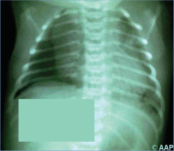
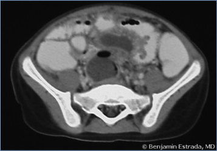
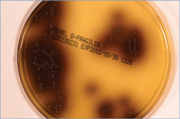

# 14. Bacteroides, Prevotella, and Other Anaerobic Gram-Negative Bacilli Infections
> Reference: [source credits](../../SOURCE_CREDITS.md). Printed pp. 64-65; PDF pp. 78-79.
> Editorial study pathway: Bacterial infections (not a part division in the source).
[Flashcards](../flashcards/014_flashcards.md) · [Quiz](../mcqs/014_mcqs.md) · [Full extraction](../../raw/chapters/014.md)

## Five study pillars

### Etiology and transmission
Most Bacteroides, Prevotella, Porphyromonas, and Fusobacterium organisms associated with human disease are pleomorphic, non–spore-forming, facultatively anaerobic, gram-negative bacilli.
*Printed p. 64 / PDF p. 78*

### Clinical recognition
Bacteroides, Prevotella, and other anaerobic gram-negative bacilli (AGNB) residing in the oral cavity have been associated with chronic sinusitis, chronic otitis media, parotitis, dental infection, peritonsillar abscess, cervical adenitis, retropharyngeal space infection, aspiration pneumonia, lung abscess, pleural empyema, or necrotizing pneumonia. Species residing in the gastrointestinal tract have been recovered in patients with peritonitis, intra-abdominal abscess, pelvic inflammatory disease, Bartholin cyst abscess, tuboovarian abscess, endometritis, acute and chronic prostatitis, prostatic and scrotal abscesses, scrotal gangrene, postoperative wound infection, and vulvovaginal and perianal infections.
*Printed p. 64 / PDF p. 78*

### Diagnostic workup
Anaerobic culture media are necessary for recovery of Bacteroides, Prevotella, and other AGNB. Because infections usually are polymicrobial, aerobic and anaerobic cultures should be obtained when AGNB species are suspected.
*Printed p. 64 / PDF p. 78*

### Treatment in the atlas
Abscesses should be drained when feasible; abscesses involving the brain, liver, and lungs may resolve with effective antimicrobial therapy alone. Necrotizing soft tissue lesions require surgical débridement and antimicrobial therapy.
*Printed p. 64 / PDF p. 78*

### Prevention and infection control
Standard precautions are recommended.
*Printed p. 65 / PDF p. 79*

## Clinical search tags
Ulcers / eschar, Conjunctivitis, Pharyngitis, Pneumonia, Diarrhea, Meningitis, Arthritis / bone pain, Abscess / soft tissue, Congenital / neonatal

## Full text, original tables, and images

# 14. Bacteroides, Prevotella, and Other Anaerobic Gram-Negative Bacilli Infections
> Private study reference ([source credits](../../SOURCE_CREDITS.md)). PDF pages 78-79; printed pages 64-65.

## PDF page 78 | printed page 64

### CLINICAL MANIFESTATIONS

Bacteroides, Prevotella, and other anaerobic gram-negative bacilli (AGNB) residing in the oral cavity have been associated with chronic sinusitis, chronic otitis media, parotitis, dental infection, peritonsillar abscess, cervical adenitis, retropharyngeal space infection, aspiration pneumonia, lung abscess, pleural empyema, or necrotizing pneumonia. Species residing in the gastrointestinal tract have been recovered in patients with peritonitis, intra-abdominal abscess, pelvic inflammatory disease, Bartholin cyst abscess, tuboovarian abscess, endometritis, acute and chronic prostatitis, prostatic and scrotal abscesses, scrotal gangrene, postoperative wound infection, and vulvovaginal and perianal infections. Invasion of the bloodstream from the oral cavity or gastrointestinal tract may result in brain abscess, meningitis, endocarditis, arthritis, or osteomyelitis. Skin and soft tissue infections include bacterial gangrene and necrotizing fasciitis; omphalitis in newborn infants; cellulitis at the site of fetal monitor probes, human bite wounds, or burns; infections adjacent to the oral cavity or rectum; and infected decubitus ulcers. Neonatal infections, including conjunctivitis, pneumonia, bacteremia, or meningitis, rarely occur. When Bacteroides, Prevotella, and other AGNB are implicated, infections are typically polymicrobial.

### ETIOLOGY

Most Bacteroides, Prevotella, Porphyromonas, and Fusobacterium organisms associated with human disease are pleomorphic, non–spore-forming, facultatively anaerobic, gram-negative bacilli.

### EPIDEMIOLOGY

Bacteroides, Prevotella, and other AGNB are part of the normal oral, gastrointestinal tract, and genital tract flora. The Bacteroides fragilis group predominates in gastrointestinal tract flora. Enterotoxigenic B fragilis may be associated with diarrhea. Members of the Prevotella melaninogenica (formerly Bacteroides melaninogenicus) and

Prevotella oralis (formerly Bacteroides oralis) groups reside in the oral cavity. These species result in infections as opportunists, usually after an alteration in skin or mucosal membranes in conjunction with other endogenous species, and often are associated with chronic mucosal injury. Rates of upper respiratory tract, head, and neck infections associated with AGNB are higher in children than in adults. Endogenous infection results from aspiration, bowel perforation, or damage to mucosal surfaces from trauma, surgery, or chemotherapy. Mucosal injury or granulocytopenia predispose to infection. Except in infections resulting from human bites, no evidence of person-to-person transmission of AGNB exists. The prevalence of AGNB infections is likely underestimated because of preanalytical collection, transportation, and specimen cultivation issues.

The incubation period is variable and depends on the inoculum and the site of involvement but usually is 1 to 5 days.

### DIAGNOSTIC TESTS

Anaerobic culture media are necessary for recovery of Bacteroides, Prevotella, and other AGNB. Because infections usually are polymicrobial, aerobic and anaerobic cultures should be obtained when AGNB species are suspected. A putrid odor, with or without gas in the infected site, suggests anaerobic infection. Use of an anaerobic transport tube or a sealed syringe is recommended for collection of clinical specimens.

### TREATMENT

Abscesses should be drained when feasible; abscesses involving the brain, liver, and lungs may resolve with effective antimicrobial therapy alone. Necrotizing soft tissue lesions require surgical débridement and antimicrobial therapy.

The choice of antimicrobial agent(s) is based on anticipated or known in vitro susceptibility testing and local antimicrobial resistance patterns. Anaerobic infections of the oral and respiratory tracts generally are susceptible to penicillin G, ampicillin, and clindamycin. However, because some species of Bacteroides and almost 50% of Prevotella species produce beta-lactamase, and penicillin treatment failure has emerged, penicillin is not recommended for empiric coverage or for treatment of severe oropharyngeal or pleuropulmonary infections or for any abdominopelvic

## PDF page 79 | printed page 65

infections. A beta-lactam combined with a beta-lactamase inhibitor (ampicillin-sulbactam, amoxicillin-clavulanate, or piperacillin-tazobactam) can be used to treat these infections.

Anaerobic infections of the gastrointestinal tract are often caused by B fragilis, which is typically resistant to penicillin G but susceptible to metronidazole, beta-lactam plus beta-lactamase inhibitors, carbapenems, cefoxitin, and chloramphenicol. The emergence of clindamycin resistance in B fragilis now limits its use. Tigecycline has in vitro activity against Prevotella and Bacteroides species but

Image 14.1 Bacteroides fragilis pneumonia in a newborn (B fragilis isolated from the placenta and blood culture from the newborn). Anaerobic cultures were obtained because of a fecal odor in the amniotic fluid.

Image 14.3 This photomicrograph shows Bacteroides fragilis after being cultured in a thioglycolate medium for 48 hours. B fragilis is a gram-negative rod that constitutes 1%–2% of the normal colonic bacterial microflora in humans. It is associated with extraintestinal infections such as abscesses and soft tissue infections, as well as diarrheal diseases. Courtesy of Centers for Disease Control and Prevention.

limited pediatric dosing and safety data are available, particularly for children younger than 8 years. Tigecycline has a black box warning for an increase in all-cause mortality and should be reserved for situations in which alternative agents are not suitable. Moxifloxacin may be an alternative to treat anaerobic infections in children with severe betalactam allergies, although emerging resistance is a concern. Cefuroxime, cefotaxime, and ceftriaxone are not reliably effective.

### INFECTION PREVENTION AND CONTROL MEASURES IN HEALTH CARE SETTINGS

Standard precautions are recommended.

### CONTROL MEASURES

None.

Image 14.2 Bacteroides fragilis abdominal abscess in a 9-year-old boy. Courtesy of Benjamin Estrada, MD.

Image 14.4 Bacteroides fragilis on bacteroid bile-esculin agar. This organism not only grows in 20% bile but also hydrolyzes esculin, causing the browning of the agar. Courtesy of Julia Rosebush, DO; Robert Jerris, PhD; and Theresa Stanley, M(ASCP).

