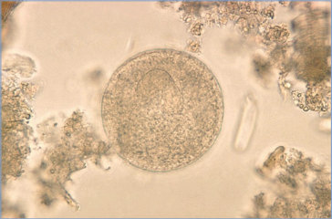

# 15. Balantidium coli Infections (Balantidiasis)
> Reference: [source credits](../../SOURCE_CREDITS.md). Printed pp. 66-67; PDF pp. 80-81.
> Editorial study pathway: Protozoal infections (not a part division in the source).
[Flashcards](../flashcards/015_flashcards.md) · [Quiz](../mcqs/015_mcqs.md) · [Full extraction](../../raw/chapters/015.md)

## Five study pillars

### Etiology and transmission
B coli, a ciliated protozoan, is the largest pathogenic protozoan known to infect humans.
*Printed p. 66 / PDF p. 80*

### Clinical recognition
Most human infections are asymptomatic. Symptomatic infection is characterized either by acute onset of bloody or watery mucoid diarrhea with abdominal pain or with chronic or intermittent episodes of diarrhea, anorexia, and weight loss.
*Printed p. 66 / PDF p. 80*

### Diagnostic workup
Diagnosis usually is made by demonstrating trophozoites (or less frequently, cysts) in stool, intestinal biopsy specimens, or ova and parasite examination of fluid aspirates from extraintestinal sites. Excretion of parasites can be intermittent, and repeated stool examinations over several days may be necessary.
*Printed p. 66 / PDF p. 80*

### Treatment in the atlas
The drugs of choice are tetracycline and metronidazole. Alternative drugs include iodoquinol and nitazoxanide.
*Printed p. 66 / PDF p. 80*

### Prevention and infection control
Standard and contact precautions are recommended, because human-to-human transmission can occur rarely.
*Printed p. 66 / PDF p. 80*

## Clinical search tags
Ulcers / eschar, Pneumonia, Diarrhea, Immunocompromised host, Animal exposure, Water exposure, Travel / endemic setting

## Full text, original tables, and images

# 15. Balantidium coli Infections (Balantidiasis)
> Private study reference ([source credits](../../SOURCE_CREDITS.md)). PDF pages 80-81; printed pages 66-67.

## PDF page 80 | printed page 66

(Balantidiasis)

### CLINICAL MANIFESTATIONS

Most human infections are asymptomatic. Symptomatic infection is characterized either by acute onset of bloody or watery mucoid diarrhea with abdominal pain or with chronic or intermittent episodes of diarrhea, anorexia, and weight loss. Inflammation of the gastrointestinal tract and local lymphatic vessels can result in bowel dilation, ulceration, perforation, and extraintestinal spread or secondary bacterial invasion. Colitis produced by Balantidium coli can mimic that of Entamoeba histolytica or noninfectious causes. Fulminant disease can occur in malnourished or otherwise debilitated or immunocompromised patients. Rare cases of appendicitis, pneumonia, and urinary tract infections have been reported.

### ETIOLOGY

B coli, a ciliated protozoan, is the largest pathogenic protozoan known to infect humans.

### EPIDEMIOLOGY

Pigs are the primary host reservoir of B coli, but the parasite has also been found in other mammals, especially primates and livestock. Infections have been reported in most areas of the world but are more common in tropical and subtropical areas or areas with poor sanitation systems. Cysts excreted in feces can be transmitted directly from hand to mouth or indirectly through fecally contaminated water or food. Excysted trophozoites infect the colon. A person is infectious as long as cysts are excreted in stool. Cysts may remain viable in the environment for months.

The incubation period is not established but may be several days.

### DIAGNOSTIC TESTS

Diagnosis usually is made by demonstrating trophozoites (or less frequently, cysts) in stool, intestinal biopsy specimens, or ova and parasite examination of fluid aspirates from extraintestinal sites. Excretion of parasites can be intermittent, and repeated stool examinations over several days may be necessary. Trophozoites are more often identified in diarrheal stools, and cysts (40–60 μm in diameter) are more common in formed stools. Trophozoites exhibit characteristic spiraling motility on wet mount. Because trophozoites degenerate rapidly, fresh diarrheal stools require either prompt microscopic examination or placement in stool fixation medium. Stool studies may be negative in the rare cases of extraintestinal manifestations of disease.

### TREATMENT

The drugs of choice are tetracycline and metronidazole. Alternative drugs include iodoquinol and nitazoxanide.

### INFECTION PREVENTION AND CONTROL MEASURES IN HEALTH CARE SETTINGS

Standard and contact precautions are recommended, because human-to-human transmission can occur rarely.

### CONTROL MEASURES

Avoiding food or water that may be contaminated with feces (especially pig feces) is key to avoiding infection. Control measures include sanitary disposal of human and porcine feces and good handwashing. Cysts are resistant to the levels of chlorination used for drinking water, and waterborne outbreaks of disease have occurred despite chlorination. Fresh produce should be avoided in high-risk settings as washing alone may be insufficient to eliminate transmission.

## PDF page 81 | printed page 67

A B

Image 15.1 Balantidium coli trophozoites are characterized by their large size (40 to >70 μm); on the cell surface, the presence of cilia, which are particularly visible (B); a cytostome (arrows); a bean-shaped macronucleus that is often visible (A); and a smaller, less conspicuous micronucleus. Courtesy of Centers for Disease Control and Prevention.

2

The cyst is the infectious stage and is acquired by the host through ingestion of contaminated food or water.

Some trophozoites invade the wall of the colon.

i

Cyst = Infective stage

1

d

= Diagnostic stage

3

Cyst Trophozoite

Image 15.3 Cysts are the parasite stage responsible for transmission of balantidiasis (1). The host most often acquires the cyst through ingestion of contaminated food or water (2). After ingestion, excystation occurs in the small intestine, and the trophozoites colonize the large intestine (3). The trophozoites reside in the lumen of the large intestine of humans and animals, where they replicate by binary fission, during which conjugation may occur (4). Trophozoites undergo encystation to produce infective cysts (5). Some trophozoites invade the wall of the colon and multiply. Some return to the lumen and disintegrate. Mature cysts are passed with feces (1). Courtesy of Centers for Disease Control and Prevention.

Image 15.2 Balantidium coli cyst in stool preparation. Courtesy of Centers for Disease Control and Prevention.

i

d

4 5

![Image 15.3 Cysts are the parasite stage responsible for transmission of balantidiasis (1). The host most often acquires the cyst through ingestion of contaminated food or water (2). After ingestion, excystation occurs in the small intestine, and the trophozoites colonize the large intestine (3). The trophozoites reside in the lumen of the large intestine of humans and animals, where they replicate by binary fission, during which conjugation may occur (4). Trophozoites undergo encystation to produce infective cysts (5). Some trophozoites invade the wall of the colon and multiply. Some return to the lumen and disintegrate. Mature cysts are passed with feces (1). Courtesy of Centers for Disease Control and Prevention.](../../figures/ch015_p0081_03.jpg)
