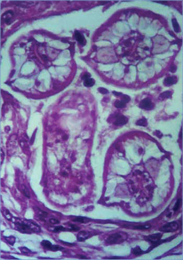
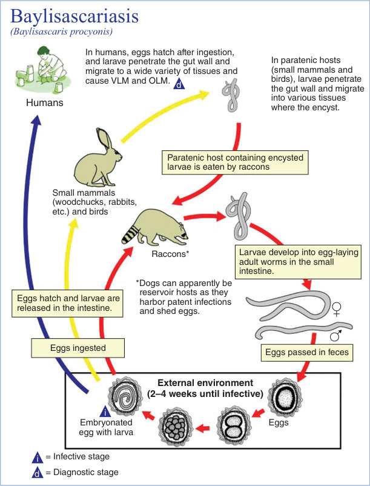
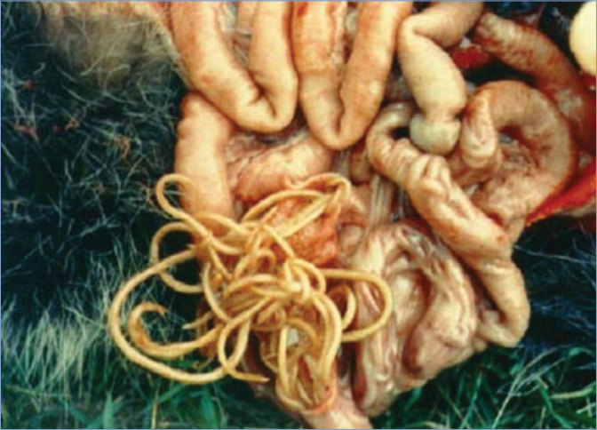

# 17. Baylisascaris Infections
> Reference: [source credits](../../SOURCE_CREDITS.md). Printed pp. 74-79; PDF pp. 88-93.
> Editorial study pathway: Helminths and ectoparasites (not a part division in the source).
[Flashcards](../flashcards/017_flashcards.md) · [Quiz](../mcqs/017_mcqs.md) · [Full extraction](../../raw/chapters/017.md)

## Five study pillars

### Etiology and transmission
B procyonis is a 9- to 22-cm long roundworm (nematode) that infects raccoons, often subclinically, as its definitive host and a wide variety (>150 species) of mammals and birds as paratenic hosts, in which its larvae aggressively migrate throughout the body. Domestic dogs can also serve as definitive hosts, but less commonly.
*Printed p. 74 / PDF p. 88*

### Clinical recognition
Clinical signs of infection with Baylisascaris procyonis, the common raccoon roundworm, are likely dependent on inoculum size. Clinically evident infections usually present as acute onset of central nervous system (CNS) disease (neural larva migrans [NLM], eosinophilic meningoencephalitis), with sudden lethargy or somnolence, weakness, irritability, behavioral regression, and decreased awareness and interaction.
*Printed p. 74 / PDF p. 88*

### Diagnostic workup
Baylisascaris infection is confirmed by identification of larvae in biopsy specimens. A presumptive diagnosis of NLM can be made on the basis of clinical (meningoencephalitis, sometimes with concomitant VLM and/or OLM-DUSN), epidemiologic (raccoon exposure), and laboratory (blood and CSF eosinophilia) findings.
*Printed p. 75 / PDF p. 89*

### Treatment in the atlas
Early diagnostic consideration and treatment are critical. Albendazole, in conjunction with highdose corticosteroids, has been advocated most widely on the basis of good CNS and CSF penetration and effectiveness in experimental animals.
*Printed p. 75 / PDF p. 89*

### Prevention and infection control
Standard precautions are recommended. The disease is not transmitted from person-to-person.
*Printed p. 75 / PDF p. 89*

## Clinical search tags
Fever, Pneumonia, Hepatosplenomegaly, Encephalitis / seizures, Weakness / paralysis, Eosinophilia, Travel / endemic setting

## Full text, original tables, and images

# 17. Baylisascaris Infections
> Private study reference ([source credits](../../SOURCE_CREDITS.md)). PDF pages 88-93; printed pages 74-79.

## PDF page 88 | printed page 74

### CLINICAL MANIFESTATIONS

Clinical signs of infection with Baylisascaris procyonis, the common raccoon roundworm, are likely dependent on inoculum size. Clinically evident infections usually present as acute onset of central nervous system (CNS) disease (neural larva migrans [NLM], eosinophilic meningoencephalitis), with sudden lethargy or somnolence, weakness, irritability, behavioral regression, and decreased awareness and interaction. There may be nuchal rigidity, decreased head control, torticollis, loss of fine motor skills, seizures, impaired vision or speech, ataxia, and difficulty sitting or standing without assistance. Once CNS onset has occurred, usually 2 to 4 weeks after infection, signs may worsen rapidly. NLM is typically accompanied by marked peripheral and/or cerebrospinal fluid (CSF) eosinophilia. Outcomes are related to the amount of inflammatory and mechanical damage occurring from the presence of larvae in the CNS and range from severe neurologic sequelae and death to milder sequelae and, in some cases, improvement with early and aggressive treatment. Other clinical presentations include visceral and ocular larva migrans (VLM, OLM); all 3 types (NLM, VLM, and OLM) may occur concomitantly. The nonspecific signs of VLM, such as rash, fever, abdominal pain, pneumonitis, and hepatomegaly, may be overshadowed by the manifestations of NLM. OLM can result in diffuse unilateral subacute neuroretinitis (DUSN), and direct visualization of a larva in the retina is sometimes possible. Similar to larva migrans caused by Toxocara species, subclinical and covert infections seem to be the most common outcome and are likely the result of incidental, low-level Baylisascaris infection.

### ETIOLOGY

B procyonis is a 9- to 22-cm long roundworm (nematode) that infects raccoons, often subclinically, as its definitive host and a wide variety (>150 species) of mammals and birds as paratenic hosts, in which its larvae aggressively migrate throughout the body. Domestic dogs can also serve as definitive hosts, but less commonly. Some other carnivores (skunks, kinkajous, bears, etc) harbor related Baylisascaris species that are

potential sources of infection, although no human cases with these animals as a source have been documented.

### EPIDEMIOLOGY

B procyonis is widely but variably distributed throughout the United States and Canada and also is found in Europe and Japan. In areas where it is endemic, <20% to >80% of raccoons can harbor the parasite in their intestines. When infective eggs or an infected paratenic host is eaten by a raccoon, the larvae grow to maturity in the small intestine, where adult female worms shed millions of eggs per day in the feces. Eggs become infective only after 2 to 4 weeks in the environment and may persist long-term in the soil. Embryonated eggs containing infective larvae are ingested from the soil by raccoons and other animals, including humans, particularly children. Risk of human infection is greatest in areas where significant raccoon populations live in peridomestic settings. More than 30 cases of Baylisascaris CNS disease (including 22 in children), 25 cases of OLM-DUSN (including 10 in children), and 100 seropositive asymptomatic cases have been reported in the United States and Canada, and it is likely that cases may be undiagnosed and/or underreported.

The main risk factor for Baylisascaris infection is contact with raccoon latrines, which are communal defecation sites often found at or on the base of trees; raised flat surfaces such as tree stumps, logs, rocks, decks, and rooftops; or unsealed attics or garages. Other risk factors include geophagia/ pica, age younger than 4 years, and in older children, developmental delay. Most reported cases of CNS disease have been in male individuals.1

Unlike Toxocara species, Baylisascaris larvae grow rapidly following infection, reaching considerable size (1,400–1,900 μm × 50–80 μm) by 10 to 15 days postinfection. They are aggressive migrators and may enter the brain of experimentally infected animals as early as 3 to 5 days postinfection. Only approximately 5% to 7% of larvae migrate into the CNS, but their size, numbers, aggressiveness, and metabolic products correlate with their high pathogenicity. In one fatal case in an 18-month-old, the brain alone contained an estimated >3,200 larvae. Lowlevel infections, even those involving the CNS,

## PDF page 89 | printed page 75

can produce a spectrum of milder focal and/or nonspecific signs.

The incubation period in overt CNS cases is usually 2 to 4 weeks.

### DIAGNOSTIC TESTS

Baylisascaris infection is confirmed by identification of larvae in biopsy specimens. A presumptive diagnosis of NLM can be made on the basis of clinical (meningoencephalitis, sometimes with concomitant VLM and/or OLM-DUSN), epidemiologic (raccoon exposure), and laboratory (blood and CSF eosinophilia) findings. Antibody detection in serum and CSF for patients with clinical symptoms is available at the Centers for Disease Control and Prevention as well as the National Reference Centre for Parasitology in Canada. Neuroimaging results can be normal initially, but as larvae migrate and cause damage to CNS tissues, diffuse or multifocal abnormalities typically develop symmetrically in deep periventricular white matter, the cerebellum, or elsewhere; these may progress to atrophic changes. In ocular disease, ophthalmologic examination can reveal chorioretinal lesions and rarely larvae. Stool examination is not helpful, because eggs are not shed in human feces.

### TREATMENT

Early diagnostic consideration and treatment are critical. Albendazole, in conjunction with highdose corticosteroids, has been advocated most widely on the basis of good CNS and CSF penetration and effectiveness in experimental animals. If infection is suspected, treatment should be initiated promptly, even while the diagnostic evaluation is being completed. Empiric therapy with albendazole should be considered for children with a history of ingestion of soil known or potentially contaminated with raccoon feces; in controlled studies, experimentally infected animals given albendazole on days 1 to 10 postinfection did not develop CNS disease, whereas all untreated animals died. Treatment with

albendazole and corticosteroids may not affect clinical outcome if severe CNS disease manifestations are evident. Limited data are available regarding safety and effectiveness of alternate anthelmintic therapies in children, although mebendazole and ivermectin have been proposed as alternatives if albendazole is unavailable; both may show effectiveness against somatic larvae especially early in infection, but because ivermectin does not cross the blood-brain barrier well, it has limited usefulness in clinical NLM. Larvae localized to the retina and away from sensitive areas can be killed by direct photocoagulation.

### INFECTION PREVENTION AND CONTROL MEASURES IN HEALTH CARE SETTINGS

Standard precautions are recommended. The disease is not transmitted from person-to-person.

### CONTROL MEASURES

Baylisascaris infections are prevented by avoiding ingestion of soil or other articles contaminated with the feces of infected animal reservoirs, primarily raccoons. People should be educated about the potential risks of this infection, and the keeping of raccoons and other wildlife as pets should be discouraged strongly. Children should be taught to recognize and avoid raccoon defecation sites (latrines) and other animal feces and to wash their hands after contact with soil, pets, or other animals. Raccoon visitation may be discouraged by limiting access to human or pet food sources; problematic animals can be trapped and removed by wildlife personnel. Raccoon latrines identified near homes, child care centers, and other facilities can be decontaminated by feces removal followed by treating the area with boiling water or a propane torch to kill residual eggs, in keeping with local fire safety regulations, or through proper removal if located within the home or other buildings (eg, attic, shed, garage).

1 The term male refers to sex assigned at birth.

## PDF page 90 | printed page 76

Image 17.1 Neuroimaging of human Baylisascaris procyonis neural larval migrans. In acute neural larval migrans, axial fluidattenuated inversion recovery magnetic resonance image (at the level of the posterior fossa) demonstrates abnormal hyperintense signal of cerebellar white matter.

Image 17.3 Biopsy-proven Baylisascaris procyonis encephalitis in a 13-month-old boy. Axial T2-weighted magnetic resonance images obtained 12 days after symptom onset show an abnormally high signal throughout most of the central white matter (arrows) compared with the dark signal expected at this age (broken arrows). Courtesy of Emerging Infectious Diseases.

Image 17.2 Neuroimaging of human Baylisascaris procyonis neural larval migrans. Axial T2-weighted magnetic resonance image (at the level of the lateral ventricles) demonstrates abnormal patchy hyperintense signal of periventricular white matter and basal ganglia.

## PDF page 91 | printed page 77

Image 17.4 Cross section of Baylisascaris procyonis larva in tissue section of brain, demonstrating characteristic diagnostic features, including prominent lateral alae and excretory columns. Courtesy of Emerging Infectious Diseases.

Image 17.6 Unembryonated egg of Baylisascaris procyonis. B procyonis eggs are 80–85μm × 65–70 μm, thick shelled, and usually slightly oval. They are similar morphologically to fertile eggs of Ascaris lumbricoides, although eggs of A lumbricoides are smaller (55–75μm × 35–50 μm). The definitive host for B procyonis is the raccoon, although dogs may also serve as definitive hosts. Because humans do not serve as definitive hosts for B procyonis, eggs are not considered a diagnostic finding and are not excreted in human feces. Courtesy of Cheryl Davis, MD, Western Kentucky University.

Image 17.5 Coronal T2-weighted magnetic resonance image of the brain in a 4-year-old with Baylisascaris procyonis eosinophilic meningitis. Arrow shows diffuse edema of the superior cerebellar hemispheres (scale bar increments in centimeters). Courtesy of Centers for Disease Control and Prevention/Emerging Infectious Diseases and Poulomi J. Pai.

![Image 17.6 Unembryonated egg of Baylisascaris procyonis. B procyonis eggs are 80–85μm × 65–70 μm, thick shelled, and usually slightly oval. They are similar morphologically to fertile eggs of Ascaris lumbricoides, although eggs of A lumbricoides are smaller (55–75μm × 35–50 μm). The definitive host for B procyonis is the raccoon, although dogs may also serve as definitive hosts. Because humans do not serve as definitive hosts for B procyonis, eggs are not considered a diagnostic finding and are not excreted in human feces. Courtesy of Cheryl Davis, MD, Western Kentucky University.](../../figures/ch017_p0091_03.jpg)

## PDF page 92 | printed page 78

(Baylisascaris procyonis)

In humans, eggs hatch after ingestion, and larave penetrate the gut wall and migrate to a wide variety of tissues and cause VLM and OLM.

d

Humans

Paratenic host containing encysted larvae is eaten by raccons

Small mammals (woodchucks, rabbits, etc.) and birds

Raccons*

*Dogs can apparently be reservoir hosts as they harbor patent infections and shed eggs.

Eggs hatch and larvae are released in the intestine.

Eggs ingested

External environment (2–4 weeks until infective)

i

Embryonated egg with larva

= Infective stage

i

= Diagnostic stage

d

Image 17.7 This illustration depicts the life cycle of Baylisascaris procyonis, the causal agent of Baylisascaris disease. OLM indicates ocular larval migrans; VLM indicates visceral larva migrans. Courtesy of Centers for Disease Control and Prevention.

In paratenic hosts (small mammals and birds), larvae penetrate the gut wall and migrate into various tissues where the encyst.

Larvae develop into egg-laying adult worms in the small intestine.

Eggs passed in feces

Eggs

## PDF page 93 | printed page 79

Image 17.8 Baylisascaris is raccoon roundworm that may cause ocular and neural larval migrans and encephalitis in humans. Photo used with permission of Michigan Department of Natural Resources.

