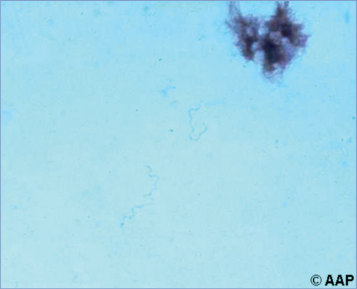

# 21. Borrelia Infections Other Than Lyme Disease (Relapsing Fever)
> Reference: [source credits](../../SOURCE_CREDITS.md). Printed pp. 89-92; PDF pp. 103-106.
> Editorial study pathway: Bacterial infections (not a part division in the source).
[Flashcards](../flashcards/021_flashcards.md) · [Quiz](../mcqs/021_mcqs.md) · [Full extraction](../../raw/chapters/021.md)

## Five study pillars

### Etiology and transmission
Worldwide, at least 14 Borrelia species cause tick-borne relapsing fever, including Borrelia hermsii, Borrelia turicatae, and (rarely) Borrelia parkeri in North America. Louse-borne relapsing fever is caused by Borrelia recurrentis.
*Printed p. 89 / PDF p. 103*

### Clinical recognition
Several types of relapsing fever infections occur in humans: tick-borne relapsing fever spread by softbodied ticks, louse-borne relapsing fever, and Borrelia miyamotoi infection, or hard tick relapsing fever, spread by hard-bodied ticks. Tick-borne and louse-borne relapsing fevers have many clinical similarities; B miyamotoi can cause an acute febrile illness but its clinical features are less well described.
*Printed p. 89 / PDF p. 103*

### Diagnostic workup
Diagnostic testing differs for tick-borne relapsing fever, louse-borne relapsing fever, and hard tick relapsing fever. In tick-borne and louse-borne relapsing fevers, because of the high degree of spirochetemia during febrile episodes, spirochetes may be observed microscopically using dark-field technique and in Wright-, Giemsa-, or acridine orange-stained preparations of thick and thin smears.
*Printed p. 90 / PDF p. 104*

### Treatment in the atlas
Treatment of tick-borne relapsing fever with a 10-day course of doxycycline typically results in prompt clearance of spirochetes and remission of symptoms. Doxycycline can be used regardless of patient age.
*Printed p. 91 / PDF p. 105*

### Prevention and infection control
Standard precautions are recommended. If louse infestation is present, contact precautions are indicated until delousing.
*Printed p. 91 / PDF p. 105*

## Clinical search tags
Fever, Petechiae / purpura, Lymphadenopathy, Cough, Pneumonia, Hepatitis / jaundice, Hepatosplenomegaly, Meningitis, Encephalitis / seizures, Arthritis / bone pain, Cytopenia, Congenital / neonatal, Immunocompromised host, Tick / arthropod exposure, Animal exposure, Travel / endemic setting

## Full text, original tables, and images

# 21. Borrelia Infections Other Than Lyme Disease (Relapsing Fever)
> Private study reference ([source credits](../../SOURCE_CREDITS.md)). PDF pages 103-106; printed pages 89-92.

## PDF page 103 | printed page 89

(Relapsing Fever)

### CLINICAL MANIFESTATIONS

Several types of relapsing fever infections occur in humans: tick-borne relapsing fever spread by softbodied ticks, louse-borne relapsing fever, and Borrelia miyamotoi infection, or hard tick relapsing fever, spread by hard-bodied ticks. Tick-borne and louse-borne relapsing fevers have many clinical similarities; B miyamotoi can cause an acute febrile illness but its clinical features are less well described. Both tick-borne relapsing fever and louse-borne relapsing fever are characterized by sudden onset of high fever, shaking chills, sweats, headache, muscle and joint pain, altered sensorium, and nausea. A fleeting macular rash of the trunk and petechiae of the skin and mucous membranes sometimes occur but are not common. Findings and complications can differ between types of relapsing fever and include hepatosplenomegaly, jaundice, thrombocytopenia, iridocyclitis, cough with pleuritic pain, pneumonitis, Bell’s palsy, meningitis, and myocarditis. Neurologic complications are more common with tick-borne relapsing fever and occur in 10% to 40% of cases. Mortality rates are 10% to 70% in untreated louseborne relapsing fever (possibly related to comorbidities and outbreaks associated with war, famine, and forced migration) and 4% to 10% in untreated tick-borne relapsing fever. Infection during pregnancy can result in spontaneous abortion, preterm birth, stillbirth, or neonatal infection with high perinatal mortality, as well as death of the pregnant individual. Fatal cases occur predominantly in infants, older adults, and people with underlying illnesses. Early treatment reduces mortality to less than 5%. Untreated, an initial febrile period (typically lasting 2 to 7 days for tick-borne and up to 10 for louse-borne) terminates spontaneously and is followed by an afebrile period of several days to weeks, then by 1 relapse or more. Relapses are more common with tick-borne disease, with generally ≥2 relapses (range: 0–13), than for louse-borne disease, with generally <2 relapses (range: 1–5). Relapses typically become shorter and progressively milder as afebrile periods lengthen. Relapse is associated with expression of

new borrelial antigens, and resolution of symptoms is associated with production of antibody specific to those new antigenic determinants.

B miyamotoi, the cause of hard tick relapsing fever, is phylogenetically similar to the agents of (soft) tick-borne and louse-borne relapsing fevers but appears to cause a wider spectrum of illness, varying from subclinical to severe. Symptoms are similar to those seen with Anaplasma phagocytophilum infection and include fever, chills, fatigue, myalgias, arthralgias, lymphadenopathy, and occasionally rash. Relapses can occur but are less common than in tick-borne and louse-borne relapsing fevers. Severe manifestations such as meningoencephalitis can occur and likely are more common in immunocompromised people.

### ETIOLOGY

Worldwide, at least 14 Borrelia species cause tick-borne relapsing fever, including Borrelia hermsii, Borrelia turicatae, and (rarely) Borrelia parkeri in North America. Louse-borne relapsing fever is caused by Borrelia recurrentis. B miyamotoi is the only species known to cause hard tick relapsing fever.

### EPIDEMIOLOGY

Because of differences in the distribution, life cycle, and feeding habits of their vector species, the epidemiology of tick-borne relapsing fever, louse-borne relapsing fever, and hard tick relapsing fever differ significantly. Tick-borne relapsing fever is transmitted through the bite of soft-bodied ticks (Ornithodoros species) and is distributed widely throughout the world. Soft-bodied ticks typically live within rodent nests. They become infected by feeding on rodents or other small mammals, and then transmit infection via their saliva during subsequent blood meals. They inflict painless bites and feed briefly (seconds to 30 minutes), usually at night, so that people often are unaware of having been bitten. In the United States, vector softbodied ticks are found most often in mountainous areas of the West. Human infection typically follows sleeping in rustic, rodent-infested cabins, although cases have been associated with primary residences and luxurious rental properties. Cases occur sporadically or in small clusters among families or cohabiting groups. Multistate outbreaks have been associated with travel to national parks,

## PDF page 104 | printed page 90

where numerous groups may cycle through an infested cabin. B hermsii is the most common cause of these infections. B turicatae infections occur less frequently; most cases have been reported from Texas and are associated with tick exposures in rodent-infested caves. Clinically apparent human infections with B parkeri in the United States are rare; the tick infected with this Borrelia species is associated with arid areas or grasslands in the western United States.

Louse-borne relapsing fever previously was widespread but currently is endemic in Ethiopia and occurs sporadically in surrounding countries; cases have been described in Western Europe in refugee and displaced populations originating from the horn of Africa. Epidemic transmission occurs when body lice (Pediculus humanus) become infected by feeding on humans with spirochetemia; infection is transmitted when infected lice are crushed and their body fluids contaminate a bite wound or skin abraded by scratching. No animal reservoir has been found for B recurrentis; human-to-human transmission occurs through infected lice.

The hard-bodied ticks Ixodes scapularis and Ixodes pacificus transmit B miyamotoi in North America. These ticks are better known as vectors of Lyme disease, anaplasmosis, and babesiosis; coinfections have been reported. Contact with Ixodes species that transmit B miyamotoi occurs through outdoor activity, especially in woody, brushy, or grassy areas in regions where Lyme disease is endemic. Unlike Lyme disease, B miyamotoi can be transmitted within the first 24 hours of tick attachment, and the probability of transmission increases with prolonged attachment. Most known cases of B miyamotoi infection have occurred in July or August, which is later than most Lyme disease cases. This suggests that B miyamotoi transmission occurs more often through the bite of larval, rather than nymphal, Ixodes ticks.

Unlike Borrelia burgdorferi, which must be acquired by feeding on an infected host, relapsing fever spirochetes can be transmitted transovarially in ticks; thus, larvae may be infected. Ticks in all stages of life may transmit B miyamotoi infection. The incubation period is about 7 days for tickborne relapsing fever, 4 to 8 days (range, 2–15 days) for louse-borne relapsing fever, and 12 to 16 days for hard tick relapsing fever.

### DIAGNOSTIC TESTS

Diagnostic testing differs for tick-borne relapsing fever, louse-borne relapsing fever, and hard tick relapsing fever. In tick-borne and louse-borne relapsing fevers, because of the high degree of spirochetemia during febrile episodes, spirochetes may be observed microscopically using dark-field technique and in Wright-, Giemsa-, or acridine orange-stained preparations of thick and thin smears. Organisms are visualized most easily in blood obtained during early febrile episodes before treatment. Direct detection using a nucleic acid amplification test (NAAT) is available at some commercial and reference laboratories and is more sensitive than microscopy, potentially allowing for detection during afebrile periods or in later relapses, when spirochetemia is lower. Serum antibodies to Borrelia species also can be detected by enzyme immunoassay or Western immunoblot analysis at some reference and commercial specialty laboratories. Serum tested early in infection may be negative, so it is important to obtain a serum sample for serologic testing during the convalescent period (at least 21 days after symptom onset); development of an immunoglobulin G response in the convalescent sample is supportive of a tick-borne relapsing fever diagnosis.

Hard tick relapsing fever attributable to B miyamotoi can be diagnosed using a NAAT with blood or cerebrospinal fluid or serologic tests performed on acute and convalescent specimens. These are not available widely but may be ordered from a limited number of commercial and reference laboratories.

In interpreting serologic tests for Borrelia infections, it is important to note that early antibiotic treatment may limit antibody response. Antibody tests are not standardized and do not distinguish among relapsing fever species. Serologic crossreactions can also occur with other spirochetes, including B burgdorferi, Treponema pallidum, and Leptospira species. Many NAATs also do not distinguish among relapsing fever species.

For inquiries about laboratory testing at the Centers for Disease Control and Prevention, visit www.cdc.gov/laboratory/specimensubmission/list.html.

## PDF page 105 | printed page 91

### TREATMENT

Treatment of tick-borne relapsing fever with a 10-day course of doxycycline typically results in prompt clearance of spirochetes and remission of symptoms. Doxycycline can be used regardless of patient age. Effective treatment with macrolide antibiotics, including erythromycin and azithromycin, also has been described. Intravenous beta-lactam antibiotics, such as penicillin or ceftriaxone, are preferred for treatment for pregnant people, when central nervous system involvement is present, in severe illness, or when oral therapy is not well tolerated.

Single-dose treatment using doxycycline or penicillin is effective for louse-borne relapsing fever in the majority of cases, but a longer treatment course is usually applied to minimize the probability of recurrence. Erythromycin or azithromycin may be considered as second-line agents.

Reports of successful treatment of hard tick relapsing fever using a 2-week course of doxycycline suggest this is adequate therapy. Amoxicillin, cefuroxime, and ceftriaxone also have been used or have shown in vitro susceptibility. Azithromycin also may be effective.

A Jarisch-Herxheimer reaction (an acute febrile reaction accompanied by headache, myalgia, respiratory distress in some cases, and a worsening of symptoms lasting less than 24 hours) can occur during the first few hours after initiating antimicrobial therapy for relapsing fever. Because this reaction sometimes is associated with transient hypotension attributable to decreased effective circulating blood volume, patients should be hospitalized and monitored closely, particularly during the first 4 hours of treatment.

### INFECTION PREVENTION AND CONTROL MEASURES IN HEALTH CARE SETTINGS:

Standard precautions are recommended. If louse infestation is present, contact precautions are indicated until delousing.

### CONTROL MEASURES

• Tick-borne relapsing fever: Soft-bodied ticks often can be found in rodent nests. Exposure is reduced most effectively by preventing rodent infestations of homes or cabins by blocking rodent access to foundations and attics and using other forms of rodent control. Dwellings infested with soft ticks should be rodentproofed and treated professionally with acaricides; rodent control without concurrent tick control may increase risk of infection transiently. In a single observational study from Israel, postexposure prophylaxis with singledose doxycycline appeared to be effective in preventing tick-borne relapsing fever among 77 spelunkers, 10 of whom were children, following a high-risk exposure.

• Louse-borne relapsing fever: When in a louseinfested environment, body lice can be controlled by bathing, washing clothing at frequent intervals, and use of pediculicides.

• Hard tick relapsing fever: Hard-bodied tick exposure can be limited through awareness and avoidance of tick habitat, use of Environmental Protection Agency-registered repellents, thorough and frequent tick checks of humans and pets, and bathing/showering soon after being outdoors. Attached ticks should be removed promptly.

Reporting suspected cases of relapsing fever to health authorities is required in many states and is important for initiation of prompt investigation and institution of control measures.

## PDF page 106 | printed page 92

Image 21.1 Borrelia in peripheral blood smear. The spirochetes can be observed with dark-field microscopy and in Wright-, Giemsa-, or acridine orange–stained smears.

Image 21.3 Dorsal view of a female head louse, Pediculus humanus capitis. The body louse, Pediculus humanus subspecies humanus, is the vector of 3 human pathogens: Rickettsia prowazekii, the agent of epidemic typhus; Borrelia recurrentis, the agent of relapsing fever; and Bartonella quintana, the agent of trench fever, bacillary angiomatosis, endocarditis, chronic bacteremia, and chronic lymphadenopathy. Courtesy of Centers for Disease Control and Prevention.

Image 21.2 This image depicts an adult female body louse, Pediculus humanus, and 2 larval young. P humanus has been shown to serve as a vector for diseases such as typhus, caused by Rickettsia prowazekii; trench fever, caused by Bartonella (formerly Rochalimaea) quintana; and relapsing fever, caused by Borrelia recurrentis. Courtesy of Centers for Disease Control and Prevention.

A B

Image 21.4 Ventral (A) and dorsal (B) views of Ornithodoros tholozani. Tick-borne relapsing fever is transmitted to humans by the Ornithodoros species soft ticks and is distributed widely throughout the world. This tick is prevalent in central Asia and the Middle East. Courtesy of Centers for Disease Control and Prevention/Emerging Infectious Diseases and Marc Victor Assous.

