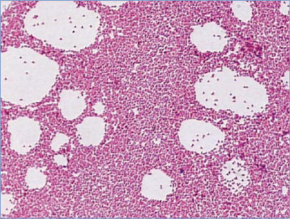

# 22. Brucellosis
> Reference: [source credits](../../SOURCE_CREDITS.md). Printed pp. 93-96; PDF pp. 107-110.
> Editorial study pathway: Bacterial infections (not a part division in the source).
[Flashcards](../flashcards/022_flashcards.md) · [Quiz](../mcqs/022_mcqs.md) · [Full extraction](../../raw/chapters/022.md)

## Five study pillars

### Etiology and transmission
Brucella bacteria are slow-growing, small, nonmotile, facultative intracellular gram-negative coccobacilli. The species that are commonly known to infect humans are Brucella abortus, Brucella melitensis, Brucella suis, and rarely, Brucella canis.
*Printed p. 93 / PDF p. 107*

### Clinical recognition
Onset of brucellosis in children can be acute or insidious. Manifestations are nonspecific and include fever (often undulating or cyclical), night sweats, weakness, malaise, anorexia, weight loss, arthralgia, myalgia, back pain, abdominal pain, headache, or refusal to bear weight.
*Printed p. 93 / PDF p. 107*

### Diagnostic workup
A definitive diagnosis is established by recovery of Brucella species from blood, bone marrow, or other tissue specimens. A variety of media will support growth of Brucella species, but the physician should contact laboratory personnel and ask that cultures be incubated for a minimum of 14 days.
*Printed p. 93 / PDF p. 107*

### Treatment in the atlas
Prolonged antimicrobial therapy is imperative for achieving a cure. Relapses generally are not associated with development of Brucella resistance but rather with premature discontinuation of therapy, localized infection, or monotherapy.
*Printed p. 94 / PDF p. 108*

### Prevention and infection control
In addition to standard precautions, contact precautions are indicated for patients with draining wounds. If aerosol-generating procedures are performed, respiratory protection (eg, use of N95 or higher respirators) also is indicated.
*Printed p. 95 / PDF p. 109*

## Clinical search tags
Fever, Lymphadenopathy, Pneumonia, Hepatitis / jaundice, Hepatosplenomegaly, Meningitis, Encephalitis / seizures, Weakness / paralysis, Arthritis / bone pain, Abscess / soft tissue, Anemia / hemolysis, Cytopenia, Immunocompromised host, Animal exposure, Travel / endemic setting

## Full text, original tables, and images

# 22. Brucellosis
> Private study reference ([source credits](../../SOURCE_CREDITS.md)). PDF pages 107-110; printed pages 93-96.

## PDF page 107 | printed page 93

### CLINICAL MANIFESTATIONS

Onset of brucellosis in children can be acute or insidious. Manifestations are nonspecific and include fever (often undulating or cyclical), night sweats, weakness, malaise, anorexia, weight loss, arthralgia, myalgia, back pain, abdominal pain, headache, or refusal to bear weight. Physical findings may include lymphadenopathy, hepatosplenomegaly, and arthritis. Abdominal pain and peripheral arthritis are reported more frequently in children than in adults. Meningitis, encephalitis, myelitis, radiculitis, neuropathies, and demyelinating syndromes have been reported. Diffuse hepatitis, hepatic granulomas, liver or spleen abscesses, epididymo-orchitis, pneumonia, lung nodules, pleural effusions, endocarditis, myocarditis, pericarditis, aortic aneurysms, uveitis, osteomyelitis, and cutaneous lesions have all been reported. Anemia, leukopenia, thrombocytopenia, or less frequently, pancytopenia and hemophagocytosis are hematologic findings that might suggest the diagnosis. The case fatality rate is less than 1%, and most deaths occur in children with endocarditis. A detailed history including travel, exposure to animals, food habits (including ingestion of unpasteurized milk or cheese), and occupational history should be obtained if brucellosis is considered. Chronic infection may last for years, and relapse following treatment of infection occurs in 5% to 15% of patients. Chronic disease is less common among children than among adults, although the rate of relapse has been found to be similar. Brucellosis in pregnancy is associated with risk of spontaneous abortion, stillbirth, or preterm delivery.

### ETIOLOGY

Brucella bacteria are slow-growing, small, nonmotile, facultative intracellular gram-negative coccobacilli. The species that are commonly known to infect humans are Brucella abortus, Brucella melitensis, Brucella suis, and rarely, Brucella canis. However, human infections with Brucella ceti, Brucella pinnipedialis, Brucella inopinata, and Brucella neotomae also have been identified. B abortus strain RB51 is a live attenuated cattle vaccine strain that can be shed in milk and can cause infections in humans.

### EPIDEMIOLOGY

Brucellosis is a zoonotic disease of wild and domestic animals. It is transmissible to humans by direct or indirect exposure to aborted fetuses, tissues, or fluids of infected animals. Transmission occurs by inoculation through mucous membranes or cuts and abrasions in the skin, inhalation of contaminated aerosols, ingestion of unpasteurized dairy products, or consumption of undercooked meats.1 People in occupations such as farming, ranching, and veterinary medicine, as well as abattoir workers, meat inspectors, and laboratory personnel, are at increased risk. Clinicians should alert the laboratory if they anticipate Brucella organisms might grow from microbiologic specimens so that appropriate laboratory precautions can be taken. In the United States, approximately 80 to 120 cases of brucellosis are reported annually, and 3% to 10% of cases occur in people younger than 19 years. Human-to-human transmission is rare. Transplacental transmission and transmission via human milk are possible. Other less common modes of transmission include blood transfusion, hematopoietic cell transplant, and sexual transmission. The number of cases in the United States has decreased considerably with routine animal vaccination and pasteurization of milk products.

The incubation period varies from 3 days to 12 months, but most people become ill within 2 to 4 weeks of exposure.

### DIAGNOSTIC TESTS

A definitive diagnosis is established by recovery of Brucella species from blood, bone marrow, or other tissue specimens. A variety of media will support growth of Brucella species, but the physician should contact laboratory personnel and ask that cultures be incubated for a minimum of 14 days. Newer blood culture systems can detect Brucella species within shorter periods. Caution should be taken with isolation of this organism because of the high risk of laboratory-acquired infection.

In patients with a clinically compatible illness, serologic testing using the serum agglutination test can confirm the diagnosis with a fourfold or greater increase in antibody titers between acute and convalescent phase serum specimens

## PDF page 108 | printed page 94

collected at least 2 weeks apart. The serum agglutination test, the gold standard test for serologic diagnosis, will detect antibodies against B abortus, B suis, and B melitensis but not against B canis or B abortus strain RB51. Although a single titer is not diagnostic, most patients with active infection in an area where brucellosis is not endemic will have a titer of 1:160 or greater within 2 to 4 weeks of clinical disease onset. Lower titers may be found early in the course of infection. Because of low sensitivity of some serologic assays, when results are negative but the clinical suspicion is high, testing should be repeated using a different assay. Enzyme immunoassay is a sensitive method for determining total or specific immunoglobulin (Ig) G, IgA, and IgM anti-Brucella antibody titers. The Centers for Disease Control and Prevention (CDC) recommends that positive enzyme immunoassay results be confirmed with an agglutination test.2

When interpreting serologic results, it is important to take into consideration exposure history, because a serologic response for B canis and B abortus strain RB51 will not be detected by commercially available tests. Brucella antibodies also cross-react with antibodies against other gram-negative bacteria, such as Yersinia enterocolitica serotype 09, Francisella tularensis, Escherichia coli O116 and O157, certain Salmonella species, Vibrio cholerae, Xanthomonas maltophilia, and Afipia clevelandensis. The timing of exposure and symptom development will assist in determining the classes of antibodies expected. IgM antibodies are produced within the first week, followed by a gradual increase in IgG antibodies. Low IgM titers may persist for months or years after initial infection. Increased concentrations of IgG agglutinins are found in acute infection, chronic infection, and relapse.

Nucleic acid amplification tests that can be performed on blood and body tissue samples have been developed and are available at the CDC. If a laboratory is not available to perform diagnostic testing for Brucella species, the physician should contact the local or state health department for assistance.

### TREATMENT

Prolonged antimicrobial therapy is imperative for achieving a cure. Relapses generally are not associated with development of Brucella resistance but

rather with premature discontinuation of therapy, localized infection, or monotherapy. Because monotherapy is associated with a high rate of relapse, combination therapy is recommended as standard treatment. Most combination regimens include oral doxycycline or trimethoprim-sulfamethoxazole plus rifampin.

Oral doxycycline is the drug of choice in persons 8 years of age and older, and should be administered together with oral rifampin for a minimum of 6 weeks. In children younger than 8 years, most data and experience support the use of trimethoprim-sulfamethoxazole administered together with oral rifampin for at least 6 weeks, although oral doxycycline plus rifampin is an alternative. An aminoglycoside can be used in place of rifampin (gentamicin for 7 days or streptomycin for 14 days), in combination with doxycycline or trimethoprim-sulfamethoxazole. Failure to complete the full 6-week course of therapy may result in relapse.

For treatment of serious infections or complications, including endocarditis, meningitis, spondylitis, and osteomyelitis, a 3-drug regimen should be used, with gentamicin included for the first 7 days of therapy in addition to doxycycline (or trimethoprim-sulfamethoxazole if doxycycline is not used) and rifampin, for a minimum of 6 weeks. For life-threatening complications of brucellosis, such as meningitis or endocarditis, the duration of therapy often is extended for 4 to 6 months. Surgical intervention should be considered in patients with complications, such as deep tissue abscesses, endocarditis, mycotic aneurysm, and foreign body infections. Joint effusions may need to be drained.

Because of antibiotic resistance with B abortus strain RB51, rifampin and penicillin should not be used for treatment of infection caused by this cattle vaccine strain (see Control Measures).

The benefit of corticosteroids for people with neurobrucellosis is unproven. Occasionally, a Jarisch- Herxheimer-like reaction (an acute febrile reaction accompanied by headache, myalgia, respiratory distress in some cases, and a worsening of symptoms lasting less than 24 hours) occurs shortly after initiation of antimicrobial therapy, but this reaction rarely is severe enough to require corticosteroids.

## PDF page 109 | printed page 95

### INFECTION PREVENTION AND CONTROL MEASURES IN HEALTH CARE SETTINGS

In addition to standard precautions, contact precautions are indicated for patients with draining wounds. If aerosol-generating procedures are performed, respiratory protection (eg, use of N95 or higher respirators) also is indicated.

### CONTROL MEASURES

The control of human brucellosis depends on control of transmission of Brucella species from cattle, goats, swine, elk, bison, and other animals. Vaccination of cattle, sheep, and goats can be effective but needs to be sustained over several years. Contact with infected animals should be avoided, especially female animals that have aborted or are giving birth.

Lactating parents with active brucellosis should not breastfeed their infants until their infection is cleared. Breastfeeding infants of a lactating parent who is diagnosed with brucellosis should be closely monitored for evidence of infection. Pasteurization of dairy products for human consumption as well as thorough cooking of meat

are important for preventing infection. The certification of unpasteurized milk does not eliminate the risk of transmission of Brucella organisms.

B abortus strain RB51 is a live attenuated cattle vaccine strain that can be shed in milk and can cause infections in humans. People who have consumed raw milk or raw milk products that are potentially contaminated with the live attenuated cattle vaccine strain B abortus strain RB51 are at high risk for brucellosis. For these people, postexposure prophylaxis with doxycycline plus trimethoprim-sulfamethoxazole is recommended for 21 days, in addition to symptom monitoring for 6 months following the last exposure. Because of antibiotic resistance with B abortus strain RB51, rifampin and penicillin should not be used (see https://emergency.cdc.gov/han/han00417. asp). Cases of brucellosis should be reported to the local health department.

1 American Academy of Pediatrics, Committee on Infectious Diseases, Committee on Nutrition. Consumption of raw or unpasteurized milk and milk products by pregnant women and children. Pediatrics. 2014;133(1):175–179 (Reaffirmed November 2019) 2 www.cdc.gov/brucellosis/pdf/brucellosi-reference-guide.pdf

## PDF page 110 | printed page 96

Image 22.1 A calcified Brucella granuloma in the spleen of a man with fever of several years’ duration. Brucella organisms that survive the action of polymorphonuclear leukocytes are ingested by macrophages and become localized in the organs of the reticuloendothelial system.

Image 22.2 Brucella species (Gram stain). Typical gram-negative coccobacilli. Courtesy of Robert Jerris, PhD.

Image 22.3 Brucella melitensis colonies. Brucella species colony characteristics: fastidious organism and colonies not usually visible at 24 hours. Brucella grows slowly on most standard laboratory media (eg, sheep blood, chocolate, and trypticase soy agars). Pinpoint, smooth, translucent, nonhemolytic colonies are shown at 48 hours of incubation. Courtesy of Centers for Disease Control and Prevention.

