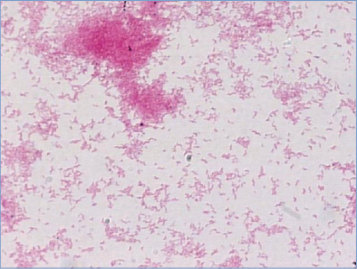
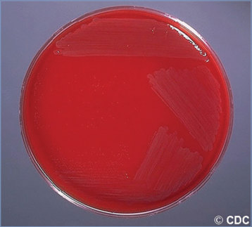

# 24. Campylobacter Infections
> Reference: [source credits](../../SOURCE_CREDITS.md). Printed pp. 101-103; PDF pp. 115-117.
> Editorial study pathway: Bacterial infections (not a part division in the source).
[Flashcards](../flashcards/024_flashcards.md) · [Quiz](../mcqs/024_mcqs.md) · [Full extraction](../../raw/chapters/024.md)

## Five study pillars

### Etiology and transmission
Campylobacter species are motile, commashaped, gram-negative bacilli that are associated with gastroenteritis. There are at least 25 species within the genus Campylobacter, but Campylobacter jejuni and Campylobacter coli are the species isolated most commonly from patients with diarrhea.
*Printed p. 101 / PDF p. 115*

### Clinical recognition
Predominant symptoms of Campylobacter infection include diarrhea, abdominal pain, malaise, and fever. Stools can contain visible or occult blood.
*Printed p. 101 / PDF p. 115*

### Diagnostic workup
C jejuni and C coli can be recovered from feces, and Campylobacter species, including C fetus, can be recovered from blood. Isolation of C jejuni and C coli from stool specimens requires selective media, microaerobic conditions, and an incubation temperature of 42°C.
*Printed p. 102 / PDF p. 116*

### Treatment in the atlas
Rehydration is the mainstay of treatment for all children with diarrhea. Most patients with Campylobacter diarrhea do not require antimicrobial therapy.
*Printed p. 102 / PDF p. 116*

### Prevention and infection control
In addition to standard precautions, contact precautions are recommended for diapered and incontinent children for the duration of illness.
*Printed p. 102 / PDF p. 116*

## Clinical search tags
Fever, Conjunctivitis, Diarrhea, Dysentery, Meningitis, Encephalitis / seizures, Arthritis / bone pain, Sepsis / shock, Congenital / neonatal, Immunocompromised host, Water exposure, Travel / endemic setting

## Full text, original tables, and images

# 24. Campylobacter Infections
> Private study reference ([source credits](../../SOURCE_CREDITS.md)). PDF pages 115-117; printed pages 101-103.

## PDF page 115 | printed page 101

### CLINICAL MANIFESTATIONS

Predominant symptoms of Campylobacter infection include diarrhea, abdominal pain, malaise, and fever. Stools can contain visible or occult blood. In neonates and young infants, bloody diarrhea without fever can be the only manifestation of infection. Febrile seizures may precede gastrointestinal tract symptoms in young children. Abdominal pain resulting from campylobacteriosis can mimic appendicitis or intussusception. Mild infection lasts 1 or 2 days and resembles viral gastroenteritis. Most patients recover in less than 1 week, but 10% to 20% have a relapse or a prolonged or severe illness. Severe or persistent infection can mimic acute inflammatory bowel disease. Bacteremia is uncommon but can occur in patients with underlying conditions. Immunocompromised hosts can have prolonged, relapsing, or extraintestinal infections, especially with Campylobacter fetus. Immunoreactive complications, such as Guillain-Barré syndrome (occurring in 1:1,000), Miller Fisher variant of Guillain-Barré syndrome (ophthalmoplegia, areflexia, ataxia), reactive arthritis (with the classic triad consisting of arthritis, urethritis, and bilateral conjunctivitis), myocarditis, pericarditis, and erythema nodosum, can occur during convalescence. Postinfectious irritable bowel syndrome can occur after campylobacteriosis.

### ETIOLOGY

Campylobacter species are motile, commashaped, gram-negative bacilli that are associated with gastroenteritis. There are at least 25 species within the genus Campylobacter, but Campylobacter jejuni and Campylobacter coli are the species isolated most commonly from patients with diarrhea. C fetus is predominantly associated with systemic illness in neonates and debilitated hosts. Other Campylobacter species, including Campylobacter lari, Campylobacter upsaliensis, and Campylobacter hyointestinalis, can result in similar diarrheal or systemic illnesses in children.

### EPIDEMIOLOGY

Although many cases go unidentified, Campylobacter species were associated with an estimated 19.5

laboratory-confirmed infections per 100,000 people in 2019, the highest incidence of bacterial foodborne infection in the United States. Although incidence decreased in the early 2000s, data from the Foodborne Diseases Active Surveillance Network indicated that in recent years, the incidence of reported infections increased, likely resulting from the increased use and sensitivity of culture-independent diagnostic tests (CIDTs). The highest rates of infection occur in children younger than 5 years. Most Campylobacter infections are acquired domestically, but up to 1 in 5 cases result from international travel. As few as 500 Campylobacter organisms can result in infection.

The gastrointestinal tracts of domestic and wild birds and animals are reservoirs of the bacteria. C jejuni and C coli have been isolated from feces of 30% to 100% of healthy chickens, turkeys, and waterfowl. Poultry carcasses commonly are contaminated. Many farm animals, pets, and meat sources can harbor the organism and are potential sources of infection. Most cases of Campylobacter infection are associated with consumption of undercooked poultry, meat, and other food that has been contaminated. Outbreaks of Campylobacter infection have been associated with unpasteurized dairy products, contaminated water, improperly cooked poultry, and produce.1 Transmission of C jejuni and C coli occurs by ingestion of contaminated food or water or by direct contact with fecal material from infected animals or people. Campylobacter infections usually are sporadic; outbreaks are rarely detected but have occurred among school-age participants on field trips to dairy farms where they consumed unpasteurized milk, and among people who had contact with pet store puppies (www.cdc.gov/ campylobacter/outbreaks/outbreaks.html). Person-to-person spread occurs occasionally, particularly among very young children, and risk is greatest during the acute phase of illness. Person-to-person transmission has occurred from infected birthing parents to neonates and has resulted in health care-associated outbreaks in nurseries. In perinatal infection, C jejuni and C coli usually cause neonatal gastroenteritis, whereas C fetus often causes neonatal septicemia or meningitis. Enteritis occurs in people of all ages. Excretion of Campylobacter organisms typically lasts 2 to 3 weeks without antimicrobial treatment but can occur for 7 weeks.

## PDF page 116 | printed page 102

The incubation period usually is 2 to 5 days but can be longer.

### DIAGNOSTIC TESTS

C jejuni and C coli can be recovered from feces, and Campylobacter species, including C fetus, can be recovered from blood. Isolation of C jejuni and C coli from stool specimens requires selective media, microaerobic conditions, and an incubation temperature of 42°C. Additional methods may be necessary to isolate other species of Campylobacter, such as hydrogen-rich microaerobic conditions and filter plating on media without antibiotic supplements. Notably, not all clinical laboratories identify Campylobacter to the species level; clinicians can consult state public health laboratories for further identification. Molecular and antigen CIDTs can provide rapid diagnostic testing; however, these tests will not produce an isolate to provide antibiotic susceptibilities. Falsepositive results from antigen-based tests have been reported. Molecular tests that detect bacterial DNA may not reflect viable organisms; therefore, clinical correlation is needed. Additionally, some diagnostics may not distinguish between C jejuni and C coli and may not detect other Campylobacter species. Referral of isolates and CIDT-positive specimens to state public health laboratories is based on state requirements. Molecular analysis of isolates is important for national Campylobacter surveillance and outbreak monitoring.

### TREATMENT

Rehydration is the mainstay of treatment for all children with diarrhea. Most patients with Campylobacter diarrhea do not require antimicrobial therapy. Antibiotics should be given in invasive cases of Campylobacter infection (eg, bacteremia) and can be considered in patients at risk for severe disease including the very young, elderly, or immunosuppressed. Macrolide antibiotics such as azithromycin and erythromycin shorten the duration of illness and excretion of the bacteria. Approximately 2% of C jejuni and 5% to 9% of C coli isolates are resistant to macrolides. Antimicrobials may prevent relapse when administered early in gastrointestinal tract infection. Treatment with azithromycin usually eradicates the organism from stool within 2 or 3 days. Fluoroquinolones, such as ciprofloxacin, may be

effective, but throughout the world, resistance to ciprofloxacin is common (up to 35% of C jejuni and C coli isolates in 2019 from the United States). C fetus generally is susceptible to aminoglycosides, extended-spectrum cephalosporins, meropenem, imipenem, ampicillin, and erythromycin. Regularly updated resistance information for C jejuni and C coli based on Centers for Disease Control and Prevention surveillance can be found at wwwn.cdc.gov/narmsnow/. Antimicrobial susceptibility testing of the isolate or epidemiologic data from the location of acquisition can help guide appropriate therapy. If antimicrobial therapy is administered for treatment of gastroenteritis, the recommended duration is 3 to 5 days. Antimotility agents are generally not recommended in children because of their limited benefit and reports of adverse outcomes in those who received these agents as monotherapy.

### INFECTION PREVENTION AND CONTROL MEASURES IN HEALTH CARE SETTINGS

In addition to standard precautions, contact precautions are recommended for diapered and incontinent children for the duration of illness.

### CONTROL MEASURES

• Hand hygiene should be performed after handling raw poultry and cutting boards, and utensils should be washed with soap and hot water after contact with raw poultry. Food preparation areas and cutting boards used for raw poultry should be separate from all other foods, especially fruits and vegetables.

• Poultry should be cooked thoroughly.

• Hand hygiene should be performed after contact with feces of dogs, cats, and farm animals.

• People should not drink raw milk.2 The certification of raw milk does not eliminate the risk of transmission of Campylobacter organisms.

• Chlorination of water supplies is important.

• People with diarrhea should be excluded from food handling, care of patients in hospitals, and care of people in custodial care and child care centers.

• Infected food handlers and hospital employees who are asymptomatic need not be excluded

## PDF page 117 | printed page 103

from work if proper personal hygiene measures, including hand hygiene, are maintained.

• People with diarrhea should not go into recreational water and should abstain from recreational water for 1 week after resolution of symptoms (or as advised by local public health authorities).

• Outbreaks of campylobacteriosis are uncommon in child care centers. General measures for interrupting enteric transmission in child care centers are recommended. Infants and children should be excluded from child care centers until either stools are contained in the diaper or, if the child is continent, when no longer having fecal accidents and stool frequency is no more than 2 stools above that child’s normal frequency, even if the stools remain loose. Although antibiotics are not generally

Image 24.1 Campylobacter jejuni (Gram stain) faintly staining short, curved, or spiral-shaped gram-negative rods from a culture of the organism. Courtesy of Robert Jerris, PhD.

recommended, azithromycin or erythromycin treatment may reduce the potential for person-to-person transmission.

• Diagnostic testing of asymptomatic exposed children is not recommended.

Public Health Reporting

Campylobacter infection is a nationally notifiable disease, and cases should be reported to local or state health departments.

1 American Academy of Pediatrics, Committee on Infectious Diseases, Committee on Nutrition. Consumption of raw or unpasteurized milk and milk products by pregnant women and children. Pediatrics. 2014;133(1):175–179 (Reaffirmed November 2019) 2 American Academy of Pediatrics, Committee on Infectious Diseases, Committee on Nutrition. Consumption of raw or unpasteurized milk and milk products by pregnant women and children. Pediatrics. 2014;133(1):175–179 (Reaffirmed November 2019)

Image 24.2 This image of a gram-stained specimen shows the spiral rods of Campylobacter fetus subspecies fetus taken from an 18-hour brain-heart infusion with a 7% addition of rabbit blood agar plate culture. Courtesy of Centers for Disease Control and Prevention.

Image 24.3 Blood agar plate culture of Campylobacter fetus subspecies intestinalis. C fetus causes prolonged, relapsing, or extraintestinal illness in immunocompromised hosts. During convalescence, C fetus infections have been associated with immunoreactive complications such as Guillain-Barré syndrome, reactive arthritis, and erythema nodosum. Courtesy of Centers for Disease Control and Prevention.

