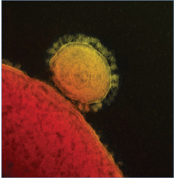
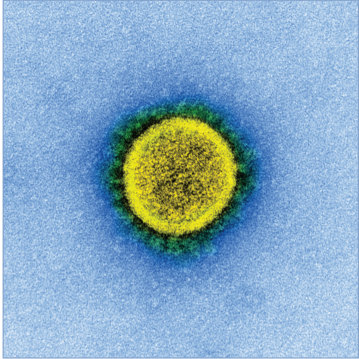

# 37. Coronaviruses, Including MERS-CoV and SARS-CoV-1
> Reference: [source credits](../../SOURCE_CREDITS.md). Printed pp. 175-178; PDF pp. 189-192.
> Editorial study pathway: Viral infections (not a part division in the source).
[Flashcards](../flashcards/037_flashcards.md) · [Quiz](../mcqs/037_mcqs.md) · [Full extraction](../../raw/chapters/037.md)

## Five study pillars

### Etiology and transmission
Coronaviruses are enveloped, nonsegmented, single-stranded, positive-sense RNA viruses named after their crown (or Latin “corona”)-like surface projections observed on electron microscopy that correspond to spike proteins. Coronaviruses are classified in the subfamily Orthocoronavirinae of the Coronaviridae family.
*Printed p. 175 / PDF p. 189*

### Clinical recognition
Human coronaviruses (HCoVs) 229E, OC43, NL63, and HKU1 are associated most frequently with an upper respiratory tract infection characterized by rhinorrhea, nasal congestion, sore throat, sneezing, and cough; fever may also occur. Symptoms are generally self-limited and typically peak on day 3 or 4 of illness.
*Printed p. 175 / PDF p. 189*

### Diagnostic workup
Multiplex assays for detection of respiratory pathogens by nucleic acid amplification are commercially available that include HCoVs 229E, OC43, NL63, HKU1, and SARS-CoV-2 as targets. Notably, multiple respiratory viruses can be detected concurrently in some patients and detection of HCoV does not always implicate it as the cause of a patient’s symptoms.
*Printed p. 176 / PDF p. 190*

### Treatment in the atlas
Infections attributable to HCoVs HKU1, OC43, 229E, and NL63 are treated with supportive care. Investigational therapy for MERS includes anti- MERS monoclonal antibodies.
*Printed p. 176 / PDF p. 190*

### Prevention and infection control
Airborne, droplet, and contact precautions are recommended for patients with suspected or known MERS-CoV infection (or SARS-CoV-1 infection if it reemerges). This includes eye protection (face shield or goggles), N95 or higher respirator (or medical mask if not available), gown, and gloves; for aerosol-generating procedures, an N95 or higher respirator should be used.
*Printed p. 176 / PDF p. 190*

## Clinical search tags
Fever, Cough, Pneumonia, Wheeze / bronchiolitis, Diarrhea, Vomiting, Cytopenia, Immunocompromised host

## Full text, original tables, and images

# 37. Coronaviruses, Including MERS-CoV and SARS-CoV-1
> Private study reference ([source credits](../../SOURCE_CREDITS.md)). PDF pages 189-192; printed pages 175-178.

## PDF page 189 | printed page 175

### CLINICAL MANIFESTATIONS

Human coronaviruses (HCoVs) 229E, OC43, NL63, and HKU1 are associated most frequently with an upper respiratory tract infection characterized by rhinorrhea, nasal congestion, sore throat, sneezing, and cough; fever may also occur. Symptoms are generally self-limited and typically peak on day 3 or 4 of illness. HCoV infections also may be associated with acute otitis media, croup, or asthma exacerbations. Less frequently, HCoVs are associated with lower respiratory tract infections, including bronchiolitis and pneumonia, primarily in younger patients or in those who are immunocompromised. Asymptomatic infections can occur.

MERS-CoV, the virus associated with the Middle East respiratory syndrome (MERS) that emerged in 2012, can cause severe disease, but asymptomatic infections and mild disease may also occur. Most cases have been identified in male adults with comorbidities. Infections in children are uncommon and typically are milder than in adults. Patients initially present with fever, myalgia, and chills followed by a nonproductive cough and dyspnea a few days later. Approximately 25% of patients may experience vomiting, diarrhea, or abdominal pain. Rapid deterioration of oxygenation with respiratory distress and progressive unilateral or bilateral airspace infiltrates on chest imaging may follow and may further progress to respiratory failure requiring mechanical ventilation. Acute kidney injury can also occur. The case fatality rate for MERS is high, estimated at approximately 35%, although this may partially reflect surveillance bias for more severe disease. Laboratory abnormalities may include thrombocytopenia, lymphopenia, and increased lactate dehydrogenase concentration, particularly among severely infected individuals.

Severe acute respiratory syndrome coronavirus 1 (SARS-CoV-1) was responsible for the 2002–2003 global outbreak of SARS, which was associated with severe respiratory symptoms, although a spectrum of disease including asymptomatic

infections and mild disease also occurred. Infections in children were generally less severe than in adults and typically presented with fever, cough, and rhinorrhea. Adolescents with SARS had clinical courses more closely resembling those of adult disease, presenting with fever, myalgia, headache, and chills. No deaths in children from SARS-CoV-1 infection were documented. The overall case fatality rate was 10% but was generally higher in older adults.

### ETIOLOGY

Coronaviruses are enveloped, nonsegmented, single-stranded, positive-sense RNA viruses named after their crown (or Latin “corona”)-like surface projections observed on electron microscopy that correspond to spike proteins. Coronaviruses are classified in the subfamily Orthocoronavirinae of the Coronaviridae family. Coronaviruses are generally host specific and can infect humans as well as a variety of different animals. Four distinct genera in the subfamily Orthocoronavirinae have been described: Alphacoronavirus, Betacoronavirus, Gammacoronavirus, and Deltacoronavirus. HCoVs 229E and NL63 belong to the genus Alphacoronavirus. HCoVs OC43 and HKU1 belong to lineage A, SARS-CoV-1 and SARS- CoV-2 belong to lineage B, and MERS-CoV belongs to lineage C of the genus Betacoronavirus.

### EPIDEMIOLOGY

HCoVs 229E, OC43, NL63, and HKU1 can be found worldwide. They typically cause disease in the winter and spring months in temperate climates. Seroprevalence data for these HCoVs suggest that exposure is common in early childhood, with approximately 90% of adults being seropositive for HCoVs 229E, OC43, and NL63 and 60% being seropositive for HCoV HKU1. The modes of transmission for HCoVs 229E, OC43, NL63, and HKU1 have not been well studied. However, on the basis of studies of other respiratory tract viruses, it is likely that transmission occurs primarily via a combination of droplet and direct and indirect contact spread. HCoVs 229E and OC43 are most likely to be transmitted during the first few days of illness, when symptoms and respiratory viral loads are at their highest.

## PDF page 190 | printed page 176

MERS-CoV likely evolved from bat coronaviruses and infected dromedary camels in parts of the Middle East and Africa, where serologic and molecular detection of MERS-CoV have been reported. MERS-CoV cases in humans continue mostly in the Middle East, primarily linked to close contact with camels or an infected person. Human-to-human transmission generally occurs in health care settings and less frequently in household settings. Transmission is thought to occur most commonly through droplet and contact spread, although airborne spread may occur. Updated figures on global cases can be found on the World Health Organization website (www. who.int/emergencies/mers-cov/en/).

SARS-CoV-1 likely evolved from a natural reservoir of SARS-CoV-like viruses in horseshoe bats through civet cats or other intermediate animal hosts in wet markets in China. Public health interventions ultimately aborted the epidemic. Human SARS-CoV-1 infection was last reported in 2004.

The incubation period for HCoV-229E is 2 to 5 days (median, 3 days). Further study is needed to confirm the incubation periods for HCoVs OC43, NL63, and HKU1. The incubation period for MERS-CoV is estimated to be 2 to 14 days (median, 5 days). The incubation period for SARS-CoV-1 is 2 to 14 days (typically 2–7 days).

### DIAGNOSTIC TESTS

Multiplex assays for detection of respiratory pathogens by nucleic acid amplification are commercially available that include HCoVs 229E, OC43, NL63, HKU1, and SARS-CoV-2 as targets. Notably, multiple respiratory viruses can be detected concurrently in some patients and detection of HCoV does not always implicate it as the cause of a patient’s symptoms. State public health departments should be contacted for evaluation of suspected cases of MERS-CoV using a nucleic acid amplification test. Guidance regarding testing for MERS-CoV (including specimen collection, typically upper respiratory, lower respiratory, and serum) is available on the Centers for Disease Control and Prevention MERS website (www. cdc.gov/coronavirus/mers/guidelinesclinical-specimens.html). State public health departments should be consulted for suspect cases of SARS-CoV-1.

### TREATMENT

Infections attributable to HCoVs HKU1, OC43, 229E, and NL63 are treated with supportive care. Investigational therapy for MERS includes anti- MERS monoclonal antibodies. A report of the combination of lopinavir-ritonavir plus subcutaneous interferon-beta-1b indicated clinical benefit, but further evaluation is needed. Remdesivir has activity against MERS-CoV and SARS-CoV-1 using in vitro systems and against SARS-CoV-1 in a mouse model. Remdesivir also has activity against SARS-CoV-2.

### INFECTION PREVENTION AND CONTROL MEASURES IN HEALTH CARE SETTINGS

Airborne, droplet, and contact precautions are recommended for patients with suspected or known MERS-CoV infection (or SARS-CoV-1 infection if it reemerges). This includes eye protection (face shield or goggles), N95 or higher respirator (or medical mask if not available), gown, and gloves; for aerosol-generating procedures, an N95 or higher respirator should be used. Airborne infection isolation rooms should be prioritized for aerosol-generating procedures. A well-ventilated single-occupancy room with a closed door may be used if aerosol-generating procedures are not performed.

For other HCoV infections, in addition to standard precautions, health care professionals should use droplet and contact precautions when examining and caring for infants and young children.

### CONTROL MEASURES

Practicing appropriate hand and respiratory hygiene can help curb spread of all respiratory tract viruses, including coronaviruses. Cleaning and disinfection of high-touch environmental surfaces using standard disinfectants should decrease the potential for indirect transmission of coronaviruses via fomites.

MERS-CoV transmission within hospitals and households can be averted with case identification and the use of infection control and public health measures, including contact tracing. However, preventing the transmission of MERS-CoV from camels to humans is more

## PDF page 191 | printed page 177

challenging, given the prevalent use of camels in some Middle East countries. Most experts believe that intermittent sporadic cases will continue because of zoonotic transmission. Several candidate vaccines are currently in trials for both humans and camels.

Image 37.1 Colorized scanning electron micrograph of Middle East respiratory syndrome virus particles (yellow) attached to the surface of an infected Vero E6 cell (blue). Image captured and color enhanced at the National Institute of Allergy and Infectious Diseases Integrated Research Facility in Fort Detrick in Frederick, Maryland.

Image 37.3 Colorized transmission electron micrograph of Middle East respiratory syndrome virus particles (blue) found near the periphery of an infected Vero E6 cell (yellow). Image captured and color enhanced at the National Institute of Allergy and Infectious Diseases Integrated Research Facility in Fort Detrick in Frederick, Maryland.

Public Health Reporting

Suspect cases of MERS or SARS-CoV-1 infection should be reported promptly to your state or local health department.

Image 37.2 Colorized scanning electron micrograph of Middle East respiratory syndrome virus particles (purple) attached to the surface of an infected Vero E6 cell (green). Image captured and color enhanced at the National Institute of Allergy and Infectious Diseases Integrated Research Facility in Fort Detrick in Frederick, Maryland.

Image 37.4 Transmission electron micrograph of Middle East respiratory syndrome coronavirus. Courtesy of National Institute of Allergy and Infectious Diseases.

## PDF page 192 | printed page 178

Image 37.5 Electron micrograph of a coronavirus. Pleomorphic virions average 100 nm in diameter and are covered with clubshaped knobs. Courtesy of National Institute of Allergy and Infectious Diseases.

Image 37.7 Note the coronaviruses contained within cytoplasmic membrane–bound vacuoles and cisternae of the rough endoplasmic reticulum. This thin-section electron micrograph of an infected Vero E6 cell reveals coronavirus particles. Courtesy of Centers for Disease Control and Prevention.

Image 37.6 Coronaviruses are a group of viruses that have a halo or crown-like (corona) appearance when viewed in an electron microscope. SARS-CoV-2, pictured, is the coronavirus that is the etiologic agent of the COVID-19 pandemic. Additional specimens are being tested to learn more about this coronavirus. Courtesy of National Institute of Allergy and Infectious Diseases.

