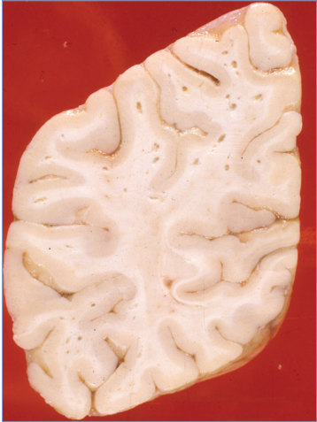
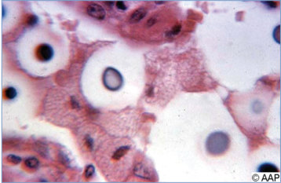
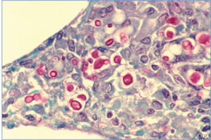

# 38. Cryptococcus neoformans and Cryptococcus gattii Infections (Cryptococcosis)
> Reference: [source credits](../../SOURCE_CREDITS.md). Printed pp. 179-182; PDF pp. 193-196.
> Editorial study pathway: Fungal infections (not a part division in the source).
[Flashcards](../flashcards/038_flashcards.md) · [Quiz](../mcqs/038_mcqs.md) · [Full extraction](../../raw/chapters/038.md)

## Five study pillars

### Etiology and transmission
There are more than 30 species of Cryptococcus, but only 2, Cryptococcus neoformans species complex and Cryptococcus gattii species complex, are regarded as consistent human pathogens. These 2 species have been divided into approximately 10 genotypes or sibling species but clinically are referred to together as cryptococcosis.
*Printed p. 179 / PDF p. 193*

### Clinical recognition
Primary pulmonary infection is acquired by inhalation of aerosolized Cryptococcus fungal propagules found in contaminated soil or organic material (eg, trees, rotting wood, and bird guano), and infection often is asymptomatic or mild. When symptomatic, pulmonary disease is characterized by cough, chest pain, and constitutional symptoms.
*Printed p. 179 / PDF p. 193*

### Diagnostic workup
The cerebrospinal fluid (CSF) profile of cryptococcal meningoencephalitis is characterized by low cell counts, low glucose, and elevated protein. Opening pressure may be markedly elevated, especially in HIV-infected individuals.
*Printed p. 180 / PDF p. 194*

### Treatment in the atlas
Practice management guidelines for cryptococcal disease are available.1,2,3 No pediatric trials have been performed, so optimal dosing and duration of therapy for children with cryptococcal infection have not been determined precisely. C neoformans and C gattii infections are treated similarly.
*Printed p. 180 / PDF p. 194*

### Prevention and infection control
Standard precautions are recommended.
*Printed p. 181 / PDF p. 195*

## Clinical search tags
Fever, Cough, Pneumonia, Meningitis, Encephalitis / seizures, Congenital / neonatal, Immunocompromised host

## Full text, original tables, and images

# 38. Cryptococcus neoformans and Cryptococcus gattii Infections (Cryptococcosis)
> Private study reference ([source credits](../../SOURCE_CREDITS.md)). PDF pages 193-196; printed pages 179-182.

## PDF page 193 | printed page 179

(Cryptococcosis)

### CLINICAL MANIFESTATIONS

Primary pulmonary infection is acquired by inhalation of aerosolized Cryptococcus fungal propagules found in contaminated soil or organic material (eg, trees, rotting wood, and bird guano), and infection often is asymptomatic or mild. When symptomatic, pulmonary disease is characterized by cough, chest pain, and constitutional symptoms. Chest radiographs may reveal solitary or multiple masses; patchy, segmental, or lobar consolidation, which often is multifocal; or a nodular or reticulonodular pattern with interstitial changes. Pulmonary cryptococcosis may present as acute respiratory distress syndrome and can mimic Pneumocystis pneumonia. Hematogenous dissemination occurs particularly to the central nervous system (CNS) but also to bones, skin, and other body sites. Disseminated cryptococcosis is generally rare in children and almost always occurs in children with defects in T-lymphocyte–mediated immunity, including children with leukemia or lymphoma, those taking corticosteroids, children with congenital immunodeficiency such as hyperimmunoglobulin M syndrome or severe combined immunodeficiency syndrome, those with acquired immunodeficiency syndrome (AIDS) from advanced human immunodeficiency virus (HIV) infection, or those who have undergone solid organ transplantation. Several anatomic sites usually are infected, but manifestations of involvement at one site predominate. Cryptococcal meningitis, the most common and serious form of cryptococcal disease in children, often follows an indolent course but symptoms can be more acute in severely immunosuppressed patients. Symptoms are often typical of those of meningitis, meningoencephalitis, or space-occupying lesions but sometimes manifest only as subtle, nonspecific findings such as fever, headache, or behavioral changes. Cryptococcal fungemia without apparent organ involvement occurs in patients with HIV infection but is rare in children.

### ETIOLOGY

There are more than 30 species of Cryptococcus, but only 2, Cryptococcus neoformans species complex and Cryptococcus gattii species complex, are regarded as consistent human pathogens. These 2 species have been divided into approximately 10 genotypes or sibling species but clinically are referred to together as cryptococcosis. Further taxonomic studies and disease correlations are anticipated in the future to aid in understanding the clinical relevance of these groups.

### EPIDEMIOLOGY

C neoformans species complex is isolated primarily from soil contaminated with pigeon or other bird droppings and causes most human infections, especially infections in immunocompromised hosts. C neoformans infects 5% to 10% of adults with AIDS, but cryptococcal disease is rare in HIV-infected and non–HIV-infected children. C gattii species complex is associated with certain trees and the surrounding soil and has emerged as disease manifesting as a respiratory syndrome with or without neurologic findings in individuals from British Columbia, Canada, and the Pacific Northwest region of the United States, but primarily as meningitis and meningoencephalitis in other regions of the United States. A high frequency of disease also has been reported in Aboriginal people in Australia and in the central province of Papua New Guinea. C gattii causes disease in both immunocompetent and immunocompromised individuals, and cases have been reported in children. Person-to-person transmission generally does not occur with cryptococcal species; although rare, transmission from donor organ and tissue grafts has been reported. The prevalence of cryptococcal disease is lower in children compared with adults and even less in children younger than 6 years compared with older children.

The incubation period for C neoformans is unknown but likely variable; dissemination often represents reactivation of latent disease acquired previously. The incubation period for C gattii is estimated at 8 weeks to 13 months based on outbreak investigations, but these figures also are imprecise.

## PDF page 194 | printed page 180

### DIAGNOSTIC TESTS

The cerebrospinal fluid (CSF) profile of cryptococcal meningoencephalitis is characterized by low cell counts, low glucose, and elevated protein. Opening pressure may be markedly elevated, especially in HIV-infected individuals. Laboratory diagnosis of cryptococcal infection is best performed using cryptococcal antigen (CrAg) detection methods or by culture. The latex agglutination test, lateral flow immunoassay, and enzyme immunoassay for detection of cryptococcal capsular polysaccharide antigen (galactoxylomannan) in serum or CSF specimens are excellent rapid diagnostic tests in patients with suspected meningitis. CrAg is detected in CSF or serum specimens from more than 95% of patients with cryptococcal meningitis. Antigen test results can be falsely negative when antigen concentrations are very high (prozone effect), which can be addressed by dilution of samples. CrAg assays are less useful in following response to therapy than they are in diagnosis, because CrAg can remain high even after viable yeasts can no longer be detected. Accuracy, ease of use, and cost have made the lateral flow immunoassay, which shows good agreement with standard CrAg testing, a common test in both resource-abundant and resource-limited settings and has allowed preemptive management strategies for adults in areas with high incidence of HIV infection.

Definitive diagnosis requires isolation of the yeast from body fluid or tissue specimens. Encapsulated yeast cells can be visualized using India ink or other stains of CSF and bronchoalveolar lavage specimens, but this method has limited sensitivity and is not recommended as a stand-alone rapid test. CSF specimens may contain only a few yeast cells, and a large quantity of CSF may be needed to recover organisms in culture. Automated blood culture systems are acceptable for growing Cryptococcus. Sabouraud dextrose agar is useful for isolation of Cryptococcus organisms from sputum, bronchopulmonary lavage, tissue, or CSF specimens. Differentiation between C neoformans species complex and C gattii species complex can be made by the use of the selective medium L-canavanine, glycine, bromothymol blue agar. A matrix-assisted laser desorption/ionization–timeof-flight mass spectrometer can identify yeasts to species complex level accurately and rapidly.

Nucleic acid amplification tests are commercially available but may miss low burden cryptococcal CNS system infections. Focal pulmonary or skin lesions can be biopsied for fungal staining and culture. Although there are Clinical Laboratory Improvement Amendments of 1988 standards for in vitro cryptococcal susceptibility testing, there are no break point minimum inhibitory concentration (MIC) interpretations; therefore, generally, a threefold increase in MIC from original to relapse isolate is evidence for direct resistance.

### TREATMENT

Practice management guidelines for cryptococcal disease are available.1,2,3 No pediatric trials have been performed, so optimal dosing and duration of therapy for children with cryptococcal infection have not been determined precisely. C neoformans and C gattii infections are treated similarly. Amphotericin B deoxycholate (1 mg/kg/day) or liposomal amphotericin B (5–6 mg/kg/day) are indicated in combination with oral flucytosine (25 mg/kg/dose, 4 times/day when renal function is normal) as first-line induction therapy for pediatric patients with meningeal and/or other serious cryptococcal infections. Among HIV-positive adults with cryptococcal meningitis, induction with a single high dose of parenteral liposomal amphotericin B (10 mg/kg) plus 14 days of oral flucytosine (100 mg/kg/day) and oral fluconazole (1,200 mg/day) demonstrated noninferiority to parenteral amphotericin B deoxycholate (1 mg/kg/ day) plus oral flucytosine (100 mg/kg/day) for 7 days, followed by oral fluconazole (1,200 mg/ day) for 7 days. Frequent monitoring of blood counts and/or serum peak flucytosine concentrations (with a target of 40 to 60 μg/mL 2 hours after the dose) are recommended to prevent neutropenia. If flucytosine cannot be administered, amphotericin B alone has been successfully used in pediatric cryptococcosis, or amphotericin B can be combined with fluconazole for the induction phase of therapy. Ideally, a lumbar puncture should be performed after 2 weeks of therapy to document microbiologic clearance. Patients in whom culture is positive after 2 weeks of therapy will require a more prolonged induction treatment course.

Patients with meningitis should receive induction combination therapy for at least 2 weeks and until a repeat CSF culture is negative, followed by

## PDF page 195 | printed page 181

consolidation therapy with fluconazole (10–12 mg/kg/day; maximum 800 mg per day) for a minimum of 8 weeks.

For any relapse, primary induction antifungal therapy should be restarted for 4 to 10 weeks, CSF cultures should be repeated every 2 weeks until sterile, and antifungal susceptibility of the relapse isolate should be determined and compared with the original isolate. Monitoring of serum CrAg is not useful to determine response to therapy in patients with cryptococcal meningitis.

Increased intracranial pressure occurs frequently despite microbiologic response and often is associated with clinical deterioration. Significant elevation of intracranial pressure is a major source of morbidity and should be managed with frequent repeated lumbar punctures or placement of a lumbar drain in those with high intracranial pressures and symptoms. Immune reconstitution inflammatory syndrome (IRIS) is described in children, and although there are no guidelines for specific management of IRIS in children, a patient should be monitored closely for signs and symptoms associated with symptomatic CNS IRIS and a steroid taper should be considered for management. In antiretroviral-naïve HIV-infected patients with newly diagnosed cryptococcal meningitis or disseminated disease, delay in potent antiretroviral therapy (ART) is recommended until the end of the first 2 weeks of induction therapy; further delays in initiating combined ART, especially in resource-limited settings, should be individualized.4

Children with HIV infection who have completed initial therapy for cryptococcosis should receive long-term (at least 1 year) secondary prophylaxis therapy with fluconazole (6 mg/kg daily; maximum dose 200 mg). The safety of discontinuing secondary prophylaxis for cryptococcosis after immune reconstitution with combined ART has not been studied in children. However, on the basis of adult data and experience, discontinuing suppressive/maintenance therapy for cryptococcosis (after receiving secondary prophylaxis for at least 1 year) can be considered for asymptomatic children ≥ 6 years of age, with increase in their CD4+ T-lymphocyte counts to ≥100 cells/mm3

and an undetectable viral load after receiving ART for ≥3 months.5 Secondary prophylaxis therapy should be reinitiated if the CD4+ T-lymphocyte count decreases to <100 cells/mm3. Most experts would not discontinue secondary prophylaxis for patients younger than age 6 years and thus individualized management plans need to be made.

Patients with less severe nonmeningeal disease (pulmonary disease) can be treated with fluconazole alone, but data on use of fluconazole for children with C neoformans infection are limited; itraconazole is a potential alternative. Another potential treatment option for patients in whom amphotericin B treatment is not possible is combination therapy with fluconazole and flucytosine; this combination has superior effectiveness compared with fluconazole alone for severe disease. Echinocandins are not active against cryptococcal infections and should not be used.

### INFECTION PREVENTION AND CONTROL MEASURES IN HEALTH CARE SETTINGS

Standard precautions are recommended.

### CONTROL MEASURES

None.

1 Perfect J, Dismukes WE, Dromer F, et al. Clinical practice guidelines for the management of cryptococcal disease: 2010 update by the Infectious Diseases Society of America. Clin Infect Dis. 2010;50(3):291–322 2 Panel on Opportunistic Infections in HIV-Exposed and HIV-Infected Children. Guidelines for the Prevention and Treatment of Opportunistic Infections in Children with and Exposed to HIV. Available at: https://clinicalinfo.hiv.gov/ en/guidelines/hiv-clinical-guidelines-pediatricopportunistic-infections/whats-new 3 World Health Organization. Guidelines for diagnosing, preventing, and managing cryptococcal disease among adults, adolescents and children living with HIV. Available at: www.who.int/publications/i/item/9789240052178 4 Panel on Opportunistic Infections in HIV-Exposed and HIV-Infected Children. Guidelines for the Prevention and Treatment of Opportunistic Infections in Children with and Exposed to HIV. Available at: https://clinicalinfo.hiv.gov/ en/guidelines/hiv-clinical-guidelines-pediatricopportunistic-infections/whats-new 5 Panel on Opportunistic Infections in HIV-Exposed and HIV-Infected Children. Guidelines for the Prevention and Treatment of Opportunistic Infections in Children with and Exposed to HIV. Available at: https://clinicalinfo.hiv.gov/ en/guidelines/hiv-clinical-guidelines-pediatricopportunistic-infections/whats-new

## PDF page 196 | printed page 182

Image 38.1 Cryptococcosis of lung in a patient with AIDS (methenamine silver stain). Histopathologic features of lung show numerous extracellular yeasts of Cryptococcus neoformans within an alveolar space. Yeasts show narrow-base budding and characteristic variation in size. Courtesy of Centers for Disease Control and Prevention.

Image 38.3 Cryptococcosis of the liver (original magnification ×810) in a patient with immunodeficiency and disseminated disease. The mucinous capsules are prominent. Courtesy of Edgar O. Ledbetter, MD, FAAP.

Image 38.5 This photomicrograph depicts Cryptococcus neoformans observable with a light India ink staining preparation. Courtesy of Centers for Disease Control and Prevention.

Image 38.2 Cryptococcus meningitis. Cystic lesions resulting from accumulation of organisms in perivascular spaces. Courtesy of Dimitris P. Agamanolis, MD.

Image 38.4 Cryptococcosis of lung in a patient with AIDS (mucicarmine stain). Histopathologic features of lung show widened alveolar septum containing a few inflammatory cells and numerous yeasts of Cryptococcus neoformans. The inner layer of the yeast capsule stains red. Courtesy of Centers for Disease Control and Prevention/Edwin P. Ewing Jr, MD.

