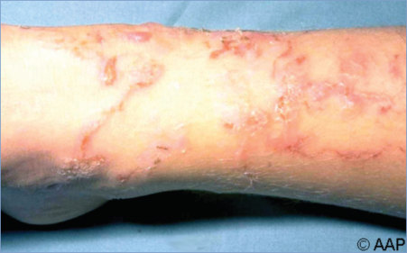
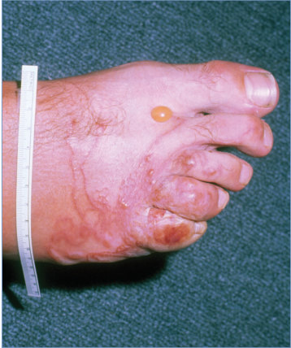
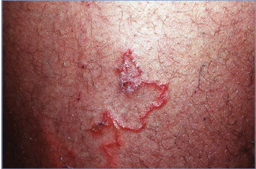
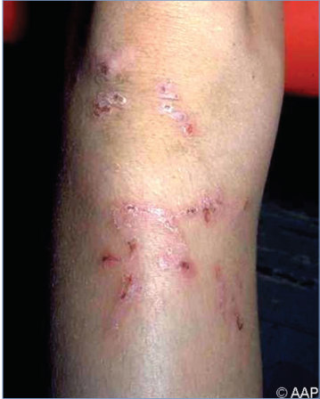

# 40. Cutaneous Larva Migrans
> Reference: [source credits](../../SOURCE_CREDITS.md). Printed pp. 189-191; PDF pp. 203-205.
> Editorial study pathway: Helminths and ectoparasites (not a part division in the source).
[Flashcards](../flashcards/040_flashcards.md) · [Quiz](../mcqs/040_mcqs.md) · [Full extraction](../../raw/chapters/040.md)

## Five study pillars

### Etiology and transmission
Infective larvae of cat and dog hookworms (most often Ancylostoma braziliense, also Ancylostoma caninum, Ancylostoma ceylanicum, and Uncinaria stenocephala) cause cutaneous larva migrans. Other skin-penetrating nematodes can cause similar pruritic serpiginous skin rashes (eg, larva currens caused by Strongyloides species and “ground itch” of Necator americanus).
*Printed p. 189 / PDF p. 203*

### Clinical recognition
Cutaneous larva migrans refers to a classic skin rash caused by zoonotic hookworms. It is a clinical diagnosis based on advancing serpiginous tracks in the skin with associated intense pruritus.
*Printed p. 189 / PDF p. 203*

### Diagnostic workup
The diagnosis is made clinically, and biopsies are not indicated. Biopsy specimens typically demonstrate an eosinophilic inflammatory infiltrate, but the migrating parasite is not visualized.
*Printed p. 189 / PDF p. 203*

### Treatment in the atlas
The disease usually is self-limited with spontaneous cure after several weeks, but treatment can decrease symptoms and hasten their resolution. Orally administered albendazole or ivermectin is the recommended therapy.
*Printed p. 189 / PDF p. 203*

### Prevention and infection control
Standard precautions are recommended.
*Printed p. 189 / PDF p. 203*

## Clinical search tags
Pruritus, Eosinophilia, Animal exposure, Travel / endemic setting

## Full text, original tables, and images

# 40. Cutaneous Larva Migrans
> Private study reference ([source credits](../../SOURCE_CREDITS.md)). PDF pages 203-205; printed pages 189-191.

## PDF page 203 | printed page 189

### CLINICAL MANIFESTATIONS

Cutaneous larva migrans refers to a classic skin rash caused by zoonotic hookworms. It is a clinical diagnosis based on advancing serpiginous tracks in the skin with associated intense pruritus. Certain zoonotic nematode larvae may penetrate intact skin and produce pruritic, reddish papules at the site of skin entry. Humans usually are “dead-end” hosts for these parasites, and the larvae are unable to progress beyond the skin and eventually die. As the larvae migrate through skin, advancing up to 20 millimeters per day, intensely pruritic serpiginous tracks are formed, a condition also referred to as creeping eruption. Bullae may develop later as a complication of the larval migration. Larval activity can continue for several weeks, but the infection typically is selflimiting. Rarely complications such as Loeffler (also spelled Löffler) syndrome (pulmonary infiltration with peripheral eosinophilia) have been reported.

### ETIOLOGY

Infective larvae of cat and dog hookworms (most often Ancylostoma braziliense, also Ancylostoma caninum, Ancylostoma ceylanicum, and Uncinaria stenocephala) cause cutaneous larva migrans. Other skin-penetrating nematodes can cause similar pruritic serpiginous skin rashes (eg, larva currens caused by Strongyloides species and “ground itch” of Necator americanus).

### EPIDEMIOLOGY

Cutaneous larva migrans is a disease of children, utility workers, gardeners, sunbathers, and others who come in contact with soil or sand contaminated with cat and dog feces. Locally acquired cases in the United States are mostly in the Southeast. Most U.S. cases are not acquired locally but occur among travelers to tropical and

subtropical regions, particularly those who have walked barefoot or have had unprotected skin contact on beaches.

The incubation period typically is short, with signs and symptoms developing several days after larval penetration of the skin. Rarely, onset may be weeks to months after exposure.

### DIAGNOSTIC TESTS

The diagnosis is made clinically, and biopsies are not indicated. Biopsy specimens typically demonstrate an eosinophilic inflammatory infiltrate, but the migrating parasite is not visualized. Eosinophilia and increased immunoglobulin E serum concentrations occur in some cases. Enzyme immunoassay or Western blot analysis using antigens of A caninum have been developed in research laboratories, but these assays are not available for routine diagnostic use.

### TREATMENT

The disease usually is self-limited with spontaneous cure after several weeks, but treatment can decrease symptoms and hasten their resolution. Orally administered albendazole or ivermectin is the recommended therapy. Repeated application of topical 10% albendazole may be useful in young children who cannot take oral medication, but it is not available commercially and must be formulated at a pharmacy. Outside the United States, topical thiabendazole has also been used successfully for treatment of localized larvae.

### INFECTION PREVENTION AND CONTROL MEASURES IN HEALTH CARE SETTINGS

Standard precautions are recommended.

### CONTROL MEASURES

Skin contact with moist soil or sand contaminated with animal feces should be avoided. Beaches should be kept free of dog and cat feces. Regular veterinary care of dogs and cats is recommended.

## PDF page 204 | printed page 190

Image 40.1 Cutaneous larva migrans lesions on the leg (caused by hookworm larvae of Ancylostoma braziliense and Ancylostoma caninum).

Image 40.2 Cutaneous larva migrans lesions of the foot of a 10-year-old. In the United States, this dog and cat hookworm infection is most commonly encountered in the Southeast. These raised, serpiginous, pruritic, migrating eruptions may extend rapidly. Copyright Gary Williams, MD.

Image 40.3 Cutaneous larva migrans infection of the foot in an adolescent. Courtesy of George Nankervis, MD.

## PDF page 205 | printed page 191

Image 40.4 Adult who noted a migrating skin lesion on the left thigh for 2 weeks. Copyright Larry I. Corman.

Image 40.5 Cutaneous larva migrans 48 hours after treatment. Orally administered albendazole or ivermectin is the recommended therapy.

