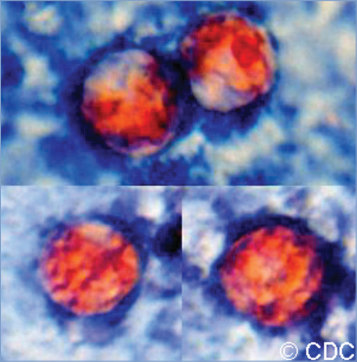

# 41. Cyclosporiasis
> Reference: [source credits](../../SOURCE_CREDITS.md). Printed pp. 192-194; PDF pp. 206-208.
> Editorial study pathway: Protozoal infections (not a part division in the source).
[Flashcards](../flashcards/041_flashcards.md) · [Quiz](../mcqs/041_mcqs.md) · [Full extraction](../../raw/chapters/041.md)

## Five study pillars

### Etiology and transmission
Cyclospora cayetanensis is a coccidian protozoan; oocysts (rather than cysts) are passed in stools and must then sporulate before they are infectious. In the laboratory, sporulation occurs at temperatures between 22°C and 32°C for 1 to 2 weeks; the exact conditions that support sporulation in the natural environment are unknown.
*Printed p. 192 / PDF p. 206*

### Clinical recognition
Watery diarrhea is the most common symptom of cyclosporiasis and can be profuse and protracted. Anorexia, nausea, substantial weight loss, flatulence, abdominal cramping and bloating, and prolonged fatigue can occur.
*Printed p. 192 / PDF p. 206*

### Diagnostic workup
Diagnosis is made by identification of oocysts (8–10 mm in diameter) in stool, intestinal fluid/ aspirates, or intestinal biopsy specimens. Oocysts may be shed in low concentrations, even by people with profuse diarrhea.
*Printed p. 192 / PDF p. 206*

### Treatment in the atlas
Trimethoprim-sulfamethoxazole, typically for 7 to 10 days, is the drug of choice; immunocompromised patients may need longer courses of therapy. No highly effective alternatives have been identified for people who cannot tolerate trimethoprimsulfamethoxazole (www.cdc.gov/parasites/ cyclosporiasis/health_professionals/ tx.html), but case reports suggest that nitazoxanide might be an effective alternative for patients who cannot tolerate sulfa drugs.
*Printed p. 192 / PDF p. 206*

### Prevention and infection control
In addition to standard precautions, contact precautions are recommended for diapered or incontinent persons.
*Printed p. 192 / PDF p. 206*

## Clinical search tags
Fever, Diarrhea, Vomiting, Water exposure, Travel / endemic setting

## Full text, original tables, and images

# 41. Cyclosporiasis
> Private study reference ([source credits](../../SOURCE_CREDITS.md)). PDF pages 206-208; printed pages 192-194.

## PDF page 206 | printed page 192

### CLINICAL MANIFESTATIONS

Watery diarrhea is the most common symptom of cyclosporiasis and can be profuse and protracted. Anorexia, nausea, substantial weight loss, flatulence, abdominal cramping and bloating, and prolonged fatigue can occur. Low-grade fever occurs in approximately 50% of patients and vomiting, body aches, headaches, and other influenza-like symptoms also may occur. Biliary tract disease has been reported. Infection usually is self-limited, but untreated people may have remitting, relapsing symptoms for weeks to months. Asymptomatic infection has been documented, most commonly in settings where cyclosporiasis is endemic.

### ETIOLOGY

Cyclospora cayetanensis is a coccidian protozoan; oocysts (rather than cysts) are passed in stools and must then sporulate before they are infectious. In the laboratory, sporulation occurs at temperatures between 22°C and 32°C for 1 to 2 weeks; the exact conditions that support sporulation in the natural environment are unknown.

### EPIDEMIOLOGY

C cayetanensis is endemic in many resource-limited countries and has been reported as a cause of travelers’ diarrhea. Foodborne and waterborne outbreaks have been reported. Most outbreaks in the United States and Canada for which a food vehicle and its source have been identified have been associated with consumption of imported fresh produce (eg, basil, cilantro, raspberries, sugar snap peas, lettuce). There has been a trend in the United States of seasonal increases in reported cases from May through August in recent years; many cases occur among people without a history of international travel. Recent increases in case numbers reported in the United States might be attributable, in part, to increased use of commercially available molecular testing panels.

Humans are the only known hosts for C cayetanensis. Direct person-to-person transmission is unlikely because excreted oocysts take at least 1 to 2 weeks (estimated) under favorable environmental conditions to sporulate and become infective. Oocysts are resistant to most disinfectants

used in food and water processing and can remain viable for prolonged periods in cool, moist environments.

The incubation period typically is 1 week but can range from 2 days to 2 weeks or more.

### DIAGNOSTIC TESTS

Diagnosis is made by identification of oocysts (8–10 mm in diameter) in stool, intestinal fluid/ aspirates, or intestinal biopsy specimens. Oocysts may be shed in low concentrations, even by people with profuse diarrhea. This constraint underscores the utility of repeated stool examinations, sensitive recovery methods (eg, concentration procedures including formalin-ethyl acetate sedimentation or sucrose centrifugal flotation), and detection methods that highlight the organism. Oocysts are autofluorescent and are variably acid fast after modified acid-fast staining of stool specimens. Molecular diagnostic assays (eg, nucleic acid amplification tests) are available commercially as part of a multiplex gastrointestinal panel and at the Centers for Disease Control and Prevention.

### TREATMENT

Trimethoprim-sulfamethoxazole, typically for 7 to 10 days, is the drug of choice; immunocompromised patients may need longer courses of therapy. No highly effective alternatives have been identified for people who cannot tolerate trimethoprimsulfamethoxazole (www.cdc.gov/parasites/ cyclosporiasis/health_professionals/ tx.html), but case reports suggest that nitazoxanide might be an effective alternative for patients who cannot tolerate sulfa drugs. Data from patients with HIV infection in Haiti have suggested that ciprofloxacin also may be effective, but anecdotal reports among immunocompetent patients do not support its effectiveness.

### INFECTION PREVENTION AND CONTROL MEASURES IN HEALTH CARE SETTINGS

In addition to standard precautions, contact precautions are recommended for diapered or incontinent persons.

### CONTROL MEASURES

Avoiding food or water that may be contaminated with feces is the best known way to prevent

## PDF page 207 | printed page 193

cyclosporiasis. Fresh produce should be avoided in high-risk settings or should be washed thoroughly before it is eaten, although this may not eliminate risk for transmission completely.

Image 41.1 Four Cyclospora oocysts from fresh stool fixed in 10% formalin (acid-fast stain). Compared with the oocysts of wet mounts, the oocysts from fixation are less perfectly round and have a wrinkled appearance. Most important, the staining is variable among the 4 oocysts. Courtesy of Centers for Disease Control and Prevention.

Public Health Reporting

Cyclosporiasis is a nationally notifiable disease. Please refer to the state or local health department for details on reporting cases.

Image 41.2 Four Cyclospora oocysts from fresh stool fixed in 10% formalin and stained with safranin, showing the uniform staining of oocysts by this method. Courtesy of Centers for Disease Control and Prevention.

## PDF page 208 | printed page 194

Sporulated oocyst

5

Ingestion of contaminated

i

Raspberries

Water Basil

Sporulated oocysts enter the food chain

4

Oocyst sporulation in the environment

3

Environmental contamination

2

Unsporulated oocyst

1

d i

= Infective stage

= Diagnostic stage

d

Unsporulated oocyst Sexual

7

Zygote Meront II

Image 41.3 Cyclospora cayetanensis. When freshly passed in stools, the oocyst is noninfective (1) (thus, direct fecal-oral transmission cannot occur; this differentiates Cyclospora from another important coccidian parasite, Cryptosporidium). In the environment (2), sporulation occurs after days or weeks at temperatures between 22°C and 32°C (71.6°F and 89.6°F), resulting in division of the sporont into 2 sporocysts, each containing 2 elongated sporozoites (3). Fresh produce and water can serve as vehicles for transmission (4), and the sporulated oocysts are ingested (in contaminated food or water) (5). The oocysts excyst in the gastrointestinal tract, freeing the sporozoites, which invade the epithelial cells of the small intestine (6). Inside the cells, they undergo asexual multiplication and sexual development to mature into oocysts, which will be shed in stools (7). The potential mechanisms of contamination of food and water are still under investigation. Some of the elements of this figure were created on the basis of an illustration by Ortega et al. Courtesy of Centers for Disease Control and Prevention.

food/water

Excretion of unsporulated oocysts in the stool

Asexual

Excystation

6

Meront I

![Image 41.3 Cyclospora cayetanensis. When freshly passed in stools, the oocyst is noninfective (1) (thus, direct fecal-oral transmission cannot occur; this differentiates Cyclospora from another important coccidian parasite, Cryptosporidium). In the environment (2), sporulation occurs after days or weeks at temperatures between 22°C and 32°C (71.6°F and 89.6°F), resulting in division of the sporont into 2 sporocysts, each containing 2 elongated sporozoites (3). Fresh produce and water can serve as vehicles for transmission (4), and the sporulated oocysts are ingested (in contaminated food or water) (5). The oocysts excyst in the gastrointestinal tract, freeing the sporozoites, which invade the epithelial cells of the small intestine (6). Inside the cells, they undergo asexual multiplication and sexual development to mature into oocysts, which will be shed in stools (7). The potential mechanisms of contamination of food and water are still under investigation. Some of the elements of this figure were created on the basis of an illustration by Ortega et al. Courtesy of Centers for Disease Control and Prevention.](../../figures/ch041_p0208_01.jpg)
