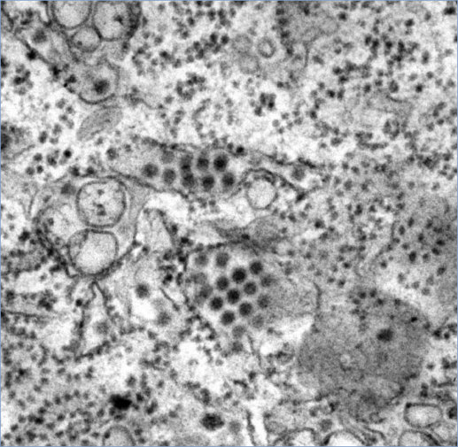
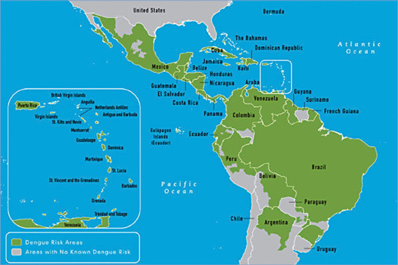
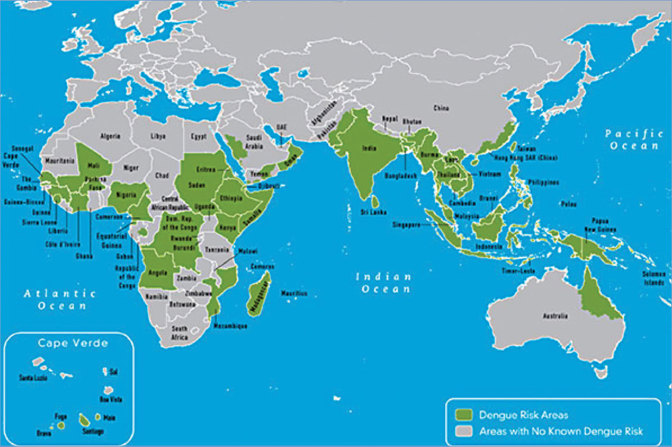
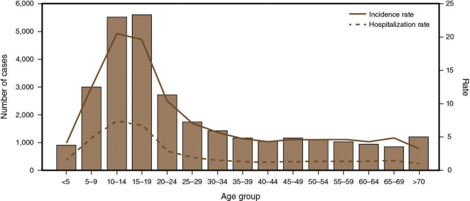
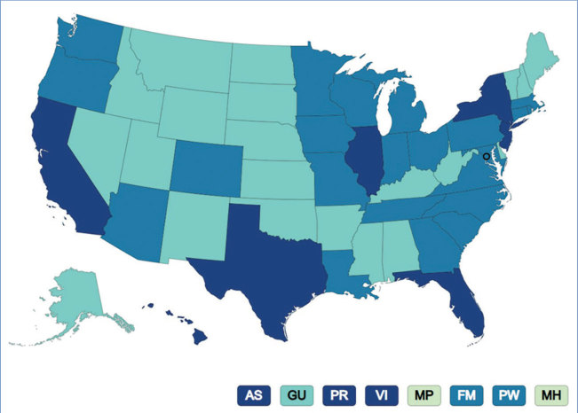
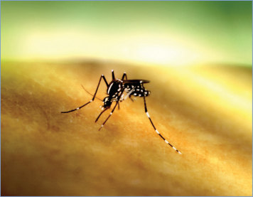
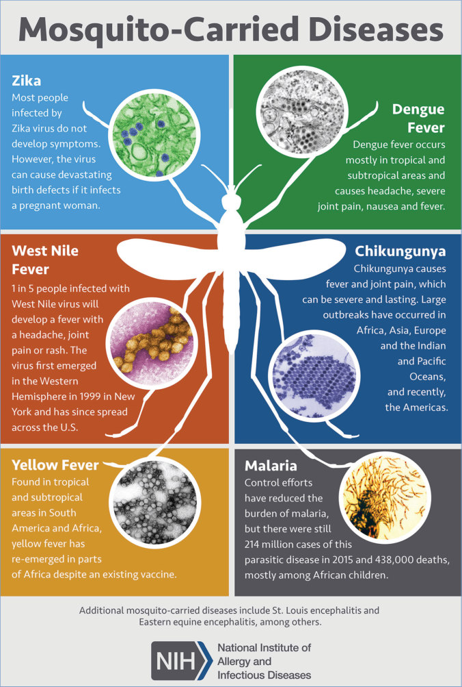

# 44. Dengue
> Reference: [source credits](../../SOURCE_CREDITS.md). Printed pp. 210-217; PDF pp. 224-231.
> Editorial study pathway: Viral infections (not a part division in the source).
[Flashcards](../flashcards/044_flashcards.md) · [Quiz](../mcqs/044_mcqs.md) · [Full extraction](../../raw/chapters/044.md)

## Five study pillars

### Etiology and transmission
Four related RNA viruses of the genus Flavivirus, dengue viruses (DENVs) 1, 2, 3, and 4, cause symptomatic (approximately 25%) and asymptomatic (approximately 75%) infections. Infection with one DENV serotype most often produces lifelong immunity against that serotype, and a period of cross-protection (often lasting 1 to 2 years) against infection with the other 3 serotypes can be observed.
*Printed p. 210 / PDF p. 224*

### Clinical recognition
Dengue infection may be asymptomatic or, if symptomatic, may have a wide range of clinical presentations.
*Printed p. 210 / PDF p. 224*

### Diagnostic workup
Laboratory confirmation of dengue can be made on a single serum, plasma, or whole blood specimen obtained within the first 7 days after the onset of symptoms by nucleic acid amplification tests (NAATs) or detection of DENV nonstructural protein 1 (NS1) antigen by immunoassay.
*Printed p. 211 / PDF p. 225*

### Treatment in the atlas
No specific antiviral therapy exists for dengue. During the febrile phase, patients should stay well hydrated and avoid use of aspirin (acetylsalicylic acid), salicylate-containing drugs, and other nonsteroidal anti-inflammatory drugs (eg, ibuprofen) to minimize potential for bleeding.
*Printed p. 212 / PDF p. 226*

### Prevention and infection control
Standard precautions are recommended, with attention to the potential for bloodborne transmission. When indicated, attention should be given to control of Aedes mosquitoes to prevent secondary transmission of DENV from infected patients to others.
*Printed p. 212 / PDF p. 226*

## Clinical search tags
Fever, Petechiae / purpura, Maculopapular rash, Vomiting, Hepatitis / jaundice, Encephalitis / seizures, Sepsis / shock, Anemia / hemolysis, Cytopenia, Tick / arthropod exposure, Travel / endemic setting

## Full text, original tables, and images

# 44. Dengue
> Private study reference ([source credits](../../SOURCE_CREDITS.md)). PDF pages 224-231; printed pages 210-217.

## PDF page 224 | printed page 210

### CLINICAL MANIFESTATIONS

Dengue infection may be asymptomatic or, if symptomatic, may have a wide range of clinical presentations. The 2009 World Health Organization classification for dengue severity (https://apps.who.int/iris/bitstream/handle/ 10665/44188/9789241547871_eng. pdf?sequence=1&isAllowed=y) is divided into: (1) Dengue without warning signs: fever plus 2 of the following: nausea/vomiting, rash, aches and pains, leukopenia, or positive tourniquet test; (2) Dengue with warning signs: dengue as defined above plus any of the following: abdominal pain or tenderness, persistent vomiting, clinical fluid accumulation (ascites, pleural effusion), mucosal bleeding, lethargy, restlessness, liver enlargement >2 cm, or increase in hematocrit concurrent with rapid decrease in platelet count; and (3) Severe dengue: dengue with at least 1 of the following criteria: severe plasma leakage leading to shock or fluid accumulation with respiratory distress, severe bleeding as evaluated by a clinician, or severe organ involvement (eg, aspartate aminotransferase or alanine aminotransferase 1,000 IU/L, impaired consciousness, failure of heart and other organs). Less common clinical syndromes include myocarditis, pancreatitis, hepatitis, hemophagocytic lymphohistiocytosis, and neurologic disease, including acute meningoencephalitis and post-dengue acute disseminated encephalomyelitis.

Dengue begins abruptly with a nonspecific, acute febrile illness lasting 2 to 7 days (febrile phase), often accompanied by muscle, joint, or bone pain, headache, retro-orbital pain, facial erythema, injected oropharynx, macular or maculopapular rash, leukopenia, and petechiae or other minor bleeding manifestations. During defervescence, usually on days 3 through 7 of illness, an increase in vascular permeability in parallel with increasing hematocrit (hemoconcentration) may occur. The increased vascular permeability may result in plasma leakage. The period of clinically significant plasma leakage usually lasts 24 to 48 hours (critical phase), followed by a convalescent phase with gradual improvement and stabilization of the hemodynamic status. Warning signs of

progression to severe dengue occur in the late febrile phase and include persistent vomiting, severe abdominal pain, mucosal bleeding, difficulty breathing, early signs of shock, and a rapid decline in platelet count with an increase in hematocrit. Patients with nonsevere disease begin to improve during the critical phase, but people with clinically significant plasma leakage develop severe disease that may include pleural effusions, ascites, hypovolemic shock, and hemorrhage.

### ETIOLOGY

Four related RNA viruses of the genus Flavivirus, dengue viruses (DENVs) 1, 2, 3, and 4, cause symptomatic (approximately 25%) and asymptomatic (approximately 75%) infections. Infection with one DENV serotype most often produces lifelong immunity against that serotype, and a period of cross-protection (often lasting 1 to 2 years) against infection with the other 3 serotypes can be observed. After this, infection with a different serotype may predispose to more severe disease. Because there are 4 serotypes, a person has a lifetime risk of up to 4 DENV infections.

### EPIDEMIOLOGY

DENV is transmitted to humans primarily through the bite of infected Aedes aegypti (and less commonly, Aedes albopictus or Aedes polynesiensis) mosquitoes. Humans are the main amplifying host of DENV and the main source of virus for Aedes mosquitoes. A sylvatic nonhuman primate DENV transmission cycle exists in parts of Africa and Southeast Asia but rarely crosses to humans. Other forms of transmission are relatively rare and include vertical transmission; transmission via breastfeeding, blood, or organ donation; and health care-associated transmission via needlestick or mucocutaneous exposure. The rate of vertical transmission is around 20% and is even higher when dengue occurs late in pregnancy near delivery. Sexual transmission is also possible but is considered a very rare route of infection.

Dengue is a major public health problem in the tropics and subtropics; about half the world’s population is thought to be at risk of infection with DENVs and approximately 100 to 400 million dengue infections occur annually worldwide (www. who.int/news-room/fact-sheets/detail/ dengue-and-severe-dengue). Dengue is

## PDF page 225 | printed page 211

endemic in the United States territories and freely associated states of Puerto Rico, the U.S. Virgin Islands, American Samoa, the Federated States of Micronesia, the Republic of Marshall Islands, and the Republic of Palau. Approximately 90% of the population in these areas at risk for dengue live in Puerto Rico, and 95% of locally acquired dengue cases reported in the United States from 2010 to 2020 occurred in Puerto Rico.1 Incidence rates vary significantly by geographic locale, affected by factors such as population density, elevation, and mosquito breeding and water supply patterns. Outbreaks with local DENV transmission have occurred in Texas, Hawaii, and Florida and in Mexican cities bordering Yuma, Arizona (San Luis Rio Colorado, Sonora), and Calexico, California (Mexicali, Baja California). Although up to 28 states now have Ae aegypti and 40 states have Ae albopictus mosquitoes, local DENV transmission is uncommon because of housing characteristics including air conditioning and screens that reduce contact between people and infected mosquitoes. Millions of U.S. travelers are at risk; dengue is the leading cause of febrile illness among travelers returning from the Caribbean, Latin America, and Southeast Asia. Dengue occurs in people of all ages but occurs at higher rates in healthy adolescents and young adults and is most likely to cause severe disease in infants, pregnant people, and patients with chronic diseases (eg, asthma, sickle cell anemia, and diabetes mellitus). Severe dengue disease is most likely to occur with second, heterologous dengue serotype infections, although it can occur with a first dengue infection or postsecondary heterologous dengue serotype infections.

The incubation period for DENV replication in mosquitoes is 8 to 12 days (extrinsic incubation); mosquitoes remain infectious for the remainder of their life cycle. In humans, the incubation period is 3 to 14 days before symptom onset (intrinsic incubation). Infected people, both symptomatic and asymptomatic, can transmit DENV to mosquitoes 1 to 2 days before symptoms develop and throughout the approximately 7-day viremic period.

### DIAGNOSTIC TESTS

Laboratory confirmation of dengue can be made on a single serum, plasma, or whole blood specimen obtained within the first 7 days after the

onset of symptoms by nucleic acid amplification tests (NAATs) or detection of DENV nonstructural protein 1 (NS1) antigen by immunoassay.

For patients with a negative NAAT or NS1 test or patients presenting more than 7 days after symptom onset, a positive anti-DENV immunoglobulin (Ig) M suggests recent infection, although with less certainty than NAAT or NS1 testing because of cross-reactivity with other flaviviruses.

Anti-DENV IgM antibodies are detectable beginning 3 to 5 days after illness onset; 99% of patients have IgM antibodies by day 10. IgM concentrations peak after 2 weeks and then often decline to undetectable levels over 2 to 3 months; they can cross-react with IgM antibodies against Zika virus and other closely related flaviviruses. In patients from areas with ongoing transmission of another flavivirus (eg, Zika virus) and whose only evidence of dengue is a positive anti-DENV IgM test, plaque reduction neutralization tests (PRNTs) quantifying virus-specific neutralizing antibody titers can distinguish DENV from other flaviviruses in some but not all cases. PRNT, however, is rarely available in clinical laboratories and results typically are not available within a timeframe that is meaningful for clinicians managing acute disease. PRNT may be valuable in circumstances where confirming the diagnosis may have important clinical implications, such as distinguishing dengue from a Zika virus infection in a pregnant individual.2,3 Anti-DENV IgG antibody remains elevated for life after DENV infection. Anti-DENV IgG antibody may be falsely positive in people with previous infection with or immunization against other flaviviruses (eg, West Nile, Japanese encephalitis, yellow fever, or Zika viruses). A fourfold or greater increase in anti- DENV IgG antibody titers between the acute (5 days after onset of symptoms) and convalescent (>15 days after onset of symptoms) samples is indicative of recent infection. Conventional serologic tests may be less reliable for diagnosis of acute DENV infection in individuals who have been vaccinated with a dengue vaccine within the previous several months. Dengue diagnostic testing is available through commercial reference laboratories and some state public health laboratories; reference testing is available from the Dengue Branch of the Centers for Disease Control and Prevention (CDC) (www.cdc.gov/dengue/).

## PDF page 226 | printed page 212

### TREATMENT

No specific antiviral therapy exists for dengue. During the febrile phase, patients should stay well hydrated and avoid use of aspirin (acetylsalicylic acid), salicylate-containing drugs, and other nonsteroidal anti-inflammatory drugs (eg, ibuprofen) to minimize potential for bleeding. Additional supportive care is required if the patient becomes dehydrated or develops warning signs of severe disease at or around the time of defervescence.

Early recognition of shock and intensive supportive therapy can reduce risk of death from severe dengue from approximately 5% to 10% to less than 1%. During the critical phase, maintenance of fluid volume and hemodynamic status is crucial to management of severe cases. Patients should be monitored for early signs of shock, occult bleeding, and plasma leakage to avoid prolonged shock, end-organ damage, and fluid overload. Patients with refractory shock may require intravenous colloids and/or blood or blood products after an initial trial of intravenous crystalloids. Reabsorption of extravascular fluid occurs during the convalescent phase with stabilization of hemodynamic status and diuresis. It is important to watch for signs of fluid overload, which may manifest as a decrease in the patient’s hematocrit as a result of the dilutional effect of reabsorbed fluid.

### INFECTION PREVENTION AND CONTROL MEASURES IN HEALTH CARE SETTINGS

Standard precautions are recommended, with attention to the potential for bloodborne transmission. When indicated, attention should be given to control of Aedes mosquitoes to prevent secondary transmission of DENV from infected patients to others.

### CONTROL MEASURES

Vector control can reduce dengue transiently, when applied rigorously, but is limited by widespread insecticide resistance in areas where the virus is endemic. A recombinant live attenuated tetravalent dengue vaccine, CYD-TDV (chimeric yellow fever dengue-tetravalent dengue vaccine) (Dengvaxia) with a 3-dose schedule administered at 0, 6, and 12 months has been approved by the U.S. Food and Drug Administration (FDA) for use in individuals 6 through 16 years of age with

laboratory-confirmed previous dengue infection and living in areas with endemic infection.

The CDC Advisory Committee on Immunization Practices (ACIP) currently recommends vaccination with the Dengvaxia vaccine for children aged 9 through 16 years of age who live in an area where dengue is endemic and have evidence of a previous dengue infection; as of December 2023, the ACIP had not yet voted on recommending its lower age range align with the FDA’s approved range. Evidence of previous dengue infection, such as laboratory confirmation of a previous dengue infection or detection of anti-DENV IgG using a highly specific serodiagnostic test, is required for eligible children before vaccination. Dengvaxia is contraindicated in children with severe immunodeficiency or immunosuppression attributable to underlying disease or therapy, including children with symptomatic HIV infection or CD4+ T-lymphocyte count of <200/mm3.

Analyses of data from clinical trials revealed an increased risk for severe dengue in seronegative vaccine recipients compared with seropositive vaccine recipients, while confirming effectiveness in preventing dengue cases, severe dengue, and hospitalizations attributable to any serotype in seropositive individuals. For this reason, CYD-TDV is not approved for use in individuals not infected previously by any DENV serotype or for whom this information is unknown, because those not infected previously are at increased risk for severe dengue when vaccinated and subsequently infected with DENV. Previous dengue infection can be documented by providing history of a laboratory-confirmed dengue infection or a positive result of a highly accurate serodiagnostic screening test. Immunogenicity and safety of recombinant live attenuated dengue vaccine after administration of immunoglobulin intravenous (IGIV) and other immunoglobulin-containing products has not been studied. Clinicians considering dengue vaccine for people who recently received blood products (including IGIV) or other immunoglobulin-containing products should delay prevaccination testing and administration of vaccine doses by 12 months. Safety and effectiveness of CYD-TDV have not been established in individuals living in areas where dengue is not endemic but who travel to areas with endemic infection, and this vaccine is not recommended for travelers.

## PDF page 227 | printed page 213

Another live attenuated tetravalent dengue vaccine (QDENGA), administered subcutaneously as a 0.5-mL dose in a 2-dose schedule (0 and 3 months), is approved for use in several countries outside of the United States in individuals 4 years or older regardless of previous dengue exposure. However, on July 11, 2023, Takeda voluntarily withdrew the QDENGA biologic license application from U.S. FDA review, so no approval in the United States is anticipated.

People traveling to areas where dengue is endemic (www.healthmap.org/dengue/) are at risk of dengue and should take precautions to protect themselves from mosquito bites. Travelers should select accommodations that are air conditioned and/or have screened windows and doors and use a bed net to sleep, although this may have limited effect because the vector mosquitoes bite primarily during the day. Travelers should wear clothing

Image 44.1 Cytoarchitectural changes found in a liver tissue specimen extracted from a patient with dengue hemorrhagic fever in Thailand (hematoxylin-eosin stain, magnification 370). This particular view reveals “mid-lobular necrosis, with accompanying acidophilic degeneration, and moderate hypertrophy of Kupffer cells.” Courtesy of Dr Yves Robin and Dr Jean Renaudet, Arbovirus Laboratory at the Pasteur Institute in Dakar, Senegal; World Health Organization.

that covers arms and legs completely whenever possible, especially during early morning and late afternoon, and use mosquito repellents registered by the U.S. Environmental Protection Agency.

Public Health Reporting

Dengue is a nationally notifiable disease, whether obtained locally in the United States or during travel. Suspected cases should be reported to the state or local health department.

1 Paz-Bailey G, Adams L, Wong JM, et al. Dengue vaccine: recommendations of the Advisory Committee on Immunization Practices, United States, 2021. MMWR Recomm Rep. 2021;70(RR-6):1–16 2 Sharp TM, Fischer M, Muñoz-Jordán JL, et al. Dengue and Zika virus diagnostic testing for patients with a clinically compatible illness and risk for infection with both viruses. MMWR Recomm Rep. 2019;68(1):1–10 3 Wong JM, Adams LE, Durbin AP, et al. Dengue: a growing problem with new interventions. Pediatrics. 2022;149(6): e2021055522

## PDF page 228 | printed page 214

Image 44.2 This transmission electron micrograph depicts a number of round dengue virus particles that were revealed in this tissue specimen. Courtesy of Centers for Disease Control and Prevention.

Image 44.3 Distribution of dengue, Western hemisphere. Courtesy of Centers for Disease Control and Prevention.

## PDF page 229 | printed page 215

Image 44.4 Distribution of dengue, Eastern hemisphere. Courtesy of Centers for Disease Control and Prevention.

Image 44.5 Number of dengue cases, incidence rate per 1,000 population, and hospitalization rate, by age group in United States territories, 2010–2020. Courtesy of Morbidity and Mortality Weekly Report.

## PDF page 230 | printed page 216

Image 44.6 All dengue cases by jurisdiction of residence in U.S. states and territories, 2010–2023. Courtesy of Centers for Disease Control and Prevention.

Image 44.7 Aedes mosquito next to a transmission electron micrograph of dengue virus particles. Aedes mosquitoes are known to transmit dengue virus. Courtesy of Centers for Disease Control and Prevention and National Institute of Allergy and Infectious Diseases.

Image 44.8 Bite by an Aedes mosquito. This species can transmit multiple diseases. Courtesy of National Institute of Allergy and Infectious Diseases.

## PDF page 231 | printed page 217

Image 44.9 Mosquito-carried diseases include Zika, dengue fever, West Nile fever, chikungunya, yellow fever, and malaria. Courtesy of National Institute of Allergy and Infectious Diseases.

