# 47. Serious Neonatal Bacterial Infections Caused by Enterobacterales (Including Septicemia and Meningitis)
> Reference: [source credits](../../SOURCE_CREDITS.md). Printed pp. 236-242; PDF pp. 250-256.
> Editorial study pathway: Bacterial infections (not a part division in the source).
[Flashcards](../flashcards/047_flashcards.md) · [Quiz](../mcqs/047_mcqs.md) · [Full extraction](../../raw/chapters/047.md)

## Five study pillars

### Etiology and transmission
Enterobacterales are a large family of gram-negative, facultatively anaerobic, rod-shaped bacteria that include Escherichia species, Klebsiella species, Enterobacter species, Proteus species, Providencia species, and Serratia species, among many others. E coli strains, often those with the K1 capsular polysaccharide antigen, are the most common cause of neonatal septicemia and meningitis by Enterobacterales species.
*Printed p. 236 / PDF p. 250*

### Clinical recognition
Neonatal septicemia or meningitis caused by Escherichia coli and other gram-negative bacilli cannot be differentiated clinically from septicemia or meningitis caused by other organisms. The early signs of sepsis can be subtle and similar to signs observed in noninfectious processes.
*Printed p. 236 / PDF p. 250*

### Diagnostic workup
Diagnosis is established by growth of E coli or other gram-negative bacilli from blood, cerebrospinal fluid (CSF), or other usually sterile sites. Isolates may be identified by traditional biochemical tests, commercially available biochemical test systems, mass spectrometry of bacterial cell components, or molecular methods.
*Printed p. 237 / PDF p. 251*

### Treatment in the atlas
• Initial empiric treatment for suspected early-onset gram-negative sepsis in neonates should be based on local and regional antimicrobial susceptibility data. The proportion of E coli bloodstream infections with onset within 72 hours of life that are resistant to ampicillin is high (approximately two-thirds) among very low birth weight infants.
*Printed p. 237 / PDF p. 251*

### Prevention and infection control
Standard precautions are recommended.
*Printed p. 238 / PDF p. 252*

## Clinical search tags
Fever, Pneumonia, Diarrhea, Vomiting, Hepatitis / jaundice, Meningitis, Abscess / soft tissue, Sepsis / shock, Congenital / neonatal

## Full text, original tables, and images

# 47. Serious Neonatal Bacterial Infections Caused by Enterobacterales (Including Septicemia and Meningitis)
> Private study reference ([source credits](../../SOURCE_CREDITS.md)). PDF pages 250-256; printed pages 236-242.

## PDF page 250 | printed page 236

(Including Septicemia and Meningitis)

### CLINICAL MANIFESTATIONS

Neonatal septicemia or meningitis caused by Escherichia coli and other gram-negative bacilli cannot be differentiated clinically from septicemia or meningitis caused by other organisms. The early signs of sepsis can be subtle and similar to signs observed in noninfectious processes. Signs of septicemia include fever, temperature instability, heart rate abnormalities, grunting respirations, apnea, cyanosis, lethargy, irritability, anorexia, vomiting, jaundice, abdominal distention, cellulitis, and diarrhea. Meningitis, especially early in the course, can occur without overt signs suggesting central nervous system involvement. Some gram-negative bacilli, such as Citrobacter koseri, Cronobacter (formerly Enterobacter) sakazakii, Serratia marcescens, and Salmonella species, are associated with increased risk for brain abscesses in infants with meningitis caused by these organisms.

### ETIOLOGY

Enterobacterales are a large family of gram-negative, facultatively anaerobic, rod-shaped bacteria that include Escherichia species, Klebsiella species, Enterobacter species, Proteus species, Providencia species, and Serratia species, among many others. E coli strains, often those with the K1 capsular polysaccharide antigen, are the most common cause of neonatal septicemia and meningitis by Enterobacterales species. Other important Enterobacterales species causing neonatal septicemia include Klebsiella species, Enterobacter species, Proteus species, Citrobacter species, Salmonella species, and Serratia species. Elizabethkingia meningoseptica, although not an Enterobacterales species, is another multidrugresistant gram-negative organism that causes a similar spectrum of disease in neonates.

### EPIDEMIOLOGY

The source of E coli and other Enterobacterales organisms in neonatal infections during the first

days of life typically is the vaginal tract of the birthing parent. Reservoirs for gram-negative bacilli can also be present within the health care environment. Acquisition of gram-negative organisms can occur through person-to-person transmission from hospital nursery personnel as well as from nursery environmental sites such as sinks, countertops, powdered infant formula, and respiratory therapy equipment, especially among very preterm infants who require prolonged neonatal intensive care management. Predisposing factors for neonatal gram-negative bacterial infections include intrapartum infection in the birthing parent, gestation less than 37 weeks, low birth weight, and prolonged rupture of membranes. Metabolic abnormalities (eg, galactosemia), fetal hypoxia, and acidosis have been implicated as predisposing factors. Neonates with defects in the integrity of skin or mucosa (eg, myelomeningocele) or abnormalities of gastrointestinal or genitourinary tracts are at increased risk of gram-negative bacterial infections. In neonatal intensive care units (NICUs), systems for respiratory and metabolic support, invasive or surgical procedures, and indwelling vascular catheters are risk factors for infection. Frequent use of broadspectrum antimicrobial agents enables selection and proliferation of strains of gram-negative bacilli that may be resistant to multiple antimicrobial agents.

Multiple mechanisms of resistance in gram-negative bacilli can be present simultaneously. Resistance resulting from production of plasmidderived extended-spectrum beta-lactamases (ESBLs) and AmpC beta-lactamases occurs primarily in E coli and Klebsiella species and from production of chromosomally encoded AmpC beta-lactamases in Enterobacter species, but these mechanisms have been reported in many other gram-negative species. Resistant gram-negative infections have been associated with nursery outbreaks, especially in very low birth weight infants. Risk factors for neonatal infection with ESBLproducing organisms include prolonged mechanical ventilation, extended hospital stay, use of invasive devices, and prior use of antimicrobial agents. Infants whose birthing parent is colonized with ESBL-producing E coli are themselves at an increased risk of becoming colonized with ESBLproducing E coli compared with infants whose birthing parent is noncolonized. Organisms that

## PDF page 251 | printed page 237

produce ESBLs typically are resistant to penicillins, cephalosporins, and monobactams and can be resistant to aminoglycosides. Carbapenemresistant Enterobacterales (CRE) that produce carbapenemases have also emerged, especially among Klebsiella pneumoniae, E coli, and Enterobacter cloacae. ESBL- and carbapenemaseproducing strains often carry additional plasmidborne genes that encode for high-level resistance to aminoglycosides, fluoroquinolones, and trimethoprim-sulfamethoxazole.

The incubation period is variable; time of onset of infection ranges from birth to several weeks after birth or longer in very low birth weight, preterm infants with prolonged hospitalizations.

### DIAGNOSTIC TESTS

Diagnosis is established by growth of E coli or other gram-negative bacilli from blood, cerebrospinal fluid (CSF), or other usually sterile sites. Isolates may be identified by traditional biochemical tests, commercially available biochemical test systems, mass spectrometry of bacterial cell components, or molecular methods. Multiplexed molecular tests capable of rapidly identifying a variety of gram-negative rods including E coli directly in positive blood culture bottles have been cleared by the U.S. Food and Drug Administration. Special screening and confirmatory laboratory procedures are required to detect some multidrugresistant gram-negative organisms. Molecular diagnostics can rapidly identify pathogens and some resistance genes from positive blood cultures but do not detect all phenotypic resistance; therefore, antimicrobial resistance testing should be performed on isolates.

### TREATMENT1,2

• Initial empiric treatment for suspected early-onset gram-negative sepsis in neonates should be based on local and regional antimicrobial susceptibility data. The proportion of E coli bloodstream infections with onset within 72 hours of life that are resistant to ampicillin is high (approximately two-thirds) among very low birth weight infants. These E coli infections almost invariably are susceptible to gentamicin, although monotherapy with an aminoglycoside is not recommended.

• Ampicillin and an aminoglycoside may be firstline therapy for neonatal sepsis in areas with

low ampicillin resistance among E coli. An alternative regimen of ampicillin and an extendedspectrum cephalosporin (eg, cefotaxime, ceftazidime, cefepime) can be used, but rapid emergence of cephalosporin-resistant organisms and increased risk of colonization or infection with ESBL-producing Enterobacterales can occur when cephalosporin use is routine in a neonatal unit. The empiric addition of broaderspectrum antibiotic therapy may be considered until culture results are available if the patient is a severely ill infant at high risk for gram-negative sepsis (such as infants with very low birth weight born after prolonged premature rupture of membranes, infants exposed to prolonged courses of antepartum antibiotic therapy, or infants with prolonged NICU hospitalization and exposure to multiple medical devices and antimicrobials).

• When there is a concern for gram-negative meningitis, an extended-spectrum cephalosporin (eg, cefotaxime, ceftazidime, cefepime) should be used unless prior patient isolates or local resistance profiles increase the likelihood of a multidrug-resistant gram-negative organism, in which case a carbapenem is the preferred choice for empiric therapy.

• Once the causative agent and its in vitro antimicrobial susceptibility pattern are known, nonmeningeal infections should be treated with the narrowest-spectrum antibiotic to which the organism is susceptible.

• For meningitis caused by an ampicillin-susceptible E coli, meningitic dosing of ampicillin is the preferred treatment because it is effective and narrow-spectrum. Meningitis caused by an ampicillin-resistant isolate can be treated with an extended-spectrum cephalosporin to which it is susceptible. Combination therapy of a beta-lactam with an aminoglycoside can be used until CSF is sterile in complicated meningitis associated with empyema, brain abscess, or other scenarios that may delay CSF sterility. Expert advice from a pediatric infectious diseases specialist is helpful for management of meningitis.

• For ESBL-producing Enterobacterales infections, a carbapenem is the drug of choice. Of the

## PDF page 252 | printed page 238

aminoglycosides, amikacin retains the most activity against ESBL-producing strains.

• For Enterobacterales isolates that contain AmpC beta-lactamase but not ESBLs, cefepime can be used if susceptible, because cefepime does not induce AmpC expression and it resists hydrolysis by AmpC b-lactamases.

• For CRE, treatment should be tailored to the susceptibility profile of the isolate and the type of carbapenemase. Combination antibiotic therapy is often used. Antibiotics that may have activity against CRE include amikacin, trimethoprim-sulfamethoxazole, fluoroquinolones, tigecycline, colistin, and polymyxin B.3 Tigecycline has a black box warning for an increase in all-cause mortality and should be reserved for situations in which alternative agents are not suitable. In neonates, there is limited experience using newer antibiotic agents with activity against CRE, like ceftazidime-avibactam, ceftolozane-tazobactam, imipenem-relebactam, or cefiderocol. Expert advice from a pediatric infectious disease specialist is recommended for management of infections caused by carbapenem-resistant organisms.

• All neonates with gram-negative meningitis should undergo repeat lumbar puncture to ensure sterility of the CSF after 48 to 72 hours of therapy. If CSF remains culture-positive, the choice and dose of antimicrobial agents should be reevaluated, and another lumbar puncture should be performed after an additional 48 to 72 hours.

• Duration of therapy is based on clinical and bacteriologic response of the patient and the site(s) of infection. The usual duration of therapy for uncomplicated gram-negative bacteremia in an infant who has had clearance of blood cultures and is clinically improving is 10 days. Infants with persistent bacteremia, prolonged clinical course, or other complications may require longer duration of therapy. The minimum treatment duration for gram-negative meningitis is 21 days; this may be extended if there are complications like brain abscess.

• All infants with gram-negative meningitis should undergo careful follow-up examinations, including testing for hearing loss,

neurologic abnormalities, and developmental delay.

• Immunoglobulin intravenous therapy for newborn infants receiving antimicrobial agents for suspected or proven serious infection does not improve outcomes and is not recommended.

### INFECTION PREVENTION AND CONTROL MEASURES IN HEALTH CARE SETTINGS

Standard precautions are recommended. Exceptions include hospital nursery epidemics, infants with Salmonella infection, and infants with infection caused by gram-negative bacilli that are resistant to multiple antimicrobial agents, including ESBL-producing strains and CRE; in these situations, contact precautions also are indicated.4

### CONTROL MEASURES

Infection-control personnel should be aware of pathogens causing infections in infants so that clusters of infections are recognized and investigated appropriately. Several cases of infection caused by the same genus and species of bacteria occurring in infants in physical proximity or caused by an unusual pathogen indicate the need for an epidemiologic investigation and related infection prevention and control measures. Periodic review of in vitro antimicrobial susceptibility patterns of clinically important bacterial isolates from newborn infants, especially infants in the NICU, can provide useful epidemiologic and therapeutic information.

1 Puopolo KM, Benitz WE, Zaoutis TE; American Academy of Pediatrics, Committee on Fetus and Newborn; Committee on Infectious Diseases. Management of neonates born at 34 6/7 weeks’ gestation with suspected or proven early-onset bacterial sepsis. Pediatrics. 2018;142(6):e20182896 2 Puopolo KM, Benitz WE, Zaoutis TE; American Academy of Pediatrics, Committee on Fetus and Newborn; Committee on Infectious Diseases. Management of neonates born at 35 0/7 weeks’ gestation with suspected or proven early-onset bacterial sepsis. Pediatrics. 2018;142(6):e20182894 3 Infectious Diseases Society of America. IDSA Guidance on the Treatment of Antimicrobial Resistant Gram-Negative Infections. Infectious Diseases Society of America; 2023. Available at: www.idsociety.org/practice-guideline/amr-guidance/ 4 Centers for Disease Control and Prevention. Facility Guidance for Control of Carbapenem Resistant Enterobacteriaceae (CRE) November 2015 Update. Available at: www.cdc.gov/hai/ pdfs/cre/CRE-guidance-508.pdf

## PDF page 253 | printed page 239

Image 47.1 A human neutrophil (red) containing ingested Klebsiella pneumoniae (purple). Image captured at the National Institute of Allergy and Infectious Diseases Rocky Mountain Laboratories in Hamilton, Montana. Courtesy of National Institute of Allergy and Infectious Diseases.

Image 47.3 Aeromonas cellulitis in an 11-year-old who previously sustained an injury to the plantar surface of the right foot. Courtesy of Benjamin Estrada, MD.

Image 47.2 A human neutrophil interacting with Klebsiella pneumoniae (pink), a multidrug-resistant bacterium that causes severe hospital infections. Image captured at the National Institute of Allergy and Infectious Diseases Rocky Mountain Laboratories in Hamilton, Montana. Courtesy of National Institute of Allergy and Infectious Diseases.

Image 47.4 Icteric preterm neonate with septicemia and perineal and abdominal wall cellulitis caused by Escherichia coli.

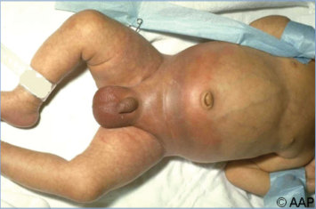

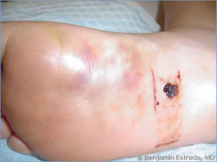

## PDF page 254 | printed page 240

Image 47.5 Neonate in Image 47.4 with Escherichia coli septicemia and perineal cellulitis, scrotal necrosis, and abdominal wall abscesses below the navel that required surgical drainage and antibiotics.

Image 47.7 Pneumonia caused by Klebsiella pneumoniae with pulmonary necrosis and downward “bulging” of the pleural fissure secondary to accumulation of tenacious secretions.

Image 47.6 Infant with osteomyelitis of the proximal right humerus caused by Escherichia coli.

Image 47.8 Lung abscess, anteroposterior view, with air-fluid level. Klebsiella pneumoniae was cultured from bronchoscopy secretions. Courtesy of Edgar O. Ledbetter, MD, FAAP.

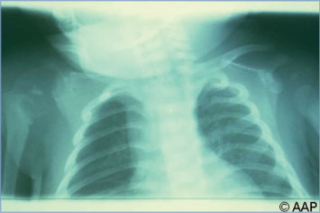

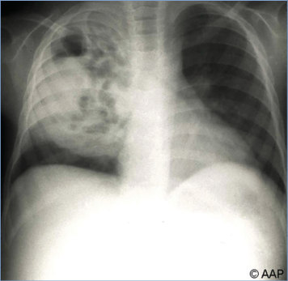

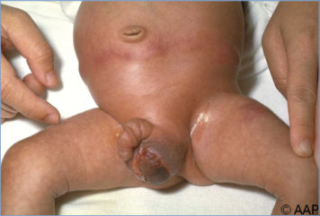

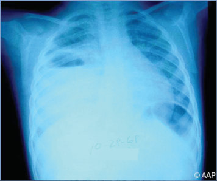

## PDF page 255 | printed page 241

Image 47.9 Lateral view of the patient in Image 47.8, with Klebsiella pneumoniae pneumonia, demonstrating large lung abscess with air-fluid level. Repeated bronchoscopy was necessary for adequate drainage. Courtesy of Edgar O. Ledbetter, MD, FAAP.

Image 47.12 Sepsis caused by Pseudomonas aeruginosa with early ecthyma gangrenosum.

Image 47.10 A 5-week-old with Klebsiella pneumoniae sepsis and meningitis with bilateral saphenous vein thrombophlebitis (illness began with diarrhea). Copyright Martin G. Myers, MD.

Image 47.11 Skin lesions caused by Pseudomonas aeruginosa in a child with neutropenia and septicemia.

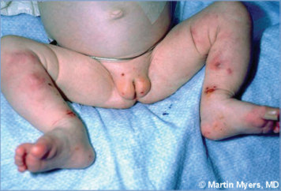

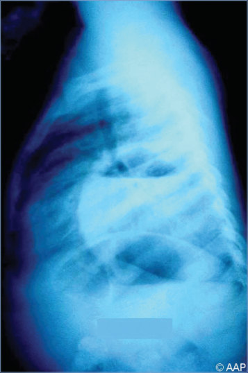

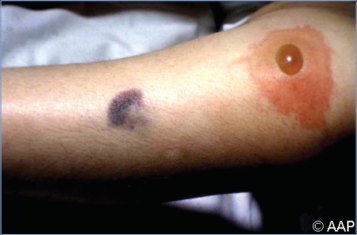

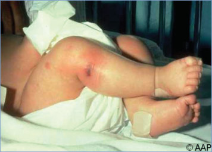

## PDF page 256 | printed page 242

Image 47.13 Sepsis caused by Pseudomonas aeruginosa with rapidly progressing ecthyma gangrenosum. This is the same patient as in Image 47.12.

Image 47.15 Gram stain of Escherichia coli in the cerebrospinal fluid of a neonate with meningitis.

Image 47.14 A preschool-aged child with acute lymphoblastic leukemia and necrotizing Pseudomonas skin lesions called ecthyma gangrenosum. Copyright Martin G. Myers, MD.

Image 47.16 This photograph depicts the colonies of Proteus mirabilis bacteria grown on a xylose-lysine-deoxycholate agar plate. Courtesy of Centers for Disease Control and Prevention.

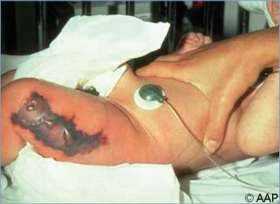

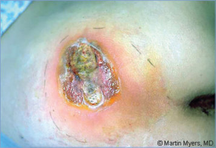

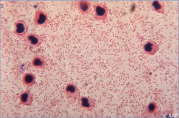

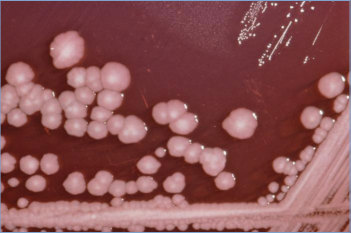
