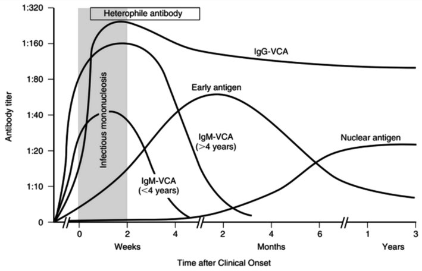
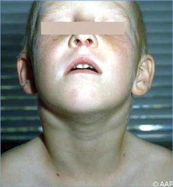
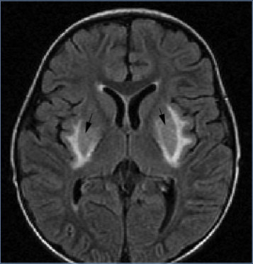
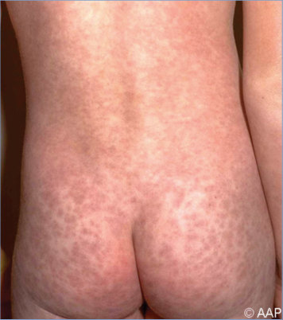
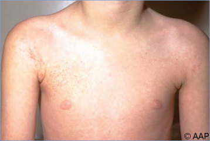
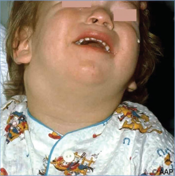
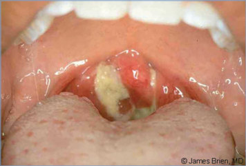

# 49. Epstein-Barr Virus Infections (Infectious Mononucleosis)
> Reference: [source credits](../../SOURCE_CREDITS.md). Printed pp. 249-254; PDF pp. 263-268.
> Editorial study pathway: Viral infections (not a part division in the source).
[Flashcards](../flashcards/049_flashcards.md) · [Quiz](../mcqs/049_mcqs.md) · [Full extraction](../../raw/chapters/049.md)

## Five study pillars

### Etiology and transmission
EBV (also known as human herpesvirus 4) is a gamma herpesvirus of the Lymphocryptovirus genus and is the most common cause of infectious mononucleosis (>90% of cases).
*Printed p. 250 / PDF p. 264*

### Clinical recognition
Infectious mononucleosis is the most common presentation of primary symptomatic Epstein- Barr virus (EBV) infection. It manifests typically as fever, pharyngitis with or without petechiae and often with exudate, lymphadenopathy, and hepatosplenomegaly.
*Printed p. 249 / PDF p. 263*

### Diagnostic workup
Infectious mononucleosis is primarily a clinical diagnosis. An absolute increase in atypical lymphocytes and mild elevations in hepatic aminotransferase concentrations during the second week of illness with infectious mononucleosis are additional characteristic but nonspecific findings.
*Printed p. 250 / PDF p. 264*

### Treatment in the atlas
There is no antiviral treatment approved for EBV infection. Patients suspected of having infectious mononucleosis should not receive ampicillin or amoxicillin, which may cause nonallergic morbilliform rashes in a proportion of patients with active EBV infection.
*Printed p. 251 / PDF p. 265*

### Prevention and infection control
Standard precautions are recommended.
*Printed p. 252 / PDF p. 266*

## Clinical search tags
Fever, Petechiae / purpura, Ulcers / eschar, Lymphadenopathy, Pharyngitis, Pneumonia, Hepatitis / jaundice, Hepatosplenomegaly, Meningitis, Encephalitis / seizures, Anemia / hemolysis, Cytopenia, Congenital / neonatal, Immunocompromised host, Travel / endemic setting

## Full text, original tables, and images

# 49. Epstein-Barr Virus Infections (Infectious Mononucleosis)
> Private study reference ([source credits](../../SOURCE_CREDITS.md)). PDF pages 263-268; printed pages 249-254.

## PDF page 263 | printed page 249

(Infectious Mononucleosis)

### CLINICAL MANIFESTATIONS

Infectious mononucleosis is the most common presentation of primary symptomatic Epstein- Barr virus (EBV) infection. It manifests typically as fever, pharyngitis with or without petechiae and often with exudate, lymphadenopathy, and hepatosplenomegaly. Atypical lymphocytosis and elevated hepatic aminotransferase concentrations are frequently found on laboratory evaluation. The spectrum of disease is wide, ranging from asymptomatic to fatal infection. Infections are typically unrecognized or nonspecific in infants and young children. Rash can occur in up to 20% of patients and is more common in patients treated with antibiotics, most commonly ampicillin or amoxicillin as well as with other penicillins. Central nervous system (CNS) manifestations include aseptic meningitis, encephalitis, myelitis, optic neuritis, cranial nerve palsies, transverse myelitis, Alice in Wonderland syndrome, and Guillain-Barré syndrome. Hematologic complications include splenic rupture, thrombocytopenia, agranulocytosis, hemolytic anemia, and hemophagocytic lymphohistiocytosis (HLH, or hemophagocytic syndrome). Pneumonia, clinical hepatitis, tonsil or adenoid enlargement resulting in upper airway obstruction, genital ulcerations, orchitis, and myocarditis are observed infrequently. Early in the course of primary infection, 1% of circulating B lymphocytes are infected with EBV, and EBVspecific cytotoxic/suppressor T lymphocytes account for up to 50% of the CD8+ T lymphocytes in the blood. Replication of EBV in B lymphocytes results in T-lymphocyte proliferation and inhibition of B-lymphocyte proliferation by T-lymphocyte cytotoxic responses, natural killer (NK) cell activation, and the production of neutralizing antibodies. Fatal disseminated infection or B-lymphocyte, T-lymphocyte, or NK-cell lymphomas rarely occur in children with no detectable immunologic abnormality as well as in children with congenital or acquired cellular immune deficiencies.

EBV is associated with several other distinct disorders, including X-linked lymphoproliferative syndrome, posttransplantation lymphoproliferative disorders, Burkitt lymphoma, Hodgkin lymphoma, nasopharyngeal carcinoma, undifferentiated B- or T-lymphocyte lymphomas, and leiomyosarcoma. X-linked lymphoproliferative syndrome occurs most often in people with an inherited, maternally derived, recessive genetic defect in the SH2DIA or XIAP/BIRC4 genes, which are important in several lymphocyte signaling pathways. The syndrome is characterized by several phenotypes, including occurrence of fatal infectious mononucleosis early in life among boys; HLH; nodular B-lymphocyte lymphomas, often with CNS involvement; and profound pancytopenia. Similarly, X-linked immunodeficiency with magnesium defect, EBV infection, and neoplasia (XMEN) disease is characterized by loss-of-function mutations in the gene encoding magnesium transporter 1 (MAGT1), chronic high-level EBV DNAemia with increased EBV-infected B cells, and heightened susceptibility to EBV-associated lymphomas. Several other genetic mutations associated with the failure to control EBV infection because of changes in T-lymphocyte and NK cell function have also been described.

EBV-associated lymphoproliferative disorders can also occur in patients who are immunocompromised, such as transplant recipients or people infected with human immunodeficiency virus (HIV). EBV-seronegative recipients of organs from EBV-seropositive donors are at highest risk for EBV-associated posttransplant lymphoproliferative disease (PTLD), with the highest incidence occurring in small intestine transplant recipients, followed by lung and heart transplant recipients, and lowest among liver and kidney transplant recipients. Proliferative states range from benign lymph node hypertrophy to monoclonal lymphomas. Other EBV-associated lymphoproliferative syndromes are of greater importance outside the United States, such as Burkitt lymphoma, which can be endemic or sporadic. EBV is present in virtually 100% of cases of endemic Burkitt lymphoma (a B-lymphocyte tumor predominantly found in the jaw or facial bones primarily in Central Africa) versus 20% of sporadic Burkitt lymphoma (a B-lymphocyte tumor of abdominal lymphoid tissue predominantly in North America

## PDF page 264 | printed page 250

and Europe). EBV is found in nearly 100% of nasopharyngeal carcinomas in Southeast Asia and the Inuit populations. EBV also has been associated with Hodgkin disease (a B-lymphocyte tumor), non-Hodgkin lymphomas (both B- and T-lymphocyte types), gastric carcinoma “lymphoepitheliomas,” and a variety of other epithelial malignancies.

Chronic fatigue syndrome is not directly caused by EBV infection; however, fatigue lasting 6 months or more may follow approximately 10% of cases of classic infectious mononucleosis.

### ETIOLOGY

EBV (also known as human herpesvirus 4) is a gamma herpesvirus of the Lymphocryptovirus genus and is the most common cause of infectious mononucleosis (>90% of cases).

### EPIDEMIOLOGY

Humans are the only known reservoir of EBV, and approximately 90% of U.S. adults have been infected. Close personal contact usually is required for transmission. The virus is viable in saliva for several hours outside the body; the role of fomites in transmission is unknown. EBV may be transmitted by blood transfusion or transplantation. Infection commonly is contracted early in life, particularly among members of lower socioeconomic groups, where crowding and intrafamilial spread is common. Endemic infectious mononucleosis is common in group settings of adolescents, such as in educational or military institutions. No seasonal pattern has been clearly documented. Intermittent excretion of EBV in saliva is lifelong after infection and likely explains viral spread and persistence in the population.

Table 49.1 Serum Epstein-Barr Virus (EBV) Antibodies in EBV Infection

Infection VCA IgG VCA IgM No previous infection – Acute infection +

Recent infection + Past infection +

VCA IgG indicates immunoglobulin (Ig) G class antibody to viral capsid antigen; VCA IgM, IgM class antibody to VCA; EA (D), early antigen diffuse staining; and EBNA, EBV nuclear antigen.

The incubation period of infectious mononucleosis is estimated to be 30 to 50 days.

### DIAGNOSTIC TESTS

Infectious mononucleosis is primarily a clinical diagnosis. An absolute increase in atypical lymphocytes and mild elevations in hepatic aminotransferase concentrations during the second week of illness with infectious mononucleosis are additional characteristic but nonspecific findings. Confirmation of primary EBV infection depends on results of serologic testing. Nonspecific tests for heterophile antibody, including the Paul- Bunnell test and slide agglutination reaction test, are available but have several limitations, including false-positive and false-negative results. The heterophile antibody response primarily is immunoglobulin (Ig) M, which appears during the first 2 weeks of illness and usually disappears over 6 months but may persist for 1 year and may also be positive with other conditions, both infectious (eg, cytomegalovirus [CMV], adenovirus, HIV) and noninfectious (eg, leukemia, lymphoma, systemic lupus erythematosus). In addition, the results of heterophile antibody tests often are negative during early EBV infection and in children younger than 4 years of age.

Multiple specific serologic antibody tests for EBV infection are available (see Table 49.1 and Figure 49.1). The most commonly performed test is for antibody against the viral capsid antigen (VCA) of EBV. Because IgG antibodies against VCA occur in high titer early in infection and persist for life at modest levels, testing of acute and convalescent serum specimens for IgG anti-VCA alone is not useful for establishing the presence of active infection. In contrast, testing for the presence of IgM anti-VCA antibody and the absence

EA (D) EBNA – – – + +/– –

+/– +/– +/– – +/– +

### Geometry-detected table

|Infection|VCA IgG|VCA IgM|EA (D)|EBNA|
|---|---|---|---|---|
|Noprevious infection|–|–|–|–|
|Acute infection|+|+|+/–|–|
|Recent infection|+|+/–|+/–|+/–|
|Past infection|+|–|+/–|+|

[View original table](../../tables/ch049_p0264_1.jpg)

## PDF page 265 | printed page 251

or very low titers of antibodies to Epstein-Barr nuclear antigen (EBNA) is useful for identifying active and recent infections. Because serum antibody against EBNA is not present until several weeks to months after onset of infection and rises with convalescence, a very elevated anti-EBNA antibody concentration typically excludes active primary infection. Testing for antibodies against early antigen is not usually required to assess EBVassociated mononucleosis. Typical patterns of antibody responses to EBV infection are illustrated in Table 49.1 and Figure 49.1.

Serologic testing for EBV is useful, particularly for evaluating patients younger than 4 years or in whom the infectious mononucleosis syndrome is not classic. Testing for other agents, especially CMV, Toxoplasma, human herpesvirus 6, adenovirus, and HIV (in those with HIV risk factors), may be indicated for some patients. Diagnosis of the entire range of EBV-associated illness requires use of additional molecular and antibody techniques, particularly for patients with immune deficiencies and transplant recipients.

Figure 49.1 Schematic representation of the evolution of antibodies to various Epstein-Barr virus antigens in patients with infectious mononucleosis

Source: Manual of Clinical Laboratory Immunology. Washington, DC: American Society for Microbiology; 1997:636. (c) 1997 American Society for Microbiology. Used with permission. No further reproduction or distribution is permitted without the prior written permission of American Society for Microbiology.

Nucleic acid amplification tests (NAATs) for detection of EBV DNA in serum, plasma, whole blood, and tissue, and NAATs or in situ hybridization for detection of EBV RNA in lymphoid cells, tissue, and/or body fluids, are available and can be useful in evaluation of immunocompromised patients and in complex clinical situations.

### TREATMENT

There is no antiviral treatment approved for EBV infection. Patients suspected of having infectious mononucleosis should not receive ampicillin or amoxicillin, which may cause nonallergic morbilliform rashes in a proportion of patients with active EBV infection. Although therapy with shortcourse corticosteroids may have a beneficial effect on some acute symptoms, because of potential adverse effects their use is usually considered only for patients with marked tonsillar inflammation with impending airway obstruction, massive splenomegaly, myocarditis, hemolytic anemia, HLH, or severe thrombocytopenia. In those situations, the dosage of prednisone usually is 1 mg/kg per day,

## PDF page 266 | printed page 252

orally (maximum 60 mg/day), for 5 to 7 days, usually with tapering over 1 to 2 weeks. Lifethreatening HLH has been treated with cytotoxic agents and immunomodulators, including etoposide, corticosteroids, and/or cyclosporine; emapalumab is approved for the treatment of progressive or refractory HLH. Although acyclovir and valacyclovir have in vitro antiviral activity against EBV and reduce viral replication, they produce no clinical benefit in infectious mononucleosis or in the prevention or treatment of EBV-associated PTLD. Decreasing immunosuppressive therapy often is beneficial as part of a preemptive strategy during EBV viral surveillance in response to increasing EBV DNAemia in transplant patients and for patients with EBV-induced PTLD. Rituximab, a monoclonal antibody directed against CD20+ B lymphocytes, is used both preemptively and for treatment of CD20+ PTLD in hematopoietic cell and solid organ transplant patients. Adoptive immunotherapy with EBV-specific cytotoxic T lymphocytes may be a treatment option in hematopoietic cell transplant recipients.

Strenuous activity and contact sports should be avoided for at least 21 days after onset of

Image 49.1 Atypical lymphocyte in a peripheral blood smear of a patient with infectious mononucleosis. This lymphocyte is larger than normal-sized lymphocytes, with a higher ratio of cytoplasm to nucleus. The cytoplasm is vacuolated and basophilic. This may also be present in cytomegalovirus infections.

symptoms of infectious mononucleosis because of concern for splenic rupture. After 21 days, limited noncontact aerobic activity can be allowed if there are no symptoms and there is no overt splenomegaly. Clearance to participate in contact sports is appropriate after 4 to 7 weeks following the onset of symptoms if the athlete is asymptomatic and has no overt splenomegaly. Imaging modalities rarely are helpful in decisions about clearance to return to contact sports. Repeat EBV serologic testing is not useful in most clinical situations. It may take 3 to 6 months or longer following mononucleosis for an athlete to return to pre-illness fitness.

### INFECTION PREVENTION AND CONTROL MEASURES IN HEALTH CARE SETTINGS

Standard precautions are recommended.

### CONTROL MEASURES

None in the hospital or clinic. Avoid salivary exchange or sharing food or drink with someone who recently had infectious mononucleosis.

Image 49.2 Bilateral cervical lymphadenopathy in an 8-year-old with Epstein-Barr virus disease who remained relatively asymptomatic. Courtesy of Edgar O. Ledbetter, MD, FAAP.

## PDF page 267 | printed page 253

Image 49.3 Epstein-Barr virus disease with pharyngeal and tonsillar exudate. Copyright James Brien, MD.

Image 49.5 Rash in a 9-year-old with infectious mononucleosis who was prescribed ampicillin.

Image 49.7 Epstein-Barr virus encephalitis. Axial fluid-attenuated inversion recovery magnetic resonance image shows basal ganglia hyperintensity (arrows).

Image 49.4 Cervical lymphadenopathy in a 2-year-old with infectious mononucleosis.

Image 49.6 Rash in the same patient as in Image 49.5, with infectious mononucleosis, who was prescribed ampicillin. These morbilliform rashes are considered nonallergic.

## PDF page 268 | printed page 254

Image 49.8 A conjunctival hemorrhage of the right eye of a patient with infectious mononucleosis. At times, noninfectious conjunctivitis, as well as other corneal abnormalities, may manifest because of the body’s systemic response to viral infections such as infectious mononucleosis. Courtesy of Centers for Disease Control and Prevention.

Image 49.9 This negatively stained transmission electron micrograph revealed the presence of numerous Epstein-Barr virus virions, members of the Herpesviridae virus family. Epstein-Barr virus is also known as human herpesvirus 4. At the core of its proteinaceous capsid, the Epstein-Barr virus contains a double-stranded DNA linear genome. Courtesy of Centers for Disease Control and Prevention/Fred Murphy, MD.

