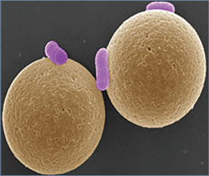
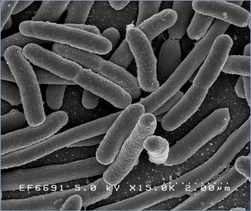
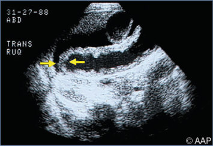
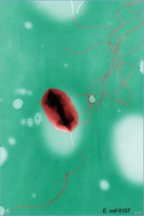
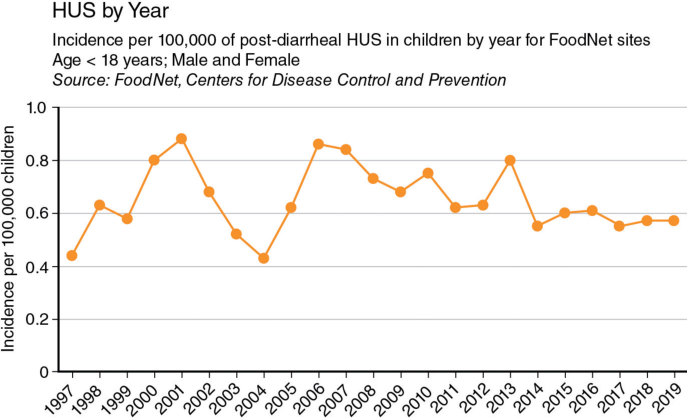

# 50. Escherichia coli Diarrhea (Including Hemolytic-Uremic Syndrome)
> Reference: [source credits](../../SOURCE_CREDITS.md). Printed pp. 255-262; PDF pp. 269-276.
> Editorial study pathway: Bacterial infections (not a part division in the source).
[Flashcards](../flashcards/050_flashcards.md) · [Quiz](../mcqs/050_mcqs.md) · [Full extraction](../../raw/chapters/050.md)

## Five study pillars

### Etiology and transmission
The 5 pathotypes of diarrhea-producing E coli have been distinguished by genetic, pathogenic, and clinical characteristics. Each pathotype is defined by the presence of virulence-related genes, and each comprises characteristic serotypes, indicated by somatic (O) and flagellar (H) antigens.
*Printed p. 256 / PDF p. 270*

### Clinical recognition
Escherichia coli is a common bacterial cause of diarrheal illness. At least 5 pathotypes of diarrhea-producing E coli strains have been identified.
*Printed p. 255 / PDF p. 269*

### Diagnostic workup
Food and Drug Administration (FDA)- approved multiplex nucleic acid amplification tests (usually offered as diagnostic panels) can detect a variety of enteric pathogens, including EAEC, EPEC, ETEC, and STEC. Some culture-independent tests include an E coli O157 specific marker to differentiate E coli O157 from non-O157 STEC serotypes.
*Printed p. 257 / PDF p. 271*

### Treatment in the atlas
Treatment is primarily supportive for all diarrheaproducing E coli.1 Orally administered electrolytecontaining solutions usually are adequate to prevent or treat dehydration and electrolyte abnormalities.2 Antimotility agents should not be administered to children with inflammatory or bloody diarrhea. Many experts advocate intravenous volume expansion during the first 4 days of proven STEC infection to maintain renal perfusion and reduce the risk of renal injury.
*Printed p. 257 / PDF p. 271*

### Prevention and infection control
In addition to standard precautions, contact precautions are indicated for diapered and incontinent patients with all types of E coli diarrhea for the duration of illness. Prolonged shedding has been noted in children younger than 5 years.
*Printed p. 258 / PDF p. 272*

## Clinical search tags
Fever, Diarrhea, Dysentery, Encephalitis / seizures, Anemia / hemolysis, Cytopenia, Immunocompromised host, Travel / endemic setting

## Full text, original tables, and images

# 50. Escherichia coli Diarrhea (Including Hemolytic-Uremic Syndrome)
> Private study reference ([source credits](../../SOURCE_CREDITS.md)). PDF pages 269-276; printed pages 255-262.

## PDF page 269 | printed page 255

(Including Hemolytic-Uremic Syndrome)

### CLINICAL MANIFESTATIONS

Escherichia coli is a common bacterial cause of diarrheal illness. At least 5 pathotypes of diarrhea-producing E coli strains have been identified. Clinical features of disease caused by each pathotype are summarized as follows (see also Table 50.1):

• Shiga toxin–producing E coli (STEC) organisms are associated with diarrhea, hemorrhagic colitis, and hemolytic-uremic syndrome (HUS). STEC O157:H7 is the virulent STEC serotype most often implicated in outbreaks, but other serotypes are increasingly common causes of illness. STEC illness typically begins with nonbloody diarrhea. Stools usually become bloody after 2 or 3 days, representing the onset of hemorrhagic colitis. Severe abdominal pain typically is short-lived, and low-grade fever is present in approximately onethird of cases. Illness caused by E coli O157:H7

Table 50.1 Classification of Escherichia coli Associated With Diarrhea

Pathotype Epidemiology Shiga toxin–producing E coli (STEC) Nonbloody and bloody diarrhea and hemolytic-uremic syndrome in all ages

Enteropathogenic E coli (EPEC) Acute and chronic endemic and epidemic diarrhea in infants in resource-limited countries; certain atypical strains in industrialized countries may cause disease

Enterotoxigenic E coli (ETEC) Infant diarrhea in resourcelimited countries, travelers’ diarrhea in all ages, and some cases in nontravelers

Enteroinvasive E coli (EIEC) Diarrhea with fever in all ages Enteroaggregative E coli (EAEC) Acute and chronic diarrhea in all ages

and other STEC organisms should be considered in people with presumptive diagnoses of intussusception, appendicitis, inflammatory bowel disease, and ischemic colitis. There are 2 types of Shiga toxin (Stx), Stx1 and Stx2, and several variants of each type. In the clinical setting, there is limited ability to differentiate between Stx variants.

• Diarrhea caused by enteropathogenic E coli (EPEC) is watery with prominent amounts of mucus but without gross blood. EPEC strains do not produce Shiga toxins and are distinguished from other diarrheagenic E coli by the distinctive attaching and effacing lesions they cause to the epithelium of the small intestine. Although usually mild, EPEC diarrhea can result in dehydration and death, particularly in resource-limited countries and immunocompromised patients. The diarrhea can be persistent and can result in wasting or growth restriction. Illness attributable to typical EPEC (caused by strains that harbor a virulence plasmid) occurs almost exclusively in children younger than 2 years and predominantly in resource-limited countries, either sporadically or in epidemics.

Type of Diarrhea Mechanism of Pathogenesis

Bloody or nonbloody Shiga toxin production, large bowel adherence, coagulopathy

Watery Small bowel adherence and effacement

Watery Heat stable and/or heat-labile enterotoxin production

Bloody or nonbloody; dysentery Mucosal invasion and inflammation of large bowel Watery, occasionally bloody Small and large bowel adherence, enterotoxin and cytotoxin production

### Geometry-detected table

|Pathotype|Epidemiology|Type of Diarrhea|Mechanism of Pathogenesis|
|---|---|---|---|
|Shiga toxin–producing _E coli_(STEC)|Nonbloody and bloody diar- rhea and hemolytic-uremic syndrome in all ages|Bloody or nonbloody|Shiga toxin production, large bowel adherence, coagulopathy|
|Enteropathogenic_E coli_ (EPEC)|Acute and chronic endemic and epidemic diarrhea in infants in resource-limited countries; certain atypical strains in industrialized countries may cause disease|Watery|Small bowel adherence and effacement|
|Enterotoxigenic_E coli_ (ETEC)|Infant diarrhea in resource- limited countries, travelers’ diarrhea in all ages, and some cases in nontravelers|Watery|Heat stable and/or heat-labile enterotoxin production|
|Enteroinvasive_E coli_ (EIEC)|Diarrhea with fever in all ages|Bloody or nonbloody; dysentery|Mucosal invasion and infammation of large bowel|
|Enteroaggregative_E coli_ (EAEC)|Acute and chronic diarrhea in all ages|Watery, occasionally bloody|Small and large bowel adherence, enterotoxin and cytotoxinproduction|

[View original table](../../tables/ch050_p0269_1.jpg)

## PDF page 270 | printed page 256

Atypical EPEC (caused by strains which do not harbor a virulence plasmid) can cause diarrhea in all ages, including prolonged diarrhea.

• Diarrhea caused by enterotoxigenic E coli (ETEC) is a 1- to 5-day, self-limited illness of moderate severity, typically with watery stools and abdominal cramps. ETEC is common in infants in resource-limited countries and in travelers to those countries. ETEC is the leading cause of travelers’ diarrhea. The prevalence of ETEC disease in the United States is unknown. With increasing use of culture-independent tests, ETEC infections may be detected more frequently especially in late summer into fall.

• Diarrhea caused by enteroinvasive E coli (EIEC) is similar clinically to diarrhea caused by Shigella species. Although dysentery can occur, diarrhea usually is watery without blood or mucus. Patients often are febrile, and stools can contain leukocytes. Severe cases of EIEC may require hospitalization.

• Enteroaggregative E coli (EAEC) organisms cause watery diarrhea and are common in people of all ages in industrialized as well as resource-limited countries. EAEC is a common cause of childhood diarrhea in resource-limited countries, acute travelers’ diarrhea, and persistent diarrhea in children or HIV-infected people. EAEC has been associated with prolonged diarrhea (14 days or longer). Asymptomatic infection can be accompanied by subclinical inflammatory enteritis and may stunt a child’s growth. With increasing use of cultureindependent tests, EAEC is being identified more frequently in the United States, even among those without international travel history.

Sequelae of STEC Infection.

HUS, manifested by varying degrees of hemolysis and uremia, is a serious sequela of STEC enteric infection believed to follow Stx-induced vasculitis and systemic complement cascade activation. STEC O157:H7 organisms are most commonly associated with HUS, which is defined by the triad of microangiopathic hemolytic anemia, thrombocytopenia, and acute renal dysfunction. HUS occurs more frequently in younger children; approximately 15% of children younger than 5 years develop HUS after E coli O157 infection as compared with approximately 6% among people

of all ages. Non-O157 STEC infections also may cause HUS but at a much lower frequency (approximately 1%) than O157 infections. HUS typically develops 7 days (up to 2 weeks, and rarely 2–3 weeks) after onset of diarrhea. The risk of developing HUS is lower in children who have a longer interval between diarrhea onset and presentation to the emergency department. More than 50% of children with HUS require dialysis, and up to 5% die. Patients with HUS can develop neurologic complications (eg, seizures, coma, or cerebral vessel thrombosis). Children presenting with an increased white blood cell count (>20 3 109/mL), neurologic complications, or need for dialysis are at higher risk of poor outcome, as are, seemingly paradoxically, children with hematocrit close to normal rather than low. There is increasing recognition of long-term risk for hypertension, proteinuria, and chronic kidney disease following HUS in children.

### ETIOLOGY

The 5 pathotypes of diarrhea-producing E coli have been distinguished by genetic, pathogenic, and clinical characteristics. Each pathotype is defined by the presence of virulence-related genes, and each comprises characteristic serotypes, indicated by somatic (O) and flagellar (H) antigens. Diarrhea is caused by the direct effects of the pathogens in the intestine.

### EPIDEMIOLOGY

Transmission of most diarrhea-associated E coli strains is through a fecal-oral mechanism.

STEC is shed in feces of cattle and, to a lesser extent, sheep, deer, and other ruminants. Human infection is acquired via contaminated food or water or via contact with an infected person, a fomite, or a carrier animal or its environment. Many foods have caused STEC outbreaks, including raw leafy vegetables, undercooked ground beef, cookie dough, raw flour, and unpasteurized milk and juice (see the Red Book Online outbreaks page for information on current outbreaks at https://publications.aap.org/redbook/ resources/17748). Outbreak investigations have implicated petting zoos, drinking water, and ingestion of recreational water. The infectious dose of STEC is low; thus, person-to-person transmission is common in households and child care centers. The number of infections reported annually to the

## PDF page 271 | printed page 257

U.S. laboratory-based enteric disease system of the Centers for Disease Control and Prevention (CDC) has increased in recent years because of the increasing use of culture-independent diagnostic tests.

The non-O157 STEC serogroups most commonly linked to illness in the United States are O26, O103, O111, O121, O145, and O45. Outbreaks from these serogroups are less common than those caused by serogroup O157 and are generally attributable to contaminated food or person-toperson transmission (often in a child care setting). There is a higher incidence of serogroup O157 infections in northern U.S. states compared with other regions.

With the exception of EAEC, non-STEC pathotypes most commonly are associated with disease in resource-limited countries, where food and water supplies are commonly contaminated and facilities and supplies for hand hygiene are suboptimal. For young children in resource-limited countries, transmission of ETEC, EPEC, and other diarrheal pathogens via contaminated weaning foods (sometimes by use of untreated drinking water in the foods) is common. ETEC diarrhea occurs in people of all ages but is especially frequent and severe in infants in resource-limited countries and travelers from industrialized countries visiting resource-limited countries. Breastfeeding is protective in such settings.

The incubation period for most diarrheaassociated E coli strains is 10 hours to 6 days; for E coli O157:H7, the incubation period usually is 3 to 4 days (range, 1–10 days).

### DIAGNOSTIC TESTS

Several U.S. Food and Drug Administration (FDA)- approved multiplex nucleic acid amplification tests (usually offered as diagnostic panels) can detect a variety of enteric pathogens, including EAEC, EPEC, ETEC, and STEC. Some culture-independent tests include an E coli O157 specific marker to differentiate E coli O157 from non-O157 STEC serotypes. Using these newer culture-independent methods, EAEC, EPEC, and ETEC may be detected more frequently than in the past and may represent colonization. Therefore, the pretest probability of the disease and clinical context, including the presence of other potential pathogens, must be considered when interpreting results of these tests.

Several commercially available, rapid immunologic assays for Shiga toxins in stool or broth culture of stool, including enzyme immunoassays (EIAs) and immunochromatographic assays, have been approved by the FDA. The Shiga toxin assays performed on broth-enriched stool specimens (usually incubated 18–24 hours) generally are more sensitive than those that test stool directly.

Rapid diagnosis facilitates patient management. Hydration is the cornerstone of management for all diarrhea cases and may be particularly protective against the development of nephropathy associated with HUS. Most E coli O157 isolates can be identified presumptively when grown on sorbitolcontaining selective media because they cannot ferment sorbitol within 24 hours. All presumptive E coli O157 isolates and all Shiga toxin-positive stool specimens that did not yield a presumptive E coli O157 isolate should be sent to a public health laboratory for further characterization, including identification of non-O157 serotype and determination of whole genome sequence.

Patients with post-diarrheal HUS should be presumed to have STEC infection, and STEC should be sought in stool specimens from all patients diagnosed with post-diarrheal HUS. However, the absence of STEC does not preclude the diagnosis of probable STEC-associated HUS, because HUS typically is diagnosed a week or more after onset of diarrhea, when the organism may not be detectable by conventional bacteriologic methods. In this setting, the selective enrichment of stool samples followed by immunomagnetic separation can markedly enhance the isolation of E coli O157 and other STEC for which immunomagnetic reagents are available. The test is available at some state public health laboratories and through requests to state health departments at the CDC. Serologic diagnosis using EIA to detect serum antibodies to E coli O157 and O111 lipopolysaccharides is available at the CDC for outbreak investigations and surveillance for patients with HUS; this testing can be arranged through state health departments.

### TREATMENT

Treatment is primarily supportive for all diarrheaproducing E coli.1 Orally administered electrolytecontaining solutions usually are adequate to prevent or treat dehydration and electrolyte

## PDF page 272 | printed page 258

abnormalities.2 Antimotility agents should not be administered to children with inflammatory or bloody diarrhea. Many experts advocate intravenous volume expansion during the first 4 days of proven STEC infection to maintain renal perfusion and reduce the risk of renal injury. Careful monitoring of patients with hemorrhagic colitis (including complete blood cell count with smear, blood urea nitrogen, and creatinine concentrations) is recommended to detect changes suggestive of HUS. If patients have no laboratory evidence of hemolysis, thrombocytopenia, or nephropathy 3 days after resolution of diarrhea, their risk of developing HUS is low.

In resource-limited countries, nutritional rehabilitation, including supplemental zinc and vitamin A, should be provided as part of case management algorithms for diarrhea where feasible. Feeding, including breastfeeding, should be continued for young children with E coli enteric infection.

Bismuth subsalicylate has been approved by the FDA for use in children 12 years and older and may be used in mild cases of ETEC travelers’ diarrhea. It can cause blackening of the tongue and stool, and patients should be advised to rinse their mouths after each dose. It contains salicylate and should not be used if there is concern for coinfection with varicella or influenza because of increased risk of Reye syndrome.

Antimicrobial Therapy

Antimicrobial therapy in patients with known or likely STEC infection remains controversial because of its association with an increased risk of developing HUS in some studies. A meta-analysis did not find that children with hemorrhagic colitis caused by STEC have a greater risk of developing HUS if treated with an antimicrobial agent. However, an association was found in analyses restricted to studies with low risk of bias and using the accepted HUS definition. Moreover, a controlled trial has not been performed, and a beneficial effect of antimicrobial treatment has not been proven. The most recently published observational studies found that treatment of diarrhea with at least some classes of antimicrobial agents was associated with HUS development. A large case-control study of 1,308 U.S. residents with E coli O157 infection found that people treated with

a beta-lactam antibiotic had 2.8-fold higher odds of developing HUS than those treated with other antibiotics. Most experts advise not prescribing antimicrobial therapy for children with E coli O157 enteritis or a clinical or epidemiologic presentation that strongly suggests STEC infection.

Antimicrobial therapy can be considered for travelers in resource-limited areas when diarrhea is moderate to severe or is associated with fever or bloody stools; however, the prevalence of antimicrobial resistance among enteric pathogens is increasing.3 Several antimicrobial agents, such as azithromycin, fluoroquinolones, and rifaximin can be effective in treatment of ETEC or EAEC travelers’ diarrhea. Treatment for no more than 3 days is advised. The choice of therapy depends on the pathogen and local antibiotic resistance patterns.

Patients with domestically acquired atypical EPEC (ie, as detected by molecular tests), EAEC, or ETEC will generally have self-limited diarrhea that does not require antimicrobial therapy. For patients with moderate or severe illness with persistent (>14 days) diarrhea attributable to diarrhea-producing E coli because they have no other pathogen detected, a treatment regimen similar to that used for ETEC or EAEC travelers’ diarrhea (azithromycin, a fluoroquinolone, or rifaximin) may be used.

### INFECTION PREVENTION AND CONTROL MEASURES IN HEALTH CARE SETTINGS

In addition to standard precautions, contact precautions are indicated for diapered and incontinent patients with all types of E coli diarrhea for the duration of illness. Prolonged shedding has been noted in children younger than 5 years.

### CONTROL MEASURES

E coli O157:H7 and Other STEC Infection

All meat should be cooked thoroughly. Ground beef should be cooked to an internal temperature of 160°F (71°C) until no pink meat remains and the juices are clear. Raw milk should not be ingested, and the certification of raw milk does not eliminate the risk of transmission of E coli organisms.4 Only pasteurized apple juice and cider products should be consumed. Care should be taken to prevent cross-contamination in areas of

## PDF page 273 | printed page 259

food preparation and good handwashing practices should be in place.

Outbreaks in Child Care Centers

If an outbreak of HUS or diarrhea attributable to STEC occurs in a child care center, immediate involvement of public health authorities is critical. Infection caused by STEC is notifiable, and rapid reporting of cases allows intervention to prevent further disease. Ill children with STEC O157 infection or virulent non-O157 STEC infection should not be permitted to reenter the child care center until all of the following: 2 stool cultures (obtained at least 48 hours after any antimicrobial therapy, if administered, has been discontinued) are negative, stools are contained in the diaper or the child is continent, stool frequency is no more than 2 stools above that child’s normal frequency, and the health department agrees with the return to child care. Stool cultures should be performed for any symptomatic contacts, and these children should be excluded from child care centers while symptomatic and the evaluation is pending. In outbreak situations involving STEC strains, stool cultures of asymptomatic contacts may aid controlling spread; consultation with public health authorities is advised. Strict attention to hand hygiene is important but can be insufficient to prevent transmission. The child care center should be closed to new admissions during an outbreak, and care should be exercised to prevent transfer of exposed children to other centers.

Nursery and Other Institutional Outbreaks

Similar to the child care institutional setting, strict attention to hand hygiene is essential for limiting spread. Ill patients should be separated from unexposed patients and their stool should be cultured as described above. Exposed patients should be observed closely.

Travelers’ Diarrhea

Travelers’ diarrhea usually is acquired by ingestion of contaminated food or water or contact with fomites and is a significant problem for people traveling in resource-limited countries. Diarrhea commonly is caused by ETEC and EAEC. Diarrhea attributable to non-O157 STEC infection is common among U.S. residents who have traveled internationally in the previous week, but E coli

O157 is rare. Travelers should be advised to drink only bottled or canned beverages and boiled or bottled water; travelers should avoid ice, raw produce, including salads, and fruit that they themselves have not peeled (only fruits with a thick peel, such as bananas and oranges, should be consumed). Cooked foods that have been left an ambient temperatures for prolonged periods should not be consumed. Hands should be washed carefully before preparing or eating food or feeding another person. Antimicrobial agents are not recommended for prevention of travelers’ diarrhea in children. Rehydration is the mainstay of treatment. Packets of oral rehydration salts can be added to boiled or bottled water and ingested to help maintain fluid balance, and breastfeeding should be encouraged and continued for young children.

Recreational Water (eg, Swimming Pools, Water Slides)

People should avoid ingesting recreational water. Because STEC has a low infectious dose and can be waterborne, people with proven or suspected STEC infection should not use recreational water venues when ill with diarrhea. As with other causes of diarrhea, children who have diarrhea attributable to STEC and who are incontinent should continue not to use recreational water venues until 1 week after symptoms resolve (or as advised by local or state public health authorities). Showering before swimming, taking children to the restroom frequently, changing diapers at designated diapering stations, and then washing hands can limit transmission of diarrheal pathogens through recreational water.

1 Shane AL, Mody RK, Crump JA, et al. 2017 Infectious Diseases Society of America clinical practice guidelines for the diagnosis and management of infectious diarrhea. Clin Infect Dis. 2017; 65(12):e45–e80. doi:10.1093/cid/cix669 2 Centers for Disease Control and Prevention. Managing acute gastroenteritis among children: oral rehydration, maintenance, and nutritional therapy. MMWR Recomm Rep. 2003;52 (RR-16):1–16 3 wwwnc.cdc.gov/travel/yellowbook/2024/preparing/ travelers-diarrhea 4 American Academy of Pediatrics, Committee on Infectious Diseases, Committee on Nutrition. Consumption of raw or unpasteurized milk and milk products by pregnant women and children. Pediatrics. 2014;133(1):175-179 (Reaffirmed November 2019)

## PDF page 274 | printed page 260

Image 50.1 Immunomagnetic bead selection of Escherichia coli bacteria. Courtesy of National Institute of Allergy and Infectious Diseases.

Image 50.3 Ultrasonographic image in a 6-year-old with hemorrhagic colitis from Escherichia coli O157:H7 who developed hemolytic-uremic syndrome. Note the bowel wall edema (arrows).

Image 50.2 Scanning electron micrograph of Escherichia coli grown in culture and adhered to a cover slip. Courtesy of National Institute of Allergy and Infectious Diseases.

Image 50.4 Escherichia coli in the intestine of an 8-month-old experiencing chronic diarrhea (fluorescent antibody stain). In a small number of individuals (mostly children <5 years and elderly people), E coli can cause hemolyticuremic syndrome, in which the red blood cells are destroyed and the kidneys fail. Courtesy of Centers for Disease Control and Prevention.

## PDF page 275 | printed page 261

Image 50.5 Transmission electron micrograph of Escherichia coli O157:H7. Courtesy of Centers for Disease Control and Prevention/ Peggy S. Hayes.

Image 50.6 Incidence of human Shiga toxin–producing Escherichia coli (STEC) infection reported to Laboratory-based Enteric Disease Surveillance (LEDS), by reporting partner, United States, 2016 (n 5 7,015).1 The “Total” category includes culture-confirmed infections of serogroup O157, non-O157 serogroups, and rough isolates.2 The “Rough” category includes isolates with an O antigen that could not be determined because the strain autoagglutinated (agglutinated in all antisera and diluent). Strains behaving in this manner are often blocked in 1 or more steps of O antigen synthesis and typically appear flat with irregular edges when grown on solid media. These isolates could be O157 or non-O157 STEC.3 The “Unknown” category includes STEC infections detected exclusively with culture-independent diagnostic tests and culture-confirmed STEC infections reported to LEDS without serogroup information. LEDS does not currently collect information on test type and cannot differentiate between these 2 types of reports. Courtesy of Centers for Disease Control and Prevention.

![Image 50.6 Incidence of human Shiga toxin–producing Escherichia coli (STEC) infection reported to Laboratory-based Enteric Disease Surveillance (LEDS), by reporting partner, United States, 2016 (n 5 7,015).1 The “Total” category includes culture-confirmed infections of serogroup O157, non-O157 serogroups, and rough isolates.2 The “Rough” category includes isolates with an O antigen that could not be determined because the strain autoagglutinated (agglutinated in all antisera and diluent). Strains behaving in this manner are often blocked in 1 or more steps of O antigen synthesis and typically appear flat with irregular edges when grown on solid media. These isolates could be O157 or non-O157 STEC.3 The “Unknown” category includes STEC infections detected exclusively with culture-independent diagnostic tests and culture-confirmed STEC infections reported to LEDS without serogroup information. LEDS does not currently collect information on test type and cannot differentiate between these 2 types of reports. Courtesy of Centers for Disease Control and Prevention.](../../figures/ch050_p0275_02.jpg)

## PDF page 276 | printed page 262

Image 50.7 Hemolytic-uremic syndrome (HUS) by year. Incidence per 100,000 of post-diarrheal HUS in children by year for Foodborne Diseases Active Surveillance Network (FoodNet) sites. Courtesy of Centers for Disease Control and Prevention.

Image 50.8 Rate of reported foodborne disease outbreaks per 1 million population and number of outbreaks, by state and confirmed and suspected etiologic agent—Foodborne Disease Outbreak Surveillance System, United States, 2017. Courtesy of Centers for Disease Control and Prevention.

