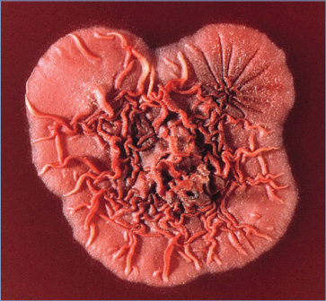
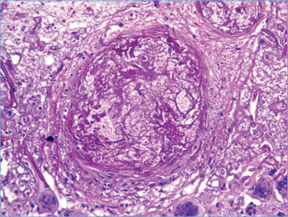
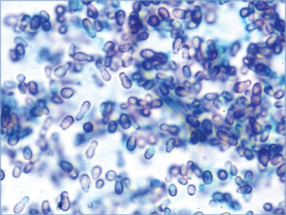
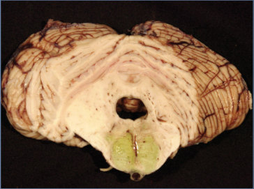
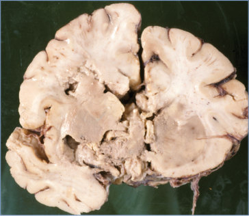

# 51. Other Fungal Diseases
> Reference: [source credits](../../SOURCE_CREDITS.md). Printed pp. 263-270; PDF pp. 277-284.
> Editorial study pathway: Fungal infections (not a part division in the source).
[Flashcards](../flashcards/051_flashcards.md) · [Quiz](../mcqs/051_mcqs.md) · [Full extraction](../../raw/chapters/051.md)

## Five study pillars

### Clinical recognition
Uncommonly encountered fungi can cause infection in infants and children with immunosuppression or other underlying conditions. Fungi can cause invasive mold infections, such as mucormycosis, fusariosis, scedosporiosis, and the phaeohyphomycoses (black molds), as well as invasive yeast infections with organisms such as Malazzesia, Trichosporon, Rhodotorula, and many more (more common mycoses, including aspergillosis, blastomycosis, candidiasis, coccidioidomycosis, cryptococcosis, histoplasmosis, paracoccidioidomycosis, and sporotrichosis, are discussed in individual chapters of Section 3 of the Red Book).
*Printed p. 263 / PDF p. 277*

## Clinical search tags
Immunocompromised host

## Full text, original tables, and images

# 51. Other Fungal Diseases
> Private study reference ([source credits](../../SOURCE_CREDITS.md)). PDF pages 277-284; printed pages 263-270.

## PDF page 277 | printed page 263

Uncommonly encountered fungi can cause infection in infants and children with immunosuppression or other underlying conditions. Fungi can cause invasive mold infections, such as mucormycosis, fusariosis, scedosporiosis, and the phaeohyphomycoses (black molds), as well as invasive yeast infections with organisms such as Malazzesia, Trichosporon, Rhodotorula, and many more (more common mycoses, including aspergillosis, blastomycosis, candidiasis, coccidioidomycosis, cryptococcosis, histoplasmosis, paracoccidioidomycosis, and sporotrichosis, are discussed in individual chapters of Section 3 of the Red Book). Children can acquire infection from these fungi through inhalation via the respiratory tract or direct inoculation after traumatic disruption of cutaneous barriers. A list of some of these fungi and the pertinent underlying host

conditions, reservoirs or routes of entry, clinical manifestations, diagnostic laboratory tests, and treatments can be found in Table 51.1. Taken as a group, few in vitro antifungal susceptibility data are available on which to base treatment recommendations for these uncommon invasive fungal infections, especially in children; thus, optimal treatments are not well established and antifungal choice may depend on the particular species. In addition, attempts to achieve source control and improve the net state of immunosuppression, including reversing severity of neutropenia, are critical. Reduction of immunosuppression and surgical excision and débridement should always be considered in management of invasive fungal infections, if feasible. Physicians should consider consultation with a pediatric infectious disease specialist experienced in the diagnosis and treatment of invasive fungal infections when treating a child infected with one of these mycoses.

## PDF page 278 | printed page 264

Voriconazole, or Voriconazole plus lipid amphotericin formulationb

Reservoir(s) or Route(s) of Entry Common Clinical Manifestations Diagnostic Laboratory Test(s) First-Line Antifungal Treatmenta

Voriconazole plus terbinafine

Culture and histopathologic examination of tissue Voriconazole

Culture of blood or tissue specimen, histopathologic examination of tissue

Pneumonia; localized pulmonary process or disseminated infection; osteomyelitis or septic arthritis; mycetoma (immunocompetent patients); endocarditis; keratitis and

Pulmonary infiltrates; cutaneous lesions (eg, ecthyma); sinusitis; keratitis; disseminated infection, onychomycosis

Additional Fungal Diseases

Hyalohyphomycosis Fusarium species Granulocytopenia; hematopoietic cell transplantation; severe immunocompromise; severe neutropenia and/or T-lymphocyte immunodeficiency

Table 51.1

Environment; respiratory tract; direct inoculation (eg, skin puncture)

Environment; respiratory tract; sinuses; skin; traumatic inoculation

Disease and Agent Underlying Host Condition(s)

None or trauma or immunosuppression; cystic fibrosis; chronic granulomatous disease; chronic glucocorticoid use; hematologic malignancy

Scedosporium apiospermum complex

Lomentospora (formerly Scedosporium) prolificans

Sinusitis; cutaneous lesions Culture and histopathologic examination of tissue Azoles (voriconazole,c posaconazole,c) or AMBb,d

Cladophialophora species None, trauma, or immunosuppression Environment Cerebral infection Culture and histopathologic examination of tissue Voriconazole,c with or without AMBd (posaconazole,c itraconazolee)

AMB; followed by itraconazolec

Environment; respiratory tract Pneumonitis; invasive dermatitis; disseminated infection Culture of blood, bone marrow, or tissue; histopathologic examination of tissue

endophthalmitis; brain abscesses; lesions of the skin, soft tissue, or bone

Phaeohyphomycosis

Alternaria species None, trauma, or immunosuppression Environment; respiratory tract; skin

Talaromycosis

Talaromyces (Penicillium) marneffei Human immunodeficiency virus infection; exposure to southeast Asia

### Geometry-detected table

|Disease and Agent|Underlying Host Condition(s)|Reservoir(s) or Route(s) of Entry|Common Clinical Manifestations|Diagnostic Laboratory Test(s)|First-Line Antifun- gal Treatmenta|
|---|---|---|---|---|---|
|**Hyalohyphomycosis**|**Hyalohyphomycosis**|**Hyalohyphomycosis**|**Hyalohyphomycosis**|**Hyalohyphomycosis**|**Hyalohyphomycosis**|
|_Fusarium_ species|Granulocytopenia; hematopoietic cell transplantation; severe immunocompromise; severe neutropenia and/or T-lymphocyte immunodefciency|Environment; respiratory tract; sinuses; skin; traumatic inoculation|Pulmonary infltrates; cutaneous lesions (eg, ecthyma); sinusitis; keratitis; disseminated infection, onychomycosis|Culture of blood or tissue specimen, histopathologic examination of tissue|Voriconazole, or Voriconazole plus lipid amphotericin formulationb|
|_Scedosporium apiospermum_ complex _Lomentospora (_formerly _Scedosporium) prolifcans_|None or trauma or immunosup- pression; cystic fbrosis; chronic granulomatous disease; chronic glucocorticoid use; hematologic malignancy|Environment; respiratory tract; direct inoculation (eg, skin puncture)|Pneumonia; localized pulmonary process or disseminated infection; osteomyelitis or septic arthritis; mycetoma (immunocompetent patients); endocarditis; keratitis and endophthalmitis; brain abscesses; lesions of the skin, soft tissue, or bone|Culture and histopatho- logic examination of tissue|Voriconazole Voriconazole plus terbinafne|
|**Talaromycosis**|**Talaromycosis**|**Talaromycosis**|**Talaromycosis**|**Talaromycosis**|**Talaromycosis**|
|_Talaromyces (Penicillium)_ _marneffei_|Human immunodefciency virus infection; exposure to southeast Asia|Environment; respiratory tract|Pneumonitis; invasive dermatitis; disseminated infection|Culture of blood, bone marrow, or tissue; histopathologic examination of tissue|AMB; followed by itraconazolec|
|**Phaeohyphomycosis**|**Phaeohyphomycosis**|**Phaeohyphomycosis**|**Phaeohyphomycosis**|**Phaeohyphomycosis**|**Phaeohyphomycosis**|
|_Alternaria_ species|None, trauma, or immunosuppression|Environment; respiratory tract; skin|Sinusitis; cutaneous lesions|Culture and histopatho- logic examination of tissue|Azoles (voriconazole,c posaconazole,c) or AMBb,d|
|_Cladophialophora_ species|None, trauma, or immunosuppres- sion|Environment|Cerebral infection|Culture and histopatho- logic examination of tissue|Voriconazole,c with or without AMBd (posaconazole,c itraconazolee)|

[View original table](../../tables/ch051_p0278_1.jpg)

## PDF page 279 | printed page 265

Environment Allergic fungal sinusitis; invasive dermatitis; disseminated infection Culture and histopathologic examination of tissue Allergic fungal sinusitis: surgery and corticosteroids

Invasive disease: azoles (voriconazole,c posaconazole,c itraconazolee) or AMB,d alone or in combination with echinocandinsb

For invasive infections, voriconazolef;

Culture and histopathologic examination of tissue Voriconazole,c,f itraconazole,c,e AMBd

Blood culture; histopathologic examination of tissue

Exophiala species, Exserohilum species None, trauma, or immunosuppression Environment Sinusitis; cutaneous lesions; disseminated infection; meningitis associated with contaminated steroid for epidural use

Bloodstream infection; superficial skin lesions endocarditis; peritonitis;

Invasive Yeasts

Trichosporon species Immunosuppression; central venous catheter; urinary catheter,

Environment; normal flora of

Curvularia species (including Bipolaris) Immunosuppression; altered skin integrity; asthma or nasal polyps; chronic sinusitis

(continues)

AMB,d removal of catheters, and temporary cessation of lipid parenteral nutrition infusion

For superficial infections, shaving of the hair and application of a topical azole to the affected areas Malassezia species Immunosuppression; preterm birth; exposure to parenteral nutrition that includes fat emulsions

posaconazole,c itraconazolee

or nodules; urine, sputum, and cerebrospinal cultures; bronchoscopy with alveolar lavage cultures

Culture of blood, catheter tip, or tissue specimen (requires special laboratory handling)

Skin Pityriasis versicolor, seborrheic dermatitis, central line-associated bloodstream infection; interstitial pneumonitis; urinary tract infection; meningitis

pneumonitis; disseminated infection

oral cavity, skin, and nails

hematologic malignancy, often with neutropenia; acquired immunodeficiency syndrome; extensive burns; glucocorticoid treatment; heart valve surgery; exposure to tropical environments

## PDF page 280 | printed page 266

Histopathologic examination of tissue and culture AMBb,d for initial therapy and consider posaconazole or isavuconazole for maintenance therapy

Reservoir(s) or Route(s) of Entry Common Clinical Manifestations Diagnostic Laboratory Test(s) First-Line Antifungal Treatmenta

Rhinocerebral infection; pulmonary infection; disseminated infection; skin (traumatic wounds) and gastrointestinal tract (less commonly)

Mucormycosis (formerly Zygomycosis)

Rhizopus; Mucor; Lichtheimia (formerly Absidia) species; Rhizomucor species; Cunninghamella species

AMB indicates amphotericin B. a Strongly or moderately recommended first-line antifungal; additional details, including alternative first or second-line antifungals available in the global guidelines:

Table 51.1 (continued)

Environment; respiratory tract; skin; ingestion

Immunosuppression; hematologic malignant neoplasm; renal failure; diabetes mellitus; iron overload syndromes

Disease and Agent Underlying Host Condition(s)

* Hoenigl M, Salmanton-García J, Walsh TJ, et al. Global guideline for the diagnosis and management of rare mould infections: an initiative of the European Confederation of Medical Mycology in cooperation with the International Society for Human and Animal Mycology and the American Society for Microbiology. Lancet Infect Dis. 2021;21(8):e246–e257 * Cornely O, Alastruey-Izquierdo A, Arenz D, et al. Global guideline for the diagnosis and management of mucormycosis: an initiative of the European Confederation of Medical Mycology in cooperation with the Mycoses Study Group Education and Research Consortium. Lancet Infect Dis. 2019;19(12):e405–e421 * Chen SC-A, Perfect J, Colombo AL, et al. Global guidelines for the diagnosis and management of rare yeast infections: an initiative of the ECMM in cooperation with ISHAM and ASM. Lancet Infect Dis. 2021;21(12):e375–e386 b There are no definitive data to routinely recommend the use of antifungal combination therapy, although combination therapy may frequently be used particularly until final species identification is known to tailor therapy. c No U.S. Food and Drug Administration approval for this indication. d Consider use of amphotericin B lipid formulations: liposomal amphotericin B is the preferred formulation; when lipid formulations are not available, deoxycholate amphotericin B may be an alternative. e Itraconazole has been shown to be effective for cutaneous disease in adults, but safety and effectiveness have not been established in children younger than 18 years. f Voriconazole demonstrates activity in vitro, but no clinical data are available.

### Geometry-detected table

|Disease and Agent|Underlying Host Condition(s)|Reservoir(s) or Route(s) of Entry|Common Clinical Manifestations|Diagnostic Laboratory Test(s)|First-Line Antifun- gal Treatmenta|
|---|---|---|---|---|---|
|**Mucormycosis(formerly Zygomycosis)**|**Mucormycosis(formerly Zygomycosis)**|**Mucormycosis(formerly Zygomycosis)**|**Mucormycosis(formerly Zygomycosis)**|**Mucormycosis(formerly Zygomycosis)**|**Mucormycosis(formerly Zygomycosis)**|
|_Rhizopus_; _Mucor_; _Lichtheimia (_formerly _Absidia)_ species; _Rhizomucor_ species; _Cunninghamella_ species|Immunosuppression; hematologic malignant neoplasm; renal failure; diabetes mellitus; iron overload syndromes|Environment; respiratory tract; skin; ingestion|Rhinocerebral infection; pulmonary infection; disseminated infection; skin (traumatic wounds) and gastro- intestinal tract (less commonly)|Histopathologic examina- tion of tissue and culture|AMBb,d for initial therapy and consider posaconazole or isavuconazole for main- tenance therapy|

[View original table](../../tables/ch051_p0280_1.jpg)

## PDF page 281 | printed page 267

Image 51.1 Note the histopathologic changes observable in a mouse testicle and indicative of penicilliosis caused by Penicillium marneffei. With methenamine silver stain, the histopathologic changes indicative of penicilliosis, caused specifically by P marneffei, include the presence of globeshaped yeast cells undergoing multiplication through fission. Courtesy of Centers for Disease Control and Prevention.

Image 51.3 This micrograph reveals a conidia-laden conidiophore of the fungus Bipolaris hawaiiensis. Bipolaris species are known to be one of the causative agents of the fungal illness phaeohyphomycosis, which can be superficially confined to the skin or systemically disseminated and can involve the brain, lungs, and bones. Courtesy of Centers for Disease Control and Prevention.

Image 51.2 This slide shows the histopathologic changes observable in a heart valve and resultant from zygomycosis caused by Rhizomucor pusillus. With methenamine silver stain, one can detect the presence of fungal elements associated with zygomycosis, including sparsely septate hyphae, among a mostly acute inflammatory process with some islands of chronic granulomatous inflammation. Courtesy of Centers for Disease Control and Prevention.

Image 51.4 Note the fine branching tubes of the fungus Exserohilum rostratum, which is the cause of phaeohyphomycosis. Phaeohyphomycosis is a fungal infection characterized by superficial and deep tissue involvement caused by dematiaceous, dark-walled fungi that form pigmented hyphae, or fine branching tubes, and yeast-like cells in the infected tissues. Courtesy of Centers for Disease Control and Prevention.

## PDF page 282 | printed page 268

Image 51.5 This photomicrograph reveals a mature sporangium of a Mucor species fungus. Mucor is a common indoor mold and is among the fungi that cause the group of infections known as zygomycosis. The infection typically involves the rhino-facial-cranial area, lungs, gastrointestinal tract, or skin and less commonly involves other organ systems. Courtesy of Centers for Disease Control and Prevention.

Image 51.7 This micrograph depicts multiple conidia-laden conidiophores and phialides of a Penicillium marneffei fungal organism. Penicillium species are known to cause penicilliosis, which usually affects individuals with immunocompromise, such as those with AIDS or undergoing chemotherapy. P marneffei is normally acquired though inhalation of airborne spores. Courtesy of Centers for Disease Control and Prevention.

Image 51.6 The surface of a Penicillium marneffei colony. P marneffei is endemic to Southeast Asia, where it is one of the more common HIV-related opportunistic infections. Courtesy of Centers for Disease Control and Prevention.

Image 51.8 This micrograph depicts a number of mycelia with attached conidia of the fungal organism Pseudallescheria boydii. The opportunistic pathogen P boydii is responsible for the infection known as pseudallescheriasis, which normally affects those who are immunocompromised, and is also known to be a cause of white grain mycetoma. Courtesy of Centers for Disease Control and Prevention.

## PDF page 283 | printed page 269

Image 51.9 This photomicrograph reveals the conidiophores with conidia of the fungus Pseudallescheria boydii from a slide culture. P boydii is pathogenic in humans, especially those who are immunocompromised, causing infections in almost all body regions, and is classified under the broad heading of pseudallescheriasis. Courtesy of Centers for Disease Control and Prevention.

Image 51.11 Malassezia furfur pneumonitis. Organisms observable with a tissue stain for fungi. Courtesy of Dimitris P. Agamanolis, MD.

Image 51.10 This culture plate revealed the results of a susceptibility test to the antifungal drug amphotericin B. The drug inhibited growth of the fungal organism Exserohilum in the clear area where the amphotericin B had diffused into the medium, whereas the Exserohilum organisms were growing elsewhere on the plate, where the drug had not diffused into the medium.

Image 51.12 Cerebral mucormycosis. Fungal organism invaded the vessel wall. The vessel is thrombosed. Courtesy of Dimitris P. Agamanolis, MD.

## PDF page 284 | printed page 270

Image 51.13 Cerebral mucormycosis in a patient with acute lymphoblastic leukemia. Occlusion of the basilar artery and infarct of the pons. The patient had jaundice. Courtesy of Dimitris P. Agamanolis, MD.

Image 51.14 Extensive cerebral necrosis in a patient with mucormycosis. Courtesy of Dimitris P. Agamanolis, MD.

