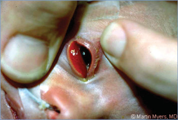
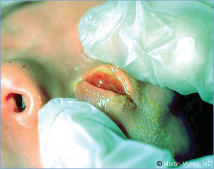
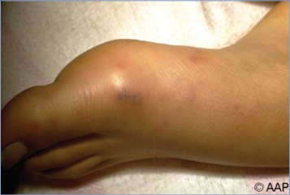
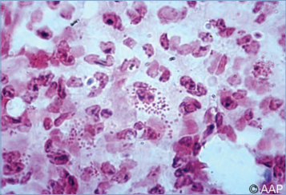
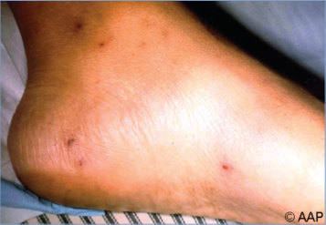
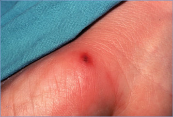
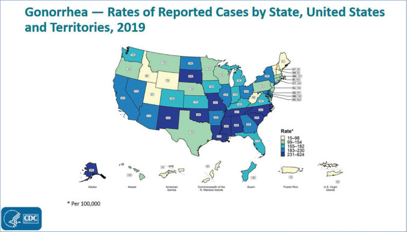
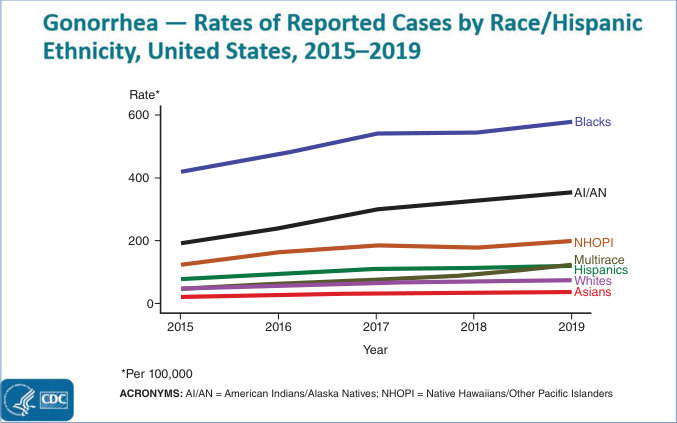

# 54. Gonococcal Infections
> Reference: [source credits](../../SOURCE_CREDITS.md). Printed pp. 280-289; PDF pp. 294-303.
> Editorial study pathway: Bacterial infections (not a part division in the source).
[Flashcards](../flashcards/054_flashcards.md) · [Quiz](../mcqs/054_mcqs.md) · [Full extraction](../../raw/chapters/054.md)

## Five study pillars

### Etiology and transmission
Neisseria gonorrhoeae is a gram-negative, oxidasepositive diplococcus.
*Printed p. 280 / PDF p. 294*

### Clinical recognition
Gonococcal infections are manifested by a spectrum of clinical presentations ranging from asymptomatic infection, to localized infections (usually mucosal), to disseminated disease, and should be considered in 3 distinct age groups: newborn infants, prepubertal children, and postpubertal sexually active adolescents and young adults. Multiple sites of infection can occur simultaneously in one person.
*Printed p. 280 / PDF p. 294*

### Diagnostic workup
Microscopic examination of Gram-stained smears of exudate from the conjunctivae, penile urethra, skin lesions, synovial fluid, and when clinically warranted, cerebrospinal fluid (CSF) may be useful in the initial evaluation. Identification of gram-negative intracellular diplococci in these smears can be helpful, particularly if the organism is not recovered in culture.
*Printed p. 281 / PDF p. 295*

### Treatment in the atlas
A single dose of intramuscular ceftriaxone is the recommended treatment for uncomplicated gonorrhea infections of the cervix, urethra, and rectum. If chlamydial infection has not been excluded, treat for C trachomatis with either oral doxycycline, azithromycin, levofloxacin, or erythromycin, depending on weight of the child/adolescent.
*Printed p. 282 / PDF p. 296*

### Prevention and infection control
Standard precautions are recommended, including for newborn infants with ophthalmia.
*Printed p. 282 / PDF p. 296*

## Clinical search tags
Vesicles, Petechiae / purpura, Maculopapular rash, Conjunctivitis, Pharyngitis, Hepatitis / jaundice, Meningitis, Arthritis / bone pain, Abscess / soft tissue, Sepsis / shock, Congenital / neonatal

## Full text, original tables, and images

# 54. Gonococcal Infections
> Private study reference ([source credits](../../SOURCE_CREDITS.md)). PDF pages 294-303; printed pages 280-289.

## PDF page 294 | printed page 280

### CLINICAL MANIFESTATIONS

Gonococcal infections are manifested by a spectrum of clinical presentations ranging from asymptomatic infection, to localized infections (usually mucosal), to disseminated disease, and should be considered in 3 distinct age groups: newborn infants, prepubertal children, and postpubertal sexually active adolescents and young adults. Multiple sites of infection can occur simultaneously in one person.

• Asymptomatic infection has been detected in the oropharynx of child sexual abuse survivors and in the urogenital tract of sexually active female (up to 80% are asymptomatic) and male (less than 10% can be asymptomatic) individuals.1 In all age groups, most pharyngeal infections are asymptomatic. Likewise, most rectal infections are asymptomatic; rectal carriage can accompany 20% to 70% of urogenital infections in female individuals.

• Localized disease presents at the site of inoculation and includes (1) scalp abscess, which can be associated with fetal scalp monitoring; (2) ophthalmia neonatorum in newborn infants following exposure during birth, or conjunctivitis in any age group following eye inoculation with infected secretions (eg, through hand transfer from urogenital tract); (3) acute tonsillopharyngitis, accompanied by cervical adenopathy; (4) urethritis (with mucopurulent discharge, dysuria, and/or suprapubic pain) in any age group or sex; (5) genital disease such as vulvitis and/or vaginitis in prepubertal patients (with vaginal discharge and/or dysuria), bartholinitis and/or cervicitis in postpubertal patients (with mucopurulent discharge, intermenstrual bleeding, and/or dyspareunia), and penile abscess; and (6) proctitis (symptoms range from painless mucopurulent discharge and scant rectal bleeding to overt proctitis with associated rectal pain and tenesmus). Extension to the upper genital tract and beyond (less common in prepubertal children) can result in pelvic inflammatory disease (endometritis and/ or salpingitis), perihepatitis (Fitz-Hugh-Curtis syndrome) in female individuals, and epididymitis,

prostatitis, and/or seminal vesiculitis in male individuals, with resultant scarring, ectopic pregnancy, impairment of fertility, and chronic pelvic pain (particularly in female individuals).

• Disseminated gonococcal infection (DGI) can occur in up to 3% of untreated people with mucosal gonorrhea. DGI can manifest as petechial or pustular skin lesions and as asymmetric polyarthralgia, tenosynovitis, or oligoarticular septic arthritis (arthritis-dermatitis syndrome). In neonates, DGI can present as sepsis, arthritis, or meningitis. Bacteremia can result in a maculopapular rash with necrosis, tenosynovitis, and migratory arthritis. Arthritis may be reactive (sterile) or septic in nature. Meningitis and endocarditis occur rarely.

### ETIOLOGY

Neisseria gonorrhoeae is a gram-negative, oxidasepositive diplococcus.

### EPIDEMIOLOGY

Gonococcal infections occur only in humans. The source of the organism is exudate and secretions from infected mucosal surfaces; N gonorrhoeae is communicable as long as a person harbors the organism. Transmission results from intimate contact, such as sexual acts and parturition. Sexual abuse is the most frequent cause of gonococcal infection in prepubertal children beyond the newborn period.

N gonorrhoeae infection is the second most commonly reported sexually transmitted infection (STI) in the United States, following Chlamydia trachomatis infection. Reported gonorrhea cases continued to be highest among adolescents and young adults. Rates of reported gonorrhea are highest in the southern United States and have significant racial/ethnic disparities. The rate of reported gonorrhea cases among Black people in the United States is significantly higher than among white people. These higher rates are not caused by ethnicity or genetic predisposition; rather, they are caused by social factors, such as poverty or inequities in education, which are more likely to affect minority groups. Disparities in gonorrhea rates also are identified in certain sexual networks. For example, surveillance networks that monitor trends in STI prevalence among men who

## PDF page 295 | printed page 281

have sex with men (MSM) have found very high proportions of positive gonorrhea pharyngeal, urethral, and rectal test results as well as coinfection with other STIs. Populations at greater risk for DGI include asymptomatic carriers; neonates; menstruating, pregnant, and postpartum people; MSM; and individuals with complement deficiency or taking eculizumab.

Gonorrhea can quickly develop resistance to antibiotics used to treat infection, and in 2019 more than half of all infections were estimated to be resistant to at least 1 antibiotic. Since 2010, almost all circulating strains in the United States, based on gonococcal isolates collected through sentinel surveillance in the Gonococcal Isolate Surveillance Project, remain susceptible to ceftriaxone, the primary treatment for gonorrhea; only 0.1% of isolates displayed elevated ceftriaxone minimum inhibitory concentrations (MICs) in 2020. In 2020, 4.8% of isolates had elevated azithromycin MICs; the proportion was higher among MSM versus men who have sex with women (9.2% vs 4.3%). In 2020, the prevalence of ciprofloxacin resistance was 34.8%.

Diagnosis of genitourinary tract gonorrhea infection should also prompt investigation for other STIs, including chlamydia, trichomoniasis, syphilis, and HIV infection. Concurrent infection with C trachomatis is common. People treated for gonococcal infection should also be treated with a regimen that is effective against C trachomatis if chlamydia infection has not been excluded.

The incubation period usually is 2 to 7 days.

### DIAGNOSTIC TESTS2,3,4

Microscopic examination of Gram-stained smears of exudate from the conjunctivae, penile urethra, skin lesions, synovial fluid, and when clinically warranted, cerebrospinal fluid (CSF) may be useful in the initial evaluation. Identification of gram-negative intracellular diplococci in these smears can be helpful, particularly if the organism is not recovered in culture. However, because of low sensitivity, a negative smear result should not be considered sufficient for ruling out infection. Intracellular gram-negative diplococci identified on Gram stain of conjunctival exudate justify presumptive treatment for gonorrhea after appropriate cultures for N gonorrhoeae are performed.

N gonorrhoeae can be isolated from normally sterile sites, such as blood, CSF, or synovial fluid, using nonselective chocolate agar with incubation in 5% to 10% carbon dioxide. Selective media that inhibit normal flora and nonpathogenic Neisseria organisms are used for cultures from nonsterile sites, such as the cervix, vagina, rectum, urethra, and pharynx. Specimens for N gonorrhoeae culture from mucosal sites should be inoculated immediately onto appropriate agar because the organism is extremely sensitive to drying and temperature changes. Culture allows for antimicrobial susceptibility testing to aid in management if infection persists following initial therapy.

A nucleic acid amplification test (NAAT) is far superior in overall performance compared with other N gonorrhoeae culture and nonculture diagnostic methods to test genital and extragenital specimens. Many commercially available products now are cleared by the U.S. Food and Drug Administration (FDA) for testing penile urethral meatal swab specimens, endocervical or vaginal swab specimens (provider or patient collected), urine specimens, oropharynx or rectal swab specimens (provider or patient collected), or liquid cytology specimens. Although NAATs are not FDA cleared for N gonorrhoeae testing on conjunctival swab specimens, they have been shown to be more sensitive compared with N gonorrhoeae culture. Product inserts for each NAAT manufacturer should be reviewed because approved collection methods and specimen types vary. For urogenital infections, the Centers for Disease Control and Prevention (CDC) recommends that optimal specimen types for gonorrhea screening using NAATs include first void urine for male patients and vaginal swab specimens for female patients. Patient-collected samples can be used in place of provider-collected samples in clinical settings when testing by NAAT for urine, penile urethral meatal, vaginal, rectal, and oropharyngeal swab specimens, and if appropriate instructions to patients have been provided. Certain NAAT platforms also permit combined testing of specimens for N gonorrhoeae and C trachomatis.

Infants and Children

Culture can be used to test urogenital and extragenital sites in infants and children. NAATs can be used to test for N gonorrhoeae from urine and

## PDF page 296 | printed page 282

vaginal specimens. Although data on NAATs from extragenital sites in children are more limited and performance is test dependent, no evidence suggests that performance of a NAAT for detection of N gonorrhoeae in children would differ from that in adults. Because of the implications of a diagnosis of N gonorrhoeae in a child, however, only validated, FDA-cleared NAATs should be used for extragenital specimens. Consultation with an expert is necessary before using a NAAT in this context, to minimize the possibility of cross-reaction with nongonococcal Neisseria species and other commensals. Gram stains are inadequate for evaluating prepubertal children for gonorrhea and should not be used to diagnose or exclude gonorrhea.

### TREATMENT5

A single dose of intramuscular ceftriaxone is the recommended treatment for uncomplicated gonorrhea infections of the cervix, urethra, and rectum. If chlamydial infection has not been excluded, treat for C trachomatis with either oral doxycycline, azithromycin, levofloxacin, or erythromycin, depending on weight of the child/adolescent. Treatment regimens for most syndromes caused by gonococcal infections, including urethritis, cervicitis, pelvic inflammatory disease, epididymitis, and proctitis, are provided in the chapter on STIs. A single 500-mg dose of intramuscular ceftriaxone also is recommended for the treatment of uncomplicated gonococcal infections of the pharynx. Gonococcal infections of the pharynx are more difficult to eradicate than are infections at urogenital and anorectal sites.

Resistance to penicillin and tetracycline is widespread, and as of 2007, the CDC no longer recommends the use of fluoroquinolones for gonorrhea because of the increased prevalence of quinoloneresistant N gonorrhoeae in the United States. Over the past decade, the MIC for cefixime against N gonorrhoeae strains circulating in the United States and other countries has increased, and treatment failure following the use of cefixime has been described in North America, Europe, and Asia. Therefore, as of 2012, the CDC no longer recommends the use of cefixime as a first-line treatment for gonococcal infection. Only ceftriaxone is recommended currently for treatment of gonorrhea in the United States.

To maximize adherence with recommended therapies and reduce complications and transmission, medication for gonococcal infection should be provided on site and directly observed. If medications are not available when treatment is indicated, linkage to an STI treatment facility should be provided for same-day treatment. To minimize disease transmission, people treated for gonorrhea should be instructed to abstain from sexual activity for 7 days after treatment and until all sex partners are adequately treated (7 days after receiving treatment and resolution of symptoms, if present).

Neonatal Infection

Infants with clinical evidence of ophthalmia neonatorum or scalp abscess attributable to N gonorrhoeae should be hospitalized, managed in consultation with a pediatric infectious disease specialist, and evaluated for disseminated infection (sepsis, arthritis, meningitis).

One dose of ceftriaxone (25–50 mg/kg, intravenously [IV] or intramuscularly [IM]) is adequate therapy for gonococcal ophthalmia. For neonates who are unable to receive ceftriaxone because of simultaneous administration of intravenous calcium, 1 dose of cefotaxime (100 mg/kg, IV or IM) may be given. Topical antibiotic therapy alone is inadequate and unnecessary if systemic treatment is administered.

For gonococcal scalp abscesses and DGIs in neonates, treatment is with ceftriaxone (25–50 mg/ kg/day, IV, administered once daily) or cefotaxime (50 mg/kg/day in 2 divided daily doses, IV or IM) for 7 days, with a duration of 10 to 14 days if meningitis is documented.

### INFECTION PREVENTION AND CONTROL MEASURES IN HEALTH CARE SETTINGS

Standard precautions are recommended, including for newborn infants with ophthalmia.

### CONTROL MEASURES

Current control measures consist of counseling on the use of barrier protection during sexual intercourse, close follow-up of infected patients and their contacts, chemoprophylaxis recommended for specific clinical scenarios, routine screening in accordance with guidelines, and case reporting to public health authorities. There is no vaccine to prevent gonococcal infections.

## PDF page 297 | printed page 283

Follow-up

A test-of-cure is not needed for people in whom uncomplicated urogenital or rectal gonorrhea is diagnosed who are treated with a single dose of ceftriaxone. Any person with pharyngeal gonorrhea should return between 7 to 14 days after initial treatment for a test-of cure using culture, NAAT, or both. If the NAAT result is positive, effort should be made to perform a confirmatory culture before retreatment, if a culture was not already collected. All positive cultures for test-of-cure should undergo antimicrobial susceptibility testing. People who have been treated for gonorrhea should be retested 3 months after treatment for the possibility of reinfection, regardless of whether they believe their sex partners were treated. If retesting at 3 months is not possible, clinicians should retest whenever people next present for medical care within 12 months following initial treatment. All people in whom gonorrhea is diagnosed should be tested for other STIs, including chlamydia, trichomoniasis (vaginal specimens), syphilis, and HIV infection.

Management of Sex Partners

Recent sex partners (ie, people having had sexual contact with the infected patient within the 60 days preceding onset of symptoms or gonorrhea diagnosis) should be referred for evaluation, testing, and presumptive treatment. If the patient’s last potential sexual exposure was >60 days before onset of symptoms or diagnosis, the most recent sex partner should be treated. To avoid reinfection, sex partners should be instructed to abstain from condomless sexual intercourse for 7 days after they and their sexual partner(s) have completed treatment and after resolution of symptoms, if present.

For people with gonorrhea for whom health department partner-management strategies are impractical or unavailable and whose providers are concerned about partners’ access to prompt clinical evaluation and treatment, expedited partner therapy can be delivered to the partner by the patient, a disease investigation specialist, or a collaborating pharmacy, as permitted by law. Details are provided in the CDC STI Guidelines.6

Prophylaxis

Neonatal Ophthalmia

If gonorrhea is prevalent in the region and prenatal treatment cannot be ensured, or where required by law, a prophylactic agent should be instilled into the eyes of all newborn infants (including those born by cesarean delivery) to prevent sight-threatening gonococcal ophthalmia.

Newborn Infants Whose Birthing Parent Has Gonococcal Infection

A neonate whose birthing parent has untreated gonorrhea is at high risk for infection. These neonates should be tested for gonorrhea at exposed sites (eg, conjunctive, vaginal, rectal, and oropharynx) and treated presumptively for gonorrhea.

Children and Adolescents With Sexual Exposure to a Patient Known to Have Gonorrhea

People sexually exposed within the 60 days preceding onset of symptoms or gonorrhea in the index case (or most recent sexual contact, if last potential sexual exposure was >60 days before onset of symptoms or gonorrhea) should undergo examination and culture and should receive the same treatment as do people known to have gonorrhea.

Postexposure Prophylaxis

Doxycycline, 200 mg, administered within 24 to 72 hours of condomless sex (doxy-PEP) has been shown in studies to reduce the incidence of syphilis, chlamydia, and gonorrhea among cisgender MSM and transgender women with a recent history of these infections.

Routine Screening

Annual screening for N gonorrhoeae infection is recommended for all sexually active women younger than 25 years.7 Additional risk factors for gonorrhea include inconsistent condom use among people who are not in mutually monogamous relationships, previous or coexisting STIs, and exchanging sex for money or drugs. Clinicians should consider the communities they serve and might opt to consult local public health authorities for guidance on identifying groups at increased risk. Gonococcal infection is concentrated in specific geographic locations and communities. MSM at high risk for gonorrhea infection

## PDF page 298 | printed page 284

(multiple anonymous partners, substance use) or those at risk for HIV acquisition should be screened at all sites of exposure every 3 to 6 months. At least annual screening is recommended for all MSM. A recent travel history with sexual contacts outside of the United States should be part of any gonorrhea evaluation.

All pregnant people younger than 25 years should be screened for gonorrhea at the first prenatal visit. Pregnant people 25 years and older should be screened if they are considered at risk (ie, a new sex partner, more than 1 sex partner, a sex partner with concurrent partners, or a sex partner who has an STI or lives in an area with a high rate of gonorrhea). A repeat screen in the third trimester is recommended for pregnant people at continued risk of gonococcal infection, including all patients younger than 25 years. Pregnant people with a diagnosis of gonorrhea should be treated immediately and rescreened within 3 months.

Public Health Reporting

All cases of gonorrhea must be reported to local public health officials. Cases in prepubertal children must be investigated to determine the source of infection.

Image 54.1 Scanning electron micrograph of Neisseria gonorrhoeae bacteria, which cause gonorrhea. Captured by the Research Technologies Branch at the Rocky Mountain Laboratories in Hamilton, Montana. Courtesy of National Institute of Allergy and Infectious Diseases.

1 The terms female, male, women, and men refer to sex assigned at birth. 2 American Academy of Pediatrics, Committee on Adolescence;

Society for Adolescent Health and Medicine. Screening for nonviral sexually transmitted infections in adolescents and young adults. Pediatrics. 2014;134(1):e302–e311 3 Centers for Disease Control and Prevention. Recommendations for the laboratory-based detection of Chlamydia trachomatis and Neisseria gonorrhoeae-2014. MMWR Recomm Rep. 2014;63(RR-2):1–19 4 Centers for Disease Control and Prevention. Sexually transmitted infections treatment guidelines, 2021. MMWR Recomm Rep. 2021;70(4):1–187. Available at: www.cdc.gov/std/ treatment-guidelines/gonorrhea.htm 5 Centers for Disease Control and Prevention. Sexually transmitted infections treatment guidelines, 2021. MMWR Recomm Rep. 2021;70(4):1–187. Available at: www.cdc.gov/std/ treatment-guidelines/gonorrhea.htm 6 Centers for Disease Control and Prevention. Sexually transmitted infections treatment guidelines, 2021. MMWR Recomm Rep. 2021;70(4):1–187. Available at: www.cdc.gov/ std/treatment-guidelines/clinical-partnerServices.htm 7 U.S. Preventive Services Task Force. Final Recommendation

Statement: Chlamydia and Gonorrhea: Screening. September 14, 2021. Available at: www.uspreventiveservicestaskforce.org/uspstf/recommendation/chlamydia-andgonorrhea-screening

Image 54.2 An infant with gonococcal ophthalmia. In-hospital evaluation and treatment are recommended for infants with gonococcal ophthalmia. Copyright Martin G. Myers, MD.

## PDF page 299 | printed page 285

Image 54.3 An 8-day-old with gonococcal ophthalmia. Copyright Martin G. Myers, MD.

Image 54.5 Profuse, purulent vaginal discharge in an 18-month-old who has gonococcal vulvovaginitis. In preadolescent children, this infection is almost always associated with sexual abuse. Identification of the species of cultured gonococci is imperative in suspected cases of sexual abuse.

Image 54.7 Gram stain of cervical discharge in an adolescent who has gonococcal cervicitis. Note multiple intracellular diplococci. In children with suspected abuse, it is imperative that the gonococcus be cultured and identified to distinguish pathogens from normal flora.

Image 54.4 This newborn has gonococcal ophthalmia neonatorum caused by a maternally transmitted gonococcal infection. Unless preventive measures are taken, it is estimated that gonococcal ophthalmia neonatorum will develop in 28% of neonates born to mothers with gonorrhea. It affects the corneal epithelium, causing microbial keratitis, ulceration, and perforation. Courtesy of Centers for Disease Control and Prevention.

Image 54.6 This colposcopic view of this patient’s cervix revealed an eroded ostium caused by Neisseria gonorrhoeae infection. A chronic N gonorrhoeae infection can lead to complications that can be apparent, such as this cervical inflammation, and some can be quite incipient, giving the impression that the infection has subsided although treatment is still needed. Courtesy of Centers for Disease Control and Prevention.

Image 54.8 Gonococcemia with maculopapular and petechial skin lesions, most commonly observed on the hands and feet.

## PDF page 300 | printed page 286

Image 54.9 Intracellular gram-negative diplococci (Neisseria gonorrhoeae) isolated on culture of a petechial skin lesion.

Image 54.11 This patient presented with a cutaneous gonococcal lesion caused by a disseminated Neisseria gonorrhoeae bacterial infection. Although gonorrhea is a sexually transmitted infection, if a gonococcal infection is allowed to go untreated, N gonorrhoeae bacteria can disseminate throughout the body, forming lesions in extragenital locations. Courtesy of Centers for Disease Control and Prevention.

Image 54.10 Adolescent with septic arthritis of the left ankle with petechial and necrotic skin lesions on the feet. Blood cultures were positive for Neisseria gonorrhoeae.

Image 54.12 This patient presented with purulent penile discharge caused by gonorrhea with an overlying penile pyoderma lesion. Pyoderma involves the formation of a purulent skin lesion, as in this case, located on the glans penis and overlying the sexually transmitted gonorrhea. Courtesy of Centers for Disease Control and Prevention.

## PDF page 301 | printed page 287

Image 54.13 This photomicrograph reveals the histopathologic features in an acute case of gonococcal urethritis (Gram stain). This image demonstrates the nonrandom distribution of gonococci among polymorphonuclear neutrophils. Note that there are intracellular and extracellular bacteria in the field of view. Courtesy of Centers for Disease Control and Prevention.

Image 54.15 This patient presented with gonococcal urethritis and gonococcal conjunctivitis of the right eye. If untreated, Neisseria gonorrhoeae may spread to the bloodstream and throughout the body. Courtesy of Centers for Disease Control and Prevention/Joe Miller.

Image 54.14 This patient presented with symptoms later diagnosed as caused by gonococcal pharyngitis. Gonococcal pharyngitis is a sexually transmitted infection acquired through oral sex with an infected partner. Most patients with throat infections caused by gonococci have no symptoms, but some with the infection can experience mild to severe sore throat. Courtesy of Centers for Disease Control and Prevention.

Image 54.16 Disseminated gonococcal infection. Courtesy of Gary Overturf, MD.

## PDF page 302 | printed page 288

Image 54.17 Rates of reported gonorrhea cases by state, United States and territories, 2019. Courtesy of Centers for Disease Control and Prevention.

Rate*

600

400

200

0

2015 2016

*Per 100,000

ACRONYMS: AI/AN = American Indians/Alaska Natives; NHOPI = Native Hawaiians/Other Pacific Islanders

Image 54.18 Rates of reported gonorrhea cases by race/Hispanic ethnicity, United States, 2015–2019. Courtesy of Centers for Disease Control and Prevention.

Blacks

AI/AN

NHOPI Multirace Hispanics Whites Asians

2017

2018 2019

Year

## PDF page 303 | printed page 289

Image 54.19 Neisseria gonorrhoeae on chocolate agar. Colonies appear off-white with no discoloration of the agar. Courtesy of Julia Rosebush, DO; Robert Jerris, PhD; and Theresa Stanley, M(ASCP).

