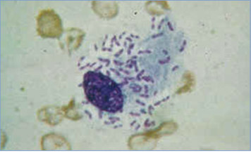

# 55. Granuloma Inguinale (Donovanosis)
> Reference: [source credits](../../SOURCE_CREDITS.md). Printed pp. 290-291; PDF pp. 304-305.
> Editorial study pathway: Bacterial infections (not a part division in the source).
[Flashcards](../flashcards/055_flashcards.md) · [Quiz](../mcqs/055_mcqs.md) · [Full extraction](../../raw/chapters/055.md)

## Five study pillars

### Etiology and transmission
The disease, donovanosis, is caused by Klebsiella granulomatis (formerly known as Calymmatobacterium granulomatis), an intracellular gram-negative bacillus.
*Printed p. 290 / PDF p. 304*

### Clinical recognition
Initial lesions of this sexually transmitted genital ulcerative disease are single or multiple painless subcutaneous nodules that gradually ulcerate. These nontender, granulomatous ulcers have raised, rolled margins, are beefy red and highly vascular, and bleed readily on contact.
*Printed p. 290 / PDF p. 304*

### Diagnostic workup
The causative organism is difficult to culture, and diagnosis requires microscopic demonstration of dark-staining intracytoplasmic Donovan bodies on Wright, Leishman, or Giemsa staining of a crush preparation from subsurface scrapings of a lesion or tissue. The microorganism also can be detected by histologic examination of biopsy specimens.
*Printed p. 290 / PDF p. 304*

### Treatment in the atlas
The recommended treatment regimen is azithromycin for at least 3 weeks and until all lesions have completely healed. Alternative treatment regimens include doxycycline, erythromycin, or trimethoprimsulfamethoxazole.
*Printed p. 290 / PDF p. 304*

### Prevention and infection control
Standard precautions are recommended.
*Printed p. 290 / PDF p. 304*

## Clinical search tags
Ulcers / eschar

## Full text, original tables, and images

# 55. Granuloma Inguinale (Donovanosis)
> Private study reference ([source credits](../../SOURCE_CREDITS.md)). PDF pages 304-305; printed pages 290-291.

## PDF page 304 | printed page 290

(Donovanosis)

### CLINICAL MANIFESTATIONS

Initial lesions of this sexually transmitted genital ulcerative disease are single or multiple painless subcutaneous nodules that gradually ulcerate. These nontender, granulomatous ulcers have raised, rolled margins, are beefy red and highly vascular, and bleed readily on contact. “Kissing” lesions may occur from autoinoculation on adjacent skin. Lesions usually involve the genitalia or perineum without regional adenopathy; however, lesions at both the genitalia and inguinal region occur in 5% to 10% of patients. Subcutaneous granulomas extending into the inguinal area can mimic inguinal adenopathy (ie, “pseudobubo”). Extragenital lesions (eg, face, mouth) account for 6% of cases. Dissemination to intra-abdominal organs and bone is rare.

### ETIOLOGY

The disease, donovanosis, is caused by Klebsiella granulomatis (formerly known as Calymmatobacterium granulomatis), an intracellular gram-negative bacillus.

### EPIDEMIOLOGY

Indigenous granuloma inguinale occurs very rarely in the United States and most industrialized nations. Sporadic cases have been described in India, South America, and South Africa. The incidence of infection seems to correlate with sustained high temperatures and high relative humidity. Infection usually is acquired by sexual contact, most commonly with a person with active infection. Young children and others can, less commonly, acquire infection by contact with infected secretions. The period of communicability extends throughout the duration of active lesions.

The incubation period is uncertain; a range of 1 to 360 days has been reported. Experimental production of typical donovanosis lesions was induced in humans 50 days after inoculation.

### DIAGNOSTIC TESTS

The causative organism is difficult to culture, and diagnosis requires microscopic demonstration of dark-staining intracytoplasmic Donovan bodies on Wright, Leishman, or Giemsa staining of a crush

preparation from subsurface scrapings of a lesion or tissue. The microorganism also can be detected by histologic examination of biopsy specimens. Culture of K granulomatis is difficult to perform and is not available routinely. No molecular tests exist that have been cleared by the U.S. Food and Drug Administration for the detection of K granulomatis. Diagnosis by nucleic acid amplification test (NAAT) and serologic testing is only available in research laboratories.

### TREATMENT1

The recommended treatment regimen is azithromycin for at least 3 weeks and until all lesions have completely healed. Alternative treatment regimens include doxycycline, erythromycin, or trimethoprimsulfamethoxazole. Pregnant and lactating people with granuloma inguinale should be treated with a macrolide regimen (azithromycin or erythromycin). Treatment has been shown to halt progression of lesions. Partial healing usually is noted within 7 days of initiation of therapy and typically proceeds inward from the ulcer margins. Prolonged therapy usually is required to permit granulation and re-epithelialization of the ulcers. Relapse can occur, especially if the antimicrobial agent is stopped before the primary lesion has healed completely. In addition, relapse can occur 6 to 18 months after apparently effective therapy. Complicated or long-standing infection can require surgical intervention.

Patients should be followed clinically until signs and symptoms have resolved. Patients should be evaluated for other sexually transmitted infections, including syphilis, HIV, gonorrhea, and chlamydia.

### INFECTION PREVENTION AND CONTROL MEASURES IN HEALTH CARE SETTINGS

Standard precautions are recommended.

### CONTROL MEASURES

People who have had sexual contact with a patient who has granuloma inguinale within the 60 days before onset of the patient’s symptoms should be examined and offered therapy. However, the value of empiric therapy in the absence of clinical signs and symptoms has not been established.

1 Centers for Disease Control and Prevention. Sexually transmitted infections treatment guidelines, 2021. MMWR Recomm Rep. 2021;70(RR-4). Available at: www.cdc.gov/std/ treatment-guidelines/donovanosis.htm

## PDF page 305 | printed page 291

Image 55.1 This patient’s penile lesions were caused by gram-negative Klebsiella granulomatis, formerly known as Calymmatobacterium granulomatis. K granulomatis causes granuloma inguinale, or donovanosis, a sexually transmitted infection that is a slowly progressive, ulcerative condition of the skin and lymphatics of the genital and perianal area. A definitive diagnosis is achieved when a tissue smear is positive for K granulomatis (Donovan bodies). Courtesy of Centers for Disease Control and Prevention.

Image 55.3 Granuloma inguinale accompanied by perianal skin ulceration caused by the bacterium Klebsiella granulomatis, formerly known as Calymmatobacterium granulomatis. The ulcerations are, for the most part, painless and granulomatous (ie, chronic inflammation). Courtesy of Centers for Disease Control and Prevention/Dr Thomas F. Sellers/Emory University.

Image 55.2 This 19-year-old woman presented with a perianal granuloma inguinale lesion of about 8 months’ duration. A genital ulcerative disease caused by the intracellular gram-negative bacterium Klebsiella granulomatis (formerly known as Calymmatobacterium granulomatis), granuloma inguinale, also known as donovanosis, occurs rarely in the United States. Courtesy of Centers for Disease Control and Prevention.

Image 55.4 Giemsa-stained Klebsiella granulomatis (Donovan bodies, formerly known as Calymmatobacterium granulomatis) of granuloma inguinale. Courtesy of Robert Jerris, PhD.

![Image 55.1 This patient’s penile lesions were caused by gramnegative Klebsiella granulomatis, formerly known as Calymmatobacterium granulomatis. K granulomatis causes granuloma inguinale, or donovanosis, a sexually transmitted infection that is a slowly progressive, ulcerative condition of the skin and lymphatics of the genital and perianal area. A definitive diagnosis is achieved when a tissue smear is positive for K granulomatis (Donovan bodies). Courtesy of Centers for Disease Control and Prevention.](../../figures/ch055_p0305_01.jpg)

