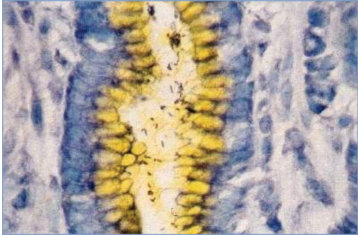
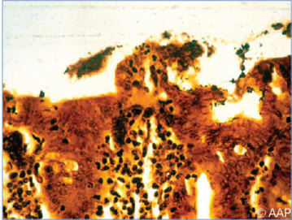
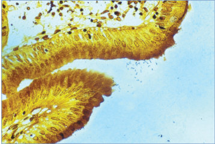

# 58. Helicobacter pylori Infections
> Reference: [source credits](../../SOURCE_CREDITS.md). Printed pp. 313-317; PDF pp. 327-331.
> Editorial study pathway: Bacterial infections (not a part division in the source).
[Flashcards](../flashcards/058_flashcards.md) · [Quiz](../mcqs/058_mcqs.md) · [Full extraction](../../raw/chapters/058.md)

## Five study pillars

### Etiology and transmission
The H pylori bacterium is a gram-negative, spiral, curved, or U-shaped microaerobic bacillus that has single or multiple flagella at one end. The organism is positive for catalase, oxidase, and urease activity.
*Printed p. 313 / PDF p. 327*

### Clinical recognition
Most Helicobacter pylori infections in children are believed to be asymptomatic. H pylori may cause chronic active gastritis and may result in duodenal and, to a lesser extent, gastric ulcers.
*Printed p. 313 / PDF p. 327*

### Diagnostic workup
Laboratory analysis of endoscopic specimens is the recommended approach for diagnosis in children. H pylori infection can be diagnosed by culture of gastric biopsy tissue on nonselective media (eg, chocolate agar, brucella agar, brainheart infusion agar) or selective media (eg, Skirrow agar) at 37°C under microaerophilic conditions (decreased oxygen, increased carbon dioxide, and increased hydrogen concentrations) for 3 to 10 days.
*Printed p. 313 / PDF p. 327*

### Treatment in the atlas
Treatment options are detailed in Tables 58.1 and 58.2. Treatment is recommended for infected patients who have peptic ulcer disease, gastric MALT-type lymphoma, or early gastric cancer.
*Printed p. 314 / PDF p. 328*

### Prevention and infection control
Standard precautions are recommended.
*Printed p. 316 / PDF p. 330*

## Clinical search tags
Petechiae / purpura, Ulcers / eschar, Vomiting, Anemia / hemolysis, Cytopenia

## Full text, original tables, and images

# 58. Helicobacter pylori Infections
> Private study reference ([source credits](../../SOURCE_CREDITS.md)). PDF pages 327-331; printed pages 313-317.

## PDF page 327 | printed page 313

### CLINICAL MANIFESTATIONS

Most Helicobacter pylori infections in children are believed to be asymptomatic. H pylori may cause chronic active gastritis and may result in duodenal and, to a lesser extent, gastric ulcers. Persistent infection with H pylori also increases the risk for the development of gastric cancers including mucosa-associated lymphoid tissue (MALT) lymphoma and adenocarcinoma in adults. However, complications of infection are infrequent in children. In children, acute H pylori infection can result in gastroduodenal inflammation that can manifest as epigastric pain, nausea, vomiting, hematemesis, and guaiac-positive stools. If present, these symptoms usually are self-limited. There is no clear association between infection and recurrent abdominal pain in the absence of peptic ulcer disease. The presence of nighttime wakening is associated with peptic ulcer disease rather than with chronic gastritis attributable to H pylori infection (for which nighttime wakening rarely occurs). Endoscopic findings of H pylori infection include nodular gastritis, chronic gastritis, and rarely, the presence of gastric or duodenal erosions or ulcers. Extraintestinal conditions in children that have been associated with H pylori infection include treatment-refractory iron-deficiency anemia and chronic immune thrombocytopenia purpura.

### ETIOLOGY

The H pylori bacterium is a gram-negative, spiral, curved, or U-shaped microaerobic bacillus that has single or multiple flagella at one end. The organism is positive for catalase, oxidase, and urease activity. The 2 main virulence factors associated with more severe disease include the cytotoxin associated gene (CagA) and the vacuolating cytotoxin (VacA).

### EPIDEMIOLOGY

H pylori organisms have been isolated from humans and other primates. An animal reservoir for human transmission has not been demonstrated. Organisms are believed to be transmitted from infected humans by the fecal-oral,

gastro-oral, and oral-oral routes. H pylori is estimated to have infected 70% of people living in resource-limited countries and 30% to 40% of people living in industrialized countries. Infection rates in children are low in resource-abundant, industrialized countries, except in children from lower socioeconomic groups, immigrants from resource-limited countries, and those living in poor hygienic conditions. Most infections are acquired in the first 8 years of life. The organism can persist in the stomach for years or for life.

Although all infected people have gastritis, over a lifetime, approximately 10% to 15% will develop peptic ulcer disease and less than 1% will develop gastric cancer.

The incubation period is unknown.

### DIAGNOSTIC TESTS

Laboratory analysis of endoscopic specimens is the recommended approach for diagnosis in children. H pylori infection can be diagnosed by culture of gastric biopsy tissue on nonselective media (eg, chocolate agar, brucella agar, brainheart infusion agar) or selective media (eg, Skirrow agar) at 37°C under microaerophilic conditions (decreased oxygen, increased carbon dioxide, and increased hydrogen concentrations) for 3 to 10 days. Colonies are small, smooth, and translucent and are positive for catalase, oxidase, and urease activity. Antimicrobial susceptibility testing of cultured isolates should be performed to guide therapy. Organisms can be visualized on histologic sections with Warthin-Starry silver, Steiner, Giemsa, or Genta staining. Presence of H pylori can be confirmed but not excluded on the basis of hematoxylin-eosin stains. Immunohistologic staining with specific H pylori antibodies may improve specificity. Because of production of high levels of urease by these organisms, urease testing of a gastric biopsy specimen can be used to detect the presence of H pylori. Urease hydrolyzes urea into ammonia and carbonate; the resulting increase in pH from the production of ammonia is detected in the assay.

Unlike in adults, noninvasive tests are not recommended for initial diagnosis of H pylori in children. Commercially available noninvasive tests include urea breath tests and stool antigen tests; these tests are designed for detection of active

## PDF page 328 | printed page 314

infection and have high sensitivity and specificity. Stool antigen tests by enzyme immunoassay monoclonal antibodies are available commercially and can be used for children of any age. The urea breath test detects labeled carbon dioxide in expired air after oral administration of isotopelabeled urea (13C or 14C). Although urea breath tests are expensive and are not useful in very young children, there is a test approved by the U.S. Food and Drug Administration (FDA) for children 3 to 17 years of age.

H pylori can be detected by nucleic acid amplification tests (NAATs) or fluorescence in situ hybridization (FISH) of gastric biopsy tissue, and NAATs also have been used to detect the organism in stool specimens. However, none of these assays are currently cleared by the FDA for H pylori testing.

Serologic testing for H pylori infection by detection of immunoglobulin G antibodies specific for H pylori should not be used in children for diagnosis or for confirming eradication.

Indications for H pylori Testing. Indications for testing for H pylori in children are not as broad as for adults, for whom there is stronger evidence for disease associations and lower risk of reinfection following treatment. Children with identified peptic ulcer disease may benefit from testing and treatment for H pylori infection. Patients with functional abdominal pain (absence of alarm symptoms by Rome criteria1) should not be tested, because there is a lack of evidence that treating H pylori infection provides relief. Testing is appropriate to confirm eradication of infection following completion of treatment.

The European Society for Paediatric Gastroenterology, Hepatology and Nutrition and the North American Society for Pediatric Gastroenterology, Hepatology & Nutrition (ESPGHAN/NASPGHAN) joint guideline recommends against a ”test and treat” strategy for H pylori infection in children. Instead, they recommend the following2:

• The diagnosis of H pylori infection should be based on either (a) histopathology (H pylori– positive gastritis) plus at least 1 other positive biopsy-based test (eg, urease test or molecularbased assays including NAAT or FISH) or (b) positive culture.

• When testing for H pylori, wait at least 2 weeks after stopping a proton pump inhibitor (PPI) and 4 weeks after stopping antimicrobial agents.

• Testing for H pylori should be performed in children with gastric or duodenal ulcers. If H pylori infection is identified, then treatment should be advised and eradication should be confirmed.

• Diagnostic testing for H pylori infection should not be performed as part of the initial investigation in children with iron-deficiency anemia. In children with refractory iron-deficiency anemia for which other causes have been ruled out, testing for H pylori during upper endoscopy may be considered.

• Diagnostic testing for H pylori infection should not be performed in children with functional abdominal pain (unless accompanied by alarm symptoms by Rome criteria3).

• Diagnostic testing for H pylori infection should not be performed when investigating causes of short stature.

The 2019 guideline from the American Society of Hematology recommends against routine testing for H pylori in children with chronic immune thrombocytopenia purpura.4

Testing to confirm eradication of infection following completion of treatment is appropriate. Noninvasive tests may be used for this purpose.

### TREATMENT5

Treatment options are detailed in Tables 58.1 and 58.2. Treatment is recommended for infected patients who have peptic ulcer disease, gastric MALT-type lymphoma, or early gastric cancer. Treatment of H pylori infection, if documented, may be considered for children who have unexplained and refractory iron-deficiency anemia. Additionally, the ESPGHAN/NASPGHAN guideline recommends eradication if infection is associated with chronic immune thrombocytopenia purpura. For patients with H pylori infection in the absence of clinical or endoscopic evidence of peptic ulcer disease, treatment is not recommended unless the patient is within a risk group or region with high incidence of gastric cancer. Medication adherence is critical to the success of eradication.

## PDF page 329 | printed page 315

The backbone of all recommended therapies includes a PPI and amoxicillin. Additions of metronidazole, clarithromycin, and/or bismuth are based on the patient’s previous treatment experience or known susceptibilities to clarithromycin and metronidazole. Reports of increasing prevalence of antibiotic-resistant strains (particularly clarithromycin resistance) as well as increasing failures of triple therapies suggest the need for bismuth-based quadruple therapy regimens (meaning 3 antibiotics and bismuth) and longer durations (14 days) for eradication of H pylori. A number of treatment regimens have been evaluated and are approved for use in adults; the safety and effectiveness of these regimens in pediatric patients have not been firmly established. There is no current evidence to support the use of probiotics to reduce medication adverse effects or improve eradication of H pylori. Limited options exist for penicillinallergic patients.

Table 58.1 Recommended Options for First-Line Therapy for Helicobacter pylori Infectiona,b

H pylori Antimicrobial Susceptibilities Susceptible to clarithromycin, susceptible to metronidazole PPI + amoxicillin + clarithromycin for 14 days

Resistant to clarithromycin, susceptible to metronidazole PPI + amoxicillin + metronidazole for 14 days

OR

Bismuth-based therapy as detailed in “Unknown” row below Susceptible to clarithromycin, resistant to metronidazole PPI + amoxicillin + clarithromycin for 14 days

Resistant to clarithromycin, resistant to metronidazole (“double resistant”) <8 y of age: PPI + amoxicillin + metronidazole + bismuth for 14 days

≥8 y of age: PPI + tetracycline + metronidazole + bismuth for 14 days Susceptibilities not known <8 y of age: PPI + amoxicillin + metronidazole + bismuth for 14 days

≥8 y of age: PPI + tetracycline + metronidazole + bismuth for 14 days

PPI indicates proton pump inhibitor.

a Adapted from Jones NL, Koletzko S, Goodman K, et al; European Society for Paediatric Gastroenterology, Hepatology and Nutrition and the North American Society for Pediatric Gastroenterology, Hepatology & Nutrition. Joint ESPGHAN/NASPGHAN guidelines for the management of Helicobacter pylori in children and adolescents (update 2016). J Pediatr Gastroenterol Nutr. 2017;64(6):991–1003. Available at: https://naspghan.org/files/Joint_ESPGHAN_NASPGHAN_Guidelines_ for_the.33.pdf. b Refer to joint ESPGHAN/NASPGHAN guidelinesa for antibiotic dosing.

Initial Therapy

• In a treatment-naïve patient with H pylori, selection of therapeutic regimen is best guided by knowledge of the susceptibilities of that patient’s organism.

• Treatment options are detailed in Table 58.1.

• A breath or stool test should be performed to document organism clearance 4 to 6 weeks after completion of initial therapy; relief of clinical symptoms is not an indicator of successful eradication.

Rescue Therapy

• Infection within the first 12 months following treatment is likely a relapse of the previous infection. In contrast to adults, reduced options exist for rescue therapy for children.

• Management and treatment options are detailed in Table 58.2.

Suggested First-Line Treatment

### Geometry-detected table

|H pylori Antimicrobial Susceptibilities|Suggested First-Line Treatment|
|---|---|
|Susceptible to clarithromycin, susceptible to metronidazole|PPI+ amoxicillin+ clarithromycin for 14 days|
|Resistant to clarithromycin, susceptible to metronidazole|PPI+ amoxicillin+ metronidazole for 14 days OR Bismuth-based therapy as detailed in “Unknown” row below|
|Susceptible to clarithromycin, resistant to metronidazole|PPI+ amoxicillin+ clarithromycin for 14 days|
|Resistant to clarithromycin, resistant to metronidazole (“double resistant”)|<8 y of age: PPI+ amoxicillin+ metronidazole+ bismuth for 14 days ≥8 y of age: PPI+ tetracycline+ metronidazole+ bismuth for 14 days|
|Susceptibilities not known|<8 y of age: PPI+ amoxicillin+ metronidazole+ bismuth for 14 days ≥8 y of age: PPI+ tetracycline+ metronidazole+ bismuth for 14 days|

[View original table](../../tables/ch058_p0329_1.jpg)

## PDF page 330 | printed page 316

Table 58.2 Rescue Therapies in Pediatric Patients Who Fail Therapy for Helicobacter pyloria,b

Initial Antibiotic Susceptibilities Past Treatment Regimen Susceptible to clarithromycin, susceptible to metronidazole PPI + amoxicillin + clarithromycin

PPI + amoxicillin + metronidazole

Susceptible to clarithromycin, susceptible to metronidazole Sequential therapyc

Resistant to clarithromycin PPI + amoxicillin + metronidazole Resistant to metronidazole PPI + amoxicillin + clarithromycin

Susceptibilities not known PPI + amoxicillin + clarithromycin

OR

PPI + amoxicillin + metronidazole

OR

Sequential therapyc

PPI indicates proton pump inhibitor.

a Adapted from Jones NL, Koletzko S, Goodman K, et al; European Society for Paediatric Gastroenterology, Hepatology and Nutrition and the North American Society for Pediatric Gastroenterology, Hepatology & Nutrition. Joint ESPGHAN/NASPGHAN guidelines for the management of Helicobacter pylori in children and adolescents (update 2016). J Pediatr Gastroenterol Nutr. 2017;64(6):991–1003. Available at https://naspghan.org/files/Joint_ESPGHAN_NASPGHAN_Guidelines_ for_the.33.pdf. b Refer to joint ESPGHAN/NASPGHAN guidelinesa for antibiotic dosing. c Sequential therapy consists of PPI + amoxicillin for 5 days, followed by PPI + clarithromycin + metronidazole for 5 days.

• A breath or stool test should be performed to document organism eradication 4 to 6 weeks after completion of rescue therapy.

### INFECTION PREVENTION AND CONTROL MEASURES IN HEALTH CARE SETTINGS

Standard precautions are recommended.

### CONTROL MEASURES

Disinfection of gastroscopes prevents transmission of the organism between patients.

1 Hyams JS, Di Lorenzo C, Saps M, Shulman RJ, Staiano A, van Tilburg M. Functional disorders: children and adolescents. Gastroenterology. 2016;150(6):1456-1468 2 Jones NL, Koletzko S, Goodman K, et al; European Society for Paediatric Gastroenterology, Hepatology and Nutrition and the North American Society for Pediatric Gastroenterology,

Suggested Rescue Treatment

PPI + amoxicillin + metronidazole

PPI + amoxicillin + clarithromycin Consider performing a second endoscopy and tissue culture and use cultured-directed treatment for 14 days

OR

Treat like double-resistant in Table 58.1 Treat like double-resistant in Table 58.1 Consider performing a second endoscopy and use a tailored treatment for 14 days

OR

Treat like double-resistant in Table 58.1

Consider performing a second endoscopy to assess secondary antimicrobial susceptibility

OR

Treat like double-resistant in Table 58.1

Hepatology & Nutrition. Joint ESPGHAN/NASPGHAN guidelines for the management of Helicobacter pylori in children and adolescents (update 2016). J Pediatr Gastroenterol Nutr. 2017;64(6):991–1003. Available at: https://naspghan.org/ files/Joint_ESPGHAN_NASPGHAN_Guidelines_for_ the.33.pdf 3 Hyams JS, Di Lorenzo C, Saps M, Shulman RJ, Staiano A, van Tilburg M. Functional disorders: children and adolescents. Gastroenterology. 2016;150(6):1456–1468 4 Neunert C, Terrell DR, Arnold DM, et al. The American Society of Hematology guidelines for immune thrombocytopenia. Blood Adv. 2019;3(23):3829–3866 5 Jones NL, Koletzko S, Goodman K, et al; European Society for Paediatric Gastroenterology, Hepatology and Nutrition and the North American Society for Pediatric Gastroenterology, Hepatology & Nutrition. Joint ESPGHAN/NASPGHAN guidelines for the management of Helicobacter pylori in children and adolescents (update 2016). J Pediatr Gastroenterol Nutr. 2017;64(6):991–1003. Available at: https://naspghan.org/ files/Joint_ESPGHAN_NASPGHAN_Guidelines_for_ the.33.pdf

### Geometry-detected table

|Initial Antibiotic Susceptibilities|Past Treatment Regimen|Suggested Rescue Treatment|
|---|---|---|
|Susceptible to clarithromycin, susceptible to metronidazole|PPI+ amoxicillin+ clarithromycin PPI+ amoxicillin+ metronidazole|PPI+ amoxicillin+ metronidazole PPI+ amoxicillin+ clarithromycin|
|Susceptible to clarithromycin, susceptible to metronidazole|Sequential therapyc|Consider performing a second endoscopy and tissue culture and use cultured-directed treatment for 14 days OR Treat like double-resistant in Table 58.1|
|Resistant to clarithromycin|PPI+ amoxicillin+ metronidazole|Treat like double-resistant in Table 58.1|
|Resistant to metronidazole|PPI+ amoxicillin+ clarithromycin|Consider performing a second endoscopy and use a tailored treatment for 14 days OR Treat like double-resistant in Table 58.1|
|Susceptibilities not known|PPI+ amoxicillin+ clarithromycin OR PPI+ amoxicillin+ metronidazole OR Sequential therapyc|Consider performing a second endoscopy to assess secondary antimicrobial susceptibility OR Treat like double-resistant in Table 58.1|

[View original table](../../tables/ch058_p0330_1.jpg)

## PDF page 331 | printed page 317

Image 58.1 Histological features of the gastric mucosa demonstrate the characteristic curved organisms in the gastric glands. Courtesy of H. Cody Meissner, MD, FAAP.

Image 58.3 A biopsy of gastric mucosa stained with Warthin-Starry silver stain showing Helicobacter pylori organisms. Courtesy of Brian Oliver, MD.

Image 58.2 Gastric mucosal biopsy demonstrating Helicobacter pylori. This organism has been isolated from humans and other primates.

Image 58.4 Helicobacter pylori infection is a known risk factor for gastritis and duodenal ulcers in children and adults. Rarely, and primarily in older adulthood, H pylori is also associated with a gastric lymphoma of the mucosaassociated lymphoid tissue. The diagnostic standard for H pylori infection of the stomach is endoscopy with biopsy. Endoscopy may show a nodular gastritis of the antrum. Courtesy of H. Cody Meissner, MD, FAAP.

