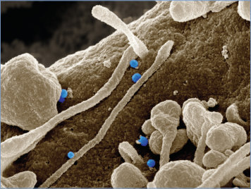
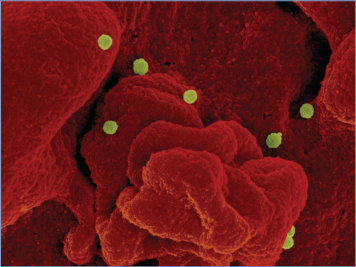
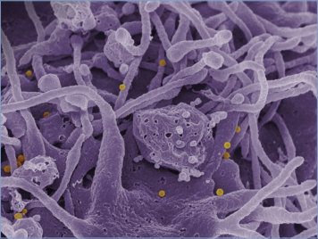
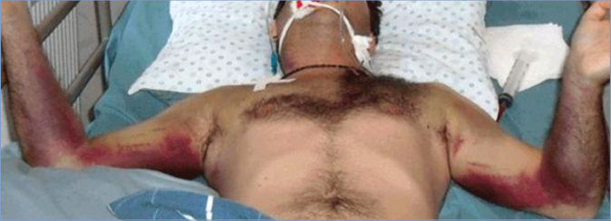
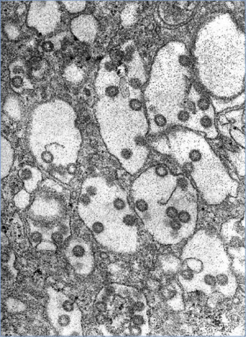

# 60. Hemorrhagic Fevers Caused by Bunyaviruses
> Reference: [source credits](../../SOURCE_CREDITS.md). Printed pp. 321-326; PDF pp. 335-340.
> Editorial study pathway: Viral infections (not a part division in the source).
[Flashcards](../flashcards/060_flashcards.md) · [Quiz](../mcqs/060_mcqs.md) · [Full extraction](../../raw/chapters/060.md)

## Five study pillars

### Etiology and transmission
The order Bunyavirales includes segmented, single-stranded RNA viruses with different geographic distributions depending on their vector or reservoir. Hemorrhagic fever syndromes are associated with viruses from 3 families: Hantaviridae (Old World hantaviruses), Nairoviridae (CCHF virus), and Phenuiviridae (RVF virus).
*Printed p. 321 / PDF p. 335*

### Clinical recognition
Bunyaviruses are arthropod- or rodent-borne infections that often result in severe febrile disease with multisystem involvement and may be associated with high rates of morbidity and mortality.
*Printed p. 321 / PDF p. 335*

### Diagnostic workup
Acute-phase quantitative nucleic acid amplification tests (NAATs) and serologic testing are the most common diagnostic tests . Viral culture of blood and/or tissue is available in specialized laboratories.
*Printed p. 322 / PDF p. 336*

### Treatment in the atlas
Currently, there are no drugs approved by the U.S. Food and Drug Administration (FDA) for prophylaxis or treatment of HFRS, CCHF, or RVF.
*Printed p. 322 / PDF p. 336*

### Prevention and infection control
In addition to standard precautions, contact and droplet precautions, including careful prevention of needlestick injuries and management of clinical specimens, are indicated for patients with CCHF for the duration for illness. Airborne isolation may be required in certain circumstances when patients undergo procedures that stimulate coughing and promote generation of aerosols.
*Printed p. 323 / PDF p. 337*

## Clinical search tags
Fever, Petechiae / purpura, Conjunctivitis, Hepatitis / jaundice, Encephalitis / seizures, Sepsis / shock, Tick / arthropod exposure, Animal exposure

## Full text, original tables, and images

# 60. Hemorrhagic Fevers Caused by Bunyaviruses
> Private study reference ([source credits](../../SOURCE_CREDITS.md)). PDF pages 335-340; printed pages 321-326.

## PDF page 335 | printed page 321

### CLINICAL MANIFESTATIONS

Bunyaviruses are arthropod- or rodent-borne infections that often result in severe febrile disease with multisystem involvement and may be associated with high rates of morbidity and mortality.

Hemorrhagic fever with renal syndrome (HFRS) is a complex, multiphasic disease characterized by vascular instability and varying degrees of renal insufficiency. Fever, flushing, conjunctival injection, headache, blurred vision, abdominal pain, and lumbar pain are followed by hypotension, oliguria, and subsequently, polyuria. Petechiae are frequent, but more serious bleeding manifestations are rare. Shock and acute renal insufficiency may occur.

Crimean-Congo hemorrhagic fever (CCHF) is a multisystem disease characterized by hepatitis and hemorrhagic manifestations. Fever, headache, and myalgia are followed by signs of a diffuse capillary leak syndrome with facial suffusion, conjunctivitis, icteric hepatitis, proteinuria, and disseminated intravascular coagulation associated with petechiae and purpura on the skin and mucous membranes. A hypotensive crisis often occurs after the appearance of frank hemorrhage from the gastrointestinal tract, nose, mouth, or uterus.

Rift Valley fever (RVF), in most cases, is a self-limited undifferentiated febrile illness. In 8% to 10% of cases, however, hemorrhagic fever with shock and icteric hepatitis, encephalitis, or retinitis develops.

### ETIOLOGY

The order Bunyavirales includes segmented, single-stranded RNA viruses with different geographic distributions depending on their vector or reservoir. Hemorrhagic fever syndromes are associated with viruses from 3 families: Hantaviridae (Old World hantaviruses), Nairoviridae (CCHF virus), and Phenuiviridae (RVF virus). Old World hantaviruses (Hantaan, Seoul, Dobrava, and Puumala viruses) cause

HFRS, and New World hantaviruses (Sin Nombre and related viruses) cause hantavirus pulmonary syndrome.

### EPIDEMIOLOGY

The epidemiology of these diseases is a function of the distribution and behavior of their reservoirs and vectors. All families except Hantaviridae are associated with arthropod vectors. Hantavirus infections are transmitted via contact with virus shed in rodent urine, saliva, or droppings; inhalation of virus in dust from contaminated nesting materials; or being bitten by an infected rodent.

Classic HFRS occurs throughout much of Asia and Europe, with up to 100,000 cases per year. The most severe form of the disease is caused by the prototype Hantaan and Dobrava viruses in rural Asia and Europe, respectively; Puumala virus is associated with milder disease (nephropathia epidemica) in Western Europe. Seoul virus is distributed worldwide in association with brown Norway rat (Rattus species) and causes a disease of variable severity. Cases have been reported in the United States among rat fanciers. Person-to-person transmission has never been reported with HFRS. Fatal outcome is seen in 1% to 15% of cases, depending on the species of virus and the level of care.

CCHF occurs in much of sub-Saharan Africa, the Middle East, northwestern China, part of the Indian subcontinent, Ukraine, Russia, Georgia, Armenia, Central Asia, and Southeast Europe. CCHF virus is transmitted by hard ticks and occasionally by contact with viremic livestock and wild animals at slaughter. Health care-associated transmission of CCHF is a serious hazard. Fatal outcome is seen in 9% to 50% of hospitalized patients.

Large outbreaks of RVF have occurred throughout sub-Saharan Africa, Egypt, Saudi Arabia, and Yemen. The virus is mosquito-borne and also can also be transmitted directly from domestic livestock to humans via contact with infected abortuses or freshly slaughtered animal carcasses. Person-to-person transmission has not been reported, but laboratory-acquired cases are well documented. Overall fatal outcome occurs in 1% to 2% of cases but has been reported to be up to 30% in hospitalized patients.

## PDF page 336 | printed page 322

The incubation periods for CCHF and RVF range from 2 to 10 days; for HFRS, the incubation period usually is longer, ranging from 7 to 42 days.

### DIAGNOSTIC TESTS

Acute-phase quantitative nucleic acid amplification tests (NAATs) and serologic testing are the most common diagnostic tests (Table 60.1). Viral culture of blood and/or tissue is available in specialized laboratories. Immunoglobulin (Ig) M antibodies or increasing IgG titers in paired serum specimens, as demonstrated by enzyme immunoassay, are diagnostic; neutralizing antibody tests provide greater virus-strain specificity but rarely are used. Serum IgM and IgG virusspecific antibodies typically develop early in convalescence in CCHF and RVF but can be absent in rapidly fatal cases of CCHF. In HFRS, IgM and IgG antibodies usually are detectable at the time of onset of illness or within 48 hours, when it is too late for virus isolation and NAAT. Diagnosis can be made retrospectively by immunohistochemical staining of formalin-fixed tissues. Although some commercial labs offer hantavirus serologies, any positive IgM results are referred to the Centers for Disease Control and Prevention (CDC) for confirmation. CCHF and RVF testing are only available at the CDC. Referrals are made through the state health department.

### TREATMENT

Currently, there are no drugs approved by the U.S. Food and Drug Administration (FDA) for prophylaxis or treatment of HFRS, CCHF, or RVF.

Table 60.1 Diagnostic Tests for Hemorrhagic Fevers Caused by Bunyaviruses

Diagnostic Testing HFRS Acute phase virus NAAT Yes, but not routinely done IgM and IgG serology Yes (at time of illness onset or within 48 h)

Virus culture of blood or tissue

No (usually not detected at time of illness)

CCHF indicates Crimean-Congo hemorrhagic fever; HFRS, hemorrhagic fever with renal syndrome; IgG, immunoglobulin G; IgM, immunoglobulin M; NAAT, nucleic acid amplification testing; RVF, Rift Valley fever.

Ribavirin, administered intravenously to patients with HFRS within the first 4 days of illness, may be effective in decreasing renal dysfunction, vascular instability, and mortality. Intravenous ribavirin is not available commercially in the United States and is available only from the manufacturer through an emergency investigational new drug application. Health care providers who need to obtain intravenous ribavirin should contact the FDA (www.fda.gov/drugs/investigationalnew-drug-ind-application/physicians-howrequest-single-patient-expanded-accesscompassionate-use; 24-hour emergency lines: 866-300-4374 or 301-796-8240). Supportive therapy for HFRS should include (1) treatment of shock, (2) monitoring of fluid balance, (3) dialysis for complications of renal failure, (4) control of hypertension during the oliguric phase, and (5) early recognition of possible myocardial failure with appropriate therapy.

Oral and intravenous ribavirin, when administered early in the course of CCHF, has been associated with milder disease, although no controlled studies have been performed. Ribavirin also may be effective as postexposure prophylaxis of CCHF.

During the RVF outbreak in Saudi Arabia in 2000, a clinical trial of ribavirin in patients with confirmed disease was halted because of an increased observation of encephalitis in patients receiving ribavirin (more than expected in RVF patients). Experimental data in hamsters, mice, and rats reported the same type of observation when treatment was delayed. Therefore, ribavirin should be avoided in RVF.

CCHF RVF Yes Yes

Yes (detectable in early convalescence, but could be absent in fatal cases)

Yes (detectable in early convalescence)

Yes (in biosafety level 4 conditions)

Yes (in biosafety level 4 conditions)

### Geometry-detected table

|Diagnostic Testing|HFRS|CCHF|RVF|
|---|---|---|---|
|Acutephase virus NAAT|Yes, but not routinely done|Yes|Yes|
|IgM and IgG serology|Yes (at time of illness onset or within 48 h)|Yes (detectable in early convalescence, but could be absent in fatal cases)|Yes (detectable in early convalescence)|
|Virus culture of blood or tissue|No (usually not detected at time of illness)|Yes (in biosafety level 4 conditions)|Yes (in biosafety level 4 conditions)|

[View original table](../../tables/ch060_p0336_1.jpg)

## PDF page 337 | printed page 323

### INFECTION PREVENTION AND CONTROL MEASURES IN HEALTH CARE SETTINGS

In addition to standard precautions, contact and droplet precautions, including careful prevention of needlestick injuries and management of clinical specimens, are indicated for patients with CCHF for the duration for illness. Airborne isolation may be required in certain circumstances when patients undergo procedures that stimulate coughing and promote generation of aerosols. Standard precautions should be followed with RVF and HFRS.

### CONTROL MEASURES

Care of Exposed People

People having direct contact with blood or other secretions from patients with CCHF should be observed closely for 14 days with daily monitoring for fever. Immediate therapy with intravenous ribavirin should be considered at the first sign of disease. Ribavirin also may be effective as postexposure prophylaxis of CCHF.

Environmental.

Hemorrhagic Fever With Renal Syndrome

Monitoring of laboratory rat colonies, community pet rat colonies, and urban rodent control may be effective for rat-borne HFRS.

Crimean-Congo Hemorrhagic Fever

In countries with endemic CCHF, arachnicides for tick control generally have limited benefit but

should be used in stockyard settings. Personal protective measures (eg, physical tick removal and protective clothing with permethrin sprays) may be effective for people at risk (farmers, veterinarians, abattoir workers).

Rift Valley Fever

Regular immunization of domestic animals should have an effect on limiting or preventing RVF outbreaks and protecting humans. Some livestock vaccines are currently in use in endemic areas. Personal protective clothing (with permethrin sprays) and insect repellants may be effective for people at risk (farmers, veterinarians, abattoir workers). Mosquito control measures are difficult to implement.

Immunoprophylaxis

No vaccines currently are approved in Europe or the United States for use in humans against hemorrhagic fevers caused by bunyaviruses. Non-live vaccines are in use for HFRS and CCHF in some Asian countries and Eastern Europe, respectively.

Public Health Reporting

State health departments and the CDC should be contacted about any suspected diagnosis of viral hemorrhagic fever because of the risk of health care-associated transmission and diagnostic confusion with other hemorrhagic illnesses.

## PDF page 338 | printed page 324

Image 60.1 Scanning electron micrograph of Crimean-Congo hemorrhagic fever viral particles (blue) budding from the surface of cultured epithelial cells from a patient. Courtesy of National Institute of Allergy and Infectious Diseases.

Image 60.3 Scanning electron micrograph of Crimean-Congo hemorrhagic fever viral particles (yellow) budding from the surface of cultured epithelial cells from a patient. Courtesy of National Institute of Allergy and Infectious Diseases.

Image 60.2 Scanning electron micrograph of Crimean-Congo hemorrhagic fever viral particles (yellow) budding from the surface of cultured epithelial cells from a patient. Courtesy of National Institute of Allergy and Infectious Diseases.

## PDF page 339 | printed page 325

Image 60.4 Isolated male patient with a diagnosis of Crimean-Congo hemorrhagic fever, a tick-borne hemorrhagic fever with documented person-to-person transmission and a case fatality rate of approximately 30%. This widespread virus has been found in Africa, Asia, the Middle East, and Eastern Europe. Courtesy of Centers for Disease Control and Prevention.

Image 60.5 Patient who has undergone intubation and who has Crimean-Congo hemorrhagic fever, Republic of Georgia, 2009, showing massive ecchymoses on the upper extremities that extend to the chest. Courtesy of Emerging Infectious Diseases.

## PDF page 340 | printed page 326

Image 60.6 Electron micrograph of the Rift Valley fever virus, which is a member of the genus Phlebovirus in the family Bunyaviridae, first reported in livestock in Kenya around 1900. Courtesy of Centers for Disease Control and Prevention.

Image 60.7 Images from immunofluorescence assays in Vero E6 cells for immunoglobulin G (IgG) against chikungunya virus (CHIKV), dengue virus (DENV), and Rift Valley fever virus (RVFV) (original magnifications ×100 and ×200). Courtesy of Emerging Infectious Diseases.

