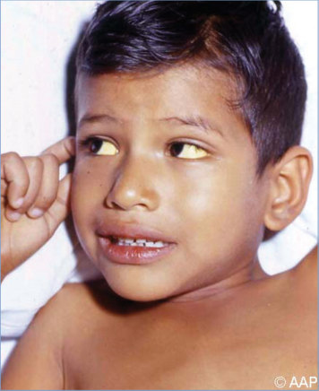
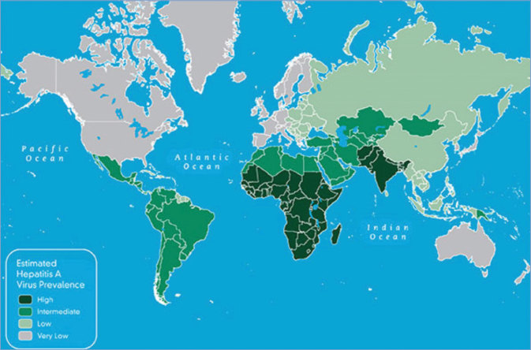
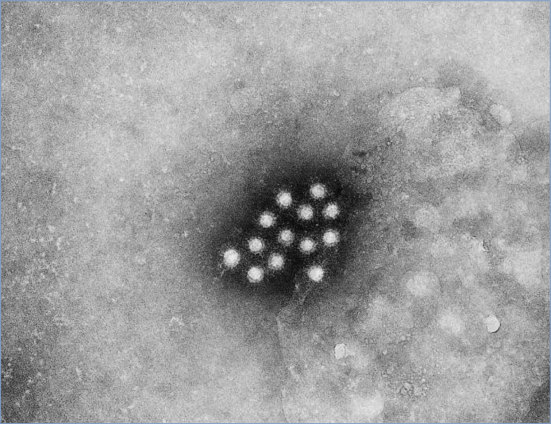
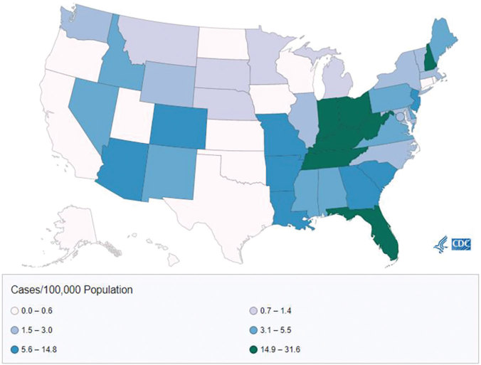

# 62. Hepatitis A
> Reference: [source credits](../../SOURCE_CREDITS.md). Printed pp. 337-345; PDF pp. 351-359.
> Editorial study pathway: Viral infections (not a part division in the source).
[Flashcards](../flashcards/062_flashcards.md) · [Quiz](../mcqs/062_mcqs.md) · [Full extraction](../../raw/chapters/062.md)

## Five study pillars

### Etiology and transmission
HAV is a small, nonenveloped, positive-sense RNA virus with an icosahedral capsid and classified as a member of the family Picornaviridae, genus Hepatovirus.
*Printed p. 337 / PDF p. 351*

### Clinical recognition
Hepatitis A is an acute, self-limited illness associated with fever, malaise, jaundice, anorexia, and nausea that typically lasts less than 2 months, although 10% to 15% of symptomatic people have prolonged or relapsing disease that lasts as long as 6 months. Symptomatic hepatitis A virus (HAV) infection occurs in approximately 30% of infected children younger than 6 years of age, but few of these children will have jaundice.
*Printed p. 337 / PDF p. 351*

### Diagnostic workup
Serologic tests for HAV-specific total antibody (ie, immunoglobulin [Ig] G plus IgM), IgG-only anti-HAV, and IgM-only anti-HAV are available commercially, primarily in enzyme immunoassay format. Presence of serum IgM anti-HAV indicates current or recent infection, although false-positive results may occur, particularly if the pretest probability of infection is low.
*Printed p. 337 / PDF p. 351*

### Treatment in the atlas
Supportive and management of complications.
*Printed p. 338 / PDF p. 352*

### Prevention and infection control
Contact precautions should be practiced in addition to standard precautions for diapered and incontinent patients for at least 1 week after onset of symptoms.
*Printed p. 338 / PDF p. 352*

## Clinical search tags
Fever, Hepatitis / jaundice, Congenital / neonatal, Water exposure, Travel / endemic setting

## Full text, original tables, and images

# 62. Hepatitis A
> Private study reference ([source credits](../../SOURCE_CREDITS.md)). PDF pages 351-359; printed pages 337-345.

## PDF page 351 | printed page 337

### CLINICAL MANIFESTATIONS

Hepatitis A is an acute, self-limited illness associated with fever, malaise, jaundice, anorexia, and nausea that typically lasts less than 2 months, although 10% to 15% of symptomatic people have prolonged or relapsing disease that lasts as long as 6 months. Symptomatic hepatitis A virus (HAV) infection occurs in approximately 30% of infected children younger than 6 years of age, but few of these children will have jaundice. Among older children and adults, infection usually is symptomatic, with jaundice occurring in 70% or more of cases. Fulminant hepatitis is rare but is more common in people with underlying liver disease. Chronic infection does not occur.

### ETIOLOGY

HAV is a small, nonenveloped, positive-sense RNA virus with an icosahedral capsid and classified as a member of the family Picornaviridae, genus Hepatovirus.

### EPIDEMIOLOGY

The most common mode of transmission is person-to-person, from fecal contamination and oral ingestion (ie, the fecal-oral route). In resource-limited countries where infection is endemic, most people are infected during the first decade of life. In the United States, rates of HAV infection decreased by 95% from 1996 to 2011 following implementation of universal infant vaccination in 2006. Since 2016, however, the United States has been in the midst of a widespread surge of person-to-person hepatitis A outbreaks unprecedented since introduction of the hepatitis A vaccine (HepA). Outbreaks, primarily among people who use drugs and people lacking housing, have occurred in 37 states; higher rates have been observed in impoverished counties. An estimated 37,700 infections occurred in 2019, a more than tenfold increase since 2015. The number of estimated cases decreased to 19,900 in 2020, possibly because of underreporting during the COVID-19 pandemic. Most HAV infection cases in the United States now are in adults 20 years and older.

Recognized risk groups for HAV infection include people who have close personal contact with a person infected with HAV, people with chronic liver disease, people with HIV infection, men who have sex with men, people who use injection or noninjection drugs, people who lack housing, people traveling to or working in countries that have highly or intermediately endemic HAV, people who have close contact with an adoptee from a country with high or intermediate HAV endemicity during the first 60 days following arrival, and people who work with HAV-infected primates or with HAV in a research laboratory setting. HAV infections and outbreaks associated with food-service establishments and food handlers, health care institutions, institutions for people with developmental disabilities, schools, and child care facilities typically reflect transmission in the community.

Outbreaks have been associated with consumption of raw produce (eg, green onions), fruits (eg, strawberries), oysters, and mussels. Waterborne outbreaks are rare and typically are associated with sewage-contaminated or inadequately treated water.

People with HAV infection are most infectious during the 1 to 2 weeks before onset of jaundice or elevation of liver enzymes, when concentration of virus in the stool is highest. Risk of transmission subsequently diminishes and is minimal by 1 week after onset of jaundice. HAV can be detected in stool for longer periods, especially in neonates and young children.

The incubation period is 15 to 50 days, with an average of 28 days.

### DIAGNOSTIC TESTS

Serologic tests for HAV-specific total antibody (ie, immunoglobulin [Ig] G plus IgM), IgG-only anti-HAV, and IgM-only anti-HAV are available commercially, primarily in enzyme immunoassay format. Presence of serum IgM anti-HAV indicates current or recent infection, although false-positive results may occur, particularly if the pretest probability of infection is low. IgM anti-HAV is included in most acute hepatitis serologic test panels offered by hospital or

## PDF page 352 | printed page 338

reference laboratories. IgM anti-HAV is detectable in up to 20% of HepA vaccine recipients when measured 2 weeks after vaccination. In infected people, serum IgM anti-HAV becomes detectable 5 to 10 days before onset of symptoms and usually declines to undetectable concentrations within 6 months after infection, although positive test results for IgM anti-HAV more than 1 year after infection have been reported. IgG anti-HAV is detectable shortly after appearance of IgM. A positive IgG anti-HAV or total anti-HAV (IgM and IgG) test result with a negative IgM anti-HAV test result indicates immunity from past infection or vaccination. Nucleic acid amplification tests (NAATs) for hepatitis A are available but not currently licensed by the U.S. Food and Drug Administration (FDA). NAAT may be considered for detection of very early infections and to assist with interpretation of questionable IgM anti-HAV results.

### TREATMENT

Supportive and management of complications.

### INFECTION PREVENTION AND CONTROL MEASURES IN HEALTH CARE SETTINGS

Contact precautions should be practiced in addition to standard precautions for diapered and incontinent patients for at least 1 week after onset of symptoms.

Table 62.1 Recommendations for Postexposure Prophylaxis of Hepatitis A Virus (HAV)

Time Since Exposure Age

≤2 wk <12 mo IGIM (0.1 mL/kg)a

12 mo–40 y HepA vaccineb,c,d

>40 y HepA vaccinec,d; consider IGIM

>2 wk <12 mo No prophylaxis

≥12 mo No prophylaxis, but HepA vaccine may be indicated for ongoing exposure

IGIM indicates immunoglobulin intramuscular; HepA indicates hepatitis A vaccine.

a Measles, mumps, and rubella vaccine should not be administered for at least 6 months after receipt of IGIM. b People with immunocompromising conditions or chronic liver disease should also receive IGIM. c Although 1 dose of HepA vaccine is needed for postexposure prophylaxis, the 2-dose series should be completed according to the recommended schedule. d People with severe allergy to HepA vaccine or its components should receive IGIM (0.1 mL/kg) but not HepAvaccine.

### CONTROL MEASURES1

General Measures

The major methods of prevention of HAV infections are improved sanitation (eg, in food preparation and of water sources) and personal hygiene (eg, hand hygiene after toilet use and diaper changes). HepA vaccine or immunoglobulin is effective in preventing infection when administered within 14 days of exposure (see Table 62.1).

Schools, Child Care, and Work

Children and adults with acute HAV infection who work as food handlers or attend or work in child care settings should be excluded for 1 week after onset of the illness.

Hepatitis A Vaccine

Two non-live single-antigen HepA vaccines, Havrix and Vaqta, are available in the United States. The vaccines are prepared from cell culture-adapted HAV, which is propagated in human fibroblasts, purified from cell lysates, formalin inactivated, and adsorbed to an aluminum hydroxide adjuvant. Vaqta contains no preservative. The hepatitis A and hepatitis B combination vaccine (HepA-HepB), Twinrix, can also be used for people 18 years and older.

Administration, Dosages, and Schedules (see Table 62.2)

Both single-antigen HepA vaccines are licensed for people 12 months and older and have pediatric and

Recommended

### Geometry-detected table

|Time Since Exposure|Age|Recommended|
|---|---|---|
|≤2 wk|<12 mo|IGIM (0.1 mL/kg)a|
|≤2 wk|12 mo–40y|HepA vaccineb,c,d|
|≤2 wk|>40y|HepA vaccinec,d; consider IGIM|
|>2 wk|<12 mo|No prophylaxis|
|>2 wk|≥12 mo|No prophylaxis, but HepA vaccine may be indicated for ongoing exposure|

[View original table](../../tables/ch062_p0352_1.jpg)

## PDF page 353 | printed page 339

Table 62.2 Recommended Doses and Schedules for Non-Live Hepatitis A Virus Vaccines

Age Vaccine Hepatitis A Antigen Dose Volume per Dose, mL 6–11 mo, traveling to area with endemic hepatitis Aa

Havrix or Vaqta 720 ELU/25 U 0.5 12 mo–18 y Havrix 720 ELU 0.5 12 mo–18 y Vaqta 25 U 0.5

≥19 y Havrix 1,440 ELU 1.0

≥19 y Vaqta 50 U 1.0

≥18 y Twinrixb 720 ELU 1.0

ELU indicates enzyme-linked immunosorbent assay units.

a Nelson NP, Link-Gelles R, Hofmeister MG, et al. Update: recommendations of the Advisory Committee on Immunization Practices for use of hepatitis A vaccine for postexposure and for preexposure prophylaxis for international travel. MMWR Morb Mortal Wkly Rep. 2018;67(43):1216–1220. b A combination of hepatitis B (Engerix-B, 20 μg) and hepatitis A (Havrix, 720 ELU) vaccine (Twinrix) is licensed for use in people age ≥18 years in 3-dose and 4-dose schedules. For pre- and postexposure hepatitis A prophylaxis, the use of single-antigen hepatitis A vaccine (ie, Havrix or Vaqta) is recommended.

adult formulations that are administered in a 2-dose schedule. Pediatric formulations are available for ages 12 months through 18 years, and adult formulations are available for people 19 years and older. HepA-HepB vaccine can be used for people 18 years and older and can be administered in a standard 3-dose schedule or an accelerated 3-dose schedule plus a booster dose 12 months later. HepA and HepA-HepB vaccines are administered intramuscularly. Recommended doses and schedules for these vaccines are listed in Table 62.2.

Immunogenicity

HepA vaccines are highly immunogenic. At least 95% of healthy children, adolescents, and adults have protective antibody concentrations when measured 1 month after receipt of the first dose. One month after a second dose, more than 99% of healthy children, adolescents, and adults have protective antibody concentrations.

Antibody concentrations are lower in infants with transplacentally acquired anti-HAV in comparison with vaccine recipients lacking anti-HAV.

No. of Doses Schedule

1 One dose for infants traveling to areas with endemic hepatitis A; this dose does not count toward completing the immunization requirement; 2 doses needed at the routine schedule after 12 mo of age 2 Initial and 6–12 mo later 2 Initial and 6–18 mo later

2 Initial and 6–12 mo later

2 Initial and 6–18 mo later

3 or 4 3-dose series: Initial, 1 mo, and 6 mo

4-dose series: Initial, 7 days, 21–30 days, and 12 mo

Transplacentally acquired anti-HAV antibody is not detectable in most infants by 12 months of age. HepA vaccine is highly immunogenic for children who begin immunization at 12 months or older, regardless of anti-HAV status of the birthing parent.

Effectiveness

In double-blind, controlled, randomized trials, the protective effectiveness in preventing clinical HAV infection was 94% to 100%.

Duration of Protection

Detectable antibody persists for at least 25 years after completion of a 2-dose series of HepA vaccine. Kinetic models of antibody decline indicate that protective levels of anti-HAV could be present for at least up to 50 years. Booster doses beyond the 2-dose primary immunization series are not recommended.

Vaccine in Immunocompromised People

Because HepA vaccine is non-live, no special precautions need to be taken when vaccinating

### Geometry-detected table

|Age|Vaccine|Hepatitis A Antigen Dose|Volume per Dose, mL|No. of Doses|Schedule|
|---|---|---|---|---|---|
|6–11 mo, traveling to area with endemic hepatitis Aa|Havrix or Vaqta|720 ELU/25 U|0.5|1|One dose for infants traveling to areas with endemic hepatitis A; this dose does not count toward completing the immunization requirement; 2 doses needed at the routine schedule after 12 mo of age|
|12 mo–18y|Havrix|720 ELU|0.5|2|Initial and 6–12 mo later|
|12 mo–18y|Vaqta|25 U|0.5|2|Initial and 6–18 mo later|
|≥19y|Havrix|1,440 ELU|1.0|2|Initial and 6–12 mo later|
|≥19y|Vaqta|50 U|1.0|2|Initial and 6–18 mo later|
|≥18 y|Twinrixb|720 ELU|1.0|3 or 4|3-dose series: Initial, 1 mo, and 6 mo 4-dose series: Initial, 7 days, 21–30 days, and 12 mo|

[View original table](../../tables/ch062_p0353_1.jpg)

## PDF page 354 | printed page 340

immunocompromised people. The immune response in immunocompromised people, including people with HIV infection, may be suboptimal based on the level of immunosuppression at the time of vaccine administration.

Vaccine Interchangeability

The 2 single-antigen HepA vaccines have similar effectiveness when administered as recommended. Completion of the immunization regimen with the same product is preferable, although interchangeability of products is acceptable if the same product is not available. Studies among adults have found no difference in the immunogenicity of a vaccine series consisting of both compared with using the same vaccine throughout the licensed schedule.

Administration With Other Vaccines

HepA vaccine may be administered concurrently with other vaccines. Vaccines should be administered in a separate syringe and at a separate injection site.

Adverse Events

No serious adverse events attributed definitively to HepA vaccine have been reported. Adverse reactions are mild and include local pain and, less commonly, induration at the injection site. The vaccine can be administered either in the thigh or the arm; the site of injection does not affect the incidence of local reactions.

Precautions and Contraindications to Immunization

The vaccine should not be administered to people with hypersensitivity to any of the vaccine components. A retrospective cohort study published in 2019 of Vaccine Safety Datalink data from 2004 through 2015 did not identify any concerning pattern of adverse events in pregnant people or their infants following hepatitis A immunizations during pregnancy. Risk to the fetus is considered to be low or nonexistent because the vaccine contains inactivated, purified virus particles. Hepatitis A vaccination is recommended during pregnancy for people at risk for HAV infection.

Preimmunization Serologic Testing

Preimmunization testing for anti-HAV generally is not recommended for children. Testing may be

cost-effective for people who have a high likelihood of hepatitis A immunity from previous infection, including people whose childhood was in a country with high endemicity and people with a history of jaundice potentially caused by HAV.

Postimmunization Serologic Testing

Postimmunization testing for anti-HAV generally is not indicated because of the high seroconversion rates in adults and children. Some commercially available anti-HAV tests may not detect low but protective concentrations of antibody among immunized people.

Immunoglobulin

Postexposure prophylaxis (PEP) with immunoglobulin intramuscular (IGIM), when administered within 2 weeks after exposure to HAV, is more than 85% effective in preventing symptomatic infection. When administered as preexposure prophylaxis (PrEP), a dose of 0.1 mL/kg confers protection against hepatitis A for up to 1 month, and a dose of 0.2 mL/kg protects for up to 2 months. Recommended PrEP and PEP IGIM doses and duration of protection are provided in Tables 62.3 and 62.1, respectively.

### PREVENTION MEASURES

PrEP Against HAV Infection (see Tables 62.2 and 62.3)

HepA vaccine is recommended routinely for children age 12 through 23 months of age and children and adolescents age 2 to 18 years of age who have not received HepA vaccine previously. HepA vaccine is recommended for people 18 years or older who are at increased risk of infection or severe disease and during outbreaks. The routine childhood immunization schedule (https://publications. aap.org/redbook/pages/Immunization- Schedules) and Table 62.2 include HepAcontaining vaccines licensed by the FDA, their doses, and schedules.

People at Increased Risk of HAV Infection or Its Consequences Who Should Be Immunized

• People with chronic liver disease.

Susceptible people with chronic liver disease (including, but not limited to, those with hepatitis C virus and/or hepatitis B virus infection, cirrhosis, fatty liver disease, alcoholic liver

## PDF page 355 | printed page 341

Table 62.3 Recommendations for Preexposure Prophylaxis of Hepatitis A Virus (HAV) for Travelers to Countries With High or Intermediate Endemic Rates of Hepatitis Aa

Age Recommended

<6 mo IGIMb For travel lasting up to 1 mo, 0.1 mL/kg; up to 2 mo, 0.2 mL/kg (repeat 0.2 mL/kg every 2 mo thereafter if risk remains).c

6–11 mo HepA vaccine This dose does not count toward the routine 2-dose series. Start the hepatitis A vaccination series at age 12 mo. 12 mo–40 y HepA vaccine Those with immunocompromising conditions, chronic liver disease, or other chronic medical conditions may also receive IGIM.b,d

>40 y HepA vaccine, consider IGIM If departure is within 2 wk, may also receive IGIMd; those with immunocompromising conditions, or chronic liver disease may also receive IGIM.

HepA indicates hepatitis A vaccine; IGIM indicates immunoglobulin intramuscular.

a People age 12 months or older should receive HepA vaccine routinely; those who have a severe allergy to HepA or its components should receive IGIM. b Measles, mumps, and rubella vaccine should not be administered for at least 6 months after receipt of IGIM. c Nelson NP, Link-Gelles R, Hofmeister MG, et al. Update: recommendations of the Advisory Committee on Immunization Practices for use of hepatitis A vaccine for postexposure and for preexposure prophylaxis for international travel. MMWR Morb Mortal Wkly Rep. 2018;67(43):1216–1220. d HepA vaccine and IGIM should be administered at the same time at different limbs.

disease, autoimmune hepatitis, or alanine aminotransferase or aspartate aminotransferase concentrations greater than twice the upper limit of normal) and people who are unvaccinated and awaiting or have received liver transplants should be immunized.

• People who use drugs. The United States has been experiencing widespread person-toperson hepatitis A outbreaks since 2016, primarily affecting people who use drugs and people lacking housing. All people who use injection or noninjection drugs should be immunized against HAV.

• People experiencing homelessness. People 1 year or older experiencing homelessness should be immunized.

• People who travel to or work in countries that have high or intermediate endemic hepatitis A (parts of Africa and Asia, Central and South America, and Eastern Europe) should be protected against HAV infection before departure (see Table 62.3) as follows:

o Infants age 6 through 11 months should receive a dose of HepA vaccine. This

Notes

travel-related dose does not count toward the routine 2-dose series that should begin at age 12 months. HepA vaccine does not interfere with response to measles, mumps, and rubella vaccine, which is also is recommended for international travelers 6 months or older.

o Healthy people 12 months through 40 years of age should receive a dose of HepA as soon as travel is considered and complete the 2-dose series according to the routine schedule.

o Infants younger than 6 months and travelers for whom vaccine is contraindicated or who choose not to receive vaccine should receive IGIM before travel when protection against HAV is recommended. For travel duration up to 1 month, 1 dose of IGIM at 0.1 mL/kg is recommended; for travel up to 2 months, 1 dose of IGIM at 0.2 mL/kg is recommended, and for travel of ≥2 months, a 0.2-mL/kg dose of immunoglobulin should be repeated every 2 months for the duration of travel or until HepA vaccine is administered (ie, for infants at age ≥6 months) (see Table 62.3).

### Geometry-detected table

|Age|Recommended|Notes|
|---|---|---|
|<6 mo|IGIMb|For travel lasting up to 1 mo, 0.1 mL/kg; up to 2 mo, 0.2 mL/kg (repeat 0.2 mL/kg every 2 mo thereafter if risk remains).c|
|6–11 mo|HepA vaccine|This dose does not count toward the routine 2-dose series. Start the hepatitis A vaccination series at age 12 mo.|
|12 mo–40 y|HepA vaccine|Those with immunocompromising conditions, chronic liver disease, or other chronic medical conditions may also receive IGIM.b,d|
|>40 y|HepA vaccine, consider IGIM|If departure is within 2 wk, may also receive IGIMd;  those with immunocompromising conditions, or chronic liver disease may also receive IGIM.|

[View original table](../../tables/ch062_p0355_1.jpg)

## PDF page 356 | printed page 342

o People older than 40 years, people with immunocompromising conditions, and people with chronic liver disease should receive a single dose of HepA vaccine as soon as travel is considered. People traveling in <2 weeks should receive the initial dose of HepA vaccine and simultaneously may receive IGIM in a different anatomic injection site. The HepA vaccine series should be completed according to the routine schedule.

• Close contacts of newly arriving international adoptees.2,3 Data from a study conducted at 3 adoption clinics in the United States indicate that 1% to 6% of newly arrived international adoptees have acute HAV infection. Risk of HAV infection among close personal contacts of international adoptees is estimated at 106 (range, 90–819) per 100,000 household contacts of international adoptees within the first 60 days of their arrival in the United States. HepA vaccine should be administered to all unvaccinated people who anticipate close personal contact (eg, household contact or regular babysitting) with a child adopted internationally from a country with high or intermediate endemic rates of hepatitis A during the first 60 days following arrival of the child in the United States. The first dose of the 2-dose HepA vaccine series should be administered as soon as adoption is planned, ideally 2 or more weeks before the arrival of the child.

• Men who have sex with men. Cyclic outbreaks of hepatitis A among men who have sex with men have been reported often, including in urban areas in the United States, Canada, and Australia. Therefore, men (adolescents and adults) who have sex with men should be immunized. Preimmunization serologic testing may be cost-effective for older people in this group.

• People at risk of occupational exposure (eg, handle nonhuman primates infected with HAV or work with HAV in a research laboratory). Outbreaks of HAV infection have been reported among people who work with nonhuman primates infected with HAV. People working with HAV-infected

nonhuman primates or HAV in a research laboratory should receive HepA vaccine.

PEP (see Table 62.1)

Use of HepA vaccine for PEP provides several advantages compared with IGIM, including induction of active immunity, much longer duration of protection, ease of administration, and greater acceptability and availability. IGIM (0.1 mL/kg) should be used for people who cannot receive HepA vaccine because they are too young or have a severe allergy to the vaccine or its components. Situations in which HepA vaccine and/or IGIM can be considered include the following:

• In general, healthy people age 12 months and older who previously have not received HepA vaccine and have been exposed to HAV should receive a dose of single-antigen HepA vaccine as soon as possible within 14 days of exposure (see Table 62.1 for prophylaxis guidance and dosages). The 2-dose series should be completed according to the recommended schedule.

• In addition to HepA vaccine, IGIM (0.1 mL/kg) may be administered to people 40 years or older, depending on the provider’s risk assessment.

• People who are immunocompromised or have chronic liver disease should receive a dose of HepA and IGIM (0.1 mL/kg) at different limbs at the same time and complete the 2-dose HepA series according to the recommended schedule. Effectiveness of HepA vaccine or IGIM for PEP when administered more than 2 weeks after exposure has not been established.

• Newborn infants born to HAV-infected people may receive IGIM (0.1 mL/kg) if the birthing parent’s HAV infection symptoms began between 2 weeks before and 1 week after delivery. Effectiveness in this circumstance has not been established.

• Hepatitis outbreaks in child care centers now are rare following widespread adoption of universal childhood immunization. In facilities with diapered children, if 1 or more cases are confirmed in child or staff attendees or 2 or more cases in households of staff or attendees,

## PDF page 357 | printed page 343

HepA vaccine or IGIM, depending on age, should be administered within 14 days of exposure to all unimmunized staff and attendees. In centers without diapered children, HepA or IGIM should be administered only to unimmunized classroom contacts to an index case with hepatitis A.

• In school and non-health care work settings, HAV exposure generally does not pose a risk of infection. If multiple cases occur among children at a school, a common source of infection should be investigated. PEP is not indicated when a single case occurs in a school and the source of infection is outside the school or work setting.

• Hospitals and other health care settings. Health care-associated transmission of HAV is uncommon when recommended infection control practices are followed. PEP within the health care setting may be considered on a case-by-case basis depending on risk of

Image 62.1 Acute hepatitis A virus infection with scleral icterus in a 10-year-old. Courtesy of Edgar O. Ledbetter, MD, FAAP.

transmission. Health care workers do not have increased prevalence of HAV infection.

• Common-source food exposure and food handlers. Food handlers are not at increased risk for hepatitis A infection based on their occupation. Most food handlers with HAV infection do not transmit HAV to others, but PEP can be considered based on risk of transmission.

1 Nelson NP, Weng MK, Hofmeister MG, et al. Prevention of hepatitis A virus infection in the United States: recommendations of the Advisory Committee on Immunization Practices, 2020. MMWR Recomm Rep. 2020;69(RR-5):1–38 2 Centers for Disease Control and Prevention. Updated recommendations from the Advisory Committee on Immunization Practices (ACIP) for use of hepatitis A vaccine in close contacts of newly arriving international adoptees. MMWR Morb Mortal Wkly Rep. 2009;58(36):1006–1007 3 American Academy of Pediatrics, Committee on Infectious Diseases. Recommendations for administering hepatitis A vaccine to contacts of international adoptees. Pediatrics. 2011;128(4):803–804

Image 62.2 Hepatitis A virus infection has caused this man’s skin and the whites of his eyes to turn yellow. Other symptoms of hepatitis A virus infection can include loss of appetite, abdominal pain, nausea or vomiting, fever, headaches, and dark urine.

## PDF page 358 | printed page 344

Image 62.3 Estimated prevalence of hepatitis A virus. Courtesy of Centers for Disease Control and Prevention.

Image 62.4 An electron micrograph of the hepatitis A virus, an RNA virus classified as a member of the picornavirus group. Courtesy of Centers for Disease Control and Prevention.

## PDF page 359 | printed page 345

Image 62.5 Actual number of acute viral hepatitis cases submitted to the Centers for Disease Control and Prevention (CDC) by states and estimated number of acute viral hepatitis cases—United States, 2010–2017. The number of estimated viral hepatitis cases was determined by multiplying the number of reported cases by a factor that adjusted for underascertainment and underreporting. Courtesy of Centers for Disease Control and Prevention.

Image 62.6 Rates of reported hepatitis A virus infection, by state or jurisdiction—United States, 2021. Courtesy of Centers for Disease Control and Prevention.

