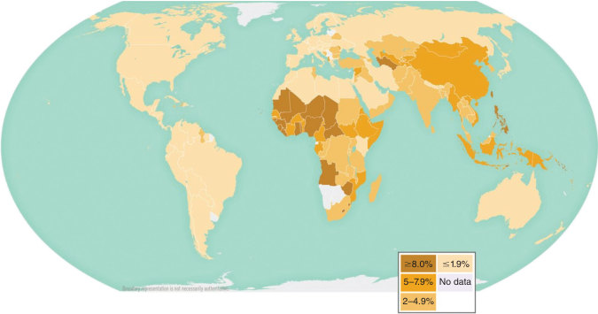
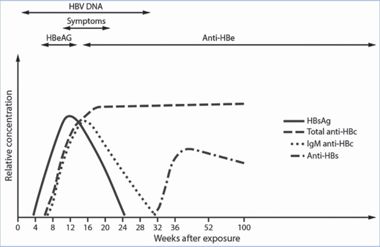
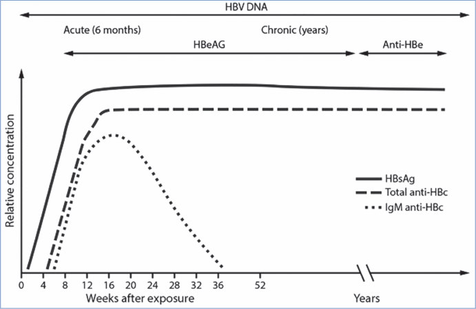
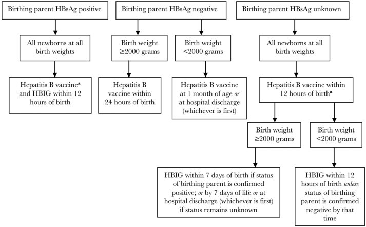
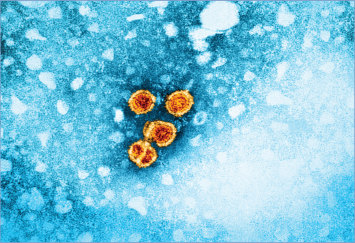
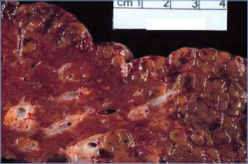
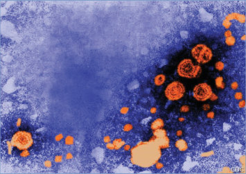
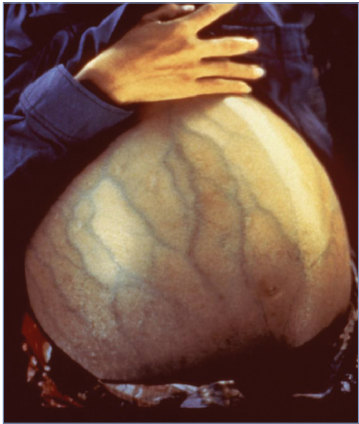
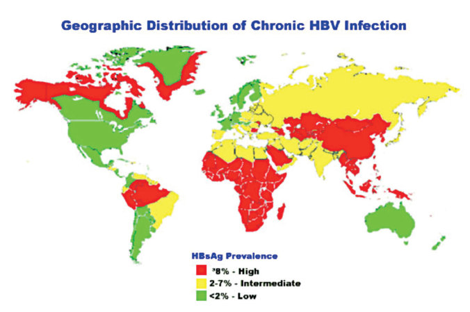
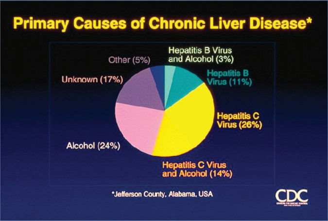

# 63. Hepatitis B
> Reference: [source credits](../../SOURCE_CREDITS.md). Printed pp. 346-364; PDF pp. 360-378.
> Editorial study pathway: Viral infections (not a part division in the source).
[Flashcards](../flashcards/063_flashcards.md) · [Quiz](../mcqs/063_mcqs.md) · [Full extraction](../../raw/chapters/063.md)

## Five study pillars

### Etiology and transmission
HBV has a partially double-stranded DNA genome contained within a 42-nm-diameter enveloped virion and belongs in the family Hepadnaviridae. Important components of the viral particle include an outer lipoprotein envelope containing HBsAg, an inner nucleocapsid consisting of hepatitis B core antigen (HBcAg), and the viral polymerase attached to the viral genome.
*Printed p. 347 / PDF p. 361*

### Clinical recognition
People acutely infected with hepatitis B virus (HBV) may be asymptomatic or symptomatic. The likelihood of developing symptoms increases with age: less than 1% of infants younger than 1 year, 5% to 15% of children 1 through 5 years, and 30% to 50% of people 6 through 30 years of age are symptomatic.
*Printed p. 346 / PDF p. 360*

### Diagnostic workup
Serologic protein antigen tests are available commercially to detect HBsAg and HBeAg. Serologic antibody assays also are available for detection of anti-HBs, total anti-HBc, IgM anti-HBc, and anti- HBe .
*Printed p. 348 / PDF p. 362*

### Treatment in the atlas
No therapy for uncomplicated acute HBV infection is recommended. Treatment with a nucleoside or nucleotide analogue is indicated if there is concern for severe infection with acute liver failure.
*Printed p. 350 / PDF p. 364*

### Prevention and infection control
Standard precautions are indicated for patients with acute or chronic HBV infection. For infants whose birthing parent is HBsAg positive, no special care in addition to standard precautions, as described under Control Measures, is needed, other than removal of birthing parent’s blood by a gloved attendant.
*Printed p. 351 / PDF p. 365*

## Clinical search tags
Petechiae / purpura, Hepatitis / jaundice, Arthritis / bone pain, Cytopenia, Congenital / neonatal, Immunocompromised host, Travel / endemic setting

## Full text, original tables, and images

# 63. Hepatitis B
> Private study reference ([source credits](../../SOURCE_CREDITS.md)). PDF pages 360-378; printed pages 346-364.

## PDF page 360 | printed page 346

### CLINICAL MANIFESTATIONS

People acutely infected with hepatitis B virus (HBV) may be asymptomatic or symptomatic. The likelihood of developing symptoms increases with age: less than 1% of infants younger than 1 year, 5% to 15% of children 1 through 5 years, and 30% to 50% of people 6 through 30 years of age are symptomatic. Few data are available for adults older than 30 years. Acute HBV infection cannot be distinguished from other forms of acute viral hepatitis on the basis of clinical signs and symptoms or nonspecific laboratory findings. The spectrum of signs and symptoms varies and includes subacute illness with nonspecific symptoms (eg, anorexia, nausea, or malaise), clinical hepatitis with jaundice, or fulminant hepatitis. Extrahepatic manifestations associated with circulating immune complexes that have been reported in HBV-infected children include arthralgias, arthritis, polyarteritis nodosa, thrombocytopenia, and glomerulonephritis. Gianotti-Crosti syndrome (papular acrodermatitis), urticaria, macular rash, or purpuric lesions may be seen in acute HBV infection.

Chronic HBV infection is defined as persistence in serum for at least 6 months of any one of the following: hepatitis B surface antigen (HBsAg), HBV DNA, or hepatitis B envelope antigen (HBeAg). Chronic HBV infection is likely in the presence of HBsAg, HBV DNA, or HBeAg in serum from a person who tests negative for immunoglobulin (Ig) M antibody to hepatitis B core antigen (IgM anti-HBc).

Age at the time of infection is the primary determinant of risk of progressing to chronic infection. Up to 90% of infants infected perinatally or in the first year of life will develop chronic HBV infection. Between 25% and 50% of children infected between 1 and 5 years of age become chronically infected, whereas 5% to 10% of infected older children and adults develop chronic HBV infection. Patients who become infected with HBV while immunosuppressed or with an underlying chronic illness (eg, end-stage renal disease) have an increased risk of developing chronic infection. Without treatment, up to 25% of infants and

children who acquire chronic HBV infection will die prematurely from HBV-related hepatocellular carcinoma (HCC) or cirrhosis.

The clinical course of untreated chronic HBV infection varies according to the population studied, reflecting differences in age at acquisition, rate of loss of HBeAg, and possibly HBV genotype. Most children have asymptomatic infection. For years to decades after initial infection, perinatally infected children are in an “immune tolerant” phase with normal or minimally elevated alanine aminotransferase (ALT) concentrations, minimal or mild liver histologic abnormalities, detectable HBeAg, and high HBV DNA concentrations (≥20,000 IU/mL). Some children with chronic HBV infection may exhibit growth impairment. Chronic HBV infection acquired during later childhood or adolescence usually is accompanied by more active liver disease and increased serum aminotransferase concentrations. Patients with detectable HBeAg (HBeAg-positive chronic hepatitis B) usually have high concentrations of HBV DNA and HBsAg in serum and are more likely to transmit infection. Over time (years to decades), HBeAg becomes undetectable in many chronically infected people. This transition often is accompanied by development of antibody to HBeAg (anti-HBe) and decreases in serum HBV DNA and serum aminotransferase concentrations and may be preceded by a temporary exacerbation of liver disease. These patients have inactive chronic infection but still may experience episodes of reactivation, manifested by increases in serum HBV DNA and aminotransferase concentrations. This may occur spontaneously or when these patients become immunosuppressed, receive antitumor necrosis factor agents or disease-modifying anti-rheumatic drugs, or have chronic hepatitis C virus (HCV) infection being treated with direct acting antiviral agents.

Because HBV-associated liver injury is believed to be immune-mediated, in people coinfected with HIV and HBV, the return of immune competence with antiretroviral treatment of HIV infection may lead to a reactivation of HBV-related liver inflammation and damage.

Some patients who lose HBeAg may continue to have ongoing histologic evidence of liver damage

## PDF page 361 | printed page 347

and moderate to high concentrations of HBV DNA (HBeAg-negative chronic hepatitis B). Patients with histologic evidence of chronic HBV infection, regardless of HBeAg status, remain at higher risk of death attributable to liver failure compared with HBV-infected people with no histologic evidence of liver inflammation and fibrosis. Chronically infected adults clear HBsAg without treatment at the rate of approximately 1% annually; for chronically infected children, however, the annual clearance rate is less than 1%.

### ETIOLOGY

HBV has a partially double-stranded DNA genome contained within a 42-nm-diameter enveloped virion and belongs in the family Hepadnaviridae. Important components of the viral particle include an outer lipoprotein envelope containing HBsAg, an inner nucleocapsid consisting of hepatitis B core antigen (HBcAg), and the viral polymerase attached to the viral genome.

### EPIDEMIOLOGY

HBV is transmitted through infected blood or body fluids. Although HBsAg has been detected in multiple body fluids including human milk, saliva, and tears, the most potentially infectious fluids include blood, serum, semen, vaginal secretions, and cerebrospinal, synovial, pleural, pericardial, peritoneal, and amniotic fluids. People with chronic HBV infection are the primary reservoirs for infection. Common modes of transmission include perinatal exposure to an infected birthing parent; percutaneous and permucosal exposure to infectious body fluids; sharing or using nonsterilized needles, syringes, or glucose monitoring equipment or devices; sexual contact with an infected person; and household exposure to a person with chronic HBV infection. Risks of HBV acquisition when a susceptible child bites a child who has chronic HBV infection or when a susceptible child is bitten by a child with chronic HBV infection are unknown. A theoretical risk exists if HBsAgpositive blood enters the oral cavity of the biter, but transmission by this route has not been reported. Transmission by transfusion of contaminated blood or blood products is rare in the United States because of routine screening of blood donors and viral inactivation of certain blood products before administration.

Perinatal transmission of HBV is highly efficient and usually occurs from blood exposures during labor and delivery. In utero transmission accounts for less than 2% of all vertically transmitted HBV infections in most studies. Without postexposure prophylaxis, the risk of an infant acquiring HBV from an infected mother as a result of perinatal exposure is 70% to 90% for infants whose birthing parent is HBsAg and HBeAg positive; the risk is 5% to 20% for infants whose birthing parent is HBsAg positive but HBeAg negative. Infants whose birthing parent has very high HBV DNA levels (>200,000 IU/mL) are at high risk of breakthrough infection despite receipt of postexposure prophylaxis with antibody and vaccine at birth.

Prevalence of HBV infection and patterns of transmission vary markedly throughout the world (see Fig 63.1). Approximately 80% of people worldwide live in regions of intermediate to high HBV endemicity, defined as prevalence of chronic HBV infection of 2% or greater. Historically, most new HBV infections occurred as a result of perinatal or early childhood infections in regions of high HBV endemicity, defined as prevalence of HBV infection of 8% or greater. Infant immunization programs in some of these countries have reduced seroprevalence of HBsAg greatly, but many countries with endemic HBV have yet to implement widespread routine birth-dose and/or childhood hepatitis B immunization programs. In regions of intermediate HBV prevalence (2% to 7%), multiple modes of transmission occur (eg, perinatal, household, sexual, injection drug use, and health care associated). In countries with low prevalence (<2%) and where routine immunization has been adopted, new infections occur most often in age groups where routine immunization is not conducted.

In regions of the world with high prevalence of chronic HBV infection, transmission between children in household settings may account for a substantial amount of transmission. Precise mechanisms of transmission from child-to-child are unknown, but frequent interpersonal contact of nonintact skin or mucous membranes with blood-containing secretions, open skin lesions, or blood-containing saliva are potential means of transmission. Transmission from sharing inanimate objects, such as razors or toothbrushes, also may

## PDF page 362 | printed page 348

Figure 63.1 Map of hepatitis B prevalence globally

Reproduced from https://wwwnc.cdc.gov/travel/yellowbook/2024/infections-diseases/hepatitis-b. Data source: 2021 estimates of hepatitis B virus disease burden. CDA Foundation Polaris Observatory. Available from: https://cdafound.org/ polaris-countries-distribution/.

occur. HBV can survive in the environment for 7 or more days but is inactivated by commonly used disinfectants, including household bleach diluted 1:10 with water. HBV is not transmitted by the fecal-oral route.

The incubation period for acute HBV infection is 45 to 160 days, with an average of 90 days.

### DIAGNOSTIC TESTS

Serologic protein antigen tests are available commercially to detect HBsAg and HBeAg. Serologic antibody assays also are available for detection of anti-HBs, total anti-HBc, IgM anti-HBc, and anti- HBe (see Table 63.1, Fig 63.2, and Fig 63.3). Most laboratories now use nucleic acid amplification tests for analysis of HBV DNA, with very high sensitivity at low levels and broad dynamic range for quantitation.

HBsAg is detectable during acute and chronic infection. If HBV infection is self-limited, HBsAg disappears in most patients within a few weeks to several months after infection, followed by appearance of anti-HBs. The time between

$8.0% #1.9%

5–7.9% No data

2–4.9%

disappearance of HBsAg and appearance of anti- HBs is termed the window period of infection. During the window period, the only marker of acute infection is IgM anti-HBc. IgM anti-HBc usually is not present in infants infected perinatally. People with chronic HBV infection have circulating HBsAg and circulating total anti-HBc (Fig 63.3); in a minority of chronically infected individuals, anti-HBs also is present. Both anti- HBs and total anti-HBc are present in people with resolved infection, whereas anti-HBs alone is present in people immunized with hepatitis B (HepB) vaccine. The presence of HBeAg in serum correlates with higher concentrations of HBV DNA and greater infectivity. Tests for HBeAg and HBV DNA are necessary in selection of candidates to receive antiviral therapy and to monitor response to therapy.

Transient presence of HBsAg can occur following receipt of HepB vaccine, with (vaccine-derived) HBsAg being detected as early as 24 hours after and up to 3 weeks following administration of the vaccine.

## PDF page 363 | printed page 349

Table 63.1 Diagnostic Tests for Hepatitis B Virus (HBV) Antigens, Antibodies, and DNA

Factors to Be Tested HBV Antigen or Antibody HBsAg Hepatitis B surface antigen Detection of acutely or chronically infected people; antigen used in hepatitis B vaccine; rarely can be detected for up to 3 weeks after a dose of hepatitis B vaccine Anti-HBs Antibody to HBsAg Identification of people who have resolved infections with HBV; determination of immunity after immunization HBeAg Hepatitis B envelope antigen Identification of infected people with high serum HBV DNA concentrations at increased risk of transmitting HBV Anti-HBe Antibody to HBeAg Identification of infected people with low to moderate serum HBV DNA concentrations at lower risk of transmitting HBV Anti-HBc (total) IgM + IgG antibody to HBcAga

Identification of people with acute, resolved, or chronic HBV infection (not present after immunization); transplacentally acquired anti-HBc is detectable for as long as 24 months among infants born to HBsAg-positive birthing parent IgM anti-HBc IgM antibody to HBcAga Identification of people with acute or recent HBV infections (including HBsAg-negative people during the “window” phase of infection; unreliable for detecting perinatal HBV infection) HBV DNA N/A Inform use of antiviral therapy, including in pregnant people (to decrease risk of perinatal transmission)

HBcAg indicates hepatitis B core antigen; IgM, immunoglobulin M.

a No test is available commercially to measure HBcAg or isolated IgG antibody to HBcAg (without also measuring IgM antibody to HBcAg, as total anti-HBc does).

Figure 63.2 Typical serologic course of acute hepatitis B virus infection with recovery

anti-HBc indicates antibody to hepatitis B core antigen; anti-HBe, antibody to hepatitis B e antigen; anti-HBs, antibody to hepatitis B surface antigen; HBeAg, hepatitis B e antigen; HBsAg, hepatitis B surface antigen; HBV, hepatitis B virus; IgM, immunoglobulin M.

From Conners EE, Panagiotakopoulos L, Hofmeister MG, et al. Screening and testing for hepatitis B virus infection: CDC recommendations—United States, 2023. MMWR Recomm Rep. 2023;72(RR-1):1–25.

Use

### Geometry-detected table

|Factors to Be Tested|HBV Antigen or Antibody|Use|
|---|---|---|
|HBsAg|Hepatitis B surface antigen|Detection of acutely or chronically infected people; antigen used in hepatitis B vaccine; rarely can be detected for up to 3 weeks after a dose of hepatitis B vaccine|
|Anti-HBs|Antibody to HBsAg|Identifcation of people who have resolved infections with HBV; determination of immunity after immunization|
|HBeAg|Hepatitis B envelope antigen|Identifcation of infected people with high serum HBV DNA concentrations at increased risk of transmitting HBV|
|Anti-HBe|Antibody to HBeAg|Identifcation of infected people with low to moderate serum HBV DNA concentrations at lower risk of transmit- ting HBV|
|Anti-HBc (total)|IgM+ IgG antibody to HBcAga|Identifcation of people with acute, resolved, or chronic HBV infection (not present after immunization); transplacentally acquired anti-HBc is detectable for as long as 24 months among infants born to HBsAg-positive birthing parent|
|IgM anti-HBc|IgM antibody to HBcAga|Identifcation of people with acute or recent HBV infec- tions (including HBsAg-negative people during the “window” phase of infection; unreliable for detecting perinatal HBV infection)|
|HBV DNA|N/A|Inform use of antiviral therapy, including in pregnant people(to decrease risk ofperinatal transmission)|

[View original table](../../tables/ch063_p0363_1.jpg)

## PDF page 364 | printed page 350

Figure 63.3 Typical serologic course of acute hepatitis B virus (HBV) infection with progression to chronic HBV infection

anti-HBc indicates antibody to hepatitis B core antigen; anti-HBe, antibody to hepatitis B e antigen; anti-HBs, antibody to hepatitis B surface antigen; HBeAg, hepatitis B e antigen; HBsAg, hepatitis B surface antigen; HBV, hepatitis B virus; IgM, immunoglobulin M.

From Conners EE, Panagiotakopoulos L, Hofmeister MG, et al. Screening and testing for hepatitis B virus infection: CDC recommendations—United States, 2023. MMWR Recomm Rep. 2023;72(RR-1):1–25.

### TREATMENT

No therapy for uncomplicated acute HBV infection is recommended. Treatment with a nucleoside or nucleotide analogue is indicated if there is concern for severe infection with acute liver failure. Acute HBV infection may be difficult to distinguish from reactivation of HBV. If reactivation is a possibility, referral to a hepatitis specialist would be warranted. Hepatitis B immunoglobulin (HBIG) and corticosteroids are not effective treatment for acute or chronic disease.

The goal of treatment in chronic HBV infection is to prevent progression to cirrhosis, hepatic failure, and HCC, with anti-HBe seroconversion, normalization of serum aminotransferase, and suppression of detectable serum HBV DNA concentrations as surrogate end points. Current indications for treatment of chronic HBV infection include evidence of ongoing HBV viral replication, as indicated by the presence for longer than 6 months of either serum HBV DNA greater than 20,000 IU/mL with HBeAg or greater than 2,000 IU/mL without

HBeAg, AND elevated serum ALT concentrations for longer than 6 months or evidence of chronic hepatitis on liver biopsy. Children without necroinflammatory liver disease and children in the immunotolerant phase (ie, normal ALT concentrations despite presence of HBV DNA) do not warrant antiviral therapy. Treatment response is measured by biochemical, serologic, virologic, and histologic response. The American Association for the Study of Liver Diseases and the Centers for Disease Control and Prevention (CDC) recommend that pregnant people with viral loads >200,000 IU/mL be offered antiviral therapy to prevent transmission to their newborn.1,2

The U.S. Food and Drug Administration (FDA) has approved 3 nucleoside analogues (entecavir, lamivudine, and telbivudine), 3 nucleotide analogues (tenofovir disoproxil fumarate, tenofovir alafenamide fumarate, and adefovir), and 2 interferon-alfa drugs (interferon alfa-2b and pegylated interferon alfa-2a) for treatment of chronic HBV infection in adults. All are available

## PDF page 365 | printed page 351

in the United States except telbivudine, which has been discontinued. An important consideration in choice of treatment is to avoid selection of antiviral resistance mutations. Entecavir, t enofovir disoproxil fumarate, tenofovir alafenamide fumarate, and pegylated interferon alfa-2a are preferred in adults as first-line therapy because of lower likelihood of developing antiviral resistance mutations over long-term therapy. FDA licensure in the pediatric population is as follows: interferon alfa-2b, ≥1 year of age; entecavir, ≥2 years of age; tenofovir disoproxil fumarate, ≥2 years of age; and telbivudine, ≥16 years of age, although this drug is no longer available in the United States. Pegylated interferon alfa-2a is not approved for treatment of children with chronic hepatitis B but is approved for children ≥5 years of age to treat chronic HCV infection. Developments in antiviral therapies of HBV and updated practice guidelines may be found on the American Association for the Study of Liver Diseases website (www. aasld.org/practice-guidelines/chronichepatitis-b). Specific therapy guidelines for children coinfected with HIV and HBV can be accessed online (https://clinicalinfo.hiv.gov/ en/guidelines).

Consultation with health care professionals (HCPs) with expertise in treating chronic hepatitis B in children is recommended.

### INFECTION PREVENTION AND CONTROL MEASURES IN HEALTH CARE SETTINGS

Standard precautions are indicated for patients with acute or chronic HBV infection. For infants whose birthing parent is HBsAg positive, no special care in addition to standard precautions, as described under Control Measures, is needed, other than removal of birthing parent’s blood by a gloved attendant.

### CONTROL MEASURES

Hepatitis B Immunoglobulin3

HBIG provides short-term protection (3–6 months) and is indicated in specific postexposure circumstances. HBIG is prepared from the plasma of donors with high concentrations of anti-HBs, with an anti-HBs titer of at least 1:100,000 by radioimmunoassay. Standard immunoglobulin is

not effective for postexposure prophylaxis against HBV infection, because concentrations of anti-HBs are too low.

Hepatitis B Vaccine

HepB vaccine is used for preexposure and postexposure prophylaxis and provides long-term protection. Preexposure immunization with HepB vaccine is the most effective means to prevent HBV infections. Highly effective and safe HepB vaccines produced by recombinant DNA technology are licensed in the United States in non-live single-antigen formulations and as components of combination vaccines. Recombinant vaccines contain 5 to 40 μg of HBsAg protein/mL, and a completed vaccine series results in production of anti-HBs of at least 10 mIU/mL in most people, which provides long-term protection for immunocompetent recipients. Single-dose formulations, including all pediatric formulations, contain no thimerosal as a preservative. Although the concentration of recombinant HBsAg protein differs among vaccine products, rates of seroprotection are equivalent when administered to immunocompetent infants, children, adolescents, or young adults in the doses recommended (see Table 63.2). A 2-dose single-antigen hepatitis B vaccine with a novel adjuvant (HepB-CpG [Heplisav-B]) and a 3-dose, 3-antigen vaccine (S, pre-S2, and pre-S1 [PreHevbrio]) are available for people 18 years and older.

High seroconversion rates and protective concentrations of anti-HBs (10 mIU/mL or greater) are achieved when HepB vaccine is administered in any of the recommended schedules, including schedules begun soon after birth in term infants (see Table 63.2). Only single-antigen HepB vaccine can be used for doses administered between birth and 6 weeks of age. Single-antigen or combination vaccine may be used to complete the series; 4 doses of vaccine may be administered if a birth dose is administered and a combination vaccine containing a hepatitis B component is used to complete the series.

Recommended schedules for routine and catch-up hepatitis B immunization are available annually from the CDC and American Academy of Pediatrics (www.cdc.gov/vaccines/schedules/ index.html and https://publications.aap.org/ redbook/pages/Immunization-Schedules). Alternate administration schedules are available

## PDF page 366 | printed page 352

Not applicable 10 μg HBsAg (0.5) (ages 6 wk through 4 y only)

Dose, μg (mL)

Dose, μg/mL Twinrix Dose, μg (mL)g Vaxelish

Adolescents 11–15 y of ageb 10 (1) Not approved for 2-dose schedule Not applicable Not applicable Not applicable Not applicable Not applicable

Adults undergoing 40 (1)i,j 40 (2)j,k Not applicable Not applicable Not applicable Not applicable Not applicable

Single-Dose Vaccinesa Multiple-Antigen Vaccinese Combination Vaccines

Adults 20 y or older 10 (1) 20 (1) Not applicable 20 (1)

Adults 18 y or older 20 (0.5) 10 (S, pre-S1, and pre-S2) (1) 20 (1)

5 (0.5) 10 (0.5) Not applicable Not applicable 10 μg HBsAg (0.5) (ages 6 wk through 6 y only)

Dose, μg (mL) Heplisav-Bd Dose, μg (mL) PreHevbrio Dose, μg (mL) Pediarixf

Recommended Dosages of Hepatitis B Vaccines

Table 63.2

Patients Recombivax HBb Dose, μg (mL) Engerix-Bc

Infants, children, and adolescents younger than 20 y (except as noted)

a Recombivax and Engerix-B vaccines are administered in a 3-dose schedule at 0, 1, and 6 months; 4 doses may be administered if a combination vaccine is used (at 2, 4, and 6 months) to complete the series. Only single-antigen hepatitis B vaccine can be used for the birth dose. Single-antigen or combination vaccine containing hepatitis B vaccine may be used to complete the series. See text for management of infants whose birthing parent is HBsAg positive or HBsAg unknown. b Available from Merck & Co Inc. A 2-dose schedule, administered at 0 months and then 4 to 6 months later, is licensed for adolescents 11 through 15 years of age using the adult formulation of Recombivax HB (10 μg). c Available from GlaxoSmithKline Biologicals. The U.S. Food and Drug Administration also has licensed this vaccine for use in an optional 4-dose (0.5-mL/dose for ages birth through 10 years and 1.0 mL/dose for ages 11–19 years) schedule at 0, 1, 2, and 12 months for all age groups. A 0-, 12-, and 24-month schedule is licensed for children 5 through 10 years of age at a 0.5-mL dose and for children 11 through 16 years of age at a 1.0-mL dose for whom an extended administration schedule is appropriate on the basis of risk of exposure. d Available from Dynavax Technologies Corporation. A 2-dose schedule administered at 0 and 1 month for use in people ≥18 years of age; safety and effectiveness of Heplisav-B have not been established in adults on hemodialysis. e Available from VBI Vaccines Inc. A 3-dose schedule administered at 0, 1, and 6 months for use in people ≥18 years of age; safety and effectiveness of PreHevbrio have not been established in adults on hemodialysis. f Combination of diphtheria and tetanus toxoids and acellular pertussis (DTaP), inactivated (non-live) poliovirus (IPV), and hepatitis B (Engerix-B 10 μg) is approved for use at 2, 4, and 6 months of age (Pediarix [GlaxoSmithKline]). This vaccine should not be administered at birth, before 6 weeks of age, or at 7 years of age or older. g A combination of hepatitis B (Engerix-B, 20 μg) and hepatitis A (Havrix, 720 enzyme-linked immunosorbent assay units [ELU]) vaccine; Twinrix is licensed for use in people 18 years of age and older in a 3-dose schedule at 0, 1, and 6 months. Alternately, a 4-dose schedule at days 0, 7, and 21 to 30, followed by a booster dose at 12 months, may be used. h Combination of DTaP, IPV, Haemophilus influenzae type b conjugate, and hepatitis B recombinant vaccines approved for use at 2, 4, and 6 months of age to be used from 6 weeks of age through age 4. Not to be used for the birth dose or for children 5 years and older. i Special formulation for adult dialysis patients administered at 0, 1, and 6 months. j When administered to these populations, follow-up serologic testing is recommended 1–2 months after completion of 2-dose series. k Two 1-mL doses administered in 1 or 2 injections in a 4-dose schedule at 0, 1, 2, and 6 months of age.

HBsAg, hepatitis B surface antigen.

dialysis

### Geometry-detected table

|Single-Dose Vaccinesa|Col2|Col3|Col4|Multiple-Antigen Vaccinese|Combination Vaccines|Col7|Col8|
|---|---|---|---|---|---|---|---|
|**Patients**|**Recombivax HBb** **Dose,µg (mL)**|**Engerix-Bc** **Dose,µg (mL)**|**Heplisav-Bd** **Dose,µg (mL)**|**PreHevbrio** **Dose,µg (mL)**|**Pediarixf** **Dose,µg/mL**|**Twinrix** **Dose,µg (mL)g**|**Vaxelish** **Dose,µg (mL)**|
|Infants, children, and adolescents younger than 20 y (except as noted)|5 (0.5)|10 (0.5)|Not applicable|Not applicable|10 µg HBsAg (0.5) (ages 6 wk through 6 y only)|Not applicable|10 µg HBsAg (0.5) (ages 6 wk through 4 y only)|
|Adolescents 11–15 y of ageb|10 (1)|Not approved for 2-dose schedule|Not applicable|Not applicable|Not applicable|Not applicable|Not applicable|
|Adults 18 y or older|||20 (0.5)|10 (S, pre-S1, and pre-S2) (1)||20 (1)||
|Adults 20y or older|10(1)|20(1)|||Not applicable|20(1)||
|Adults undergoing dialysis|40 (1)i,j|40 (2)j,k|Not applicable|Not applicable|Not applicable|Not applicable|Not applicable|

[View original table](../../tables/ch063_p0366_1.jpg)

## PDF page 367 | printed page 353

and licensed by the FDA (see Table 63.2). These alternate dosage and administration schedules result in equivalent immunogenicity and can be used when acceptable on the basis of low risk of exposure and to facilitate adherence.

HepB vaccine can be administered concurrently with other vaccines.

Vaccine Interchangeability

In general, the various brands of age-appropriate HepB vaccines are interchangeable within an immunization series. Vaccination should not be deferred when the manufacturer of the previously administered vaccine is unknown or when the vaccine from the same manufacturer is unavailable. Adolescent patients who start their hepatitis B schedule with the adult formulation of Recombivax HB are not candidates to complete their series with the adult formulation of Engerix-B. Similarly, people 18 years or older who start their hepatitis B series with Heplisav-B should complete it with the same product. Of note, data are limited on safety and immunogenicity when PreHevbrio is interchanged with HepB vaccines from other manufacturers.

Routes of Administration

Vaccine is administered intramuscularly in the anterolateral thigh for infants or deltoid area for children and adults. Administration in the buttocks or by the intradermal route is not recommended at any age.

Effectiveness and Duration of Protection

HepB vaccines licensed in the United States have a 90% to 95% effectiveness for preventing HBV infection and clinical HBV disease among susceptible children and adults. Immunocompetent people who achieve anti-HBs concentration ≥10 mIU/mL after preexposure vaccination have virtually complete protection against infection with HBV. Long-term studies of immunocompetent adults and children indicate that immune memory remains intact for at least 3 decades and protects against symptomatic acute and chronic HBV infection, even though anti-HBs concentrations may become low or undetectable over time.

Booster Doses

Routine booster doses of HepB vaccine are not recommended for children and adults with normal

immune status. For patients undergoing hemodialysis who are at continued risk of infection, immunity should be assessed by annual anti-HBs testing, and a booster dose should be administered when the anti-HBs concentration is <10 mIU/mL. Annual anti-HBs testing and booster doses when anti-HBs concentrations decrease to <10 mIU/mL should be considered for immunocompromised people (eg, people with HIV, hematopoietic cell transplant recipients, and people receiving chemotherapy) if they have an ongoing risk for HBV exposure. Similar consideration may be given to children with cystic fibrosis, liver disease, or celiac disease if there is an ongoing risk for HBV exposure. Children with HIV and celiac disease may not respond as well to HepB vaccine.

Adverse Events

Adverse effects reported in adults and children are pain at the injection site, fever, reported more commonly in children than adults, and fatigue, reported more commonly in adults. Anaphylaxis is uncommon, occurring in less than 1 in 1.3 million recipients. Large, controlled epidemiologic studies and review by the National Academy of Medicine4 found no evidence of an association between HepB vaccine and sudden infant death syndrome, type 1 diabetes mellitus, seizures, encephalitis, or autoimmune (eg, vasculitis) or demyelinating disease, including multiple sclerosis.

Immunization During Pregnancy or Lactation

No adverse effect on the developing fetus has been observed after immunization during pregnancy. Pregnancy and lactation are not contraindications to immunization. Data are not available to assess the safety of Heplisav-B or PreHevbrio during pregnancy, during breastfeeding, or on milk production and excretion. Thus, providers should vaccinate pregnant people needing HepB vaccination with Engerix-B, Recombivax HB, or Twinrix.

Serologic Testing5

Susceptibility testing before immunization is not indicated routinely for children or adolescents. Screening with a triple panel (HBsAg, anti-HBs, and total anti-HBc) is recommended for all adults 18 years and older at least once in their lifetime. People at increased risk for hepatitis B infection, regardless of age, and anyone who requests

## PDF page 368 | printed page 354

HBV testing also should be screened. Testing of pregnant individuals for hepatitis B infection is recommended during each pregnancy (see Serologic Screening of Pregnant People, below). Infants whose birthing parent is HBsAg positive should have postvaccination serologic testing for HBsAg and anti-HBs at 9 to 12 months of age. Anti-HBs testing of health care personnel and others at increased or ongoing risk of hepatitis B exposure may be performed to document presence of protective antibody.

Preexposure Universal Immunization

Immunization with HepB vaccine is recommended for all infants, children, adolescents, and adults through 59 years of age. (www.cdc.gov/ vaccines/schedules/hcp/imz/catchup.html, https://publications.aap.org/redbook/ pages/Immunization-Schedules, and www. cdc.gov/mmwr/volumes/71/wr/mm7113a1. htm). Age-specific vaccine dosages are provided in Table 63.2.

Newborn Immunization, Including Management Based on HBsAg Status of the Birthing Parent

Serologic Screening of Pregnant People6

Testing of all pregnant individuals is recommended to identify newborn infants who require immediate postexposure prophylaxis. Testing with HBsAg is recommended during each pregnancy, regardless of vaccination status or history of testing; a triple panel (HBsAg, anti-HBs, and total anti-HBc) may be offered to those who have not had this performed previously. All pregnant individuals should be tested during an early prenatal visit and testing should be repeated at the time of admission to the hospital for delivery for HBsAg-negative people who are at high risk of HBV infection or who have had clinical hepatitis. Individuals who are HBsAg positive also should be tested for HBV DNA and referred to appropriate specialists to assess need for treatment and to ensure follow-up of their infants and immunization of sexual and household contacts.

Birth Dose of Hepatitis B Vaccine and Use of HBIG7

The strategy for preventing hepatitis B in newborn infants, based on birth weight and birthing parent’s HBsAg status, involves providing a birth

dose of hepatitis B vaccine to all infants and, for some infants, HBIG. Starting vaccination at birth for all infants serves as a safety net in case a birthing parent’s HBsAg-positive status was not identified at birth, such as if results were not obtained, were misinterpreted, were falsely negative, were transcribed or reported to the infant care team inaccurately, or were not communicated to the nursery. The strategy acknowledges and accounts for risk factors that may not have been reported and high-risk birthing parents who may not have been retested around the time of delivery.

HepB vaccine should be administered to all infants born to HBsAg-negative birth parents within 24 hours of birth for infants with birth weight ≥2,000 g, and at hospital discharge or 1 month of age (whichever is first) for infants with birth weight <2,000 g. HepB vaccine plus HBIG should be administered within 12 hours of birth to all newborn infants whose birthing parent is HBsAg positive. Appropriate management at birth of these infants and those whose birthing parent’s HBsAg status is unknown is described below and in Figure 63.4.

Subsequent Immunization of Newborns Whose Birthing Parent Is HBsAg Negative and Those Whose HBsAg Was Unknown at Birth but Is Subsequently Confirmed as Negative (Tables 63.2 and 63.3)

Infants whose birthing parent is HBsAg negative and those whose birthing parent’s initial HBsAg status was unknown but subsequently is confirmed as negative should complete hepatitis B immunization according to routine immunization schedules with either singleantigen (at ages 1–2 months and 6–18 months) or combination hepatitis B-containing (ages 2, 4, and 6 months) vaccine. Minimum intervals of 4 weeks (28 days) should occur between doses 1 and 2, and 8 weeks between doses 2 and 3, with a minimum of 16 weeks between doses 1 and 3; when 4 doses are administered, substitute “dose 4” for “dose 3” in these calculations (www.cdc.gov/vaccines/schedules/hcp/ imz/child-adolescent.html and https:// publications.aap.org/redbook/pages/ Immunization-Schedules). Infants whose birthing parent’s HBsAg is unknown and remains unknown are managed as infants whose birthing parent is HBsAg positive (see below).

## PDF page 369 | printed page 355

Figure 63.4 Administration of Birth Dose of Hepatitis B Vaccine by Birth Weight and HBsAg Status of Birthing Parent

Modified from American Academy of Pediatrics, Committee on Infectious Diseases, Committee on Fetus and Newborn. Elimination of perinatal hepatitis B: providing the first vaccine dose within 24 hours of birth. Pediatrics. 2017;140(3):e20171870.

a For newborn infants with birth weight <2,000 g, this dose will not count toward total doses in series.

Management of Infants Born to HBsAg-Positive People

All infants born to HBsAg-positive people, including infants weighing less than 2,000 g, should receive the initial dose of HepB vaccine within 12 hours of birth (see Table 63.3 for appropriate dosages), and HBIG (0.5 mL) should be administered concurrently but at different anatomic sites (eg, different extremities) (Fig 63.4). Infants whose birthing parent has other evidence suggestive of HBV infection (eg, presence of HBV DNA, HBeAg positive, or known to be chronically infected with HBV) should be managed this way as well. Effectiveness of HBIG diminishes the longer after exposure it is initiated. The interval of effectiveness is unlikely to exceed 7 days. Subsequent doses of vaccine should be administered as recommended in Table 63.3. For infants who weigh <2,000 g at birth, the initial vaccine dose should not be counted in the required 3-dose schedule (a total

of 4 doses of HepB vaccine should be administered), and the subsequent 3 doses should be administered at months 1, 2 to 3, and 6 months for single-antigen products and months 2, 4, and 6 for hepatitis B-containing combination vaccines (Table 63.3). By the chronologic age of 1 month, all medically stable preterm infants, regardless of initial birth weight or gestational age, are as likely to respond to HepB immunization as are term and larger infants.

Breastfeeding of an infant by an HBsAg-positive parent poses no additional risk of acquisition of HBV infection by the infant with appropriate administration of HepB vaccine and HBIG.

FOLLOW-UP MANAGEMENT OF INFANTS WHOSE

BIRTHING PARENT IS HBsAg POSITIVE. Infants whose birthing parent is HBsAg positive should be tested for anti-HBs and HBsAg at 9 to 12 months of age, at least 1 to 2 months after completion of the immunization series.8,9 Testing should not be

## PDF page 370 | printed page 356

Table 63.3 Hepatitis B Vaccine Schedules for Infants by Hepatitis B Surface Antigen (HBsAg) Status of Birthing Parent and Birth Weight

Single-Antigen Vaccine

HBsAg Status of Birthing Parent

Dose Age Positive 1a Birth (12 h or less) HBIGb Birth (12 h or less) 2 1 through 2 mo for BW ≥2,000 g; 1 mo for BW <2,000 g

3c 6 mo for BW ≥2,000 g; 2–3 mo for BW <2,000 g

4 Only if BW <2,000 g

6 mo

Unknownc 1a Birth (12 h or less) BW <2,000 g HBIG at birth (12 h or less)

2 1 through 2 mo for BW ≥2,000 g; 1 mo for BW <2,000 g if status of birthing parent remains unknown

3d 6 mo for BW ≥2,000 g; 2–3 mo for BW <2,000 g if status of birthing parent remains unknown

4 Only if BW <2,000 g AND status of birthing parent remains unknown

6 mo

Negative 1a Birth (12 h or less) for BW ≥2,000 g; hospital discharge or age 1 mo for oBW <2,000 g

2 1 through 2 mo 3d 6 through 18 mo 4 Not applicable

BW indicates birth weight; HBIG, hepatitis B immunoglobulin.

a Recombivax HB or Engerix-B should be used for the birth dose. Pediarix and Vaxelis should not be administered at birth or before 6 weeks of age. b HBIG (0.5 mL) administered intramuscularly in a separate site from vaccine. c Birthing parents should have blood drawn and tested for HBsAg as soon as possible after admission for delivery. Infants with birth weight <2,000 g should receive HBIG by 12 hours; for infants with birth weight ≥2,000 g if the birthing parent is found to be HBsAg positive, the infant should receive HBIG as soon as possible but no later than 7 days of age. d The final dose in the vaccine series should not be administered before 24 weeks (164 days) of age.

Source: Schillie S, Vellozzi C, Reingold A, et al. Prevention of hepatitis B virus infection in the United States: recommendations of the Advisory Committee on Immunization Practices. MMWR Recomm Rep. 2018;67(1):1–31.

Single-Antigen + Combination

Dose Age 1a Birth (12 h or less) (combination vaccine should not be used for birth dose) HBIGb Birth (12 h or less)

2 2 mo

3 4 mo

4d 6 mo (Pediarix)

1a Birth (12 h or less) (Combination vaccine should not be used for birth dose)

2 2 mo

3 4 mo

4d 6 mo (Pediarix)

1a Birth (24 h or less) (combination vaccine should not be used for birth dose)

2 2 mo 3 4 mo 4d 6 mo (Pediarix)

### Geometry-detected table

|HBsAg Status of Birthing Parent|Single-Antigen Vaccine|Col3|Single-Antigen + Combination|Col5|
|---|---|---|---|---|
|**HBsAg Status of** **Birthing Parent**|**Dose**|**Age**|**Dose**|**Age**|
|Positive|1a|Birth (12 h or less)|1a Birth (12 h or less) (combination vaccine should not be used for birth dose)|1a Birth (12 h or less) (combination vaccine should not be used for birth dose)|
|Positive|HBIGb|Birth(12 h or less)|HBIGb|Birth(12 h or less)|
|Positive|2|1 through 2 mo for BW ≥2,000 g; 1 mo for BW <2,000g|2|2 mo|
|Positive|3c|6 mo for BW≥2,000 g; 2–3 mo for BW<2,000g|3|4 mo|
|Positive|4 Only if BW <2,000g|6 mo|4d|6 mo (Pediarix)|
|Unknownc|1a|Birth (12 h or less) BW<2,000 g HBIG at birth(12 h or less)|1a Birth (12 h or less) (Combination vaccine should not be used for birth dose)|1a Birth (12 h or less) (Combination vaccine should not be used for birth dose)|
|Unknownc|2|1 through 2 mo for BW ≥2,000 g; 1 mo for BW<2,000 g if status of birthing parent remains unknown|2|2 mo|
|Unknownc|3d|6 mo for BW≥2,000 g; 2–3 mo for BW<2,000 g if status of birthing parent remains unknown|3|4 mo|
|Unknownc|4 Only if BW <2,000 g AND status of birthing parent remains unknown|6 mo|4d|6 mo (Pediarix)|
|Negative|1a|Birth (12 h or less) for BW≥2,000 g; hospital discharge or age 1 mo for ºBW<2,000g|1a Birth (24 h or less) (combination vaccine should not be used for birth dose)|1a Birth (24 h or less) (combination vaccine should not be used for birth dose)|
|Negative|2|1 through 2 mo|2|2 mo|
|Negative|3d|6 through 18 mo|3|4 mo|
|Negative|4|Not applicable|4d|6 mo(Pediarix)|

[View original table](../../tables/ch063_p0370_1.jpg)

## PDF page 371 | printed page 357

performed before 9 months of age to maximize likelihood of detecting late onset of HBV infections. Immunized infants with anti-HBs concentrations ≥10 mIU/mL and who are HBsAg negative are considered not to be infected and to have adequate vaccine-associated immune protection. Infants with anti-HBs concentrations <10 mIU/mL and who are HBsAg negative following a 3-dose hepatitis B vaccine series should receive 1 additional dose of hepatitis B vaccine followed by testing for anti-HBs and HBsAg 1 to 2 months after the fourth dose. Infants with anti- HBs concentrations ≥10 mIU/mL and who are HBsAg negative after the fourth dose are considered not to be infected and to have adequate vaccine-associated immune protection. Infants with anti-HBs concentrations <10 mIU/mL and who are HBsAg negative after the fourth dose should receive 2 additional doses of vaccine, separated by at least 8 weeks, followed by testing for anti-HBs and HBsAg 1 to 2 months after the sixth dose. An alternate approach for children who have completed a 3-dose series of HepB vaccine but did not achieve anti-HBs titers ≥10 mIU/mL is to give 3 additional doses of HepB vaccine at the same dosing intervals as the first series and then retest for anti-HBs titers 1 to 2 months after the third dose of this second series. Subsequent doses of hepatitis B vaccine when anti-HBs concentrations are <10 mIU/mL after the sixth dose are not indicated.

Management of Infants Whose Birthing Parent’s HBsAg Status Is Unknown or Whose Birthing Parent Was Not Tested for HBsAg During Pregnancy

TERM INFANTS (WEIGHING ≥2,000 g AT BIRTH).

Pregnant people whose HBsAg status is unknown at delivery should undergo blood testing as soon as possible to determine their HBsAg status. While awaiting results, the infant should receive the first HepB vaccine dose within 12 hours of birth, as recommended for infants whose birthing parent is HBsAg positive (see Table 63.3 and Fig 63.4). Routine nursery procedures, such as skin-to-skin care, delayed bathing, and breastfeeding within the first hour, may continue as recommended by the facility. If the birthing parent is found to be HBsAg positive, term infants should receive HBIG (0.5 mL) as soon as possible, but within 7 days of birth, and should complete the HepB

immunization series as recommended (see Tables 63.2 and 63.3). If the birthing parent is found to be HBsAg negative, HepB immunization in the dose and schedule recommended for term infants whose birthing parent is HBsAg negative should be completed (see Table 63.2). If the birthing parent’s HBsAg status remains unknown, it is appropriate to administer HBIG within 7 days of birth and complete the HepB immunization series as recommended for infants whose birthing parent is HBsAg positive (Table 63.3 and Fig 63.4).

INFANTS WEIGHING LESS THAN 2,000 g. HBsAg status of the birthing parent should be determined as soon as possible. Infants weighing <2,000 g whose birthing parent’s HBsAg status is unknown should receive HepB vaccine within the first 12 hours of life (Table 63.3 and Fig 63.4). Because of the potentially decreased immunogenicity of the HepB vaccine in infants weighing <2,000 g at birth, these infants should also receive HBIG (0.5 mL) within 12 hours of birth if the birthing parent’s HBsAg status cannot be determined by that time (Table 63.3 and Fig 63.4). The initial vaccine dose should not be counted toward the 3 doses of hepatitis B vaccine required to complete the immunization series, and the subsequent 3 doses (for a total of 4 doses) are administered according to the HBsAg status of the birthing parent. If the birthing parent is HBsAg positive or the parent’s status remains unknown, the infant would receive the subsequent 3 doses administered at months 1, 2 to 3, and 6 months for single-antigen HepB products, and months 2, 4, and 6 for HepBcontaining combination vaccines (Tables 63.2 and 63.3). Serologic testing for both of these groups of infants should be performed as described above for infants whose birthing parent is HBsAg positive and revaccination performed if necessary.

Routine Immunization of Infants, Children, and Adolescents Who Did Not Begin Immunization at Birth

Serologic testing to identify HBV infection (with a triple panel of HBsAg, anti-HBs, and total anti- HBc) should be performed for people in risk groups with high rates of infection, including people born in countries with intermediate or high HBV endemicity (even if immunized, because the series may

## PDF page 372 | printed page 358

have been started after the infection was acquired), children born in the United States who were not vaccinated as infants whose parents were born in a country with high HBV endemicity, current or past users of injection drugs, men who have sex with men, people with HIV or HCV infection, people currently or formerly incarcerated, people with sexually transmitted infections or multiple sexual partners, people on dialysis, household and sexual contacts of HBsAg-positive people, people with elevated ALT or aspartate aminotransferase levels of unknown origin, and anyone who requests HBV testing. The first dose of vaccine may be given at the time of testing so that immunization is not delayed. Children identified as HBsAg positive should be referred for management and monitoring of hepatitis B infection. Those who are HBsAg negative and anti-HBs negative should be immunized according to doses and schedules noted in Table 63.2. Routine postimmunization testing is not recommended.

Lapsed Immunizations

For infants, children, adolescents, and adults with lapsed immunizations (ie, the interval between doses is longer than that in one of the recommended schedules), the vaccine series should be completed without repeating doses, as long as minimum dosing intervals between the remaining doses necessary to complete the series are heeded.

Negative Anti-HBs in Previously Immunized Children

Providers may be asked to manage children tested for anti-HBs following receipt of hepatitis B immunization given at age-appropriate doses and intervals and found to have anti-HBs <10 mIU/mL. Serologic testing following routine immunization of children is not recommended routinely. If confirming response to vaccine is desired, such as after a needlestick injury, a single dose of vaccine may be administered, followed by testing for anti-HBs 1 to 2 months later. Children with anti-HBs ≥10 mIU/mL can be considered to have adequate vaccine-associated immune protection. Those with anti-HBs <10 mIU/mL may be given 2 more doses of hepatitis B vaccine with testing for anti-HBs 1 to 2 months after the last dose. A vaccine nonresponder is defined as a person with anti-HBs <10 mIU/mL after 2 complete series of HepB vaccine.

### SPECIAL CONSIDERATIONS

Considerations for High-Risk Groups

Patients Undergoing Hemodialysis

Immunization is recommended for susceptible patients undergoing hemodialysis. Immunization early in the course of renal disease is encouraged, because response is better than in advanced disease. Specific dosage recommendations have not been made for children undergoing hemodialysis. Some experts recommend increased doses of HepB vaccine for children receiving hemodialysis to increase immunogenicity.

People Born in Countries Where the Prevalence of Chronic HBV Infection Is 2% or Greater

Foreign-born people (including immigrants, refugees, asylum seekers, and internationally adopted children) from countries where prevalence of chronic HBV infection is 2% or greater (see Fig 63.1) should be screened for HBsAg regardless of immunization status. Previously unimmunized family members and other household contacts should be immunized if a household member is found to be HBsAg positive. Positive HBsAg test results are nationally notifiable, and people with positive HBsAg test results should be referred for medical management to reduce their risk of complications from chronic HBV infection and to reduce risk of transmission.

Inmates in Juvenile Detention and Other Correctional Facilities

Unimmunized or underimmunized people in juvenile and adult correctional facilities should be immunized. If the length of stay is not sufficient to complete the immunization series, the series should be initiated, and follow-up mechanisms with a health care facility should be established to ensure completion of the series.

International Travelers

People traveling to areas where prevalence of chronic HBV infection is 2% or greater (see Fig 61.3) should be immunized. Ideally, HepB vaccine should be administered ≥6 months before travel so that a 3-dose regimen can be completed (see Preexposure Universal Immunization). If fewer than 4 months are available before departure, the alternative 4-dose schedule of 0, 1, 2, and 12 months, licensed for one vaccine (see Table 63.2), might provide opportunity

## PDF page 373 | printed page 359

for more rapid development of protection. Individual health care providers may choose to use an accelerated schedule (eg, doses at days 0, 7, and 21–30, with a booster at 12 months) for travelers who will depart before an approved immunization schedule can be completed. People who receive immunization on an accelerated schedule that is not licensed by the FDA also should receive a dose at 12 months after initiation of the series to promote long-term immunity. For people 18 years and older, the 2-dose regimen of Heplisav-B can be completed in 1 month and offers greater flexibility before travel.

Postimmunization Testing for Anti-HBs

Routine postimmunization testing for anti-HBs is not necessary after routine vaccination of healthy people but is recommended 1 to 2 months after the final vaccine dose for the following specific groups: (1) hemodialysis patients (and other people who might require outpatient hemodialysis), (2) people with HIV infection, (3) other immunocompromised patients (eg, hematopoietic cell transplant recipients or people receiving chemotherapy), (4) people at occupational risk of exposure from percutaneous injuries or mucosal or nonintact skin exposures (eg, certain health care and public safety workers), (5) sexual partners of HBsAg-positive people, and (6) infants whose birthing parent is HBsAg positive and infants whose birthing parent’s HBsAg status remains unknown (testing should consist of HBsAg and anti-HBs).

Management of Nonresponders

Vaccine recipients who do not develop a serum anti-HBs response (≥10 mIU/mL) after a primary vaccine series should be tested for HBsAg to rule out the possibility of a chronic infection as an explanation of failure to respond to the vaccine. If the HBsAg test result is negative, a single dose of HepB vaccine can be administered followed by testing for anti-HBs in 1 to 2 months. If anti-HBs is ≥10 mIU/mL, no further testing is required. If anti-HBs is <10 mIU/mL, additional doses should be administered to complete the second vaccine series, with testing for anti-HBs 1 to 2 months after the last dose. For the 3-dose vaccine series using Engerix-B or Recombivax HB, this would require 2 additional doses of vaccine, and for the 2-dose series using Heplisav-B (licensed only in adults), this would require 1 additional dose.

For very recently vaccinated HCPs with anti-HBs <10 mIU/mL, in whom the low antibody concentration is more likely to reflect a failure to respond rather than waning antibody concentration, it may be more practical to revaccinate with an entire second series (3 doses of Engerix-B or Recombivax HB; 2 doses of Heplisav-B or PreHevbrio) followed by anti-HBs testing 1 to 2 months after the last dose. Heplisav-B may be used for revaccination following an initial HepB vaccine series that consisted of doses from a different manufacturer. A vaccine nonresponder is defined as a person with anti-HBs <10 mIU/mL after 2 complete series of HepB vaccine.

Care of Exposed People (Postexposure Immunoprophylaxis)

Household Contacts and Sexual Partners of HBsAg-Positive People

Household and sexual contacts of HBsAg-positive people (with acute or chronic HBV infection) identified through prenatal screening, blood donor screening, or diagnostic or other serologic testing should be screened for HBV infection with a triple panel (HBsAg, anti-HBs, and total anti-HBc). Unvaccinated and uninfected people should be immunized. The first dose of vaccine should be administered after the blood for serologic tests is obtained and while waiting for the results. People with chronic HBV should be referred for medical evaluation to prevent complications of the infection.

Prophylaxis with HBIG for other unimmunized household contacts of HBsAg-positive people is not indicated unless they have a discrete, identifiable exposure to the index patient (see next paragraph).

Postexposure Prophylaxis for People With Discrete Identifiable Exposures to Blood or Body Fluids

Management of people with a discrete, identifiable percutaneous (eg, needlestick, laceration, bite that breaks the skin), mucosal (eg, ocular or mucous membrane), or sexual exposure to blood or body fluids includes consideration of whether the HBsAg status of the person who was the source of exposure and the hepatitis B immunization and response status of the exposed person are known (also see Table 63.4). If possible, a blood specimen

## PDF page 374 | printed page 360

Table 63.4 Guidelines for Postexposure Prophylaxisa of People With Nonoccupational Exposuresb to Blood or Body Fluids That Contain Blood, by Exposure Type and Vaccination Status

Unvaccinated Personc

Exposure

HBsAg-positive source Household member Consider testing if significant exposure; if negative administer hepatitis B vaccine series

Percutaneous (eg, bite or needlestick) or mucosal exposure to HBsAg-positive blood or body fluids

Administer hepatitis B vaccine series and hepatitis B immunoglobulin (HBIG)

Sexual or needle-sharing contact of an HBsAg-positive person

Administer hepatitis B vaccine series and HBIG

Person who has been sexually assaulted or abused by a perpetrator who is HBsAg positive

Administer hepatitis B vaccine series and HBIG

Source with unknown HBsAg status Person who has been sexually assaulted or abused by a perpetrator with unknown HBsAg status

Administer hepatitis B vaccine series

Percutaneous (eg, bite or needlestick) or mucosal exposure to potentially infectious blood or body fluids from a source with unknown HBsAg status

Administer hepatitis B vaccine series

Sex or needle-sharing contact of person with unknown HBsAg status

Administer hepatitis B vaccine series

HBsAg indicates hepatitis B surface antigen.

a When indicated, immunoprophylaxis should be initiated as soon as possible, preferably within 24 hours. Studies are limited on the maximum interval after exposure during which postexposure prophylaxis is effective, but the interval is unlikely to exceed 7 days for percutaneous exposures or 14 days for sexual exposures. The hepatitis B vaccine series should be completed. b These guidelines apply to nonoccupational exposures. Guidelines for occupational exposures can be found in Schillie S, Murphy TV, Sawyer M, et al. CDC guidance for evaluating health-care personnel for hepatitis B virus protection and for administering post exposure management. MMWR Recomm Rep. 2013;62(RR-10):1–19. c A person who is in the process of being vaccinated but who has not completed the vaccine series should complete the series and receive treatment as indicated. d A person who has written documentation of a complete hepatitis B vaccine series and who did not receive postvaccination testing.

Source: Schillie S, Vellozzi C, Reingold A, et al. Prevention of hepatitis B virus infection in the United States: recommendations of the Advisory Committee on Immunization Practices. MMWR Recomm Rep. 2018;67(1):1–31.

from the person who was the source of the exposure should be tested for HBsAg, and appropriate prophylaxis should be administered according to the hepatitis B immunization status and anti-HBs response status (if known) of the exposed person (see Table 63.4). Detailed guidelines for management of health care personnel and other people exposed to blood that is or might be HBsAg positive are provided in the recommendations of the Advisory Committee on Immunization Practices of the CDC.10

Treatment

Previously Vaccinated Persond

Ensure completion of vaccine series

Administer hepatitis B vaccine booster dose

Administer hepatitis B vaccine booster dose

Administer hepatitis B vaccine booster dose

No treatment

No treatment

No treatment

Child Care

Children who are HBsAg positive and who have no behavioral or medical risk factors, such as unusually aggressive behavior (eg, frequent biting), generalized dermatitis, or a bleeding problem, should be admitted to child care without restrictions. Under these circumstances, the risk of HBV transmission in child care settings is negligible, and routine screening for HBsAg is not warranted. Admission of HBsAg-positive children

### Geometry-detected table

|Exposure|Treatment|Col3|
|---|---|---|
|**Exposure**|**Unvaccinated Personc**|**Previously Vaccinated Persond**|
|**HBsAg-positive source**|**HBsAg-positive source**|**HBsAg-positive source**|
|Household member|Consider testing if signifcant exposure; if negative administer hepatitis B vaccine series|Ensure completion of vaccine series|
|Percutaneous (eg, bite or needle- stick) or mucosal exposure to HBsAg-positive blood or body fuids|Administer hepatitis B vaccine series and hepatitis B immunoglobulin (HBIG)|Administer hepatitis B vaccine booster dose|
|Sexual or needle-sharing contact of an HBsAg-positiveperson|Administer hepatitis B vaccine series and HBIG|Administer hepatitis B vaccine booster dose|
|Person who has been sexually assaulted or abused by a perpetrator who is HBsAg positive|Administer hepatitis B vaccine series and HBIG|Administer hepatitis B vaccine booster dose|
|**Source with unknown HBsAg status**|**Source with unknown HBsAg status**|**Source with unknown HBsAg status**|
|Person who has been sexually assaulted or abused by a perpetrator with unknown HBsAg status|Administer hepatitis B vaccine series|No treatment|
|Percutaneous (eg, bite or needle- stick) or mucosal exposure to potentially infectious blood or body fuids from a source with unknown HBsAg status|Administer hepatitis B vaccine series|No treatment|
|Sex or needle-sharing contact of person with unknown HBsAg status|Administer hepatitis B vaccine series|No treatment|

[View original table](../../tables/ch063_p0374_1.jpg)

## PDF page 375 | printed page 361

with behavioral or medical risk factors should be assessed on an individual basis by the child’s physician, in consultation with the child care staff. A susceptible child who bites another child or adult who is HBsAg-positive should initiate or complete the hepatitis B vaccine series; HBIG is not recommended in this circumstance.

1 Terrault NA, Lok ASF, McMahon BJ, et al. Update on prevention, diagnosis, and treatment of chronic hepatitis B: AASLD 2018 hepatitis B guidance. Hepatology. 2018;67(4):1560–1599 2 Schillie S, Vellozzi C, Reingold A, et al. Prevention of hepatitis B virus infection in the United States: recommendations of the Advisory Committee on Immunization Practices. MMWR Recomm Rep. 2018;67(RR-1):1–31 3 Dosages recommended for postexposure prophylaxis are for products licensed in the United States. Because concentration of anti-HBs in other products may vary, different dosages may be recommended in other countries. 4 Institute of Medicine. Adverse Effects of Vaccines: Evidence and Causality. Washington, DC: National Academies Press; 2011 5 Conners EE, Panagiotakopoulos L, Hofmeister MG, et al.

Screening and testing for hepatitis B virus infection: CDC recommendations-United States, 2023. MMWR Recomm Rep. 2023;72(RR-1):1–25

Image 63.1 Colorized three-dimensional Imagery of hepatitis B virus. Courtesy of National Institute of Allergy and Infectious Diseases.

6 Conners EE, Panagiotakopoulos L, Hofmeister MG, et al.

Screening and testing for hepatitis B virus infection: CDC recommendations-United States, 2023. MMWR Recomm Rep. 2023;72(RR-1):1–25 7 American Academy of Pediatrics, Committee on Infectious Diseases, Committee on Fetus and Newborn. Elimination of perinatal hepatitis B: providing the first vaccine dose within 24 hours of birth. Pediatrics. 2017;140(3):e20171870 8 Schillie S, Murphy TV, Fenlon N, et al. Update: shortened interval for postvaccination serologic testing of infants born to hepatitis B-infected mothers. MMWR Morb Mortal Wkly Rep. 2015;64(30):1118–1120 9 American Academy of Pediatrics, Committee on Infectious Diseases, Committee on Fetus and Newborn. Elimination of perinatal hepatitis B: providing the first vaccine dose within 24 hours of birth. Pediatrics. 2017;140(3):e20171870 10 Schillie S, Murphy TV, Sawyer M, et al. CDC guidance for evaluating health-care personnel for hepatitis B virus protection and for administering post exposure management. MMWR Recomm Rep. 2013;62(RR-10):1–19

Image 63.2 Colorized transmission electron micrograph of hepatitis B virus particles (colorized orange and yellow). Courtesy of National Institute of Allergy and Infectious Diseases and Centers for Disease Control and Prevention.

## PDF page 376 | printed page 362

Image 63.3 This female Cambodian patient presented with a distended abdomen caused by a hepatoma resulting from chronic hepatitis B virus infection. Courtesy of Centers for Disease Control and Prevention.

Image 63.5 This transmission electron micrograph reveals the presence of hepatitis B virions. Courtesy of Centers for Disease Control and Prevention/Erskine Palmer, MD.

Image 63.4 Section of liver damaged by hepatitis B virus infection. Note the enlarged cells and blistering capsular surface. Courtesy of Immunization Action Coalition.

## PDF page 377 | printed page 363

Image 63.6 Actual number of acute viral hepatitis cases submitted to the Centers for Disease Control and Prevention (CDC) by states and estimated number of acute viral hepatitis cases—United States, 2010–2017. The number of estimated viral hepatitis cases was determined by multiplying the number of reported cases by a factor that adjusted for underascertainment and underreporting. Courtesy of Centers for Disease Control and Prevention.

Image 63.7 World map for hepatitis B virus (HBV) infection endemicity. HBsAg indicates hepatitis B surface antigen. Courtesy of Centers for Disease Control and Prevention.

## PDF page 378 | printed page 364

Image 63.8 Pie chart showing causes of chronic liver disease in residents of Jefferson County, Alabama. Hepatitis B and C viruses contributed to most cases of chronic liver disease in this population. Courtesy of Centers for Disease Control and Prevention.

