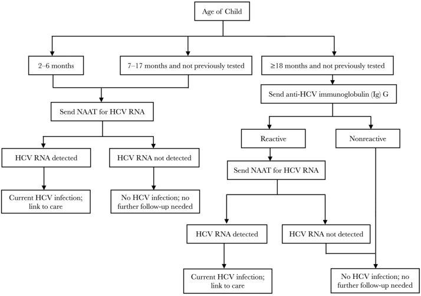
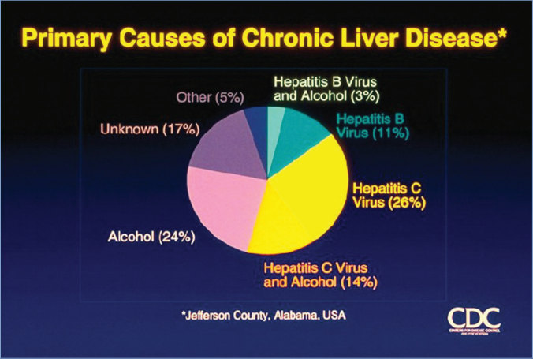
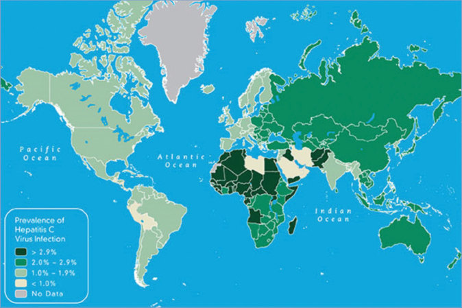

# 64. Hepatitis C
> Reference: [source credits](../../SOURCE_CREDITS.md). Printed pp. 365-371; PDF pp. 379-385.
> Editorial study pathway: Viral infections (not a part division in the source).
[Flashcards](../flashcards/064_flashcards.md) · [Quiz](../mcqs/064_mcqs.md) · [Full extraction](../../raw/chapters/064.md)

## Five study pillars

### Etiology and transmission
HCV is a small, single-stranded, positive-sense RNA virus and is a member of the family Flaviviridae in the genus Hepacivirus. At least 7 HCV genotypes exist and more than 60 subtypes have been described to date.
*Printed p. 365 / PDF p. 379*

### Clinical recognition
Signs and symptoms of hepatitis C virus (HCV) infection are indistinguishable from those of hepatitis A virus (HAV) or hepatitis B virus (HBV) infections. Acute disease tends to be mild and insidious in onset, and most infections are asymptomatic.
*Printed p. 365 / PDF p. 379*

### Diagnostic workup
Diagnostic assays for the detection of antibody to HCV (anti-HCV) antibody are available in various formats, which include enzyme immunoassays, chemiluminescent immunoassays, and immunochromatographic or rapid tests. NAATs for detection and quantitation of HCV RNA are used for diagnosis of current HCV infection and for monitoring response to antiviral therapy.
*Printed p. 366 / PDF p. 380*

### Treatment in the atlas
Two interferon-free, pan-genotypic antiviral drug regimens have been approved by the FDA for children as young as 3 years: sofosbuvir/velpatasvir and glecaprevir/pibrentasvir. Two additional antiviral drug therapies, sofosbuvir and ledipasvir/sofosbuvir, have activity against some but not all HCV genotypes and are approved for use in people 3 years or older.
*Printed p. 367 / PDF p. 381*

### Prevention and infection control
Standard precautions are recommended.
*Printed p. 367 / PDF p. 381*

## Clinical search tags
Ulcers / eschar, Hepatitis / jaundice, Congenital / neonatal, Immunocompromised host

## Full text, original tables, and images

# 64. Hepatitis C
> Private study reference ([source credits](../../SOURCE_CREDITS.md)). PDF pages 379-385; printed pages 365-371.

## PDF page 379 | printed page 365

### CLINICAL MANIFESTATIONS

Signs and symptoms of hepatitis C virus (HCV) infection are indistinguishable from those of hepatitis A virus (HAV) or hepatitis B virus (HBV) infections. Acute disease tends to be mild and insidious in onset, and most infections are asymptomatic. Jaundice occurs in less than 20% of patients with HCV infection, and abnormalities in serum alanine aminotransferase concentrations generally are less pronounced than in patients with HBV infection. Rates of spontaneous viral clearance vary, but roughly 20% or more of children with perinatal infection clear the virus by 2 years of age, with upwards of 65% clearing the virus by 5 years of age. Most children with chronic infection are asymptomatic and may not show biochemical evidence of liver disease initially. Liver failure secondary to HCV infection is one of the leading indications for liver transplantation among adults in the United States. Limited data indicate that cirrhosis and hepatocellular carcinoma occur less commonly in children than in adults, but because fibrosis increases with disease duration, individuals who are perinatally infected are at risk of developing severe disease in adolescence or as young adults.

### ETIOLOGY

HCV is a small, single-stranded, positive-sense RNA virus and is a member of the family Flaviviridae in the genus Hepacivirus. At least 7 HCV genotypes exist and more than 60 subtypes have been described to date. Distribution of genotypes and subtypes varies by geographic location; genotype 1a is the most common genotype in the United States.

### EPIDEMIOLOGY

Prevalence of HCV infection in the general population of the United States is estimated at 1.0%, equating to an estimated 2.4 (2.0–2.8) million people in the United States with chronic HCV infection. Incidence of HCV infection decreased markedly in the United States in all age groups from the 1990s to reach its lowest incidence in 2006–2010. Since 2010, however, there has been an increase in reported cases of acute HCV

infection in the United States, largely related to injection drug use. The highest incidence of acute hepatitis C infection is in people 20 through 39 years of age, leading to an increase in the number of infants exposed prenatally to HCV (www.cdc.gov/hepatitis/statistics/ SurveillanceRpts.htm). Worldwide, the prevalence of chronic HCV infection is highest in Eastern Europe, central Asia, northern Africa, and the Middle East.

HCV is transmitted primarily through percutaneous (parenteral) exposures to infectious blood that can result from injection drug use, needlestick injuries, and inadequate infection control in health care settings. The most common risk factors for adults are injection drug use and multiple sexual partners. The most common route of infection for children is from birthing parent to infant transmission. The current risk of HCV infection after blood transfusion in the United States is estimated to be less than 1 per 2 million units transfused because of exclusion of high-risk donors and of HCV-positive units after antibody testing as well as screening of blood units by nucleic acid amplification tests (NAATs). All intravenous and intramuscular immunoglobulin and plasma products now available commercially in the United States undergo an inactivation procedure for HCV or are documented to have undetectable HCV RNA before release.

Of acute hepatitis C cases reported to public health authorities with available risk factor information, two-thirds are in people who acknowledge they inject drugs. Data from recent multicenter, population-based cohort studies indicate that approximately one-third of people who inject drugs 18 to 30 years of age are infected with HCV. People with sporadic percutaneous exposures, such as health care professionals, may be infected; per-exposure risk of HCV transmission from needlestick is estimated at 0.2%. Health care-associated outbreaks have been documented, especially in nonhospital settings with inadequate infection control and injection safety procedures. Prevalence of HCV is higher among people with frequent direct percutaneous exposures, such as patients receiving hemodialysis (7%).

Sexual transmission of HCV between monogamous heterosexual partners is extremely rare. Transmission can occur in men who have sex with

## PDF page 380 | printed page 366

men, especially in association with sexual practices that result in mucosal trauma, presence of concurrent anogenital ulcerative disease, HIVpositive serostatus, or sex while using methamphetamines. HCV has been identified in semen and rectal and vaginal fluids, especially in those coinfected with HIV.

Transmission among family contacts could occur from direct or inapparent percutaneous or mucosal exposure to blood (eg, sharing toothbrushes or razors), but this is extremely uncommon.

Seroprevalence among pregnant people in the United States is estimated at 1% to 2% but is higher in some areas. Risk of perinatal transmission is approximately 6% to 7% among HIVnegative pregnant people with hepatitis C. The exact timing of vertical HCV transmission is not established. Recent guidelines from the Centers for Disease Control and Prevention (CDC) recommend testing of all pregnant people for HCV with each pregnancy. Factors that may increase risk of perinatal transmission include invasive prenatal diagnostic testing (eg, chorionic villus sampling), internal fetal monitoring, vaginal lacerations, and prolonged rupture of membranes (>6 hours). Method of delivery has no effect on perinatal infection risk. Coinfection in the pregnant person with poorly controlled HIV is associated with increased risk of perinatal transmission of HCV (twofold greater). Early and sustained control of HIV viremia with antiretroviral therapy may reduce risk of HCV transmission to infants.

All people with detectable HCV RNA in their blood are considered infectious.

The incubation period for HCV infection averages 6 to 7 weeks, with a range of 2 weeks to 6 months. The time from exposure to development of viremia generally is 1 to 3 weeks.

### DIAGNOSTIC TESTS1,2

Diagnostic assays for the detection of antibody to HCV (anti-HCV) antibody are available in various formats, which include enzyme immunoassays, chemiluminescent immunoassays, and immunochromatographic or rapid tests. NAATs for detection and quantitation of HCV RNA are used for diagnosis of current HCV infection and for monitoring response to antiviral therapy. Screening for HCV infection usually is accomplished by

serologic testing for anti-HCV with reflex testing of reactive samples with NAAT to diagnose current infection. Third-generation anti-HCV assays cleared by the U.S. Food and Drug Administration (FDA) are at least 97% sensitive and more than 99% specific. Anti-HCV antibodies can be detected approximately 8 to 11 weeks after exposure. In clinical settings where exposure to HCV is considered likely, testing for HCV RNA should be performed regardless of the anti-HCV result. Transplacentally acquired antibody may persist for up to 18 months in infants born to anti-HCV– positive mothers.

FDA-cleared NAATs for detection of HCV RNA are available commercially and are recommended in the 2013 CDC HCV testing algorithm as reflex tests for patients with anti-HCV reactive test results. HCV RNA can be detected in serum or plasma within 1 to 3 weeks after exposure to the virus and weeks before onset of liver enzyme abnormalities or appearance of anti-HCV antibody. Assays for detection of HCV RNA are used commonly in clinical practice to (1) detect HCV infection after needlestick or transfusion and before seroconversion, (2) identify current infection in anti-HCV–positive patients, (3) identify infection in infants early in life (ie, from perinatal transmission) when transplacentally acquired antibody interferes with ability to detect antibody produced by the infant, (4) identify HCV infection in severely immunocompromised or hemodialysis patients in whom there may be delayed seroconversion to anti-HCV, (5) detect a recent or acute infection when the HCV antibody is negative, and (6) monitor patients receiving antiviral therapy. False-positive and false-negative results of NAATs can occur from improper handling, storage, and contamination of test specimens. HCV genotyping is still needed for determining which directacting antiviral agents should be used in individual patients, but as pan-genotypic antiviral drugs become available more widely, genotype testing may become less relevant.

Infants exposed perinatally should be tested by NAAT for HCV RNA at age 2 through 6 months to identify children who might go on to develop chronic HCV infection if not treated. Similarly, infants and children aged 7 through 17 months of age who are perinatally exposed to HCV and have not previously been tested should have a NAAT

## PDF page 381 | printed page 367

for HCV RNA performed. Infants with detectable HCV RNA should be managed in consultation with a health care provider with expertise in pediatric hepatitis C management. Infants with an undetectable HCV RNA result do not require further follow-up unless clinically warranted. Children aged ≥18 months who are perinatally exposed to HCV and have not previously been tested should be tested serologically for anti-HCV immunoglobulin G (Fig 64.1).

### TREATMENT

Two interferon-free, pan-genotypic antiviral drug regimens have been approved by the FDA for children as young as 3 years: sofosbuvir/velpatasvir and glecaprevir/pibrentasvir. Two additional antiviral drug therapies, sofosbuvir and ledipasvir/sofosbuvir, have activity against some but not all HCV genotypes and are approved for use in people 3 years or older. All HCV-infected children 3 years or older should be treated in line with public health goals of viral hepatitis elimination. Children with a diagnosis of current HCV infection should be cared for in consultation with a provider with expertise in pediatric hepatitis C for clinical monitoring and consideration for treatment. The American Association for the Study of Liver Disease (AASLD) and the Infectious Diseases Society of America (IDSA) summarize recommended antiviral drug treatment for adults (www. hcvguidelines.org) and children (www. hcvguidelines.org/unique-populations/ children).

Management of Chronic HCV Infection

Because of the very high rate of severe hepatitis in patients with HCV-associated chronic liver disease, all patients with chronic HCV infection should be immunized against HAV and HBV. Risk of liver-related morbidity and mortality, including cirrhosis and primary hepatocellular carcinoma, increases with advancing age in individuals with chronic HCV infection. Among children, progression of liver disease appears to be accelerated when comorbid conditions, including HIV, childhood cancer, iron overload, or thalassemia, are present. Pediatricians should be alert for conditions that may worsen liver disease in patients with HCV infection, such as concomitant infections, and alcohol use. After assessment of risks and benefits, hepatotoxic drugs should be used

with caution in children with chronic HCV infection. Notably, corticosteroids, cytotoxic chemotherapy, and therapeutic doses of acetaminophen are not contraindicated in children with chronic HCV infection, and acetaminophen is safe and effective in this population when dosed appropriately. Children with chronic infection should be followed closely, including sequential monitoring of serum alanine aminotransferase concentrations, because of the potential for chronic liver disease. Evidence-based, consensus recommendations from the IDSA, the AASLD, and the International Antiviral Society–USA for screening, treatment, and management of patients with HCV infection, including children and pregnant people, can be found online (www.hcvguidelines.org).

### INFECTION PREVENTION AND CONTROL MEASURES IN HEALTH CARE SETTINGS

Standard precautions are recommended.

### CONTROL MEASURES

Care of Exposed People

Immunoprophylaxis

Use of immunoglobulin for postexposure prophylaxis against HCV infection is not recommended based on lack of clinical effectiveness in humans and data from animal studies. Potential donors of immunoglobulin are screened for anti-HCV and excluded from donation if positive, so immunoglobulin preparations are devoid of anti-HCV antibody.

Pregnancy and Breastfeeding3,4

All pregnant people should be tested for HCV during each pregnancy. Pregnant persons with detectable HCV RNA are considered to have current HCV infection; if no HCV test is available from that pregnancy and the most recent NAAT indicated detectable HCV RNA in the absence of treatment, they also are considered to have current HCV infection. If anti-HCV testing is reactive and HCV RNA results are not available, pregnant persons are considered to have probable HCV infection; similarly, if no HCV test is available from pregnancy and the most recent anti-HCV test is reactive in the absence of an undetectable RNA or treatment, they also are considered to have probable HCV infection.

Transmission of HCV by breastfeeding has not been documented. Anti-HCV and HCV RNA have

## PDF page 382 | printed page 368

been detected in colostrum, but risk of HCV transmission is similar in breastfed and formulafed infants. According to current guidelines of the AASLD and IDSA, HCV infection in the parent is not a contraindication to breastfeeding (www. hcvguidelines.org/unique-populations/ pregnancy). Breastfeeding parents who are HCV infected should interrupt breastfeeding temporarily if their nipples are bleeding or cracked and can consider expressing and discarding their milk until the nipples are healed. Once the nipples no longer are cracked or bleeding, breastfeeding may resume.

Child Care

Exclusion of children with HCV infection from out-of-home child care is not indicated.

Serologic Testing for HCV Infection

Universal Screening Recommendations

• Individuals 18 years or older should be tested at least once in their lifetime, except in settings where the prevalence of HCV infection is <0.1%.

• Pregnant people of any age (during each pregnancy).

People Who Have Risk Factors for HCV Infection

In addition to the universal screening recommendations above, HCV testing is recommended for anyone at increased risk for HCV infection and other populations, including5:

• Children whose birthing parent has HCV infection;

• People who have ever injected drugs, including those who injected only once many years ago;

• Recipients of clotting factor concentrates made before 1987;

• Recipients of blood transfusions or solid organ transplants before July 1992;

• Patients who have ever received long-term hemodialysis treatment;

• People with known exposures to HCV, such as

8 Health care workers after needlesticks, sharps, or mucosal exposures involving HCV-positive blood;

8 Recipients of blood from a donor who later tested HCV-positive;

• All people with HIV infection;

• Patients with persistently abnormal liver enzyme test results; and

• Any person who requests hepatitis C testing, regardless of disclosure of risk, because many people might be reluctant to disclose stigmatizing risks.

Professional organizations have additional testing recommendations for specific populations, including those on PrEP, those in correctional or detention facilities, those who have had organ transplant, and those with end-stage renal disease.

Children Whose Birthing Parent Has HCV Infection

Children whose birthing parent has HCV infection should be tested for HCV infection, because 5% to 7% of these children will acquire infection, and the risk of transmission is higher if the parent is coinfected with uncontrolled HIV.

Counseling of Patients With HCV Infection

All people with HCV infection should be considered infectious, should be informed of the possibility of transmission to others, and should refrain from donating blood, organs, tissues, or semen and from sharing toothbrushes and razors.

Infected people should be counseled to avoid hepatotoxic agents, including medications, and should be informed of the risks of excessive alcohol ingestion. All patients with chronic HCV infection should be immunized against HAV and HBV.

Changes in sexual practices of infected people with a long-term, monogamous partner are not recommended, although these couples should be informed of possible risks and use of precautions to prevent transmission. People with multiple sexual partners should be advised to decrease the number of partners and to use condoms to prevent transmission. No data exist to support counseling a person of childbearing age against pregnancy. Currently, HCV antiviral therapy is not recommended during pregnancy, but early phase clinical studies and anecdotal reports suggest this is safe and effective. People who become pregnant while receiving antiviral therapy should discuss risk and benefits of continuing treatment with their physician. The Coalition for Global Hepatitis Elimination has established a registry to track

## PDF page 383 | printed page 369

outcomes for any patient who is or becomes pregnant while receiving antiviral treatment. (www.globalhep.org/evidence-base/ treatment-pregnancy-hepatitis-c-tip-hepcregistry).

The CDC Division of Viral Hepatitis maintains a website (www.cdc.gov/hepatitis/HCV) with information on hepatitis for health care professionals and the public. Information also can be obtained from the National Institutes of Health Web site (www. niddk.nih.gov/health-information/liverdisease/viral-hepatitis/hepatitis-c).

1 Centers for Disease Control and Prevention. Testing for HCV infection: an update of guidance for clinicians and laboratorians. MMWR Morb Mortal Wkly Rep. 2013;62(18):362–365

Figure 64.1 Testing of children perinatally exposed to HCV

Modified from Conners EE, Panagiotakopoulos L, Hofmeister MG, et al. Screening and testing for hepatitis B virus infection: CDC Recommendations—United States, 2023. MMWR Recomm Rep. 2023;72(RR-1):1–25.

2 Panagiotakopoulos L, Sandul AL, Conners EE, Foster MA, Nelson NP, Wester C. CDC recommendations for hepatitis C testing among perinatally exposed infants and children- United States, 2023. MMWR Recomm Rep. 2023;72 (RR-4):1–19 3 Panagiotakopoulos L, Sandul AL, Conners EE, Foster MA, Nelson NP, Wester C. CDC recommendations for hepatitis C testing among perinatally exposed infants and children-United States, 2023. MMWR Recomm Rep. 2023;72(RR-4):1–19 4 Schillie S, Wester C, Osborne M, Wesolowski L, Ryerson AB. CDC recommendations for hepatitis C screening among adults-United States, 2020. MMWR Recomm Rep. 2020;69(RR-2):1–17 5 Centers for Disease Control and Prevention. Recommendations for hepatitis C screening among adults-United States 2020. MMWR Recomm Rep. 2020;69(2):1–17. Available at: www.cdc.gov/mmwr/volumes/69/rr/rr6902a1.htm

## PDF page 384 | printed page 370

Image 64.1 Colorized transmission electron micrograph of a hepatitis C virion. Micrograph courtesy of Maria Teresa Catanese and Charles M. Rice, The Rockefeller University; colorized by National Institute of Allergy and Infectious Diseases. Courtesy of National Institute of Allergy and Infectious Diseases and The Rockefeller University.

Image 64.3 Actual number of acute viral hepatitis cases submitted to the Centers for Disease Control and Prevention (CDC) by states and estimated number of acute viral hepatitis cases—United States, 2010–2017. The number of estimated viral hepatitis cases was determined by multiplying the number of reported cases by a factor that adjusted for underascertainment and underreporting. Courtesy of Centers for Disease Control and Prevention.

Image 64.2 Side-by-side transmission electron micrograph images of hepatitis B and C virions. Hepatitis B micrograph (left) is courtesy of Centers for Disease Control and Prevention; hepatitis C micrograph (right) is courtesy of Maria Teresa Catanese and Charles M. Rice, The Rockefeller University.

## PDF page 385 | printed page 371

Image 64.4 Pie chart showing causes of chronic liver disease in residents of Jefferson County, Alabama. Hepatitis B and C viruses contributed to most cases of chronic liver disease in this population. Courtesy of Centers for Disease Control and Prevention.

Image 64.5 Prevalence of chronic hepatitis C virus infection. Courtesy of Centers for Disease Control and Prevention.

