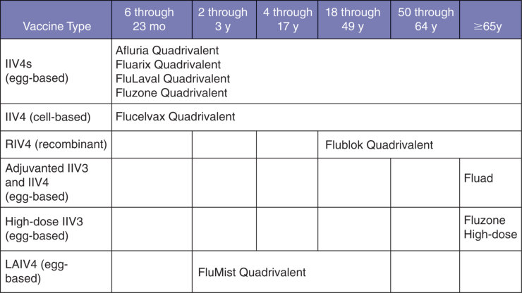
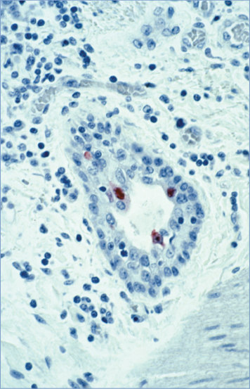
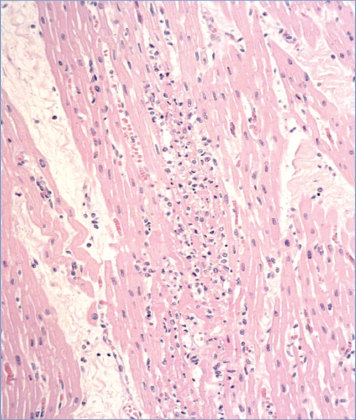
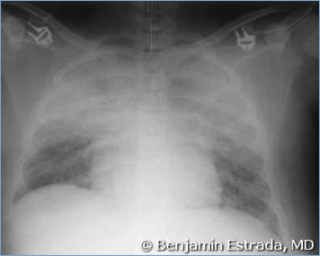
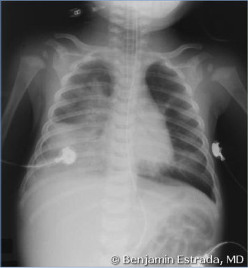
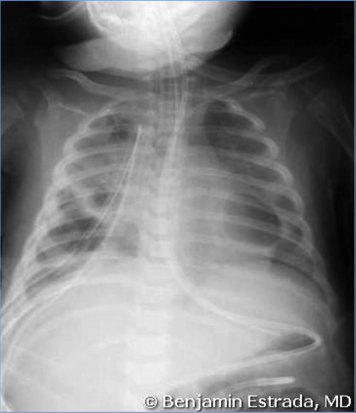
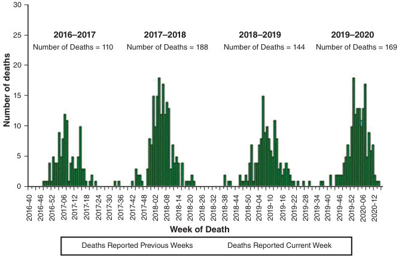
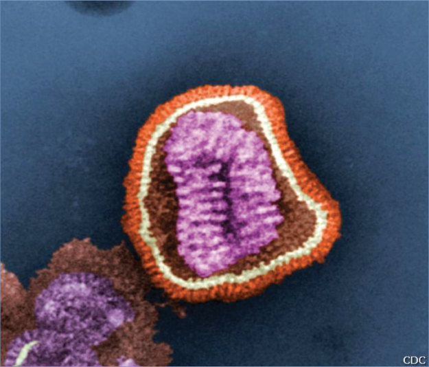
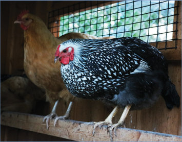

# 74. Influenza
> Reference: [source credits](../../SOURCE_CREDITS.md). Printed pp. 440-457; PDF pp. 454-471.
> Editorial study pathway: Viral infections (not a part division in the source).
[Flashcards](../flashcards/074_flashcards.md) · [Quiz](../mcqs/074_mcqs.md) · [Full extraction](../../raw/chapters/074.md)

## Five study pillars

### Etiology and transmission
Influenza viruses are orthomyxoviruses of 3 genera or types (A, B, and C). Annual epidemics are caused by influenza virus types A and B, and both influenza A and B virus antigens are included in seasonal influenza vaccines.
*Printed p. 440 / PDF p. 454*

### Clinical recognition
Influenza illness typically begins with sudden onset of fever, often accompanied by nonproductive cough, chills or rigors, diffuse myalgia, headache, and malaise. Subsequently, respiratory tract symptoms including sore throat, nasal congestion, rhinitis, and cough become more prominent.
*Printed p. 440 / PDF p. 454*

### Diagnostic workup
Influenza testing should be performed in children with signs and symptoms of influenza when test results are anticipated to impact clinical management (eg, to inform the decision to initiate antiviral or antibiotic therapy, pursue other diagnostic testing, or initiate infection prevention and control measures). The decision to test is related to the level of local influenza activity, clinical suspicion for influenza, and the sensitivity and specificity of commercially available influenza tests .
*Printed p. 441 / PDF p. 455*

### Treatment in the atlas
In the United States, 3 classes of antiviral medications with different mechanisms of action currently are approved for treatment or prophylaxis of influenza infections. Two of these classes are used in clinical management of influenza disease: 3 drugs in the NA inhibitor class (oral oseltamivir, inhaled zanamivir, and intravenous peramivir) and 1 drug in the cap-dependent endonuclease inhibitor class (oral baloxavir marboxil).
*Printed p. 442 / PDF p. 456*

### Prevention and infection control
In addition to standard precautions, droplet precautions are recommended for children hospitalized with influenza or an influenza-like illness for the duration of illness.
*Printed p. 444 / PDF p. 458*

## Clinical search tags
Fever, Cough, Pneumonia, Wheeze / bronchiolitis, Diarrhea, Vomiting, Encephalitis / seizures, Arthritis / bone pain, Sepsis / shock, Immunocompromised host, Travel / endemic setting

## Full text, original tables, and images

# 74. Influenza
> Private study reference ([source credits](../../SOURCE_CREDITS.md)). PDF pages 454-471; printed pages 440-457.

## PDF page 454 | printed page 440

### CLINICAL MANIFESTATIONS

Influenza illness typically begins with sudden onset of fever, often accompanied by nonproductive cough, chills or rigors, diffuse myalgia, headache, and malaise. Subsequently, respiratory tract symptoms including sore throat, nasal congestion, rhinitis, and cough become more prominent. Less commonly, abdominal pain, nausea, vomiting, and diarrhea are associated with influenza illness. In some children, influenza can appear as an upper respiratory tract illness or as a febrile illness with few respiratory tract symptoms. In infants, influenza can produce a nonspecific sepsis-like illness, and in infants and young children, influenza can cause otitis media, croup, pertussis-like illness, bronchiolitis, or pneumonia. Acute myositis secondary to influenza can present with calf tenderness and refusal to walk.

Although most children with influenza recover fully after 3 to 7 days of illness, complications may occur, even in previously healthy children. Neurologic complications associated with influenza range from febrile seizures to severe encephalopathy and encephalitis with status epilepticus, resulting in neurologic sequelae or death. Reye syndrome, now a very rare condition, has been associated with influenza infection and the use of aspirin therapy during the illness. Children with influenza or suspected influenza should not be given aspirin, and children with diseases that necessitate long-term aspirin therapy or salicylatecontaining medication, including juvenile idiopathic arthritis or Kawasaki disease, should be recognized as being at increased risk for complications from influenza. Death from influenzaassociated myocarditis has been reported. Invasive secondary infections or coinfections with Staphylococcus aureus (including methicillin-resistant S aureus), Streptococcus pneumoniae, group A streptococcus, or other bacterial pathogens can result in severe disease and death.

### ETIOLOGY

Influenza viruses are orthomyxoviruses of 3 genera or types (A, B, and C). Annual epidemics are caused by influenza virus types A and B, and both influenza A and B virus antigens are included in

seasonal influenza vaccines. Type C influenza viruses can cause sporadic mild influenza-like illness in children. Type C antigens are not included in influenza vaccines. Influenza A viruses are further classified into subtypes based on their surface antigens, hemagglutinin (HA) and neuraminidase (NA). Examples of these virus subtypes include H1N1 and H3N2 influenza A viruses. Specific antibodies to these antigens, especially to HA, are important determinants of immunity.

A minor antigenic variation that leads to changes in the HA or NA surface proteins of influenza A or B viruses is termed antigenic drift. Antigenic drift occurs continuously and results in new strains of influenza A and B viruses, resulting in seasonal epidemics.

A major antigenic variation that leads to new subtypes containing a unique HA and/or NA is termed antigenic shift. If the new virus subtype infects humans and is transmitted efficiently from person to person in a sustained manner, a pandemic can occur because the human population has little or no preexisting immunity to the newly emerged influenza strain. Antigenic shift occurs only among influenza A viruses and has produced 4 influenza pandemics in the 20th and 21st centuries, the most recent in 2009. As with previous antigenic shifts, the 2009 pandemic influenza A (H1N1pdm09) viral strain subsequently replaced the previously circulating seasonal influenza A (H1N1) strain in the ensuing influenza seasons.

Humans of all ages may sporadically be infected with emerging influenza A viruses of swine or avian origin. Most notable among avian influenza viruses are A (H5N1), which emerged in 1997 in Hong Kong, and A (H7N9), first detected in 2013 in China, both of which have been associated with severe disease and high case fatality rates. Since 2017, the Asian (H7N9) subtype is considered the influenza virus with the highest potential pandemic risk.

### EPIDEMIOLOGY

Influenza is highly contagious. The virus is spread person to person, primarily through large-particle respiratory droplet transmission (eg, coughing or sneezing), which requires close proximity between the person who is the source and the person who is the recipient because droplets

## PDF page 455 | printed page 441

generally only travel short distances. Another mode of transmission comes from contact with influenza virus from droplet-contaminated hands or surfaces, where it can remain viable for up to 24 hours, with transfer from hands to mucosal surfaces of the face. Airborne transmission via small-particle aerosols in the vicinity of the infectious individual also may occur. Patients may be infectious 24 hours before onset of symptoms. Viral shedding in nasal secretions usually peaks during the first 3 days of illness and ceases within 7 days but prolonged shedding (10 days or longer) can occur in young children and immunocompromised patients.

Influenza activity in the United States typically occurs anytime from October to May, commonly peaking between December and February. Seasonal epidemics can last 8 to 12 weeks or longer. Circulation of 2 or 3 influenza virus strains in a community may be associated with a prolonged influenza season and may produce bimodal peaks in activity.

Seasonal influenza epidemics are associated with an estimated 9.3 to 41 million illnesses, 140,000 to 710,000 hospitalizations, and 12,000 to 52,000 respiratory and circulatory deaths annually in the United States. The Centers for Disease Control and Prevention (CDC) estimates that on average, 8% (range, 3%–11%) of the U.S. population develops symptomatic influenza illness during a typical season, depending on the circulating strains. During community outbreaks of influenza, the highest influenza incidence occurs among children, ranging from 10% to 40%, particularly school-aged children. Secondary spread to adults and other children within a family is common. Spread within schools can be a driver of more widespread transmission within the community.

Hospitalization rates are highest in those younger than 5 years and are similar to hospitalization rates among people 65 years and older. Although rates vary across studies (190–480 per 100,000 population) because of differences in methodology and severity of influenza seasons, children younger than 2 years consistently are at a substantially higher risk of hospitalization than are older children. Rates of hospitalization and morbidity attributable to complications, such as pneumonia, are greater in children with high-risk conditions, including chronic pulmonary diseases such as

asthma, neurologic and neurodevelopmental disorders, hemodynamically significant cardiac disease, obesity, immunosuppression, metabolic diseases such as diabetes mellitus, and hemoglobinopathies such as sickle cell disease. However, 40% to 50% of all children hospitalized with influenza have no known underlying conditions, and almost half of children who die from influenza do not have an underlying high-risk condition. The total number of reported annual influenza-related deaths in the United States, including both chronically ill and previously healthy children, usually ranges from 35 to 199, with higher numbers reported in some seasons; actual numbers of deaths likely exceed the reported values.

Information about influenza surveillance is available through www.cdc.gov/flu/weekly.

The incubation period usually is 1 to 4 days, with a mean of 2 days.

### DIAGNOSTIC TESTS

Influenza testing should be performed in children with signs and symptoms of influenza when test results are anticipated to impact clinical management (eg, to inform the decision to initiate antiviral or antibiotic therapy, pursue other diagnostic testing, or initiate infection prevention and control measures). The decision to test is related to the level of local influenza activity, clinical suspicion for influenza, and the sensitivity and specificity of commercially available influenza tests (Table 74.1). These include rapid molecular tests for influenza called nucleic acid amplification tests (NAATs) as part of single-plex or multiplex assays, immunofluorescence assays (direct or indirect fluorescent antibody staining) for antigen detection, rapid influenza diagnostic tests based on antigen detection, rapid cell culture (shell vial culture), and viral tissue cell culture (conventional) for virus isolation. The optimal choice of influenza test depends on the clinical setting.

The sensitivity and specificity of any influenza test varies by the type of test used (Table 74.1), the time from illness onset, specimen quality and source, and specimen handling and processing. To diagnose influenza in the outpatient or inpatient setting, testing should occur as soon after illness onset as possible, because the quantity of virus shed decreases rapidly as illness progresses.

## PDF page 456 | printed page 442

Table 74.1 Summary of Influenza Diagnostic Tests

Influenza Diagnostic Test Method Availability Rapid influenza diagnostic tests (RIDTs)a

Antigen detection Wide

Nucleic acid amplification Wide

Rapid molecular assaysb

Nucleic acid amplification

Limited

Molecular assays (including RT-PCR)c

Direct and indirect Immunofluorescence antibody assaysc

Antigen detection Wide

Virus isolation Limited

Rapid cell culture (shell vials and cell mixtures)c

Tissue cell culturec Virus isolation Limited

RT-PCR indicates reverse transcriptase-polymerase chain reaction. May be single-plex or multiplex, real time, and other RNA-based assays.

a Most rapid influenza diagnostic tests are CLIA waived. b Some rapid influenza molecular assays are CLIA waived, depending on the specimen. c Not CLIA waived. Requires laboratory expertise.

Adapted from www.cdc.gov/flu/professionals/diagnosis/overview-testing-methods.htm.

Nasopharyngeal swab specimens have the highest yield of upper respiratory tract specimens for detection of influenza viruses. Mid-turbinate nasal swab or wash specimens are also acceptable. Testing with combined nasal and throat swab specimens may increase the detection of influenza viruses over single specimens from either site (particularly over throat swab specimens alone). Using flocked swabs likely improves influenza virus detection over nonflocked swabs.

When influenza is circulating in the community, hospitalized patients with signs and symptoms of influenza should be tested with a molecular NAAT with high sensitivity and specificity. For patients with respiratory failure receiving mechanical ventilation, including patients with negative influenza testing results on upper respiratory tract specimens, endotracheal aspirate or bronchoalveolar lavage fluid specimens should be obtained. Nonrespiratory specimens such as blood, plasma, serum, cerebrospinal fluid, urine, and stool should not be used for routine diagnosis of influenza.

At-home tests are available for children as young as 2 years. The use of at-home test results to inform treatment decisions should be informed by the sensitivity and specificity of the test, the prevalence of influenza in the community, and the

Typical Processing Time Sensitivity Types Detected

<15 min Moderate A and B

15–30 min High A and B

1–8 h High A and B

1–4 h Moderate A and B

1–3 days High A and B

3–10 days High A and B

presence and duration of compatible signs and symptoms.

Results of influenza testing should be properly interpreted in the context of clinical findings and local community influenza activity, because the prevalence of circulating influenza viruses influences the positive and negative predictive values of these influenza screening tests. False-positive results are more likely to occur during periods of low influenza activity; false-negative results are more likely to occur during periods of peak influenza activity.

### TREATMENT

In the United States, 3 classes of antiviral medications with different mechanisms of action currently are approved for treatment or prophylaxis of influenza infections. Two of these classes are used in clinical management of influenza disease: 3 drugs in the NA inhibitor class (oral oseltamivir, inhaled zanamivir, and intravenous peramivir) and 1 drug in the cap-dependent endonuclease inhibitor class (oral baloxavir marboxil). Guidance for use of these antiviral agents is summarized in Table 74.2 and at https://publications.aap.org/ redbook/resources/15189 and www.cdc.gov/ flu/professionals/antivirals/index.htm.

### Geometry-detected table

|Influenza Diagnostic Test|Method|Availability|Typical Processing Time|Sensitivity|Types Detected|
|---|---|---|---|---|---|
|Rapid infuenza diagnostic tests (RIDTs)a|Antigen detection|Wide|<15 min|Moderate|A and B|
|Rapid molecular assaysb|Nucleic acid amplifcation|Wide|15–30 min|High|A and B|
|Molecular assays (including RT-PCR)c|Nucleic acid amplifcation|Limited|1–8 h|High|A and B|
|Direct and indirect Immunofuorescence antibody assaysc|Antigen detection|Wide|1–4 h|Moderate|A and B|
|Rapid cell culture (shell vials and cell mixtures)c|Virus isolation|Limited|1–3 days|High|A and B|
|Tissue cell culturec|Virus isolation|Limited|3–10 days|High|A and B|

[View original table](../../tables/ch074_p0456_1.jpg)

## PDF page 457 | printed page 443

Table 74.2 Antiviral Drugs for Influenzaa

Drug (Trade Name) Virus Administration Treatment Indications Oseltamivir (Tamiflu)

A and B Oral twice daily for 5 days Birth or olderb Zanamivir (Relenza)

A and B Inhalation twice daily for 5 days 7 y or older Peramivir (Rapivab)

A and Bc Intravenous as a single dose 6 m or older Baloxavir marboxil (Xofluxa)d

A and B Oral as a single dose 5 y or older

a For current recommendations about treatment and chemoprophylaxis of influenza, including specific dosing information, see https://publications.aap.org/ redbook and www.cdc.gov/flu/professionals/antivirals/index.htm. Antiviral susceptibilities of viral strains are reported weekly at www.cdc.gov/flu/ weekly/fluactivitysurv.htm. b Approved by the FDA for children as young as 2 weeks of age. Given available pharmacokinetic data and limited safety data, the AAP believes that oseltamivir can be used to treat influenza in both term and preterm infants from birth because benefits of therapy are likely to outweigh possible risks of treatment. c Peramivir effectiveness is based on clinical trials in which the predominant influenza virus type was influenza A; a limited number of subjects infected with influenza B virus were enrolled. d Long-acting endonuclease inhibitor with different mechanism of action than neuraminidase inhibitors. Greater activity on influenza B reported compared with oseltamivir. No data on use in pregnancy or breastfeeding. Not recommended in severely immunocompromised patients.

Oseltamivir is the preferred antiviral medication for patients with influenza A and B. The U.S. Food and Drug Administration (FDA) has approved oseltamivir for influenza treatment in children as young as 2 weeks of age. However, the available pharmacokinetic and safety data suggest that oseltamivir can be used to treat influenza in both term and preterm infants from birth, because benefits of therapy are likely to outweigh possible risks of treatment. Initiation of antiviral therapy should be based on signs and symptoms consistent with influenza infection and epidemiologic factors. Provision of antiviral therapy does not require a positive test result for influenza.

Inhaled zanamivir is an acceptable alternative for children 7 years and older. Intravenous peramivir is approved for use in people 6 months and older. Oral baloxavir is approved for people 5 years and older.

Resistance to oseltamivir and zanamivir has been documented in less than 1% of the tested influenza viral samples during the past seasons. Decreased susceptibility to baloxavir has been reported in Japan, where use has been more common; surveillance for resistance among circulating influenza viruses is ongoing in the United States but remains rare. Each year, options for treatment or chemoprophylaxis of influenza in the

Chemoprophylaxis Indicatons Adverse Effects

3 mo or older Nausea, vomiting, headache; skin reactions; diarrhea (children <1 year)

5 y or older Bronchospasm, skin reactions

Not recommended Diarrhea, skin reactions

5 y or older Nausea, vomiting, diarrhea

United States will depend on influenza strain resistance patterns.

Regardless of influenza vaccination status, antiviral treatment should be offered as early as possible to the following individuals:

• Any hospitalized child with suspected or confirmed influenza disease, regardless of the duration of symptoms;

• Any child, inpatient or outpatient, with severe, complicated, or progressive illness attributable to influenza, regardless of the duration of symptoms or presence of high-risk conditions; and

• Any child, inpatient or outpatient, with influenza virus infection of any severity who is at high risk of complications of influenza, regardless of the duration of symptoms.

Antiviral treatment may be considered for the following individuals in the outpatient setting:

• Any child with suspected or confirmed influenza disease who is not at high risk for influenza complications, if treatment can be initiated within 48 hours of illness onset; and

• Any child with suspected or confirmed influenza disease whose siblings or household

### Geometry-detected table

|Drug (Trade Name)|Virus|Administration|Treatment Indications|Chemoprophylaxis Indicatons|Adverse Effects|
|---|---|---|---|---|---|
|Oseltamivir (Tamifu)|A and B|Oral twice daily for 5 days|Birth or olderb|3 mo or older|Nausea, vomiting, headache; skin reactions; diarrhea (children<1 year)|
|Zanamivir (Relenza)|A and B|Inhalation twice daily for 5 days|7 y or older|5 y or older|Bronchospasm, skin reactions|
|Peramivir (Rapivab)|A and Bc|Intravenous as a single dose|6 m or older|Not recommended|Diarrhea, skin reactions|
|Baloxavir marboxil (Xofuxa)d|A and B|Oral as a single dose|5 y or older|5 y or older|Nausea, vomiting, diarrhea|

[View original table](../../tables/ch074_p0457_1.jpg)

## PDF page 458 | printed page 444

contacts are either younger than 6 months or at high risk for influenza complications.

Children with severe influenza should be evaluated carefully for possible coinfection with bacterial pathogens (eg, S aureus or S pneumoniae) that might require antimicrobial therapy.

The most common adverse effects of oseltamivir are nausea and vomiting. Postmarketing reports, almost exclusively from Japan, have noted selfinjury and delirium with use of oseltamivir among pediatric patients, but other data suggest that these occurrences may have been related to influenza disease itself rather than antiviral therapy. An FDA review of controlled clinical trial data and ongoing surveillance did not establish a link between oseltamivir (or any influenza antiviral medication) and neurologic or psychiatric events. Zanamivir use has been associated with bronchospasm in some people and is not recommended for use in patients with chronic respiratory diseases, such as asthma or chronic obstructive pulmonary disease, which increase the risk of bronchospasm. Zanamivir is contraindicated in patients with milk protein allergy. The most common adverse effects of baloxavir are nausea, vomiting, and diarrhea.

Control of fever with acetaminophen or another appropriate nonsalicylate-containing antipyretic agent may be important in some children, because fever and other symptoms of influenza could exacerbate underlying chronic conditions. Children and adolescents with influenza should not receive aspirin or any salicylate-containing products because of the potential risk of developing Reye syndrome.

### INFECTION PREVENTION AND CONTROL MEASURES IN HEALTH CARE SETTINGS

In addition to standard precautions, droplet precautions are recommended for children hospitalized with influenza or an influenza-like illness for the duration of illness.

### CONTROL MEASURES

Influenza Vaccines1

All people 6 months and older should be vaccinated annually against influenza. Two types of influenza vaccines are available for children: inactivated

(non-live) influenza vaccines (IIVs), which contain no live virus and are given via intramuscular injection; and the live attenuated influenza vaccine (LAIV), which is given as a nasal spray. All influenza vaccines are formulated to protect against the same viral strains. The influenza virus strains selected for inclusion in the seasonal vaccine may change yearly in anticipation of the predominant influenza strains expected to circulate in the northern hemisphere in the upcoming influenza season on the basis of influenza circulation in the southern hemisphere and/or in the northern hemisphere’s prior season. All pediatric influenza vaccines available in the United States since the 2019–2020 season are quadrivalent, containing 2 influenza A strains and 2 influenza B strains. All licensed pediatric vaccines in the United States are manufactured using virus grown in eggs (eggbased), except for 1 non-live cell-based vaccine. One recombinant vaccine is licensed for individuals 18 years and older. The age indication and dose vary among licensed influenza vaccines for children (see Fig 74.1). FDA-approved formulations of licensed influenza vaccines are available for children 6 months and older (see Table 74.3). The American Academy of Pediatrics (AAP) has no preference for any type of vaccine (IIV or LAIV) or formulation over another.

An adjuvanted, cell-based vaccine designed to protect against H5N1 in the event of a pandemic has been approved for children 6 months or older. Recommendations for its use would be made in the event that such a pandemic develops.

Immunogenicity and Dosing in Children

Children 9 years and older require only 1 dose of influenza vaccine annually, regardless of their influenza immunization history. Children 6 months through 8 years of age who are receiving the influenza vaccine for the first time or who have received only 1 dose before the upcoming influenza season should receive 2 doses of influenza vaccine administered at least 4 weeks apart. For children requiring 2 doses, vaccination should not be delayed to obtain a specific product for either dose. Any available, age-appropriate vaccine can be used. The doses do not need to be the same brand, and a child may receive a combination of IIV and LAIV if appropriate for age and health status. Protection against disease is

## PDF page 459 | printed page 445

Figure 74.1 Available influenza vaccines in the United States, by FDA-licensed age indication

Table 74.3 Schedule for Influenza Vaccine Dosing by Agea

Age Dose, mLb No. of Doses

6 through 35 mo 0.25 1–2d

0.5 1–2d 3 y through 8 y 0.5 1–2d 9 y through 17 y 0.5 1 18 y or older 0.5 1 2 y through 49 years (healthy) 0.2 1–2d

a Manufacturers include Sanofi Pasteur (Fluzone Quadrivalent, split-virus vaccines licensed for people 6 months or older, Fluzone High-Dose, and Flublok Quadrivalent, recombinant vaccine licensed for people 18 years or older), Seqirus (Afluria Quadrivalent, split virus vaccine for people 6 months and older; Flucelvax Quadrivalent cell-based vaccine licensed for people 6 months and older, and Fluad adjuvanted trivalent vaccine for people 65 years and older), GlaxoSmithKline Biologicals (Fluarix Quadrivalent and FluLaval Quadrivalent split-virus vaccines licensed for people 6 months or older), and AstraZeneca (live attenuated influenza vaccine for otherwise healthy persons 2–49 years of age). b From: Grohskopf LA, Blanton LH, Ferdinands JM, et al. Prevention and control of seasonal influenza with vaccines: recommendations of the Advisory Committee on Immunization Practices—United States, 2022–23 influenza season. MMWR Recomm Rep. 2022;71(RR-1):1–28. Available at: www.cdc.gov/mmwr/volumes/71/ rr/rr7101a1.htm. Dosages are those recommended in recent years. Refer to the product circular each year to ensure that the appropriate dosage is given for each available formulation. c For adults and older children, the recommended site of immunization is the deltoid muscle. For infants and young children, the preferred site is the anterolateral aspect of the thigh. d Two doses administered at least 4 weeks apart are recommended for children 6 months through 8 years who are receiving influenza vaccine for the first time, who have received a single dose prior to the start of the current season, or whose immunization history is unknown. e The 0.25-mL prefilled syringes for Afluria are no longer available. For children aged 6 through 35 months, a 0.25-mL dose must be obtained from a multidose vial for

Afluria, or from a single-dose or a multidose vial for Fluzone.

achieved 1 to 2 weeks after the second dose. For children 8 years of age who require 2 doses of influenza vaccine, both doses should be administered even if the child turns age 9 years between dose 1 and dose 2.

Routec

Intramuscular (Afluria, Fluzone)e

Intramuscular (Fluzone, Fluarix, FluLaval, Afluria, Flucelvax) Intramuscular Intramuscular Intramuscular Intranasal (FluMist)

Coadministration With Other Vaccines

Influenza vaccines can be administered simultaneously with other live and non-live vaccines, including COVID-19 vaccines. Receipt of recommended childhood vaccines during a single visit

### Geometry-detected table

|Age|Dose, mLb|No. of Doses|Routec|
|---|---|---|---|
|6 through 35 mo|0.25|1–2d|Intramuscular(Afuria, Fluzone)e|
||0.5|1–2d|Intramuscular (Fluzone, Fluarix, FluLaval, Afuria, Flucelvax)|
|3 y through 8y|0.5|1–2d|Intramuscular|
|9 y through 17y|0.5|1|Intramuscular|
|18y or older|0.5|1|Intramuscular|
|2 y through 49 years (healthy)|0.2|1–2d|Intranasal (FluMist)|

[View original table](../../tables/ch074_p0459_1.jpg)

## PDF page 460 | printed page 446

has important benefits of protecting children against many infectious diseases and minimizing the number of visits that parents or caregivers and children must make.

Recommendations for Influenza Immunization2,3,4

All people 6 months and older should receive influenza vaccine annually. Influenza vaccine should be offered as soon as it becomes available, especially to children who require 2 doses, with the recommended dose(s) ideally received by the end of October (www.cdc.gov/flu/). Providers should continue to offer vaccine until the vaccine expiration date (typically June 30, marking the end of the influenza season), because influenza circulation is unpredictable. Particular efforts should focus on vaccination of all children and adolescents with factors associated with an elevated risk of complications from influenza, including the following:

• Age <5 years, and especially <2 years, regardless of the presence of underlying medical conditions.

• Residence in a chronic care facility or nursing home.

• Chronic pulmonary disease (including asthma, cystic fibrosis, and compromised respiratory function [eg, tracheostomy or requiring mechanical ventilation]), hemodynamically significant cardiovascular disease (except hypertension alone), or renal (including chronic kidney disease, end-stage kidney disease, and dialysis), hepatic (including chronic liver disease and cirrhosis), hematologic (including sickle cell disease and other hemoglobinopathies), or metabolic disorders (including diabetes mellitus).

• Immunosuppression attributable to any cause, including that caused by medications or by HIV infection.

• Neurologic and neurodevelopment conditions (including disorders of the brain, spinal cord, peripheral nerve, and muscle such as cerebral palsy, epilepsy, stroke, intellectual disability, moderate-to-severe developmental delay, muscular dystrophy, or spinal cord injury).

• Being pregnant or in the postpartum period during the influenza season.

• Receipt of long-term aspirin therapy or salicylate-containing medications (including

those with Kawasaki disease and rheumatologic conditions) because of increased risk of Reye syndrome.

• Extreme obesity (not well defined in children but could consider body mass index 99th percentile for age).

Special Considerations

The optimal time to provide IIV to children with malignant neoplasms is not well defined, but generally vaccine should be administered 2 weeks before cytotoxic chemotherapy when clinically possible. In children receiving immunosuppressive chemotherapy, influenza immunization may result in a less robust response than in immunocompetent children. IIV should be deferred in children who have received anti-B lymphocyte therapies in the previous 6 months until there is evidence of B lymphocyte recovery. Children who have completed chemotherapy 3 months prior generally have adequate rates of seroconversion. Transplantation recipients should receive IIV vaccination starting 4 to 6 months after hematopoietic cell transplantation and 3 months after solid organ transplantation (SOT), although IIV may be considered 1 month after SOT during the influenza season.

Corticosteroids administered daily for brief periods or every other day seem to have a minimal effect on antibody response to influenza vaccine. Prolonged administration (eg, 14 days) of high doses of corticosteroids (ie, a dose of prednisone of either 2 mg/kg or greater or a total of 20 mg/day or greater for children who weigh 10 kg or more or an equivalent dose of other corticosteroids) may impair antibody response. Influenza immunization can be deferred during the time of receipt of highdose corticosteroids, provided deferral does not compromise the likelihood of immunization before the start of influenza season.

Children with hemodynamically unstable cardiac disease are at high risk of complications of influenza. The immune response to and safety of IIV in these children are comparable to the immune response and safety in healthy children.

Breastfeeding

Breastfeeding is not a contraindication for influenza immunization. Special effort should be made to vaccinate all persons who are breastfeeding

## PDF page 461 | printed page 447

during the influenza season if they were not vaccinated during pregnancy.

Influenza Control in Peri- and Postpartum Settings

Strategies to decrease the likelihood of transmission from a birth parent to the newborn child during the birth hospitalization are provided at www.cdc.gov/flu/professionals/ infectioncontrol/peri-post-settings.htm.

Close Contacts of High-Risk Patients

Immunization of everyone who is in close contact with children younger than 5 years or children with high-risk conditions is an important strategy to ensure protection for these children who may not benefit from adequate protection from vaccination alone.

Health Care Personnel

The AAP supports mandatory annual immunization programs for health care personnel (HCP), because HCP frequently come into contact with patients at high risk of influenza illness in clinical settings.5

Reactions, Adverse Effects, and Contraindications

The most common reactions after IIV administration are local injection site pain and tenderness. Fever may occur within 24 hours after immunization in approximately 10% to 35% of children younger than 2 years but rarely in older children and adults. Mild systemic symptoms, such as nausea, lethargy, headache, muscle aches, and chills, may occur after administration of IIV. LAIV may result in nasal congestion, rhinorrhea, and sore throat, as well as wheezing, particularly in younger children and those with chronic respiratory diseases such as asthma.

Anaphylaxis after receipt of any influenza vaccine is a contraindication to influenza vaccination. Children who have had an allergic reaction after a previous dose of any influenza vaccine should be evaluated by an allergist to help determine the vaccine component responsible for the reaction and whether or not future receipt of an influenza vaccine is appropriate. Children who are allergic to gelatin (very rare) should receive IIV rather than LAIV.

Minor illnesses, with or without fever, are not contraindications to the use of influenza vaccines, including among children with mild upper respiratory infection symptoms or allergic rhinitis. In children with a moderate to severe febrile illness (eg, high fever, active infection, requiring hospitalization, etc), on the basis of the judgment of the clinician, vaccination should be deferred until resolution of the illness. Similarly, children with an amount of nasal congestion that would notably impede vaccine delivery into the nasopharyngeal mucosa should have LAIV vaccination deferred until resolution, or should receive IIV since nasal congestion would not impact its delivery. LAIV is contraindicated in immunocompromised hosts and pregnant individuals as well as in patients with asplenia or central nervous system anatomic barrier defects (eg, cochlear implant, congenital dysplasia of the inner ear, persistent cerebrospinal fluid communication with nasopharynx/oropharynx). LAIV may be administered to healthy household and other close contacts of people with altered immunocompetence.

Although most influenza vaccines are produced in eggs and contain measurable amounts of egg protein, they are well tolerated by recipients with egg allergy of any severity. Special precautions for recipients of IIV or LAIV with egg allergy are not warranted, as the rate of anaphylaxis after administration is no greater in recipients with egg allergy versus those without egg allergy or from other universally recommended vaccines.

History of Guillain-Barré syndrome (GBS) following influenza vaccine is considered a precaution for the administration of influenza vaccines. Data on the risk of GBS following vaccination with seasonal influenza vaccine are variable and have been inconsistent across seasons. GBS is rare, especially in children, and there is a lack of evidence on risk of GBS following influenza vaccine in children. The decision not to immunize should be thoughtfully balanced against the potential morbidity and mortality associated with influenza for that individual.

Chemoprophylaxis

Chemoprophylaxis with influenza antivirals should not be considered a substitute for immunization. If not contraindicated, influenza vaccine always should be offered, even after influenza

## PDF page 462 | printed page 448

virus has begun circulating in the community. Health care professionals should inform recipients of antiviral chemoprophylaxis that the risk of influenza is lowered but still remains while taking medication, and susceptibility to influenza returns when medication is discontinued.

Chemoprophylaxis is not a contraindication to immunization with IIV and does not interfere with the immune response to IIV. Chemoprophylaxis should not be administered in conjunction with LAIV immunization, because antivirals will interfere with LAIV replication. On the basis of drug half-lives, it is prudent to assume interference is possible during the following periods: (1) for oseltamivir and zanamivir, from 48 hours before to 2 weeks after LAIV; (2) for peramivir, from 5 days before to 2 weeks after LAIV; and (3) for baloxavir, from 17 days before to 2 weeks after LAIV. Chemoprophylaxis is not recommended for infants younger than 3 months, unless the situation is judged critical, because of limited safety and effectiveness data in this age group.

Antiviral options for influenza chemoprophylaxis are listed in Table 74.2. For current recommendations about chemoprophylaxis against influenza, see www.cdc.gov/flu/professionals/

Image 74.1 Influenza B virus particles, colorized gold, isolated from a patient sample and then propagated in cell culture. oth influenza A and B viruses can cause seasonal flu; however, unlike influenza A virus, which can also infect animals, influenza B virus infects only humans. Microscopy by John Gallagher and Audray Harris, National Institute of Allergy and Infectious Diseases Laboratory of Infectious Diseases. Courtesy of National Institute of Allergy and Infectious Diseases.

antivirals/index.htm or https://publications. aap.org/redbook/resources/15189.

Public Health Reporting

All influenza-associated pediatric deaths as well as all infections with a novel influenza A virus are nationally notifiable and should be reported to the CDC through state health departments.

1 American Academy of Pediatrics, Committee on Infectious Diseases. Policy statement. Recommendations for prevention and control of influenza in children, 2023–2024. Pediatrics. 2023;152(4):e2023063722 2 Grohskopf LA, Blanton LH, Ferdinands JM, et al. Prevention and control of seasonal influenza with vaccines: recommendations of the Advisory Committee on Immunization Practices—United States, 2022–23 influenza season. MMWR Recomm Rep. 2022;71(RR-1):1–28. For updates, see www. cdc.gov/flu 3 American Academy of Pediatrics, Committee on Infectious Diseases. Policy statement. Recommendations for prevention and control of influenza in children, 2023–2024. Pediatrics. 2023;152(4):2023063772 4 American Academy of Pediatrics, Committee on Infectious Diseases. Technical report. Recommendations for prevention and control of influenza in children, 2023–2024. Pediatrics. 2023;152(4):2023063773 5 Bernstein HH, Starke JR; and the American Academy of Pediatrics, Committee on Infectious Diseases. Policy statement: Influenza immunization for all health care personnel: keep it mandatory. Pediatrics. 2015;136(4):809–818 (Reaffirmed

Image 74.2 Influenza B virus particles, colorized yellow and green, isolated from a patient sample and then propagated in cell culture. Both influenza A and B viruses can cause seasonal flu; however, unlike influenza A virus, which can also infect animals, influenza B virus infects only humans. Microscopy by John Gallagher and Audray Harris, National Institute of Allergy and Infectious Diseases Laboratory of Infectious Diseases. Courtesy of National Institute of Allergy and Infectious Diseases.

## PDF page 463 | printed page 449

Image 74.3 When a critical portion of a community is immunized against a contagious disease, most members of the community are protected against that disease. This is known as community (or herd) immunity. The principle of community immunity applies to control of a variety of contagious diseases, including influenza, measles, mumps, rotavirus, and pneumococcal disease. The top box depicts a community in which no one is immunized and an outbreak occurs. In the middle box, some of the population is immunized but not enough to confer community immunity. In the bottom box, a critical portion of the population is immunized, protecting most community members. Courtesy of National Institute of Allergy and Infectious Diseases.

![Image 74.3 When a critical portion of a community is immunized against a contagious disease, most members of the community are protected against that disease. This is known as community (or herd) immunity. The principle of community immunity applies to control of a variety of contagious diseases, including influenza, measles, mumps, rotavirus, and pneumococcal disease. The top box depicts a community in which no one is immunized and an outbreak occurs. In the middle box, some of the population is immunized but not enough to confer community immunity. In the bottom box, a critical portion of the population is immunized, protecting most community members. Courtesy of National Institute of Allergy and Infectious Diseases.](../../figures/ch074_p0463_01.jpg)

## PDF page 464 | printed page 450

A

A

C

C

Image 74.4 Pathological findings from a patient with confirmed influenza A (H5N1) infection (hematoxylin-eosin stain, magnification 340). A, Hyaline membrane formation lining the alveolar spaces of the lung and vascular congestion with a few infiltrating lymphocytes in the interstitial areas. Reactive fibroblasts are also present. B, An area of lung with proliferating reactive fibroblasts within the interstitial areas. Few lymphocytes are visible, and no viral intranuclear inclusions are visible. C, Fibrinous exudates filling the alveolar spaces, with organizing formation and few hyaline membranes. The surrounding alveolar spaces contain hemorrhage. D, A section of spleen showing numerous atypical lymphoid cells scattered around the white pulp. No viral intranuclear inclusions are visible. Courtesy of Centers for Disease Control and Prevention.

B

B

D

D

![Image 74.4 Pathological findings from a patient with confirmed influenza A (H5N1) infection (hematoxylin-eosin stain, magnification 340). A, Hyaline membrane formation lining the alveolar spaces of the lung and vascular congestion with a few infiltrating lymphocytes in the interstitial areas. Reactive fibroblasts are also present. B, An area of lung with proliferating reactive fibroblasts within the interstitial areas. Few lymphocytes are visible, and no viral intranuclear inclusions are visible. C, Fibrinous exudates filling the alveolar spaces, with organizing formation and few hyaline membranes. The surrounding alveolar spaces contain hemorrhage. D, A section of spleen showing numerous atypical lymphoid cells scattered around the white pulp. No viral intranuclear inclusions are visible. Courtesy of Centers for Disease Control and Prevention.](../../figures/ch074_p0464_01.jpg)

## PDF page 465 | printed page 451

March 2020)

Image 74.5 Influenza viral antigens in bronchial epithelial lining cells as visualized with immunohistochemistry. Courtesy of Centers for Disease Control and Prevention.

Image 74.7 Influenza pneumonia in a 12-year-old with respiratory failure. Courtesy of Benjamin Estrada, MD.

Image 74.6 Focal myocarditis observed in a patient with influenza B infection. Note myocardial necrosis associated with areas of mostly mononuclear inflammation. Courtesy of Centers for Disease Control and Prevention.

Image 74.8 Coronal T2-weighted magnetic resonance image obtained in a 5-year-old with influenza-associated encephalopathy demonstrating bilateral confluent signal hyperintensity in the white matter (arrows) and thalami (asterisks). Courtesy of James Sejvar, MD.

## PDF page 466 | printed page 452

Image 74.9 Influenza A with Staphylococcus aureus pneumonia with empyema in a preschool-aged child. Courtesy of Benjamin Estrada, MD.

Image 74.11 Emergency hospital during the 1918 influenza epidemic, Camp Funston, KS. Source: National Museum of Health and Medicine, Armed Forces Institute of Pathology, Washington, DC, Image NCP 1603. Courtesy of Immunization Action Coalition.

Image 74.10 Influenza A with Staphylococcus aureus superinfection in a 6-year-old. Note the presence of bilateral pneumatoceles. Courtesy of Benjamin Estrada, MD.

Image 74.12 Colorized transmission electron micrograph of avian influenza A (H5N1) viruses (gold) grown in Madin-Darby canine kidney epithelial cells (green). Avian influenza A viruses do not usually infect humans; however, several instances of human infections and outbreaks have been reported since 1997. When such infections occur, public health authorities monitor these situations closely. Courtesy of Centers for Disease Control and Prevention.

## PDF page 467 | printed page 453

Image 74.13 This negative-stained transmission electron micrograph depicts the ultrastructural details of an influenza virus particle, or virion. Courtesy of Centers for Disease Control and Prevention/Erskine L. Palmer, MD/M. L. Martin, MD.

30

2016–2017 2017–2018

25

Number of Deaths = 110 Number of Deaths = 188

Number of deaths

20

15

10

5

0

2016-40

2016-46

2016-52

2017-06 2017-12

2017-18

2017-24 2017-30

2017-36

2017-42 2017-48

2018-02

2018-08

2018-14

2018-20

2018-26

Week of Death

Deaths Reported Previous Weeks

Image 74.14 Influenza-associated pediatric deaths by week of death, 2016–2017 season to 2019–2020 season. Courtesy of Centers for Disease Control and Prevention.

2018–2019 2019–2020

Number of Deaths = 144 Number of Deaths = 169

2018-32

2018-38 2018-44

2018-50 2019-04

2019-10

2019-16

2019-22

2019-28

2019-34 2019-40

2019-46

2019-52

2020-06

2020-12

Deaths Reported Current Week

## PDF page 468 | printed page 454

Image 74.15 Antigenic drift. Each year’s flu vaccine contains 3 flu strains—2 A strains and 1 B strain—that can change from year to year. After vaccination, the body produces infection-fighting antibodies against the 3 flu strains in the vaccine. If a vaccinated individual is exposed to any of the 3 flu strains during the flu season, the antibodies will latch on to the virus hemagglutinin (HA) antigens, preventing the flu virus from attaching to healthy cells and infecting them. Influenza virus genes, made of RNA, are more prone to mutations than are genes made of DNA. If the HA gene changes, so can the antigen that it encodes, causing it to change shape. If the HA antigen changes shape, antibodies that would normally match up to it no longer can, allowing the newly mutated virus to infect the body’s cells. This type of genetic mutation is called antigenic drift. Courtesy of National Institute of Allergy and Infectious Diseases.

![Image 74.15 Antigenic drift. Each year’s flu vaccine contains 3 flu strains—2 A strains and 1 B strain—that can change from year to year. After vaccination, the body produces infection-fighting antibodies against the 3 flu strains in the vaccine. If a vaccinated individual is exposed to any of the 3 flu strains during the flu season, the antibodies will latch on to the virus hemagglutinin (HA) antigens, preventing the flu virus from attaching to healthy cells and infecting them. Influenza virus genes, made of RNA, are more prone to mutations than are genes made of DNA. If the HA gene changes, so can the antigen that it encodes, causing it to change shape. If the HA antigen changes shape, antibodies that would normally match up to it no longer can, allowing the newly mutated virus to infect the body’s cells. This type of genetic mutation is called antigenic drift. Courtesy of National Institute of Allergy and Infectious Diseases.](../../figures/ch074_p0468_01.jpg)

## PDF page 469 | printed page 455

Image 74.16 Antigenic shift. The genetic change that enables a flu strain to jump from one animal species to another, including humans, is called antigenic shift. Antigenic shift can happen in 3 ways. Antigenic shift 1: A duck or other aquatic bird pass a bird strain of influenza A to an intermediate host, such as a chicken or pig. A person passes a human strain of influenza A to the same chicken or pig. When the viruses infect the same cell, genes from the bird strain mix with genes from the human strain to yield a new strain. The new strain can spread from the intermediate host to humans. Antigenic shift 2: Without undergoing genetic change, a bird strain of influenza A can jump directly from a duck or other aquatic bird to humans. Antigenic shift 3: Without undergoing genetic change, a bird strain of influenza A can jump directly from a duck or other aquatic bird to an intermediate animal host and then to humans. The new strain may further evolve to spread from person to person. If so, a flu pandemic could arise. HA indicates hemagglutinin; NA, neuraminidase. Courtesy of National Institute of Allergy and Infectious Diseases.

![Image 74.16 Antigenic shift. The genetic change that enables a flu strain to jump from one animal species to another, including humans, is called antigenic shift. Antigenic shift can happen in 3 ways. Antigenic shift 1: A duck or other aquatic bird pass a bird strain of influenza A to an intermediate host, such as a chicken or pig. A person passes a human strain of influenza A to the same chicken or pig. When the viruses infect the same cell, genes from the bird strain mix with genes from the human strain to yield a new strain. The new strain can spread from the intermediate host to humans. Antigenic shift 2: Without undergoing genetic change, a bird strain of influenza A can jump directly from a duck or other aquatic bird to humans. Antigenic shift 3: Without undergoing genetic change, a bird strain of influenza A can jump directly from a duck or other aquatic bird to an intermediate animal host and then to humans. The new strain may further evolve to spread from person to person. If so, a flu pandemic could arise. HA indicates hemagglutinin; NA, neuraminidase. Courtesy of National Institute of Allergy and Infectious Diseases.](../../figures/ch074_p0469_01.jpg)

## PDF page 470 | printed page 456

Image 74.17 Three influenza A (H5N1/bird flu) virus particles (rod shaped). Note: Layout incorporates 2 Centers for Disease Control and Prevention transmission electron micrographs that have been inverted, repositioned, and colorized by National Institute of Allergy and Infectious Diseases. Scale has been modified.

Image 74.19 Domestic chickens. Courtesy of National Institute of Allergy and Infectious Diseases.

Image 74.18 Colorized transmission electron micrograph of influenza A virus particles, colorized orange and gold, isolated from a patient sample and then propagated in cell culture. Influenza A can infect both humans and animals, including birds and pigs. Microscopy by John Gallagher and Audray Harris, National Institute of Allergy and Infectious Diseases Laboratory of Infectious Diseases.

Image 74.20 Colorized transmission electron micrograph of a crosssection of SW31 (swine strain) influenza virus particles (orange) found near the surface of an infected Madin- Darby canine kidney cell (green). Image captured and color enhanced at the National Institute of Allergy and Infectious Diseases Integrated Research Facility in Fort Detrick in Frederick, Maryland.

## PDF page 471 | printed page 457

Image 74.21 Colorized transmission electron micrograph of SW31 (swine strain) influenza virus particles (green) attached to and budding from the surface of a Madin-Darby canine kidney cell (purple). Image captured and color enhanced at the National Institute of Allergy and Infectious Diseases Integrated Research Facility in Fort Detrick in Frederick, Maryland.

