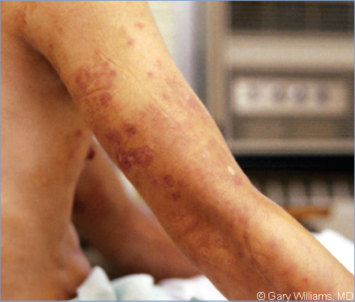
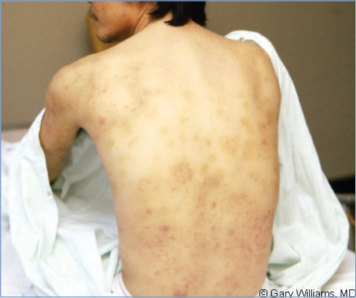
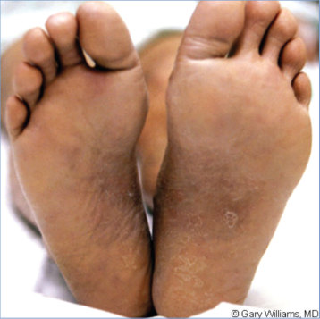
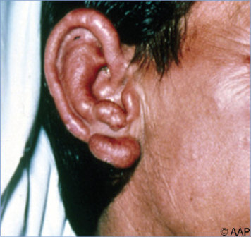
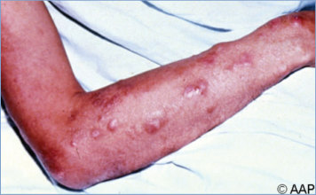
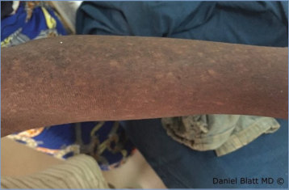
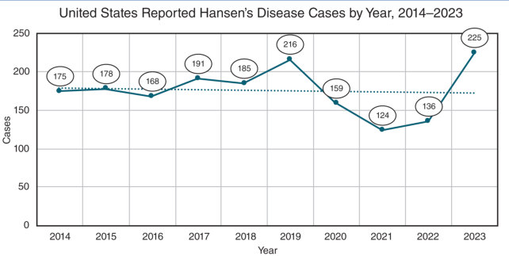

# 79. Leprosy
> Reference: [source credits](../../SOURCE_CREDITS.md). Printed pp. 483-487; PDF pp. 497-501.
> Editorial study pathway: Bacterial infections (not a part division in the source).
[Flashcards](../flashcards/079_flashcards.md) · [Quiz](../mcqs/079_mcqs.md) · [Full extraction](../../raw/chapters/079.md)

## Five study pillars

### Etiology and transmission
Leprosy is caused by M leprae and Mycobacterium lepromatosis. The organisms can be differentiated only genetically.
*Printed p. 483 / PDF p. 497*

### Clinical recognition
Leprosy (Hansen disease) is a curable infection primarily involving skin, peripheral nerves, and mucosa of the upper respiratory tract. The clinical forms of leprosy reflect the cellular immune response to Mycobacterium leprae and, in turn, the number, size, structure, and bacillary content of the lesions.
*Printed p. 483 / PDF p. 497*

### Diagnostic workup
There are no diagnostic tests or methods to detect subclinical leprosy. Histopathologic examination of a skin biopsy by an experienced pathologist is the best method of establishing the diagnosis and establishing disease classification.
*Printed p. 484 / PDF p. 498*

### Treatment in the atlas
Therapy for patients with leprosy should be undertaken in consultation with an expert in leprosy. The NHDP (www.hrsa.gov/ hansens-disease; 800-642-2477) provides consultation on clinical and pathologic issues and information about local Hansen disease clinics and clinicians who have experience with the disease.
*Printed p. 484 / PDF p. 498*

### Prevention and infection control
Standard precautions are indicated; isolation is not required.
*Printed p. 485 / PDF p. 499*

## Clinical search tags
Fever, Ulcers / eschar, Arthritis / bone pain, Animal exposure, Travel / endemic setting

## Full text, original tables, and images

# 79. Leprosy
> Private study reference ([source credits](../../SOURCE_CREDITS.md)). PDF pages 497-501; printed pages 483-487.

## PDF page 497 | printed page 483

### CLINICAL MANIFESTATIONS

Leprosy (Hansen disease) is a curable infection primarily involving skin, peripheral nerves, and mucosa of the upper respiratory tract. The clinical forms of leprosy reflect the cellular immune response to Mycobacterium leprae and, in turn, the number, size, structure, and bacillary content of the lesions. The organism has unique tropism for peripheral nerves, and all forms of leprosy exhibit nerve involvement. Leprosy skin lesions are quite varied and may present as macular hypopigmented or erythematous anesthetic lesions, discolored patches, scaly plaques, sharply defined macules with central clearing, painless ulcers, or nodules. Leprosy lesions usually do not itch or hurt. They lack sensation to heat, touch, and pain but otherwise may be difficult to distinguish from other common maladies. There may be madarosis (loss of eyelashes or eyebrows). Although the nerve injury caused by leprosy is irreversible, early diagnosis and drug therapy can prevent sequelae.

Leprosy manifests over a broad clinical and histopathologic spectrum. In the United States, the Ridley-Jopling scale is used to classify patients according to the histopathologic features of their lesions and organization of the underlying granuloma. The scale is as follows: (1) tuberculoid; (2) borderline tuberculoid; (3) mid-borderline; (4) borderline lepromatous; and (5) lepromatous. A simplified scheme introduced by the World Health Organization for circumstances in which pathologic examination and diagnosis are unavailable is based purely on clinical skin examination. This scheme classifies leprosy by the number of skin patches as either paucibacillary (1–5 lesions, usually tuberculoid or borderline tuberculoid) or multibacillary (>5 lesions, usually mid-borderline, borderline lepromatous, or lepromatous). Patients in the tuberculoid spectrum have active cellmediated immunity with low antibody responses to M leprae and few well-defined lesions containing few bacilli. Lepromatous spectrum cases have high antibody responses with little cell-mediated immunity to M leprae and several somewhat diffuse lesions usually containing numerous bacilli.

Serious consequences of leprosy occur from immune reactions and nerve involvement with resulting anesthesia, which can lead to repeated unrecognized trauma, ulcerations, fractures, and even bone resorption. Leprosy is a leading cause of permanent physical disability among communicable diseases worldwide. Eye involvement can occur, especially corneal scarring, and patients should be examined by an ophthalmologist. A diagnosis of leprosy should be considered in any patient with a hypoesthetic or anesthetic skin rash or skin patches who has a history of residence or travel in areas with endemic leprosy or exposure to armadillos.

Leprosy Reactions

Acute clinical exacerbations reflect abrupt changes in the immunologic balance. These reactions are especially common during initial years of treatment but can occur in the absence of therapy. Two major types of leprosy reactions (LRs) are observed. Type 1 (reversal reaction [LR-1]) is observed predominantly in borderline tuberculoid and borderline lepromatous leprosy and is the result of a sudden increase in effective cellmediated immunity. Acute tenderness and swelling at the site of cutaneous and neural lesions with development of new lesions are major manifestations. Ulcerations can occur, but polymorphonuclear leukocytes are absent from the LR-1 lesion. Fever and systemic toxicity are uncommon. Type 2 (erythema nodosum leprosum [LR-2]) occurs in borderline and lepromatous forms as a systemic inflammatory response. Tender, red subcutaneous papules or nodules resembling erythema nodosum can occur along with high fever, migrating polyarthralgia, painful swelling of lymph nodes and spleen, iridocyclitis, and rarely, nephritis.

### ETIOLOGY

Leprosy is caused by M leprae and Mycobacterium lepromatosis. The organisms can be differentiated only genetically. They manifest an identical spectrum of clinical symptoms and are equally susceptible to antibiotics typically used to treat leprosy. They are obligate intracellular, rod-shaped bacteria that can have variable findings on Gram stain and are weakly acid-fast on standard Ziehl-Neelsen staining. They are best visualized using the Fite

## PDF page 498 | printed page 484

stain. Leprosy bacilli have not been cultured successfully in vitro. They are the only bacteria known to infect Schwann cells of peripheral nerves, and demonstration of acid-fast bacilli in peripheral nerves is pathognomonic for leprosy.

### EPIDEMIOLOGY

Leprosy is considered a neglected tropical disease and is most prevalent in tropical and subtropical zones. It is not highly infectious. Several human genes have been identified that are associated with susceptibility to M leprae, and a minority of people appear to be genetically susceptible to the infection. Accordingly, spouses of leprosy patients are not likely to develop leprosy, but biological parents, children, and siblings who are household contacts of untreated patients with leprosy are at higher risk.

Transmission is believed to be most effective through long-term close contact with an infected individual and likely occurs through respiratory shedding of organisms. The 9-banded armadillo (Dasypus novemcinctus) is a recognized nonhuman reservoir of M leprae, and zoonotic transmission has been reported in the southern United States. There are reports of M leprae infection among 9-banded armadillos as well as the 6-banded armadillo (Euphractus sexcinctus) in both Central and South America, mainly Argentina and Brazil. In addition, red squirrels (Sciurus vulgaris) in the British Isles may carry M leprae and M lepromatosis, and groups of chimpanzees in East Africa also have been found to carry M leprae. People living with HIV infection do not appear to be at increased risk of becoming infected with M leprae. However, concomitant HIV infection and leprosy can lead to worsening of leprosy symptoms during HIV treatment and resulting immune reconstitution inflammatory syndrome. Like many other chronic infectious diseases, onset of leprosy is associated increasingly with use of anti-inflammatory autoimmune therapies and immunologic senescence among elderly patients. Little is known about transmission during pregnancy and in the peripartum period. Further guidance on managing pregnant people and infants is available at http:// internationaltextbookofleprosy.org/ chapter/pregnancy-and-children.

More than 200,000 cases including 15,000 children receive a diagnosis of leprosy annually

worldwide. More than 65% of the world’s patients with leprosy reside in South and Southeast Asia, primarily India. Other areas of high endemicity include Angola, Brazil, the Central African Republic, Democratic Republic of Congo, Madagascar, Mozambique, the Republic of the Marshall Islands, South Sudan, the Federated States of Micronesia, and the United Republic of Tanzania. Approximately 6,500 people with leprosy currently live in the United States, with approximately 150 to 200 new cases presenting each year. The majority of leprosy cases reported in the United States occur among residents of Arkansas, California, Florida, Hawaii, Louisiana, New York, and Texas or among immigrants and other people who lived or worked in countries with endemic leprosy.

The incubation period usually is 3 to 5 years but may range from 1 to 20 years. The average age at onset varies according to endemicity within a population. All age groups are susceptible.

### DIAGNOSTIC TESTS

There are no diagnostic tests or methods to detect subclinical leprosy. Histopathologic examination of a skin biopsy by an experienced pathologist is the best method of establishing the diagnosis and establishing disease classification. Formalin fixed or paraffin embedded biopsies can be sent to the National Hansen’s Disease (Leprosy) Program (NHDP [800-642-2477; www.hrsa.gov/ hansens-disease/diagnosis/biopsy.html]). Acid-fast bacilli may be found in slit smears or biopsy specimens of skin lesions from patients with lepromatous (multibacillary) forms of the disease but rarely are visualized from patients with the paucibacillary tuberculoid and indeterminate (first lesion with slightly diminished sensation) forms of disease. A nucleic acid amplification test for M leprae and M lepromatosis is available at the NHDP, as are molecular tests for genetic mutations associated with drug resistance and strain typing based on single nucleotide polymorphisms and other genomic elements. Tuberculin skin tests and interferon-gamma release assays are not used to diagnose leprosy.

### TREATMENT

Leprosy is curable. Therapy for patients with leprosy should be undertaken in consultation with an

## PDF page 499 | printed page 485

expert in leprosy. The NHDP (www.hrsa.gov/ hansens-disease; 800-642-2477) provides consultation on clinical and pathologic issues and information about local Hansen disease clinics and clinicians who have experience with the disease. The open access International Textbook of Leprosy (http://internationaltextbookofleprosy.org/) is another valuable resource. Prevention of permanent nerve damage and disability is an important goal of treatment and requires education of and self-awareness by the patient. Combination antimicrobial therapy can be obtained free of charge from the NHDP in the United States and from the World Health Organization in other countries (www.hrsa.gov/hansensdisease/ diagnosis/recommendedtreatment.html).

It is important to treat infections with more than 1 antimicrobial agent to prevent development of antimicrobial-resistant organisms. Most patients are treated with dapsone and rifampin for 12 months (tuberculoid disease) or dapsone, rifampin, and clofazimine for 24 months (lepromatous disease). Regimens and doses for children are available and should be chosen with assistance from NHDP. Resistance to all 3 drugs has been documented but is extremely rare. Before beginning antimicrobial therapy, patients should be tested for glucose-6-phosphate dehydrogenase deficiency, have baseline complete blood cell counts and serum aminotransferase results documented, and be evaluated for any evidence of tuberculosis infection, especially if infected with HIV. This consideration is important to avoid monotherapy of active tuberculosis with rifampin while treating active leprosy. The infectivity of leprosy patients to others ceases within only a few days of initiating standard multidrug therapy.

Management of LRs is complex and expert guidance should be sought. Reactions should be treated aggressively to prevent peripheral nerve damage. Treatment with prednisone (1 mg/kg per day, orally) can be initiated for short-term management and rescue situations. Long-term use of prednisone should incorporate a sparing agent such as methotrexate. LR-2 may be treated with thalidomide (100–400 mg/day for 4 days). Thalidomide is available through Bristol-Meyers

Squibb and is used under strict supervision (www.celgeneriskmanagement.com or 888-423-5436). Thalidomide is not approved for use in children younger than 12 years. Most patients can be treated on an outpatient basis. Rehabilitative measures, including surgery and physical therapy, may be necessary for some patients.

All patients with leprosy should be educated about signs and symptoms of neuritis and cautioned to report them immediately so that corticosteroid therapy can be instituted. Patients should receive counseling because of the social and psychological effects of this disease.

Relapse of disease after completing multidrug therapy is rare (0.01%–0.14%); the presentation of new skin patches usually is attributable to a late type 1 reaction (LR-1). When it does occur, relapse usually is attributable to reactivation of drug-susceptible organisms. People with relapses of disease require another course of multidrug therapy.

### INFECTION PREVENTION AND CONTROL MEASURES IN HEALTH CARE SETTINGS

Standard precautions are indicated; isolation is not required.

### CONTROL MEASURES

Leprosy is a reportable disease in the United States. Newly diagnosed cases should be reported to state public health authorities, the Centers for Disease Control and Prevention, and the NHDP. Household contacts should be examined initially, but long-term follow-up of asymptomatic contacts is not warranted. Chemoprophylaxis is not recommended.

There are no vaccines approved for use in the United States. A single bacille Calmette-Guérin (BCG) immunization is reported to be from 28% to 60% protective against leprosy, and BCG vaccine is used as an adjunct to drug therapy in Brazil. However, BCG vaccine administration also may precipitate leprosy among subclinically infected individuals. The effectiveness of combined drug and immunotherapy is unknown.

## PDF page 500 | printed page 486

Image 79.1 Hansen disease. A young Vietnamese boy who spent 2 years in a refugee camp in the Philippines presented with the nodular violaceous skin lesion shown. The results of a biopsy of the lesion showed acid-fast organisms surrounding blood vessels. A diagnosis of lepromatous leprosy was made, and the child was treated with a multidrug regimen. Copyright Barbara Jantausch, MD, FAAP.

Image 79.3 Erythema nodosum leprosum in the same patient as in Image 79.2. Copyright Gary Williams, MD.

Image 79.2 Erythema nodosum leprosum in a 29-year-old man. Copyright Gary Williams, MD.

Image 79.4 Erythema nodosum leprosum in the same patient as in Images 79.2 and 79.3. Copyright Gary Williams, MD.

## PDF page 501 | printed page 487

Image 79.5 Lepromatous leprosy in a man. Newly diagnosed cases are considered contagious until treatment is established and should be reported to local and state public health departments. Courtesy of Hugh Moffet, MD.

Image 79.7 Hypopigmented skin lesions in the arm of an 18-month-old boy with multibacillary leprosy. This patient experienced lack of sensation during a pinprick test performed on the lesions. Courtesy of Daniel Blatt, MD.

Image 79.8 U.S.-reported Hansen disease cases by year, 2014–2023. Courtesy of Health Resources & Services Administration.

Image 79.6 The affected arm of a man with lepromatous leprosy. Courtesy of Hugh Moffet, MD.

