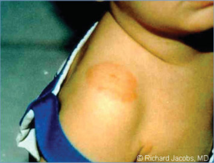
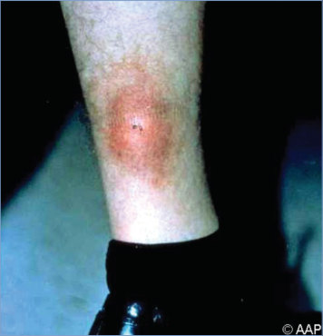
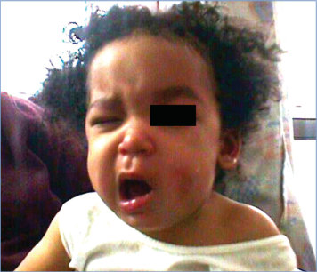
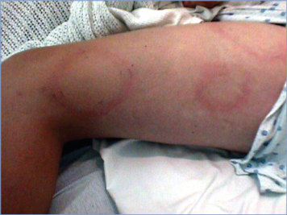
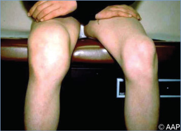
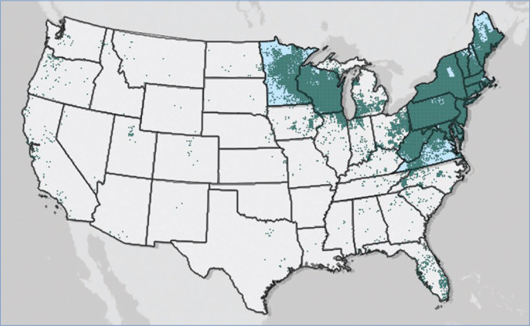
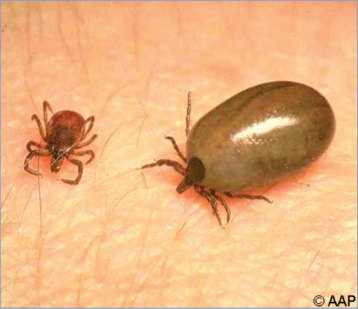

# 82. Lyme Disease (Lyme Borreliosis, Borrelia burgdorferi sensu lato Infection)
> Reference: [source credits](../../SOURCE_CREDITS.md). Printed pp. 499-510; PDF pp. 513-524.
> Editorial study pathway: Bacterial infections (not a part division in the source).
[Flashcards](../flashcards/082_flashcards.md) · [Quiz](../mcqs/082_mcqs.md) · [Full extraction](../../raw/chapters/082.md)

## Five study pillars

### Etiology and transmission
In the United States, Lyme disease is caused by the spirochete Borrelia burgdorferi sensu stricto and rarely, in the upper Midwest, by the recently discovered Borrelia mayonii. In Eurasia, B burgdorferi, Borrelia afzelii, and Borrelia garinii cause borreliosis.
*Printed p. 499 / PDF p. 513*

### Clinical recognition
Clinical manifestations of Lyme disease are divided into 3 stages: early localized, early disseminated, and late manifestations. Early localized disease, the most common manifestation of Lyme disease in children, is characterized by a distinctive lesion, erythema migrans (EM).
*Printed p. 499 / PDF p. 513*

### Diagnostic workup
Diagnosis of Lyme disease rests first and foremost on the recognition of a consistent clinical illness in people who have had plausible geographic exposure. Information on areas of existing and emerging Lyme disease risk is available from the Centers for Disease Control and Prevention (www.cdc.gov/lyme/datasurveillance/ lyme-disease-maps.html).
*Printed p. 500 / PDF p. 514*

### Treatment in the atlas
Consensus practice guidelines for assessment, treatment, and prevention of Lyme disease have been published jointly by the Infectious Diseases Society of America, American Academy of Neurology, and American College of Rheumatology and are available at www.idsociety.org/ practice-guideline/lyme-disease. Care of children should follow recommendations in Table 82.1.
*Printed p. 502 / PDF p. 516*

### Prevention and infection control
Standard precautions are recommended.
*Printed p. 504 / PDF p. 518*

## Clinical search tags
Fever, Pruritus, Conjunctivitis, Meningitis, Encephalitis / seizures, Arthritis / bone pain, Abscess / soft tissue, Congenital / neonatal, Tick / arthropod exposure, Travel / endemic setting

## Full text, original tables, and images

# 82. Lyme Disease (Lyme Borreliosis, Borrelia burgdorferi sensu lato Infection)
> Private study reference ([source credits](../../SOURCE_CREDITS.md)). PDF pages 513-524; printed pages 499-510.

## PDF page 513 | printed page 499

(Lyme Borreliosis, Borrelia burgdorferi sensu lato Infection)

### CLINICAL MANIFESTATIONS

Clinical manifestations of Lyme disease are divided into 3 stages: early localized, early disseminated, and late manifestations. Early localized disease, the most common manifestation of Lyme disease in children, is characterized by a distinctive lesion, erythema migrans (EM). An EM lesion appears at the site of the tick bite days to weeks later, beginning as a red macule or papule that usually expands to form a large (≥5 cm in diameter) annular, erythematous lesion, classically with central clearing creating a bull’s-eye pattern. The lesion typically is painless and nonpruritic. EM lesions can vary greatly in size and shape and can be confused with other skin conditions (eg, cellulitis or ringworm). For images demonstrating the range of manifestations of EM rashes as well as rashes that can be confused with EM, see www.cdc.gov/lyme/signs_symptoms/ rashes.html. Factors that distinguish EM from a local allergic reaction to a tick bite include larger size, gradual expansion, and lack of pruritus.

Early disseminated Lyme disease can present with multiple EM lesions, cranial neuritis (cranial nerve VII most common), meningitis, radiculitis, or carditis. Lyme meningitis can present with simultaneous cranial neuropathy or papilledema. Lyme carditis can present with syncope, palpitations, or fatigue. First-degree atrioventricular block is the abnormality identified on electrocardiography most commonly. Systemic symptoms, such as low-grade fever, arthralgia, myalgia, headache, and fatigue, may be present during the early localized or early disseminated stages. Ophthalmic manifestations (eg, conjunctivitis, optic neuritis, keratitis, and uveitis) are uncommon.

The most common manifestation of late Lyme disease in children is mono- or oligoarticular large joint arthritis, most frequently involving the knee. Children with Lyme arthritis have joint swelling out of proportion to pain or disability. If arthrocentesis is performed, synovial fluid white blood cells will be elevated. Children with Lyme arthritis have lower peripheral blood neutrophilia and

inflammatory markers compared with children with pyogenic arthritis. Children with early Lyme disease treated with appropriate antimicrobial agents rarely develop late manifestations.

Lyme disease is not believed to produce a congenital infection syndrome. No causal relationship between Lyme disease in a pregnant person and abnormalities of pregnancy or congenital disease caused by Borrelia burgdorferi sensu lato complex has been documented. No evidence exists that Lyme disease can be transmitted via human milk.

### ETIOLOGY

In the United States, Lyme disease is caused by the spirochete Borrelia burgdorferi sensu stricto and rarely, in the upper Midwest, by the recently discovered Borrelia mayonii. In Eurasia, B burgdorferi, Borrelia afzelii, and Borrelia garinii cause borreliosis.

### EPIDEMIOLOGY

Almost 35,000 cases of confirmed and probable Lyme disease were reported in the United States in 2019, though the actual number of cases is likely at least tenfold greater because of underreporting. Lyme disease occurs primarily in 2 distinct geographic regions of the United States, with more than 95% of cases occurring in the Northeast, Mid-Atlantic, and upper Midwestern states. Over the past 2 decades, Lyme disease has expanded considerably into states that border this region. Transmission also occurs at a low level on the West Coast, with some focal areas of endemicity in central and northern California. The occurrence of cases in the United States correlates with the distribution and frequency of infected tick vectors—Ixodes scapularis in eastern and Midwest states and Ixodes pacificus in western states. Climate change likely has contributed to the expansion of the range of these tick vectors (see www.epa.gov/climate-indicators/ climate-change-indicators-lyme-disease). In Southern states, I scapularis ticks do not feed commonly on competent reservoir mammals and are less likely to bite humans because of different questing habits. Individuals with cases reported from states with low endemic transmission most often are exposed or infected during travel, although some cases may be misdiagnoses resulting from false-positive or misinterpreted test

## PDF page 514 | printed page 500

results. History of travel to areas with endemic transmission can guide clinical decision-making.

Most cases of early localized and early disseminated Lyme disease occur between April and October, with a peak in June and July. People of all ages can be affected, but incidence in the United States is highest among children 5 through 9 years of age and adults 55 through 69 years of age. Lyme arthritis occurs throughout the year without a seasonal peak.

With lesion(s) similar to EM, “southern tickassociated rash illness” (STARI) has been reported mainly in south central and southeastern states without endemic B burgdorferi infection. The etiology is unknown. STARI results from the bite of the Lone Star tick, Amblyomma americanum, which is abundant in southern states and is biologically incapable of transmitting B burgdorferi. Patients with STARI may present with constitutional symptoms in addition to EM, but STARI has not been associated with any of the disseminated complications of Lyme disease. Appropriate treatment of STARI is unknown.

Lyme disease also is endemic in eastern Canada, Europe, states of the former Soviet Union, China, Mongolia, and Japan. The primary tick vector in Europe is Ixodes ricinus, and the primary tick vector in Asia is Ixodes persulcatus. Clinical manifestations vary somewhat from those seen in the United States. European Lyme disease can cause the skin lesions borrelial lymphocytoma and acrodermatitis chronica atrophicans and is more likely to produce neurologic disease, whereas arthritis is uncommon. These differences are attributable to the different genospecies of Borrelia responsible for European Lyme disease.

Patients with Lyme disease can be infected simultaneously with agents of babesiosis, anaplasmosis, and hard tick-borne relapsing fever. These diagnoses should be suspected in patients who manifest high fever, have hematologic abnormalities consistent with these infections, or do not respond as expected to therapy prescribed for Lyme disease, such as fever persisting for more than 1 day after starting treatment. Patients with Lyme disease may be coinfected with Powassan virus (deer tick virus) in the United States or with tick-borne encephalitis virus if infection was acquired in Europe.

The incubation period in the United States for Lyme disease from tick bite to appearance of single or multiple EM lesions ranges from 3 to 32 days, with a median time of 11 days. Late manifestations such as arthritis can occur months after the tick bite. Most children who develop Lyme disease do not recall a tick bite; absence of tick bite history should not be used to exclude disease.

### DIAGNOSTIC TESTS

Diagnosis of Lyme disease rests first and foremost on the recognition of a consistent clinical illness in people who have had plausible geographic exposure. Information on areas of existing and emerging Lyme disease risk is available from the Centers for Disease Control and Prevention (www.cdc.gov/lyme/datasurveillance/ lyme-disease-maps.html). In patients with an EM lesion, Lyme disease is diagnosed based of the characteristic appearance of this skin lesion coupled with likely exposure in areas of known incidence. As the sensitivity of serologic testing is low during early infection (<50% with a solitary EM lesion), treatment should be initiated without serologic testing.

Diagnosis of extracutaneous Lyme disease, including late-stage disease, requires a typical clinical illness, plausible geographic exposure, and a positive serologic test result. The standard testing method for Lyme disease is a 2-tier serologic algorithm. Detailed serologic testing guidelines from the Association of Public Health Laboratories can be found at www.aphl.org/ aboutAPHL/publications/Documents/ ID-2021-Lyme-Disease-Serologic-Testing- Reporting.pdf. The initial screening test identifies antibodies to a whole-cell sonicate, to peptide antigen, or to recombinant antigens of B burgdorferi using an enzyme-linked immunosorbent assay (ELISA or EIA) or immunofluorescent antibody test.

If the first-tier EIA result is negative, the patient is considered seronegative and no further testing is indicated. If the result is equivocal or positive, then a second-tier test is required to confirm the result. There are 2 options for second-tier testing: (1) a Western immunoblot, which is part of the standard 2-tiered testing algorithm; or (2) an EIA test that has been cleared specifically by the U.S.

## PDF page 515 | printed page 501

Food and Drug Administration (FDA) for use as a second-tier confirmatory test, which is part of the modified 2-tiered testing algorithm (www.cdc. gov/mmwr/volumes/68/wr/mm6832a4. htm?s_cid=mm6832a4_w).

Two-tier serologic testing is essential because of the characteristics of Lyme antibody tests. Falsepositive results on first-tier tests are common and can be explained partly by antigenic components of B burgdorferi that are not specific to this species. Cross-reactive antibodies may be produced in response to spirochetes in normal oral flora, other spirochetal infections (including syphilis), other acute infections, and certain autoimmune diseases. In areas with endemic infection, previous infection with seroconversion may have occurred, and a seropositive patient’s current symptoms may be coincidental. Patients with active Lyme disease almost always have objective signs of infection (eg, an EM lesion, facial nerve palsy, arthritis). Nonspecific symptoms commonly accompany these specific signs but almost never are the only evidence of Lyme disease. Serologic testing for Lyme disease should not be performed for individuals without symptoms or signs suggestive of Lyme disease and plausible geographic exposure.

Second-tier testing with immunoglobulin (Ig) M and IgG immunoassays should be performed only as part of a validated 2-tier serologic testing algorithm. The Western immunoblot assay (performed as part of a standard 2-tier testing algorithm) tests for presence of antibodies to specific B burgdorferi antigens, including IgM antibodies to 3 spirochetal antigens (the 23/24, 39, and 41 kDa polypeptides) and IgG antibodies to 10 spirochetal antigens (the 18, 23/24, 28, 30, 39, 41, 45, 60, 66, and 93 kDa polypeptides). Many clinical laboratories report presence of antibody to each of 13 bands, describing each band as positive or negative. However, a positive immunoblot result is defined as presence of at least 2 IgM bands or 5 IgG bands. Physicians must be careful not to misinterpret a positive band as a positive test result or interpret a result as positive despite presence of 4 or fewer IgG bands. IgG antibodies to flagella protein, the p41 band, are present in 30% to 50% of healthy people.

A second-tier IgM result performed as part of standard or modified 2-tier testing can be falsely positive. IgM assays are useful only for patients in the first 4 weeks after symptom onset and should

be disregarded in patients who have had symptoms for longer than 4 weeks. Most untreated patients with disseminated Lyme disease will have a positive IgG result by week 4 of symptoms.

Most patients with early disseminated disease and virtually all patients with late Lyme disease have antibodies against B burgdorferi. Some patients with early Lyme disease treated with antimicrobial agents never develop detectable antibodies against B burgdorferi; they are cured and are not at risk of late disease. Development of antibodies in patients treated for early Lyme disease does not indicate lack of cure or presence of persistent infection. Ongoing infection without development of antibodies (“seronegative Lyme”) has not been demonstrated. Once antibodies develop, they may persist for many years. Tests for antibodies should not be repeated or used to assess success of treatment.

Current evidence indicates that patients with B mayonii infection develop a serologic response similar to that of patients infected with B burgdorferi. Standardized 2-tier testing can be expected to have positive results in patients with B mayonii infection. Some assays marketed in the United States have reduced sensitivity for European strains of B burgdorferi. For patients potentially infected in Europe, check with the test provider or laboratory director to select tests that have been validated for this purpose.

Nucleic acid amplification tests (NAATs) for B burgdorferi can be performed on synovial fluid or tissue, blood, or cerebrospinal fluid but currently are not cleared by the FDA. Sensitivity of Lyme NAATs of cerebrospinal fluid is very low; this test should not be obtained routinely for diagnosis of central nervous system infections. NAAT of joint fluid or synovial tissue may be considered in addition to serology in patients for whom the diagnosis of Lyme arthritis is being considered.

A number of tests for Lyme disease have been found to be invalid on the basis of independent testing or to be too nonspecific to exclude falsepositive results. These include urine tests for B burgdorferi, CD57 assay, novel culture techniques, and antibody panels that differ from those recommended as part of standardized 2-tier testing. Although these tests are available from some clinical laboratories, they are not FDA

## PDF page 516 | printed page 502

cleared and are not appropriate diagnostic tests for Lyme disease.

### TREATMENT

Consensus practice guidelines for assessment, treatment, and prevention of Lyme disease have been published jointly by the Infectious Diseases Society of America, American Academy of Neurology, and American College of Rheumatology and are available at www.idsociety.org/

Table 82.1 Recommended Treatment of Lyme Disease in Children

Disease Category Erythema migrans (single or multiple) (any age)

Doxycycline, 4.4 mg/kg per day, orally, divided into 2 doses (maximum 200 mg/day) for 10 days

OR

Amoxicillin, 50 mg/kg per day, orally, divided into 3 doses (maximum 1.5 g/day) for 14 days

OR

Cefuroxime axetil, 30 mg/kg per day, orally, in 2 divided doses (maximum 1 g/day) for 14 days

OR, for a patient unable to take a β-lactam or doxycycline,

Azithromycin,a 10 mg/kg/day, orally, once daily for 7 days Isolated facial palsy Doxycycline, 4.4 mg/kg per day, orally, divided into 2 doses (maximum 200 mg/day), for 14–21 daysb

Arthritis An oral agent as for early localized disease, for 28 days Persistent arthritis after first course of therapy

Retreat using an oral agent as for first-episode arthritis for an additional 28 days

OR

Ceftriaxone sodium, 50–75 mg/kg, IV, once a day (maximum 2 g/day) for 14–28 days Atrioventricular heart block or carditis

An oral agent as for early localized disease, for 14 days (range 14–21 days)

OR

Ceftriaxone sodium, 50–75 mg/kg, IV, once a day (maximum 2 g/day) for 14 days (range 14–21 days for a hospitalized patient); oral therapy (using an agent as for early localized disease) can be substituted when the patient is stabilized or discharged, to complete the 14- to 21-day course Meningitis Doxycycline, 4.4 mg/kg per day, orally, divided into 1 or 2 doses (maximum 200 mg/day) for 14–21 days

OR

Ceftriaxone sodium, 50–75 mg/kg, IV, once a day (maximum 2 g/day) for 14–21 days

IV indicates intravenously.

a Because of concerns for lower effectiveness, macrolide antibiotics including azithromycin are considered second-line agents, and should be reserved for patients in whom other antibiotic classes are contraindicated. Azithromycin has not been sufficiently studied for manifestations of Lyme disease other than erythema migrans. b There is insufficient evidence on whether corticosteroids are safe with Lyme facial palsy.

practice-guideline/lyme-disease. Care of children should follow recommendations in Table 82.1. Antimicrobial therapy for nonspecific symptoms or for asymptomatic seropositivity is not recommended. Antimicrobial agents administered for durations not specified in Table 82.1 are not recommended. Alternative diagnostic approaches or therapies without adequate validation and publication in peer-reviewed scientific literature are discouraged.

Drug(s) and Dose

### Geometry-detected table

|Disease Category|Drug(s) and Dose|
|---|---|
|Erythema migrans (single or multiple) (any age)|Doxycycline, 4.4 mg/kg per day, orally, divided into 2 doses (maximum 200 mg/day) for 10 days **OR** Amoxicillin, 50 mg/kg per day, orally, divided into 3 doses (maximum 1.5 g/day) for 14 days **OR** Cefuroxime axetil, 30 mg/kg per day, orally, in 2 divided doses (maximum 1 g/day) for 14 days **OR**, for a patient unable to take aβ-lactam or doxycycline, Azithromycin,a 10 mg/kg/day, orally, once daily for 7 days|
|Isolated facial palsy|Doxycycline, 4.4 mg/kg per day, orally, divided into 2 doses (maximum 200 mg/day), for 14–21 daysb|
|Arthritis|An oral agent as for early localized disease, for 28 days|
|Persistent arthritis after frst course of therapy|Retreat using an oral agent as for frst-episode arthritis for an additional 28 days **OR** Ceftriaxone sodium, 50–75 mg/kg, IV, once a day (maximum 2g/day) for 14–28 days|
|Atrioventricular heart block or carditis|An oral agent as for early localized disease, for 14 days (range 14–21 days) **OR** Ceftriaxone sodium, 50–75 mg/kg, IV, once a day (maximum 2 g/day) for 14 days (range 14–21 days for a hospitalized patient); oral therapy (using an agent as for early localized disease) can be substituted when the patient is stabilized or discharged, to complete the 14- to 21-day course|
|Meningitis|Doxycycline, 4.4 mg/kg per day, orally, divided into 1 or 2 doses (maximum 200 mg/day) for 14–21 days **OR** Ceftriaxone sodium, 50–75 mg/kg, IV, once a day (maximum 2g/day) for 14–21 days|

[View original table](../../tables/ch082_p0516_1.jpg)

## PDF page 517 | printed page 503

Early Localized Disease With EM (Single or Multiple)

Doxycycline, amoxicillin, or cefuroxime axetil can be used to treat children of any age who present with EM lesions. Azithromycin is a second-line antimicrobial agent for EM, and its use should be limited to patients with EM in whom other antibiotic classes are contraindicated; it has not been studied sufficiently to warrant use in manifestations of Lyme disease other than EM. Selection of an oral antimicrobial agent for treatment of EM should be based on the following considerations: presence of neurologic disease (for which doxycycline is the drug of choice), drug allergy, adverse effects, frequency of administration (doxycycline and cefuroxime axetil are administered twice a day, amoxicillin is administered 3 times a day), ability to minimize sun exposure (photosensitivity may be associated with doxycycline use), likelihood of coinfection with Anaplasma phagocytophilum or Ehrlichia muris-like agent (neither is sensitive to β-lactam antimicrobial agents), and when Staphylococcus aureus cellulitis cannot be distinguished easily from EM (doxycycline is effective against most strains of methicillin-sensitive and methicillin-resistant S aureus). EM should be treated orally for 10 days if doxycycline is used and for 14 days if amoxicillin or cefuroxime axetil is used. Treatment of EM results in resolution of the skin lesion within several days of initiating therapy and almost always prevents development of later stages of Lyme disease. Because STARI may be indistinguishable from early Lyme disease and questions remain about appropriate treatment, some physicians treat STARI with the same antimicrobial agents orally as for Lyme disease.

Early Disseminated Disease

Oral antimicrobial agents are appropriate and effective for most manifestations of disseminated Lyme disease. Doxycycline is preferred therapy for facial nerve palsy caused by B burgdorferi in children of any age, because amoxicillin is unlikely to reach therapeutic levels in the central nervous system. The risks and benefits of concurrent corticosteroid therapy for Lyme disease-associated facial nerve palsy are unknown.

A growing body of evidence suggests that oral doxycycline is effective for treatment of Lyme meningitis and may be used as an alternative to

hospitalization and parenteral ceftriaxone or penicillin G therapy in children well enough to be treated as outpatients. Lumbar puncture is indicated for a child with a stiff neck and other symptoms of meningitis in whom the possibility of a bacterial (nonspirochetal) meningitis cannot be ruled out. Neurologic disease is treated for 14 to 21 days.

Late Disseminated Disease

Children with Lyme arthritis are treated with oral antimicrobial agents (eg, doxycycline, amoxicillin, or cefuroxime axetil) for 28 days. Children with no or minimal response to an initial course of oral antibiotics should be retreated with a second course of either parenteral or oral therapy; guidelines from multiple societies express a slight preference for parenteral therapy.2 A second course of treatment may be considered for those with a partial response; specialty consultation may be helpful in these circumstances.

Approximately 10% to 15% of patients treated for Lyme arthritis will develop persistent synovitis that can last for months to years. Theories of pathophysiology include delayed resolution of inflammation because of slow clearance of nonviable bacteria following treatment versus an autoimmune mechanism. Misdiagnosis also should be considered (ie, Lyme antibodies in serum present from a previous infection or cross-reacting because of another disorder). Persisting synovitis following Lyme disease, termed “postantibiotic Lyme arthritis,” is a strongly HLA-associated phenomenon. Patients with persistent synovitis despite repeat treatment should be managed initially with nonsteroidal anti-inflammatory drugs; referral to a rheumatologist may be appropriate for more severe cases. Arthroscopic synovectomy rarely is required for disabling or refractory cases.

Persistent Posttreatment Symptoms

Some patients have prolonged, persistent symptoms following standard treatment for Lyme disease. This phenomenon may not be unique to Lyme disease but rather a more general occurrence during convalescence from systemic illness. Patients with persistent symptoms following Lyme disease usually respond to symptomatic treatment and recover gradually.

## PDF page 518 | printed page 504

Several double-blind, randomized, placebocontrolled trials have found that retreatment with additional antimicrobial agents for patients with residual posttreatment Lyme disease subjective symptoms may be associated with harm and does not offer benefit.3,4,5,6 Administration of additional antimicrobial agents to a patient who has been given standard treatment for Lyme disease and continues to have symptoms is discouraged strongly. Retreatment is appropriate for subsequent acute infections caused by B burgdorferi.

Pregnancy

Tetracyclines are contraindicated in pregnancy. Doxycycline has not been studied adequately during pregnancy to make a recommendation regarding its use. Otherwise, therapy is the same as recommended for nonpregnant people.

### INFECTION PREVENTION AND CONTROL MEASURES IN HEALTH CARE SETTINGS

Standard precautions are recommended.

### CONTROL MEASURES

Chemoprophylaxis

Even in areas of high endemicity (the coastal northeast), where 30% to 50% of I scapularis ticks harbor B burgdorferi, risk of Lyme disease following a recognized tick bite is low, although it increases with duration of attachment. Testing of the tick for spirochete infection has poor predictive value and is not recommended.

Studies of doxycycline prophylaxis have been conducted in adults and older children (≥12 years). Benefits of prophylaxis may outweigh risks when the bite is high risk, defined as those that occur in areas of high endemicity; the bite was from an identified Ixodes species tick; the tick was attached for >36 hours; and prophylaxis can be started within 72 hours of tick removal. A single prophylactic 200-mg dose (or 4.4 mg/kg for children weighing less than 45 kg) of doxycycline can be used in children of any age to reduce risk of acquiring Lyme disease after a high-risk tick bite. Amoxicillin prophylaxis has not been studied sufficiently but likely would require a longer course

than doxycycline because of its shorter half-life and is not recommended. There are no clinical data to support antibiotic prophylaxis for anaplasmosis, ehrlichiosis, babesiosis, or Rocky Mountain spotted fever.

Blood Donation

No documented cases of B burgdorferi transmission have occurred to date as a result of spirochete transmission via blood transfusion. Patients with active Lyme disease should not donate blood, because spirochetemia can occur in early disease. Patients who have been treated for Lyme disease can be considered for blood donation.

Vaccines

Multiple vaccine candidates are currently under development for both adults and children.

Public Health Reporting

Lyme disease is a nationally notifiable disease in the United States.

1 Lantos PM, Rumbaugh J, Bockenstedt LK, et al. Clinical practice guidelines by the Infectious Diseases Society of America (IDSA), American Academy of Neurology (AAN), and American College of Rheumatology (ACR): 2020 guidelines for the prevention, diagnosis and treatment of Lyme disease. Clin Infect Dis. 2021;72(1):e1–e48. Available at: www.idsociety.org/practice-guideline/lyme-disease/ 2 Lantos PM, Rumbaugh J, Bockenstedt LK, et al. Clinical practice guidelines by the Infectious Diseases Society of America (IDSA), American Academy of Neurology (AAN), and American College of Rheumatology (ACR): 2020 guidelines for the prevention, diagnosis and treatment of Lyme disease. Clin Infect Dis. 2021;72(1):e1–e48. Available at: www.idsociety.org/practice-guideline/lyme-disease/ 3 Feder HM, Johnson BJ, O’Connell S, et al; Ad Hoc International Lyme Disease Group. A critical appraisal of “chronic Lyme disease.” N Engl J Med. 2007;357(14):1422–1430 4 Lantos PM, Rumbaugh J, Bockenstedt LK, et al. Clinical practice guidelines by the Infectious Diseases Society of America (IDSA), American Academy of Neurology (AAN), and American College of Rheumatology (ACR): 2020 guidelines for the prevention, diagnosis and treatment of Lyme disease. Clin Infect Dis. 2021;72(1):e1–e48. Available at: www.idsociety.org/practice-guideline/lyme-disease/ 5 Berende A, ter Hofstede HJ, Vos FJ, et al. Randomized trial of longer-term therapy for symptoms attributed to Lyme disease. N Engl J Med. 2016;374(13):1209–1220 6 Marzec NS, Nelson C, Waldron PR, et al. Serious bacterial infections acquired during treatment of patients given a diagnosis of chronic Lyme disease-United States. MMWR Morb Mortal Wkly Rep. 2017;66(23):607–609

## PDF page 519 | printed page 505

Image 82.1 The Lyme disease spirochete, Borrelia burgdorferi, is an obligate parasite that cycles between ticks and vertebrate hosts. B burgdorferi alters the proteins expressed on its outer surface, depending on the state of each host. Here, we used immunofluorescent antibodies to identify spirochetes that express outer surface protein D (yellow and red) and merged the image with an image of all the spirochetes labeled with an anti-B burgdorferi antibody (green). Courtesy of National Institute of Allergy and Infectious Diseases.

Image 82.3 Erythema migrans lesion at the site of a tick bite characteristic of early localized Lyme disease. It is annular with central clearing (ie, a target lesion), but in other cases, the initial lesion can be uniformly erythematous and can occasionally have a vesicular or necrotic center. Systemic symptoms, such as fever, myalgia, headache, or malaise, can occur at this stage of infection.

Image 82.2 Lyme disease. The rash of erythema migrans in a 4-yearold boy with infection caused by Borrelia burgdorferi. Copyright Richard Jacobs, MD.

Image 82.4 The rash at the site of a tick bite on the lower leg indicates the variation in the initial rash of Lyme disease. Central clearing is incomplete, and a central necrotic area is apparent at the presumed site of the tick bite.

![Image 82.1 The Lyme disease spirochete, Borrelia burgdorferi, is an obligate parasite that cycles between ticks and vertebrate hosts. B burgdorferi alters the proteins expressed on its outer surface, depending on the state of each host. Here, we used immunofluorescent antibodies to identify spirochetes that express outer surface protein D (yellow and red) and merged the image with an image of all the spirochetes labeled with an anti-B burgdorferi antibody (green). Courtesy of National Institute of Allergy and Infectious Diseases.](../../figures/ch082_p0519_01.jpg)

## PDF page 520 | printed page 506

Image 82.5 A 15-month-old girl with left facial nerve palsy complicating Lyme disease. Copyright Michael Rajnik, MD, FAAP.

Image 82.7 A 14-year-old boy with multiple annular skin lesions and worsening headache associated with photophobia. Results from a lumbar puncture revealed a cerebrospinal fluid pleocytosis and aseptic meningitis. The characteristic erythema migrans skin lesions helped determine the diagnosis of Lyme disease. The patient was treated with intravenous ceftriaxone. Copyright Barbara Jantausch, MD, FAAP.

Image 82.6 Erythema migrans lesions in a 12-year-old boy who contracted Lyme disease in Maryland. Copyright Michael Rajnik, MD, FAAP.

Image 82.8 Borrelia burgdorferi synovitis with marked swelling and only mild tenderness. Arthritis usually occurs within 1 to 2 months after the appearance of erythema migrans, and the knees are the most commonly affected joints.

## PDF page 521 | printed page 507

Image 82.9 This photograph depicts the pathognomonic erythematous rash in the pattern of a bull’s-eye, which developed at the site of a tick bite on the posterior of this Maryland woman’s right upper arm. Courtesy of Centers for Disease Control and Prevention/James Gathany.

Image 82.11 Taken with darkfield microscopy technique, this photomicrograph reveals the presence of spirochetes, or corkscrewshaped bacteria known as Borrelia burgdorferi, which are the pathogen responsible for causing Lyme disease (magnification ×400). B burgdorferi are helical-shaped bacteria and are about 10 to 25 μm long. These bacteria are transmitted to humans by the bite of an infected deer tick. Courtesy of Centers for Disease Control and Prevention.

Image 82.10 This photograph depicts the pathognomonic erythematous rash (erythema migrans) in the pattern of a bull’s-eye, which developed at the site of a tick bite on the posterior of this Maryland woman’s right upper arm. The expanding rash reflects migration of the spirochetes after introduction of the organism during the tick bite. Courtesy of Centers for Disease Control and Prevention/James Gathany.

## PDF page 522 | printed page 508

Image 82.12 Reported cases of Lyme disease—United States, 2022. One dot is placed randomly within the county of residence for each confirmed case. Courtesy of Centers for Disease Control and Prevention.

Image 82.13 Two deer ticks of the Ixodes genus that transmit Borrelia burgdorferi to humans. The engorged tick on the right demonstrates increased size from a blood meal. Both are magnified in this photograph.

Image 82.14 This photograph depicts a dorsal view of an immature, or nymphal, Lone Star tick, Amblyomma americanum. Nymphal ticks are much smaller than adult ticks, and people might not notice a nymph until it has been feeding for a few days. Nymphs are therefore more likely than adult ticks to transmit diseases to people. Courtesy of Centers for Disease Control and Prevention/Amanda Loftis, MD; William Nicholson, MD; Will Reeves, MD; and Chris Paddock, MD.

## PDF page 523 | printed page 509

Image 82.15 This photograph depicts a white-footed mouse, Peromyscus leucopus, which is a wild rodent reservoir host of ticks, which are known to carry Borrelia burgdorferi, the bacteria responsible for Lyme disease. During their larval stage, Ixodidae, or hard ticks, feed on small mammals, particularly the white-footed mouse, which serves as the primary reservoir for B burgdorferi. Courtesy of Centers for Disease Control and Prevention.

Image 82.17 This photograph depicts a dorsal view of a female Lone Star tick, Amblyomma americanum. Note the characteristic Lone Star marking located centrally on its dorsal surface, at the distal tip of its scutum. Courtesy of Centers for Disease Control and Prevention/Amanda Loftis, MD; William Nicholson, MD; Will Reeves, MD; and Chris Paddock, MD.

Image 82.16 This is a male Ixodes ricinus tick (smaller) shown copulating with a female tick (larger). I ricinus, the castor bean tick, so called because of its resemblance to the castor bean, is a vector for the Borrelia burgdorferi spirochete, the cause of Lyme disease, and is commonly found on farm animals and deer. Courtesy of Centers for Disease Control and Prevention/World Health Organization.

## PDF page 524 | printed page 510

Image 82.18 This photograph depicts a dorsal view of an adult female western black-legged tick, Ixodes pacificus, which has been shown to transmit Borrelia burgdorferi, the agent of Lyme disease, and Anaplasma phagocytophilum, the agent of human granulocytic anaplasmosis (previously known as human granulocytic ehrlichiosis), in the western United States. The small scutum does not cover its entire abdomen, thereby allowing the abdomen to expand many times when this tick ingests its blood meal, and helps identify this specimen as female. The 4 pairs of jointed legs place these ticks in the phylum Arthropoda and the class Arachnida. Courtesy of Centers for Disease Control and Prevention/Amanda Loftis, MD; William Nicholson, MD; Will Reeves, MD; and Chris Paddock, MD.

Image 82.19 This black-legged tick, Ixodes scapularis, is found on a wide range of hosts, including mammals, birds, and reptiles. These ticks are known to transmit the agent of Lyme disease, Borrelia burgdorferi, to humans and animals during feeding when they insert their mouth parts into the skin of a host and slowly take in the nutrient-rich host blood. Courtesy of Centers for Disease Control and Prevention/Michael L. Levin, PhD.

![Image 82.18 This photograph depicts a dorsal view of an adult female western black-legged tick, Ixodes pacificus, which has been shown to transmit Borrelia burgdorferi, the agent of Lyme disease, and Anaplasma phagocytophilum, the agent of human granulocytic anaplasmosis (previously known as human granulocytic ehrlichiosis), in the western United States. The small scutum does not cover its entire abdomen, thereby allowing the abdomen to expand many times when this tick ingests its blood meal, and helps identify this specimen as female. The 4 pairs of jointed legs place these ticks in the phylum Arthropoda and the class Arachnida. Courtesy of Centers for Disease Control and Prevention/Amanda Loftis, MD; William Nicholson, MD; Will Reeves, MD; and Chris Paddock, MD.](../../figures/ch082_p0524_02.jpg)
