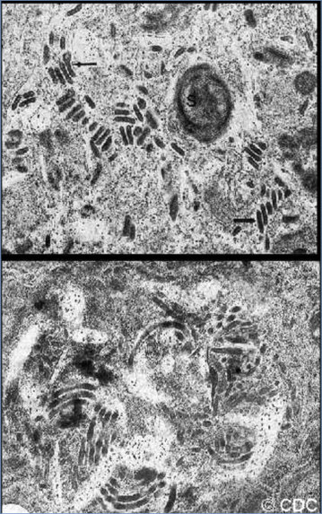

# 89. Microsporidia Infections (Microsporidiosis)
> Reference: [source credits](../../SOURCE_CREDITS.md). Printed pp. 576-579; PDF pp. 590-593.
> Editorial study pathway: Fungal infections (not a part division in the source).
[Flashcards](../flashcards/089_flashcards.md) · [Quiz](../mcqs/089_mcqs.md) · [Full extraction](../../raw/chapters/089.md)

## Five study pillars

### Etiology and transmission
Microsporidia are obligate intracellular, sporeforming organisms historically classified as parasites but closely related to fungi; their taxonomic position continues to be debated. More than 1,400 species belonging to about 200 genera have been identified with at least 15 reported in human infection .
*Printed p. 576 / PDF p. 590*

### Clinical recognition
Clinical presentations of microsporidia infections are diverse and vary according to the causal species and route of infection. They can be grouped broadly into intestinal, ocular, and disseminated infections.
*Printed p. 576 / PDF p. 590*

### Diagnostic workup
Infection with gastrointestinal tract microsporidia can be documented by microscopic identification of spores in stool or biopsy specimens. The laboratory should be alerted and specific stains for microsporidia requested, because routine ova and parasite examination usually does not detect microsporidia spores.
*Printed p. 577 / PDF p. 591*

### Treatment in the atlas
Restoration of immune function is critical for control of microsporidia infection in immunocompromised individuals. Effective antiretroviral therapy is the primary initial treatment for these infections in people with HIV infection and can result in resolution of symptoms even without specific therapy against microsporidia.
*Printed p. 577 / PDF p. 591*

### Prevention and infection control
In addition to standard precautions, contact precautions are recommended for diapered and incontinent children for the duration of illness.
*Printed p. 577 / PDF p. 591*

## Clinical search tags
Diarrhea, Dysentery, Immunocompromised host, Animal exposure, Water exposure

## Full text, original tables, and images

# 89. Microsporidia Infections (Microsporidiosis)
> Private study reference ([source credits](../../SOURCE_CREDITS.md)). PDF pages 590-593; printed pages 576-579.

## PDF page 590 | printed page 576

(Microsporidiosis)

### CLINICAL MANIFESTATIONS

Clinical presentations of microsporidia infections are diverse and vary according to the causal species and route of infection. They can be grouped broadly into intestinal, ocular, and disseminated infections. Infection may also be asymptomatic. Patients with symptomatic intestinal infection have watery, nonbloody diarrhea; nausea; and diffuse abdominal pain. Abdominal cramping can occur. Symptomatic intestinal infection, often manifested by protracted diarrhea, is most common in immunocompromised people, especially in organ transplant recipients and people with HIV infection with low CD4+ T-lymphocyte counts (<100 cells/μL). Complications include malnutrition, progressive weight loss, and failure to thrive. Ocular infections most often affect the cornea, and disseminated infections can lead to biliary tract, cerebral, respiratory, muscle, and genitourinary involvement (see Table 89.1). Chronic infection in immunocompetent people is rare.

Table 89.1 Clinical Manifestations of Microsporidia Infections

Microsporidia Anncaliia algerae Myositis, ocular infection, cellulitis, myositis, disseminated disease Anncaliia connori Disseminated disease, ocular infection Anncaliia vesicularum Myositis Encephalitozoon cuniculi Encephalitis, hepatitis, peritonitis, ocular infection, sinusitis, osteomyelitis, pulmonary disease, disseminated disease Encephalitozoon hellem Ocular infection, disseminated disease, sinusitis, pneumonitis, nephritis, urethritis, cystitis Encephalitozoon intestinalis Diarrhea, cholangitis, disseminated infection, skin infection, ocular infection Enterocytozoon bieneusi Diarrhea, acalculous cholecystitis, pulmonary disease Microsporidium africanum Ocular infection Microsporidium ceylonensis Ocular infection Nosema ocularum Ocular infection Pleistophora species Myositis, disseminated disease, sinusitis Trachipleistophora anthropophthera Disseminated infection, encephalitis, ocular infection

Trachipleistophora hominis Myositis, sinusitis, encephalitis, ocular infection, disseminated disease Tubulinosema acridophagus Disseminated infection, myositis Vittaforma corneae Ocular infection, urinary tract infection, diarrhea

Adapted from: Han B, Weiss LM. Microsporidia: obligate intracellular pathogens within the fungal kingdom. Microbiol Spectr. 2017;5(2).

See also: www.cdc.gov/dpdx/microsporidiosis/.

### ETIOLOGY

Microsporidia are obligate intracellular, sporeforming organisms historically classified as parasites but closely related to fungi; their taxonomic position continues to be debated. More than 1,400 species belonging to about 200 genera have been identified with at least 15 reported in human infection (Table 89.1). Enterocytozoon bieneusi and Encephalitozoon intestinalis are the pathogens reported most commonly in humans and are associated most often with chronic diarrhea in people with HIV infection.

### EPIDEMIOLOGY

Most microsporidia infections are transmitted by oral ingestion of spores. Microsporidia spores commonly are found in surface water, and strains responsible for human infection have been identified in municipal water supplies and groundwater. Spores can survive for extended periods in the environment. Several studies indicate that waterborne transmission occurs. Donor-derived infections in organ transplant recipients have been documented. Person-to-person spread by the fecal-oral route also occurs. Spores also have been

Clinical Manifestation

### Geometry-detected table

|Microsporidia|Clinical Manifestation|
|---|---|
|_Anncaliia algerae_|Myositis, ocular infection, cellulitis, myositis, disseminated disease|
|_Anncaliia connori_|Disseminated disease, ocular infection|
|_Anncaliia vesicularum_|Myositis|
|_Encephalitozoon cuniculi_|Encephalitis, hepatitis, peritonitis, ocular infection, sinusitis, osteomyelitis, pulmonary disease, disseminated disease|
|_Encephalitozoon hellem_|Ocular infection, disseminated disease, sinusitis, pneumonitis, nephritis, urethritis, cystitis|
|_Encephalitozoon intestinalis_|Diarrhea, cholangitis, disseminated infection, skin infection, ocular infection|
|_Enterocytozoon bieneusi_|Diarrhea, acalculous cholecystitis,pulmonary disease|
|_Microsporidium africanum_|Ocular infection|
|_Microsporidium ceylonensis_|Ocular infection|
|_Nosema ocularum_|Ocular infection|
|_Pleistophora_ species|Myositis, disseminated disease, sinusitis|
|_Trachipleistophora_ _anthropophthera_|Disseminated infection, encephalitis, ocular infection|
|_Trachipleistophora hominis_|Myositis, sinusitis, encephalitis, ocular infection, disseminated disease|
|_Tubulinosema acridophagus_|Disseminated infection, myositis|
|_Vittaforma corneae_|Ocular infection, urinary tract infection, diarrhea|

[View original table](../../tables/ch089_p0590_1.jpg)

## PDF page 591 | printed page 577

detected in other body fluids, but their role in transmission is unknown. Data suggest the possibility of zoonotic and vector-borne transmission.

The incubation period is unknown.

### DIAGNOSTIC TESTS

Infection with gastrointestinal tract microsporidia can be documented by microscopic identification of spores in stool or biopsy specimens. The laboratory should be alerted and specific stains for microsporidia requested, because routine ova and parasite examination usually does not detect microsporidia spores. Microsporidia spores can be detected in formalin-fixed or unfixed stool, other fluid, or tissue specimens stained with a chromotrope-based stain (a modification of the trichrome stain) and examined by an experienced microscopist. Fluorescent techniques including calcofluor or Fungi-Fluor also can be used to detect organisms in stool or tissue sections. Identification and diagnostic confirmation of species requires transmission electron microscopy or molecular methods (nucleic acid amplification test), which are available for E bieneusi, E intestinalis, Encephalitozoon hellem, and Encephalitozoon cuniculi. The value of serologic testing, when available, has not been substantiated.

### TREATMENT

Restoration of immune function is critical for control of microsporidia infection in immunocompromised individuals. Effective antiretroviral therapy is the primary initial treatment for these infections in people with HIV infection and can result in resolution of symptoms even without specific therapy

against microsporidia. Albendazole is the drug of choice for systemic infections caused by microsporidia other than E bieneusi infection, which may respond to fumagillin. Fumagillin for systemic use is not available in the United States; it is associated with bone marrow toxicity, and recurrence of diarrhea is common after therapy is discontinued. Limited data suggest that nitazoxanide may be effective for treatment of E bieneusi gastroenteritis in patients with AIDS. Topical fumagillin is used to treat ocular microsporidial infection. Topical voriconazole (1%) and topical fluoroquinolones have been reported effective for treatment of microsporidial ocular infection, but more study is needed. Supportive care for malnutrition and dehydration may be necessary. Antimotility agents may be useful to control chronic diarrhea.

### INFECTION PREVENTION AND CONTROL MEASURES IN HEALTH CARE SETTINGS

In addition to standard precautions, contact precautions are recommended for diapered and incontinent children for the duration of illness.

### CONTROL MEASURES

In patients with HIV infection and other immunocompromised people, attention to hand hygiene, drinking bottled or boiled water, and avoiding unpeeled fruits and vegetables may decrease exposure. No chemoprophylactic regimens are known to be effective in preventing microsporidiosis, although continuation of treatment regimens is recommended as secondary prophylaxis in individuals with HIV infection until immune reconstitution.

## PDF page 592 | printed page 578

Image 89.1 Transmission electron micrographs showing developmental intracellular stages of microsporidia. Courtesy of Centers for Disease Control and Prevention.

Image 89.3 Transmission electron micrograph of a mature microsporidian spore. Black arrows indicate the electron dense cell wall; red arrows, the coils of polar tubule. Polymerase chain reaction assay can be used for diagnosis, but serological tests are unreliable. Courtesy of Centers for Disease Control and Prevention.

Image 89.2 Transmission electron micrograph showing developing forms of Encephalitozoon intestinalis inside a parasitophorous vacuole (red arrows) with mature spores (black arrows). Microsporidiosis, parasite. Courtesy of Centers for Disease Control and Prevention.

## PDF page 593 | printed page 579

Image 89.4 The infective form of microsporidia is the resistant spore, and it can survive for a long time in the environment (1). The spore extrudes its polar tubule and infects the host cell (2). The spore injects the infective sporoplasm into the eukaryotic host cell through the polar tubule (3). Inside the cell, the sporoplasm undergoes extensive multiplication by either merogony (binary fission) (4) or schizogony (multiple fission). This development can occur either in direct contact with the host cell cytoplasm (eg, Enterocytozoon bieneusi) or inside a vacuole termed parasitophorous vacuole (eg, Enterocytozoon intestinalis). Free in the cytoplasm or inside a parasitophorous vacuole, microsporidia develop by sporogony to mature spores (5). During sporogony, a thick wall is formed around the spore that provides resistance to adverse environmental conditions. When the spores increase in number and completely fill the host cell cytoplasm, the cell membrane is disrupted and releases the spores to the surroundings (6). These free mature spores can infect new cells, thus continuing the cycle. Courtesy of Centers for Disease Control and Prevention.

![Image 89.4 The infective form of microsporidia is the resistant spore, and it can survive for a long time in the environment (1). The spore extrudes its polar tubule and infects the host cell (2). The spore injects the infective sporoplasm into the eukaryotic host cell through the polar tubule (3). Inside the cell, the sporoplasm undergoes extensive multiplication by either merogony (binary fission) (4) or schizogony (multiple fission). This development can occur either in direct contact with the host cell cytoplasm (eg, Enterocytozoon bieneusi) or inside a vacuole termed parasitophorous vacuole (eg, Enterocytozoon intestinalis). Free in the cytoplasm or inside a parasitophorous vacuole, microsporidia develop by sporogony to mature spores (5). During sporogony, a thick wall is formed around the spore that provides resistance to adverse environmental conditions. When the spores increase in number and completely fill the host cell cytoplasm, the cell membrane is disrupted and releases the spores to the surroundings (6). These free mature spores can infect new cells, thus continuing the cycle. Courtesy of Centers for Disease Control and Prevention.](../../figures/ch089_p0593_01.jpg)
