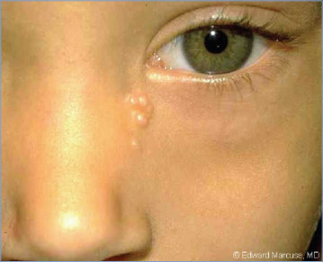
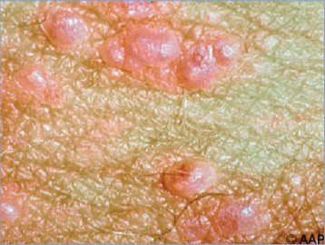
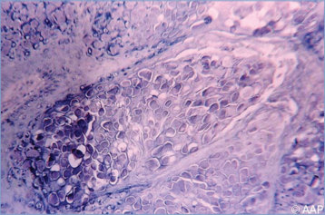
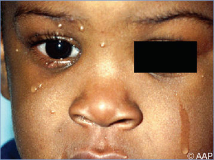
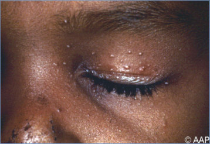
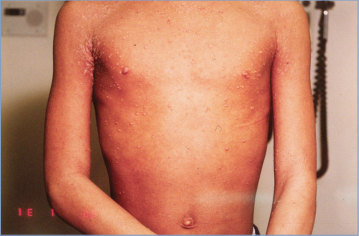

# 90. Molluscum Contagiosum
> Reference: [source credits](../../SOURCE_CREDITS.md). Printed pp. 580-583; PDF pp. 594-597.
> Editorial study pathway: Viral infections (not a part division in the source).
[Flashcards](../flashcards/090_flashcards.md) · [Quiz](../mcqs/090_mcqs.md) · [Full extraction](../../raw/chapters/090.md)

## Five study pillars

### Etiology and transmission
Molluscum contagiosum virus is the sole member of the genus Molluscipoxvirus, family Poxviridae. DNA subtypes of molluscum contagiosum virus can be differentiated, but the specific subtype probably is insignificant in pathogenesis.
*Printed p. 580 / PDF p. 594*

### Clinical recognition
Molluscum contagiosum is a benign viral infection of the skin with no systemic manifestations. It usually is characterized by 1 to 20 discrete, 2- to 5-mm-diameter, flesh-colored to translucent, dome-shaped papules, some with central umbilication.
*Printed p. 580 / PDF p. 594*

### Diagnostic workup
The diagnosis usually can be made clinically from the characteristic appearance of umbilicated papules. Side lighting of the individual lesions may enhance the visibility of the umbilication.
*Printed p. 580 / PDF p. 594*

### Treatment in the atlas
There is no consensus on management of molluscum contagiosum in children and adolescents. Genital lesions in sexually active patients should be treated to prevent spread to sexual contacts.
*Printed p. 580 / PDF p. 594*

### Prevention and infection control
Standard precautions are recommended.
*Printed p. 581 / PDF p. 595*

## Clinical search tags
Congenital / neonatal, Immunocompromised host

## Full text, original tables, and images

# 90. Molluscum Contagiosum
> Private study reference ([source credits](../../SOURCE_CREDITS.md)). PDF pages 594-597; printed pages 580-583.

## PDF page 594 | printed page 580

### CLINICAL MANIFESTATIONS

Molluscum contagiosum is a benign viral infection of the skin with no systemic manifestations. It usually is characterized by 1 to 20 discrete, 2- to 5-mm-diameter, flesh-colored to translucent, dome-shaped papules, some with central umbilication. Lesions commonly occur on the trunk, face, and extremities but rarely are generalized. Molluscum contagiosum is a self-limited epidermal infection with individual lesions often spontaneously resolving in 6 to 12 months but some taking as long as 3 to 4 years to disappear completely. An eczematous reaction (molluscum dermatitis) encircling the lesions is common. People with atopic dermatitis and immunocompromising conditions, including HIV infection and patients with congenital DOCK8 deficiency or CARD11 mutations, tend to have more widespread and prolonged eruptions, which often are recalcitrant to therapy.

### ETIOLOGY

Molluscum contagiosum virus is the sole member of the genus Molluscipoxvirus, family Poxviridae. DNA subtypes of molluscum contagiosum virus can be differentiated, but the specific subtype probably is insignificant in pathogenesis. Other poxviruses include the agents of smallpox, mpox, vaccinia, and cowpox.

### EPIDEMIOLOGY

Humans are the only known source of the virus, which is spread by direct contact with lesions, including scratching, shaving, sexual contact, or fomites. Vertical transmission has been linked with neonatal molluscum contagiosum infection. Lesions can be disseminated by autoinoculation. Infectivity generally is low, but occasional outbreaks may occur in facilities such as child care centers. The period of communicability is unknown.

The incubation period is generally between 2 and 7 weeks but may be as long as 6 months.

### DIAGNOSTIC TESTS

The diagnosis usually can be made clinically from the characteristic appearance of umbilicated papules. Side lighting of the individual lesions

may enhance the visibility of the umbilication. Handheld dermoscopy can be useful in identifying orifices (umbilications) along with white amorphous structures with a surrounding crown of vessels. Wright or Giemsa staining of cells expressed from the central core of a lesion reveals characteristic intracytoplasmic inclusions. Electron microscopic examination of these cells identifies typical poxvirus particles. The virus does not grow readily in culture. Serologic testing is not available routinely for clinical practice. If uncertainty persists in the differential diagnosis (eg, warts, trichoepithelioma, tuberous sclerosis), nucleic acid amplification tests are available at certain reference centers. Adolescents and young adults with genital molluscum contagiosum should prompt a screening for other sexually transmitted infections.

### TREATMENT

There is no consensus on management of molluscum contagiosum in children and adolescents. Genital lesions in sexually active patients should be treated to prevent spread to sexual contacts. Nongenital lesions in healthy people are typically self-limited, so treatment may be unnecessary. However, therapy may be warranted to: (1) alleviate discomfort, including itching; (2) reduce autoinoculation; (3) limit transmission of the virus to close contacts; (4) reduce cosmetic concerns; and (5) prevent secondary infection.

Physical destruction of the lesions is the most rapid and effective means of curing molluscum contagiosum. Modalities available include curettage, cryodestruction with liquid nitrogen, electrodesiccation, and chemical agents designed to initiate a local inflammatory response (podophyllin, tretinoin, cantharidin, 25%–50% trichloroacetic acid, liquefied phenol, silver nitrate, tincture of iodine, or potassium hydroxide). Although randomized controlled trials have been conducted for the use of cantharidin, the evidence for most of these other modalities remains anecdotal. Cantharidin was approved by the U.S. Food and Drug Administration (FDA) on July 21, 2023, for treatment of molluscum. In addition, berdazimer gel was approved by the FDA for treatment of molluscum on January 5, 2024. When treatment is desired, the most support exists for cryotherapy,

## PDF page 595 | printed page 581

curettage, or cantharidin. These treatments require an experienced health care professional, as they can result in postprocedural pain, irritation, dyspigmentation, and scarring. Because physical destruction of the lesions is painful, appropriate local anesthesia may be required, particularly in young children.

Cidofovir is a cytosine nucleotide analogue with in vitro activity against molluscum contagiosum; successful intravenous treatment of immunocompromised adults with severe involvement has been reported. However, use of cidofovir should be reserved for extreme cases because of potential carcinogenicity and known toxicities (neutropenia and potentially permanent nephrotoxicity) associated with systemic administration of cidofovir. Successful treatment using compounded formulations of topical cidofovir has been reported in both adult and pediatric cases, most of whom were immunocompromised. Solitary genital lesions in children usually are not acquired by sexual transmission and do not necessarily denote sexual abuse, as other modes of direct contact with the virus, including autoinoculation, may result in genital infection.

Image 90.1 Molluscum contagiosum lesions adjacent to the nasal bridge. Copyright Edgar K. Marcuse, MD.

### INFECTION PREVENTION AND CONTROL MEASURES IN HEALTH CARE SETTINGS

Standard precautions are recommended.

### CONTROL MEASURES

No control measures are known for isolated cases. For outbreaks, which are common in the tropics, restricting direct person-to-person contact and sharing of potentially contaminated fomites, such as towels and bedding, may decrease spread. Molluscum contagiosum should not prevent a child from attending child care or school or from swimming in public pools. Covering lesions is not necessary for child care, but when possible, localized lesions not covered by clothing may be covered with a gas-permeable dressing followed by under wrap and tape when participating in sports activities.1 When children will be entering swimming pools, a watertight bandage can be placed on visible lesions. Bandages should be changed daily or when soiled.

1 Davies HH, Jackson MA, Rice SG; American Academy of Pediatrics, Committee on Infectious Diseases. Infectious diseases associated with organized sports and outbreak control. Pediatrics. 2017;140(4):e20172477

Image 90.2 A central dimple or umbilication is the hallmark of molluscum contagiosum. The lesions of molluscum contagiosum vary in size from 1 to 6 mm and, unlike venereal warts, are smooth and pearly and have an umbilicated center.

## PDF page 596 | printed page 582

Image 90.3 Molluscum contagiosum lesions in a skin biopsy specimen (Giemsa stain, original magnification 340). Courtesy of Edgar O. Ledbetter, MD, FAAP.

Image 90.5 Pearly papules on the forehead and eyelid in a child with molluscum contagiosum lesions, which commonly occur on the face.

Image 90.7 A 15-year-old boy with HIV with numerous and widespread molluscum contagiosum lesions. Courtesy of Larry Frenkel, MD.

Image 90.4 Molluscum contagiosum is characterized by ≥1 translucent or white papules. Intracytoplasmic inclusions may be seen with Wright or Giemsa staining of material expressed from the core of a lesion.

Image 90.6 This 10-year-old girl had multiple small bumps on the face for 1 month. These had started as a solitary papule on her eyebrow but spread over several weeks. They developed a small pointed core and embarrassed the child. School pictures were pending. The family strongly requested treatment. There was a family history of keloids. The family was counseled on the limited treatment options because of the potential for permanent scarring and keloid formation. Consultation with a dermatologist was arranged at the parents’ request. Courtesy of Will Sorey, MD.

![Image 90.6 This 10-year-old girl had multiple small bumps on the face for 1 month. These had started as a solitary papule on her eyebrow but spread over several weeks. They developed a small pointed core and embarrassed the child. School pictures were pending. The family strongly requested treatment. There was a family history of keloids. The family was counseled on the limited treatment options because of the potential for permanent scarring and keloid formation. Consultation with a dermatologist was arranged at the parents’ request. Courtesy of Will Sorey, MD.](../../figures/ch090_p0596_04.jpg)

## PDF page 597 | printed page 583

Image 90.8 This healthy 5-year-old boy with widespread molluscum was prescribed home treatment with a topical liquid salicylic acid preparation. He developed itchy crusted erosions around the treated lesions. Topical therapy was discontinued, and a topical antibiotic ointment was started, with rapid clearing of the irritant dermatitis. Courtesy of H. Cody Meissner, MD, FAAP.

