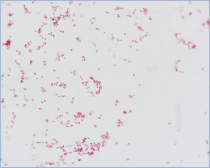
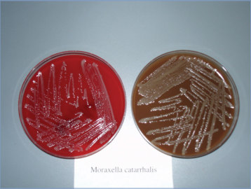
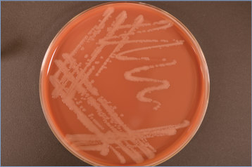

# 91. Moraxella catarrhalis Infections
> Reference: [source credits](../../SOURCE_CREDITS.md). Printed pp. 584-585; PDF pp. 598-599.
> Editorial study pathway: Bacterial infections (not a part division in the source).
[Flashcards](../flashcards/091_flashcards.md) · [Quiz](../mcqs/091_mcqs.md) · [Full extraction](../../raw/chapters/091.md)

## Five study pillars

### Etiology and transmission
M catarrhalis is a gram-negative aerobic diplococcus.
*Printed p. 584 / PDF p. 598*

### Clinical recognition
Moraxella catarrhalis is commonly implicated in acute otitis media (AOM), otitis media with effusion, and sinusitis. AOM caused by M catarrhalis occurs predominantly in younger infants and frequently is recovered from middle ear and sinuses as part of mixed infections.
*Printed p. 584 / PDF p. 598*

### Diagnostic workup
The organism can be isolated on blood or chocolate agar culture media after incubation in air or with increased carbon dioxide. On Gram stain, Moraxella species are short and plump gram-negative cocci, usually occurring in pairs or short chains and are mostly catalase and cytochrome oxidase positive.
*Printed p. 584 / PDF p. 598*

### Treatment in the atlas
Almost all strains of Moraxella species produce b-lactamase and are resistant to amoxicillin, unlike other common pathogens causing AOM. M catarrhalis is typically susceptible to ampicillin-sulbactam (and amoxicillin-clavulanate), second- or third-generation cephalosporins, trimethoprim-sulfamethoxazole, macrolides, and fluoroquinolones.
*Printed p. 584 / PDF p. 598*

### Prevention and infection control
Standard precautions are recommended.
*Printed p. 584 / PDF p. 598*

## Clinical search tags
Pneumonia, Meningitis, Arthritis / bone pain, Abscess / soft tissue, Congenital / neonatal, Immunocompromised host

## Full text, original tables, and images

# 91. Moraxella catarrhalis Infections
> Private study reference ([source credits](../../SOURCE_CREDITS.md)). PDF pages 598-599; printed pages 584-585.

## PDF page 598 | printed page 584

### CLINICAL MANIFESTATIONS

Moraxella catarrhalis is commonly implicated in acute otitis media (AOM), otitis media with effusion, and sinusitis. AOM caused by M catarrhalis occurs predominantly in younger infants and frequently is recovered from middle ear and sinuses as part of mixed infections. Since introduction of the conjugate pneumococcal vaccine, M catarrhalis appears to be recovered in a greater proportion of children undergoing tympanocentesis. M catarrhalis was recovered from 15% of children with AOM undergoing tympanocentesis between 2015 and 2019; however, it is unclear whether this represents an increase in cases attributable to M catarrhalis or a decrease in pneumococcal disease. M catarrhalis can cause pneumonia with or without bacteremia in immunocompetent infants and has been recovered from children with aspirated foreign body complicated by secondary infection. It is more commonly recovered from children with chronic lung disease or impaired host defenses, such as leukemia with neutropenia or congenital immunodeficiency. In immunocompromised children, often no focus of infection is identified. Other clinical manifestations include hypotension with or without a rash that is indistinguishable from that observed in meningococcemia; neonatal meningitis; and focal infections, such as preseptal cellulitis, bacterial tracheitis, urethritis, osteomyelitis, or septic arthritis. Rare manifestations include endocarditis, peritonitis, shunt-associated ventriculitis, meningitis, and mastoiditis. Health care-acquired M catarrhalis bacteremia has been reported in hospitalized children with transnasal devices (nasogastric tube, elemental diet tube, or nasotracheal tube); foci of infection in these cases have included pneumonia or bronchitis. Other health care-associated outbreaks of M catarrhalis have been described.

### ETIOLOGY

M catarrhalis is a gram-negative aerobic diplococcus.

### EPIDEMIOLOGY

M catarrhalis is part of the normal microbiota of the upper respiratory tract of humans. At least two-thirds of children are colonized within the

first year of life. The mode of transmission is presumed to be direct contact with contaminated respiratory tract secretions or droplet spread. Infection is most common in infants and young children but also occurs in immunocompromised people of all ages. The duration of carriage by children with infection or colonization and the period of communicability are unknown. Recent studies suggest early colonization with M catarrhalis is associated with a stable microbiome and low risk for recurrent respiratory tract infection.

### DIAGNOSTIC TESTS

The organism can be isolated on blood or chocolate agar culture media after incubation in air or with increased carbon dioxide. On Gram stain, Moraxella species are short and plump gram-negative cocci, usually occurring in pairs or short chains and are mostly catalase and cytochrome oxidase positive. Nucleic acid amplification tests for M catarrhalis have been developed but currently are used for research purposes only. The significance of M catarrhalis detection from clinical specimens requires clinical correlation; isolation of M catarrhalis from respiratory cultures may often represent colonization rather than infection.

### TREATMENT

Almost all strains of Moraxella species produce b-lactamase and are resistant to amoxicillin, unlike other common pathogens causing AOM. M catarrhalis is typically susceptible to ampicillin-sulbactam (and amoxicillin-clavulanate), second- or third-generation cephalosporins, trimethoprim-sulfamethoxazole, macrolides, and fluoroquinolones. Empiric and definitive therapy will depend on the severity of illness and type of infection, immunocompetence of the patient, and susceptibility of the isolate. The organism is resistant to clindamycin, vancomycin, and oxacillin. Macrolideresistant isolates have been reported from Asia, but resistant strains only rarely have been identified in the United States or Western Europe.

### INFECTION PREVENTION AND CONTROL MEASURES IN HEALTH CARE SETTINGS

Standard precautions are recommended.

### CONTROL MEASURES

None.

## PDF page 599 | printed page 585

Image 91.1 Gram stain of Moraxella catarrhalis showing characteristic gram-negative diplococci morphological features (magnification 3100). Courtesy of Rita Yee, MT(ASCP)SM.

Image 91.3 Moraxella catarrhalis on chocolate agar. Courtesy of Julia Rosebush, DO; Robert Jerris, PhD; and Theresa Stanley, M(ASCP).

Image 91.2 Moraxella catarrhalis on blood and chocolate agar plates, both inoculated simultaneously. Courtesy of Rita Yee, MT(ASCP)SM.

