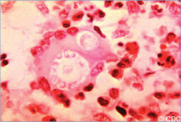
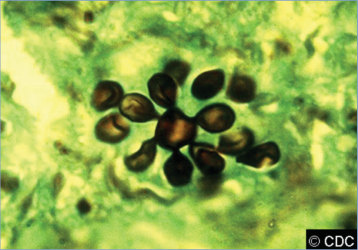
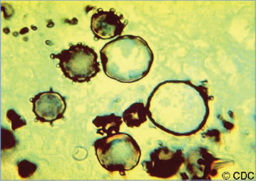
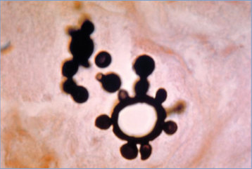

# 98. Paracoccidioidomycosis (Formerly Known as South American Blastomycosis)
> Reference: [source credits](../../SOURCE_CREDITS.md). Printed pp. 618-620; PDF pp. 632-634.
> Editorial study pathway: Fungal infections (not a part division in the source).
[Flashcards](../flashcards/098_flashcards.md) · [Quiz](../mcqs/098_mcqs.md) · [Full extraction](../../raw/chapters/098.md)

## Five study pillars

### Etiology and transmission
Paracoccidioides brasiliensis is a thermally dimorphic fungus with yeast and mycelia (mold) phases. P brasiliensis complex contains 5 different phylogenetic lineages (S1a, S1b, PS2, PS3, and PS4).
*Printed p. 618 / PDF p. 632*

### Clinical recognition
Most disease occurs in adults (90%–95% of cases). The site of initial infection is the lungs.
*Printed p. 618 / PDF p. 632*

### Diagnostic workup
Diagnosis is confirmed by visualization of fungal elements. Round, multiple-budding yeast cells with a distinguishing pilot’s wheel appearance can be seen in preparations of sputum, bronchoalveolar lavage specimens, scrapings from ulcers, and material from lesions or in tissue biopsy specimens.
*Printed p. 618 / PDF p. 632*

### Treatment in the atlas
Oral therapy with itraconazole is the treatment of choice for less severe or localized infection. Serum trough concentrations of itraconazole should be 1 to 2 mg/mL.
*Printed p. 618 / PDF p. 632*

### Prevention and infection control
Standard precautions are recommended.
*Printed p. 619 / PDF p. 633*

## Clinical search tags
Fever, Abscess / soft tissue, Travel / endemic setting

## Full text, original tables, and images

# 98. Paracoccidioidomycosis (Formerly Known as South American Blastomycosis)
> Private study reference ([source credits](../../SOURCE_CREDITS.md)). PDF pages 632-634; printed pages 618-620.

## PDF page 632 | printed page 618

(Formerly Known as South American Blastomycosis)

### CLINICAL MANIFESTATIONS

Most disease occurs in adults (90%–95% of cases). The site of initial infection is the lungs. Clinical patterns include subclinical infection or progressive disease that can be either acutesubacute (juvenile type) or chronic (adult type). Constitutional symptoms, such as fever, malaise, anorexia, and weight loss, are common in both adult and juvenile forms.

In the juvenile form, the initial pulmonary infection usually is asymptomatic, and manifestations are related to dissemination of infection to the reticuloendothelial system, resulting in enlarged lymph nodes and involvement of liver, spleen, and bone marrow. Skin lesions are observed regularly and are located typically on the face, neck, and trunk. Involvement of bones, joints, and mucous membranes is less common. Enlarged lymph nodes occasionally coalesce and form abscesses or fistulas. The chronic form of the illness can be localized to the lungs or can disseminate. Oral mucosal lesions are observed in half of the cases, and skin involvement is common but occurs in a smaller proportion than in patients with the acutesubacute form. Infection can be latent for years before causing illness.

### ETIOLOGY

Paracoccidioides brasiliensis is a thermally dimorphic fungus with yeast and mycelia (mold) phases. P brasiliensis complex contains 5 different phylogenetic lineages (S1a, S1b, PS2, PS3, and PS4). Paracoccidioides lutzii also causes paracoccidioidomycosis.

### EPIDEMIOLOGY

The infection occurs in Latin America, from Mexico to Argentina, with 80% of cases in Brazil. The natural reservoir is unknown although soil is suspected; most disease is associated with agricultural work. The mode of transmission is unknown but most likely occurs via inhalation of contaminated soil or dust; person-to-person transmission does not occur. The armadillo is a known reservoir of P brasiliensis.

The incubation period is highly variable, ranging from 1 month to decades. Cases have been diagnosed outside endemic regions, so prior residence in Latin America is an important determinant in raising suspicion of the infection.

### DIAGNOSTIC TESTS

Diagnosis is confirmed by visualization of fungal elements. Round, multiple-budding yeast cells with a distinguishing pilot’s wheel appearance can be seen in preparations of sputum, bronchoalveolar lavage specimens, scrapings from ulcers, and material from lesions or in tissue biopsy specimens. Specimens can be prepared with several procedures, including wet or KOH wet preparations, or histologic staining with hematoxylin and eosin, silver, or periodic acid–Schiff. The mycelia form of P brasiliensis can be cultured on most enriched media, including Mycosel or Sabouraud dextrose agar, at 25°C to 30°C. Cultures should be held at least 8 weeks. The appearance of the mycelia form is not distinctive, and identification requires conversion to the yeast phase or DNA sequence determination. Complement fixation and immunodiffusion serologic tests are available for antibody detection. Semiquantitative immunodiffusion is the preferred test, with sensitivity around 80% and specificity >95%, and is the most widely available test in endemic regions.

### TREATMENT1

Oral therapy with itraconazole is the treatment of choice for less severe or localized infection. Serum trough concentrations of itraconazole should be 1 to 2 mg/mL. A trough level should be checked 10 days or later following initiation to ensure adequate drug exposure. When measured by highpressure liquid chromatography, both itraconazole and its bioactive hydroxyitraconazole metabolite are reported, the sum of which should be considered in assessing the trough concentration. The itraconazole oral solution formulation is preferred over the capsule formulation because of improved absorption, and should be taken on an empty stomach. However, a super bioavailable itraconazole is now approved by the U.S. Food and Drug Administration for the treatment of pulmonary and extrapulmonary blastomycosis in individuals 18 years or older, with pharmacokinetic studies of this formulation demonstrating less variable

## PDF page 633 | printed page 619

absorption than conventional itraconazole capsules and a similar side effect profile; data in children are lacking.

Voriconazole may be as effective as itraconazole, including when there is central nervous system involvement, but has not been studied as extensively. Close monitoring of voriconazole serum trough concentrations is critical for both effectiveness and safety. Most experts agree that voriconazole trough concentrations should be measured on day 3 or later after initiating treatment, and for children, therapeutic trough concentrations are 2 to 6 mg/mL. It is important to individualize dosing in patients following initiation of voriconazole therapy, because there is high interpatient variability in metabolism.

Isavuconazole has been effective in adults, but there are limited pediatric data for paracoccidioidomycosis.

Optimal duration of therapy is unknown, but prolonged therapy for 9 to 18 months is necessary to minimize the relapse rate, and children with severe disease can require a longer course.

Trimethoprim-sulfamethoxazole orally is an inferior alternative to itraconazole, and treatment must be continued for 18 months or longer to lessen risk of relapse, which occurs in 10% to 15%

Image 98.1 Histopathologic features of paracoccidioidomycosis, skin. Budding cell of Paracoccidioides brasiliensis within multinucleated giant cell. Courtesy of Centers for Disease Control and Prevention.

of optimally treated patients. Amphotericin B generally is given only for initial treatment of severe paracoccidioidomycosis for 2 to 4 weeks. Intravenous trimethoprim-sulfamethoxazole is another option. Children treated initially by the intravenous route can transition to orally administered therapy after clinical improvement has been observed, usually after 3 to 6 weeks.

Serial serologic testing by complement fixation or semiquantitative immunodiffusion is useful for monitoring the response to therapy. The expected response is a progressive decline in titers after 1 to 3 months of treatment with stabilization at a low titer for years or even for life.

### INFECTION PREVENTION AND CONTROL MEASURES IN HEALTH CARE SETTINGS

Standard precautions are recommended.

### CONTROL MEASURES

None.

1 Thompson GR III, Le T, Chindamporn A, et al. Global guideline for the diagnosis and management of the endemic mycoses: an initiative of the European Confederation of Medical Mycology in cooperation with the International Society for Human and Animal Mycology [Erratum in: Lancet Infect Dis. 2021; 21(11):e341]. Lancet Infect Dis. 2021;21(12):e364–e374

Image 98.2 Pictured is a Sabouraud dextrose agar slant culture of the fungus Paracoccidioides brasiliensis grown at 37°C (98.6°F). This is the only etiologic agent of the disease paracoccidioidomycosis. P brasiliensis is geographically restricted to areas of South and Central America. Courtesy of Centers for Disease Control and Prevention.

## PDF page 634 | printed page 620

Image 98.3 This is a slant culture growing the fungus Paracoccidioides brasiliensis during its yeast phase. Inhalation of P brasiliensis conidia is presumably the route of acquisition. The primary infection is asymptomatic in most cases and can remain dormant for years within lymph nodes, reappearing later, usually because of some type of immunodeficiency. Courtesy of Centers for Disease Control and Prevention.

Image 98.5 Histopathologic features of paracoccidioidomycosis, liver. Minute buds on several cells of Paracoccidioides brasiliensis (methenamine silver stain). Courtesy of Centers for Disease Control and Prevention.

Image 98.4 Histopathologic features of paracoccidioidomycosis. Budding cell of Paracoccidioides brasiliensis (methenamine silver stain). Courtesy of Centers for Disease Control and Prevention.

Image 98.6 Histopathologic features of paracoccidioidomycosis. Budding cells of Paracoccidioides brasiliensis (methenamine silver stain). Courtesy of Centers for Disease Control and Prevention.

