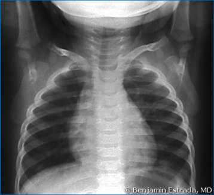
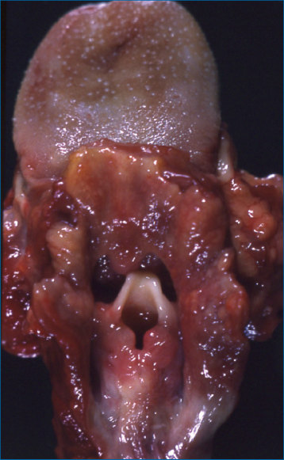
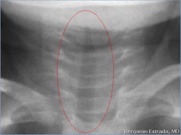
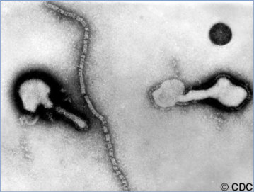
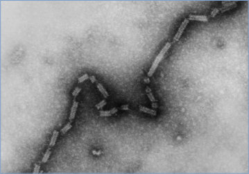
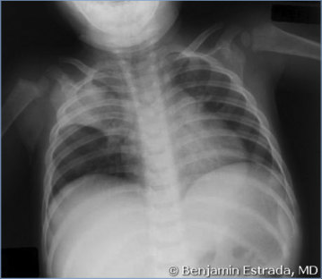
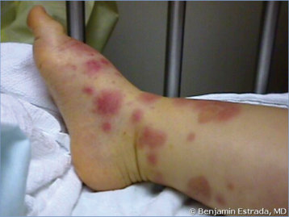

# 100. Parainfluenza Viral Infections
> Reference: [source credits](../../SOURCE_CREDITS.md). Printed pp. 625-628; PDF pp. 639-642.
> Editorial study pathway: Viral infections (not a part division in the source).
[Flashcards](../flashcards/100_flashcards.md) · [Quiz](../mcqs/100_mcqs.md) · [Full extraction](../../raw/chapters/100.md)

## Five study pillars

### Etiology and transmission
hPIVs are enveloped single-stranded negativesense RNA viruses classified in the family Paramyxoviridae. Four antigenically distinct types—1, 2, 3, and 4 (with 2 subtypes, 4A and 4B)—that infect humans have been identified. hPIV1 and hPIV3 are in the genus Respirovirus, and hPIV2 and hPIV4 are classified in the genus Rubulavirus.
*Printed p. 625 / PDF p. 639*

### Clinical recognition
Human parainfluenza viruses (hPIVs) are the major cause of laryngotracheobronchitis (croup) and also cause bronchiolitis and pneumonia as well as upper respiratory tract infection.1 hPIV type 1 (hPIV1) and, to a lesser extent, hPIV type 2 (hPIV2) are the most common pathogens associated with croup. hPIV type 3 (hPIV3) most commonly is associated with bronchiolitis and pneumonia in infants and young children. Infections with hPIV type 4 (hPIV4) are less well characterized but have been associated with both upper and lower respiratory tract infections.
*Printed p. 625 / PDF p. 639*

### Diagnostic workup
Nucleic acid amplification tests are the preferred diagnostic method for detection and differentiation of hPIVs and have become the standard method in clinical practice. hPIVs are included in many multiplex polymerase chain reaction–based respiratory pathogen panels, although hPIV4 is less commonly included. hPIVs may be isolated from nasopharyngeal secretions in cell culture, usually within 4 to 7 days of culture inoculation. Serologic diagnosis, made by a significant increase in antibody titer between acute and convalescent serum specimens, is less useful, because results are delayed and infection may not always be accompanied by a significant homotypic antibody response.
*Printed p. 625 / PDF p. 639*

### Treatment in the atlas
Specific antiviral therapy is not available. Pharmacologic therapy focuses on decreasing airway edema via corticosteroids and nebulized epinephrine, which are mainstays of treatment.
*Printed p. 626 / PDF p. 640*

### Prevention and infection control
In addition to standard precautions, contact and droplet precautions are recommended for the duration of hPIV-associated illness. In immunocompromised patients, the duration of precautions should be extended because of possible prolonged shedding.
*Printed p. 626 / PDF p. 640*

## Clinical search tags
Fever, Pharyngitis, Pneumonia, Wheeze / bronchiolitis, Meningitis, Encephalitis / seizures, Immunocompromised host, Travel / endemic setting

## Full text, original tables, and images

# 100. Parainfluenza Viral Infections
> Private study reference ([source credits](../../SOURCE_CREDITS.md)). PDF pages 639-642; printed pages 625-628.

## PDF page 639 | printed page 625

### CLINICAL MANIFESTATIONS

Human parainfluenza viruses (hPIVs) are the major cause of laryngotracheobronchitis (croup) and also cause bronchiolitis and pneumonia as well as upper respiratory tract infection.1 hPIV type 1 (hPIV1) and, to a lesser extent, hPIV type 2 (hPIV2) are the most common pathogens associated with croup. hPIV type 3 (hPIV3) most commonly is associated with bronchiolitis and pneumonia in infants and young children. Infections with hPIV type 4 (hPIV4) are less well characterized but have been associated with both upper and lower respiratory tract infections. Longitudinal studies have demonstrated that upper respiratory infections caused by viruses, including hPIVs, can be associated with acute otitis media, which is frequently a mixed viralbacterial infection. Rarely, hPIVs have been isolated from patients with parotitis, myopericarditis, aseptic meningitis, encephalitis, febrile seizures, and Guillain-Barré syndrome. hPIV infections can exacerbate symptoms of chronic lung disease and asthma in children and adults. In children with immunodeficiency and recipients of hematopoietic cell transplants, hPIVs, most commonly hPIV3, can cause refractory infections with persistent shedding, severe pneumonia with extrapulmonary dissemination, and even fatal disease. hPIV infections do not confer complete protective immunity; therefore, reinfections can occur with all serotypes and at any age, but reinfections usually are mild and limited to the upper respiratory tract.

### ETIOLOGY

hPIVs are enveloped single-stranded negativesense RNA viruses classified in the family Paramyxoviridae. Four antigenically distinct types—1, 2, 3, and 4 (with 2 subtypes, 4A and 4B)—that infect humans have been identified. hPIV1 and hPIV3 are in the genus Respirovirus, and hPIV2 and hPIV4 are classified in the genus Rubulavirus.

### EPIDEMIOLOGY

hPIVs are transmitted from person to person by direct contact with contaminated nasopharyngeal

secretions through large respiratory tract droplets and fomites. hPIV infections can be sporadic or associated with outbreaks of acute respiratory tract disease. Seasonal patterns of infection are distinct, predictable, and cyclic in temperate regions. Different serotypes have distinct epidemiologic patterns. hPIV1 tends to produce outbreaks of respiratory tract illness, usually croup, in the autumn of every other year. A major increase in the number of cases of croup in the autumn usually indicates an hPIV1 outbreak. hPIV2 also can cause outbreaks of respiratory tract illness in the autumn, but hPIV2 outbreaks tend to be less severe, irregular, and less common. hPIV3 is endemic and usually is prominent during spring and summer in temperate climates but often continues into autumn, especially in years when autumn outbreaks of hPIV1 or hPIV2 are absent. hPIV4 seasonal patterns are not as well characterized, but studies have shown that infections with hPIV4 had year-round prevalence with peaks during the fall and winter.

The age of primary infection varies with serotype. Primary infection with all types usually occurs by 5 years of age. Infection with hPIV3 more often occurs in infants and is a frequent cause of bronchiolitis and pneumonia in this age group. By 12 months of age, 50% of infants have acquired hPIV3 infection. Infections with hPIV1 and, to a lesser extent, hPIV2 are more likely to occur between 1 and 5 years of age. Acquisition of hPIV4 also occurs more often during preschool years.

Immunocompetent children with primary hPIV infection may shed virus for up to 1 week before onset of clinical symptoms and for 1 to 3 weeks after symptoms have disappeared, depending on serotype. Severe lower respiratory tract disease with prolonged shedding of the virus can occur in immunocompromised individuals. In these patients, infection may disseminate, with reports of extrapulmonary dissemination to brain, myocardium, and pericardium.

The incubation period ranges from 2 to 6 days. Symptoms can develop from 2 to 10 days after exposure and typically last up to 7 to 10 days, although viral shedding can persist for several weeks.

### DIAGNOSTIC TESTS

Nucleic acid amplification tests are the preferred diagnostic method for detection and differentiation

## PDF page 640 | printed page 626

of hPIVs and have become the standard method in clinical practice. hPIVs are included in many multiplex polymerase chain reaction–based respiratory pathogen panels, although hPIV4 is less commonly included. hPIVs may be isolated from nasopharyngeal secretions in cell culture, usually within 4 to 7 days of culture inoculation. Serologic diagnosis, made by a significant increase in antibody titer between acute and convalescent serum specimens, is less useful, because results are delayed and infection may not always be accompanied by a significant homotypic antibody response.

### TREATMENT

Specific antiviral therapy is not available. Pharmacologic therapy focuses on decreasing airway edema via corticosteroids and nebulized epinephrine, which are mainstays of treatment. Patients with mild croup can often be managed with supportive care at home, although data have shown benefit for outpatients with mild croup who receive steroids. Oral, intramuscular, and nebulized corticosteroids (ie, budesonide) have been demonstrated to decrease the severity and duration of symptoms and hospitalization in patients with moderate to severe laryngotracheobronchitis. Nebulized epinephrine is typically used in conjunction with corticosteroids for moderate to severe croup, and repeated doses may be needed for patients with severe croup. Antimicrobial agents should be reserved for documented secondary bacterial infections. Use of

ribavirin (usually inhaled), with or without concomitant administration of immunoglobulin intravenous, has been reported anecdotally in immunocompromised patients with severe pneumonia; however, controlled studies are lacking and this use is not routinely recommended.

### INFECTION PREVENTION AND CONTROL MEASURES IN HEALTH CARE SETTINGS

In addition to standard precautions, contact and droplet precautions are recommended for the duration of hPIV-associated illness. In immunocompromised patients, the duration of precautions should be extended because of possible prolonged shedding.

### CONTROL MEASURES

Appropriate respiratory hygiene and cough etiquette should be followed. Exposure to hPIV-infected people, including other patients, staff, and family members, may not be recognized, both because illness may be mild and because infected people may shed virus for up to 1 week before onset of clinical symptoms. Additional infection control measures should be considered in certain settings (eg, child care centers, nursing homes) when respiratory infections have been identified.

1 American Academy of Pediatrics, Subcommittee on Diagnosis and Management of Bronchiolitis. Clinical practice guideline: the diagnosis, management, and prevention of bronchiolitis. Pediatrics. 2014;134(5):e1474–e1502

## PDF page 641 | printed page 627

Image 100.1 Fatal croup. Edema, congestion, and inflammation of larynx and pharynx. Courtesy of Dimitris P. Agamanolis, MD.

Image 100.2 Parainfluenza laryngotracheitis in a 2-year-old boy. Courtesy of Benjamin Estrada, MD.

Image 100.3 Parainfluenza laryngotracheitis with the steeple sign (circled) in a 2-year-old. Courtesy of Benjamin Estrada, MD.

## PDF page 642 | printed page 628

Image 100.4 Parainfluenza pneumonia in a 2-year-old boy. Courtesy of Benjamin Estrada, MD.

Image 100.6 Transmission electron micrograph of parainfluenza virus showing 2 intact particles and a free filamentous nucleocapsid. Courtesy of Centers for Disease Control and Prevention.

Image 100.5 Erythema multiforme minor in a 2-year-old boy with parainfluenza. Courtesy of Benjamin Estrada, MD.

Image 100.7 This electron micrograph depicts the paramyxovirus 4A nucleocapsid with its herringbone-shaped RNA core. Courtesy of Centers for Disease Control and Prevention.

