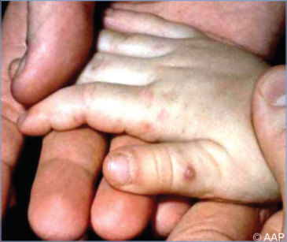
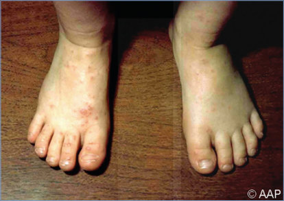
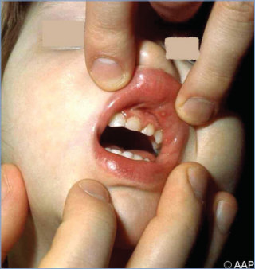
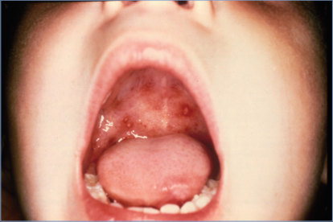

# 102. Parechovirus Infections
> Reference: [source credits](../../SOURCE_CREDITS.md). Printed pp. 639-641; PDF pp. 653-655.
> Editorial study pathway: Viral infections (not a part division in the source).
[Flashcards](../flashcards/102_flashcards.md) · [Quiz](../mcqs/102_mcqs.md) · [Full extraction](../../raw/chapters/102.md)

## Five study pillars

### Etiology and transmission
PeVs are small, nonenveloped, single-stranded, positive-sense RNA viruses in the family Picornaviridae. The Parechovirus genus consists of 6 species, Parechovirus A through F.
*Printed p. 639 / PDF p. 653*

### Clinical recognition
Parechoviruses (PeVs) primarily cause disease in young infants and present in a similar manner to enteroviruses, with febrile illness, exanthems (maculopapular, erythroderma, and/or palmar and plantar erythema), sepsis-like syndrome (frequently with leukopenia), and/or central nervous system disease. The latter includes meningitis (typically with little or no pleocytosis), encephalitis (typically white-matter predominant), seizures, and apnea; long-term neurodevelopmental sequelae may occur.
*Printed p. 639 / PDF p. 653*

### Diagnostic workup
Parechovirus-specific molecular tests such as nucleic acid amplification tests (NAATs) represent the best available diagnostic method. Some assays may not detect all PeV-A types.
*Printed p. 639 / PDF p. 653*

### Treatment in the atlas
No specific therapy is available for PeV infections. Immunoglobulin intravenous has been used in some published case reports of neonates with severe PeV infections.
*Printed p. 640 / PDF p. 654*

### Prevention and infection control
In addition to standard precautions, contact precautions are appropriate for infants and young A C children for the duration of PeV illness. Cohorting of infected neonates may be effective in controlling hospital nursery outbreaks.
*Printed p. 640 / PDF p. 654*

## Clinical search tags
Fever, Maculopapular rash, Pneumonia, Diarrhea, Hepatitis / jaundice, Meningitis, Encephalitis / seizures, Weakness / paralysis, Sepsis / shock, Cytopenia, Congenital / neonatal

## Full text, original tables, and images

# 102. Parechovirus Infections
> Private study reference ([source credits](../../SOURCE_CREDITS.md)). PDF pages 653-655; printed pages 639-641.

## PDF page 653 | printed page 639

### CLINICAL MANIFESTATIONS

Parechoviruses (PeVs) primarily cause disease in young infants and present in a similar manner to enteroviruses, with febrile illness, exanthems (maculopapular, erythroderma, and/or palmar and plantar erythema), sepsis-like syndrome (frequently with leukopenia), and/or central nervous system disease. The latter includes meningitis (typically with little or no pleocytosis), encephalitis (typically white-matter predominant), seizures, and apnea; long-term neurodevelopmental sequelae may occur. Infections (particularly with Human parechovirus [HPeV]-3) in neonates or very young infants may be severe, with manifestations that include sepsis, hepatitis and coagulopathy, myocarditis, pneumonia, and/or meningoencephalitis; long-term sequelae or death may occur. PeV infections in older infants and toddlers have been associated with generally mild upper and lower respiratory tract disease and gastroenteritis (although causation has not been established consistently) and a variety of other less common manifestations, including acute flaccid paralysis; acute disseminated encephalomyelitis; myalgia and myositis; herpangina; hand, foot, and mouth disease; sudden infant death syndrome; and hemophagocytic lymphohistiocytosis.

### ETIOLOGY

PeVs are small, nonenveloped, single-stranded, positive-sense RNA viruses in the family Picornaviridae. The Parechovirus genus consists of 6 species, Parechovirus A through F. Parechovirus A (formerly named Human parechovirus) includes at least 19 PeV types (designated HPeV1–19) and is the only species known to cause human disease. HPeV-1 and HPeV-2 previously were classified as echoviruses 22 and 23, respectively. HPeV-1 and HPeV-3 have been implicated in disease most frequently.

### EPIDEMIOLOGY

Humans are the primary reservoir for PeV-A, although infection in primates has been demonstrated. PeV-A infections have been reported worldwide. Seroepidemiologic studies suggest

that PeV-A infections occur commonly during early childhood. In some studies, most schoolaged children have serologic evidence of prior infection, but seroprevalence appears to vary by geographic region and specific PeV-A type. PeV infections frequently are asymptomatic. Symptomatic infection is most frequent in children younger than 2 years, with the most severe disease occurring in infants (especially younger than 6 months of age infected with HPeV-6).

Transmission appears to occur via the fecal-oral and respiratory routes, from symptomatic or asymptomatic individuals. On the basis of reports of very early onset neonatal disease, in utero and perinatal transmission also may occur. Certain PeV-A types may circulate throughout the year, while infections by other types (eg, HPeV-3) occur more commonly during summer and fall months in temperate climates. Multiple PeV-A types may circulate in a community during the same time period. Community outbreaks and health careassociated transmission in neonatal and pediatric hospital units have been observed. Virus is shed from the upper respiratory tract for 1 to 3 weeks and in stool for less than 2 weeks to as long as 6 months. Shedding may occur in the absence of illness or continue after symptoms resolve.

The incubation period for PeV infections has not been defined.

### DIAGNOSTIC TESTS

Parechovirus-specific molecular tests such as nucleic acid amplification tests (NAATs) represent the best available diagnostic method. Some assays may not detect all PeV-A types. Enterovirus NAATs will not detect PeVs (and vice versa). PeVs can be detected by molecular assays in stool, rectal and throat swab specimens, nasopharyngeal aspirates, tracheal secretions, blood, and cerebrospinal fluid. Certain multiplex NAATs designed to detect multiple bacterial and viral agents of meningitis and encephalitis, including PeVs, in cerebrospinal fluid are available. The PeV type can be identified by partial or complete sequencing of the viral protein 1 region, typically through reverse transcriptase-polymerase chain reaction amplification. Serologic assays have been developed for research but are not available commercially for diagnostic purposes.

## PDF page 654 | printed page 640

### TREATMENT

No specific therapy is available for PeV infections. Immunoglobulin intravenous has been used in some published case reports of neonates with severe PeV infections.

### INFECTION PREVENTION AND CONTROL MEASURES IN HEALTH CARE SETTINGS

In addition to standard precautions, contact precautions are appropriate for infants and young

A

C

Image 102.1 Vesicular eruptions in hand (A), knee (B), and mouth (C) of a 6-year-old with coxsackievirus A6 infection. Several of the fingernails shed (D) 2 months after the pictures were taken. Courtesy of Centers for Disease Control and Prevention/ Emerging Infectious Diseases.

Image 102.2 Enterovirus infection in a preschool-aged child. Hand, foot, and, mouth disease lesions are caused by coxsackievirus A16 and enterovirus 71.

children for the duration of PeV illness. Cohorting of infected neonates may be effective in controlling hospital nursery outbreaks.

### CONTROL MEASURES

Hand hygiene and environmental cleaning are important in decreasing spread of PeVs within families and institutions.

B

D

## PDF page 655 | printed page 641

Image 102.3 Enterovirus infection (hand, foot, and, mouth disease) affecting the feet.

Image 102.4 Enterovirus infection (hand, foot, and, mouth disease) affecting the anterior buccal mucosa. These lesions are generally less painful than herpes simplex lesions.

Image 102.5 Characteristic papulovesicular lesions of hand, foot, and, mouth disease in a 2-year-old. Courtesy of George Nankervis, MD.

