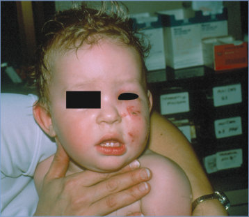
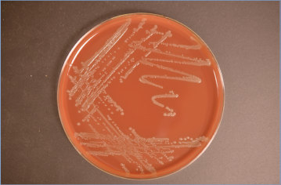

# 104. Pasteurella Infections
> Reference: [source credits](../../SOURCE_CREDITS.md). Printed pp. 648-650; PDF pp. 662-664.
> Editorial study pathway: Bacterial infections (not a part division in the source).
[Flashcards](../flashcards/104_flashcards.md) · [Quiz](../mcqs/104_mcqs.md) · [Full extraction](../../raw/chapters/104.md)

## Five study pillars

### Etiology and transmission
The genus Pasteurella is one of 5 genera of human pathogens classified in the family Pasteurellaceae; the other genera are Actinobacillus, Aggregatibacter, Haemophilus, and Mannheimia. Members of the genus Pasteurella are nonmotile, facultatively anaerobic, mostly catalase and oxidase positive, nitrate reducing, gram-negative coccobacilli that are primarily respiratory tract colonizers and pathogens in animals.
*Printed p. 648 / PDF p. 662*

### Clinical recognition
The most common manifestation is cellulitis at the site of a bite or scratch of a cat, dog, or other domestic or wild animal. Cellulitis typically develops within 12 to 24 hours of the injury and includes warmth, swelling, erythema, tenderness, and serosanguinous to purulent drainage at the wound site.
*Printed p. 648 / PDF p. 662*

### Diagnostic workup
The isolation of Pasteurella species from a normally sterile body site (eg, blood, joint fluid, bone, cerebrospinal fluid, pleural fluid, peritoneal fluid, or suppurative lymph nodes) establishes the diagnosis of systemic infection. Recovery of the organism from a superficial site, such as drainage from a skin lesion subsequent to an animal bite, must be interpreted in the context of other potential pathogens isolated, as mixed infection may occur.
*Printed p. 648 / PDF p. 662*

### Treatment in the atlas
Penicillin resistance is rare, but b-lactamase–producing strains have been recovered. Other oral agents that usually are effective include ampicillin, amoxicillin, amoxicillin-clavulanate, cefuroxime axetil, cefixime, cefpodoxime, cefdinir, trimethoprimsulfamethoxazole, azithromycin, doxycycline, and fluoroquinolones.
*Printed p. 649 / PDF p. 663*

### Prevention and infection control
Standard precautions are recommended.
*Printed p. 649 / PDF p. 663*

## Clinical search tags
Fever, Ulcers / eschar, Lymphadenopathy, Conjunctivitis, Pneumonia, Hepatitis / jaundice, Meningitis, Arthritis / bone pain, Abscess / soft tissue, Sepsis / shock, Congenital / neonatal, Immunocompromised host, Animal exposure

## Full text, original tables, and images

# 104. Pasteurella Infections
> Private study reference ([source credits](../../SOURCE_CREDITS.md)). PDF pages 662-664; printed pages 648-650.

## PDF page 662 | printed page 648

### CLINICAL MANIFESTATIONS

The most common manifestation is cellulitis at the site of a bite or scratch of a cat, dog, or other domestic or wild animal. Cellulitis typically develops within 12 to 24 hours of the injury and includes warmth, swelling, erythema, tenderness, and serosanguinous to purulent drainage at the wound site. Regional lymphadenopathy, chills, and fever can also occur. The most frequent local complications related to deep penetration of the teeth or claws of the biting animal are abscesses and tenosynovitis, but septic arthritis and osteomyelitis also occur. Other less common manifestations include septicemia, central nervous system infections (meningitis is the most common, although brain abscess and subdural empyema have been observed), ocular infections (eg, conjunctivitis, corneal ulcer, endophthalmitis), endocarditis, respiratory tract infections (eg, pneumonia, pulmonary abscesses, pleural empyema, epiglottitis), appendicitis, hepatic abscess, granulomatous hepatitis, peritonitis, ventriculoperitoneal shunt infection, and urinary tract infection. Infection in the neonate is rare but may present as early onset fulminant sepsis with or without meningitis from vertical transmission or later with sepsis and/or meningitis or focal infections after animal exposures (sometimes without known bites, scratches, or licks). People with liver disease, solid organ transplant, or underlying host defense abnormalities are predisposed to bacteremia with Pasteurella multocida. Those with chronic pulmonary or renal conditions may be predisposed to lung or kidney infections, respectively.

### ETIOLOGY

The genus Pasteurella is one of 5 genera of human pathogens classified in the family Pasteurellaceae; the other genera are Actinobacillus, Aggregatibacter, Haemophilus, and Mannheimia. Members of the genus Pasteurella are nonmotile, facultatively anaerobic, mostly catalase and oxidase positive, nitrate reducing, gram-negative coccobacilli that are primarily respiratory tract colonizers and pathogens in animals. The most common human pathogen is P multocida. Most human infections

are caused by the following species or subspecies: P multocida subspecies multocida (causing more than 50% of infections), followed by Pasteurella canis, P multocida subspecies septica, Pasteurella stomatis, and Pasteurella dagmatis.

### EPIDEMIOLOGY

Pasteurella species have a worldwide distribution. They colonize the upper respiratory tract of 70% to 90% of cats, 25% to 50% of dogs, and many other wild and domestic animals including large cats, lions, tigers, panthers, swine, rats, opossums, rabbits, and fowl. Transmission most frequently occurs from the bite, scratch, or lick of a previous wound by a cat or dog. Infected cat bite wounds contain Pasteurella species more often than do dog bite wounds. Rarely, respiratory tract spread occurs from animals to humans, and in 5% to 15% of all cases, no animal exposure can be identified. The highest rates of infection occur in children younger than 5 years and in adults older than 55 years of age. Human-to-human transmission has been documented vertically, horizontally from colonized people, and through contaminated blood products.

The incubation period usually is less than 24 hours.

### DIAGNOSTIC TESTS

The isolation of Pasteurella species from a normally sterile body site (eg, blood, joint fluid, bone, cerebrospinal fluid, pleural fluid, peritoneal fluid, or suppurative lymph nodes) establishes the diagnosis of systemic infection. Recovery of the organism from a superficial site, such as drainage from a skin lesion subsequent to an animal bite, must be interpreted in the context of other potential pathogens isolated, as mixed infection may occur. Pasteurella species are somewhat fastidious but may be cultured on several media generally used in clinical laboratories, including tryptic soybean digest agar with 5% sheep blood and chocolate agars, at 35°C to 37°C without increased carbon dioxide concentration. Although they resemble several other organisms morphologically, laboratory identification to the genus level generally is not difficult, although species and subspecies differentiation is more challenging. Newer laboratory methods, including polymerase chain reaction amplification of the 16S rRNA gene

## PDF page 663 | printed page 649

followed by sequencing and identification of cellular components by matrix-assisted laser desorption/ionization–time-of-flight mass spectroscopy, have significantly improved species identification.

### TREATMENT

The drug of choice is penicillin. Penicillin resistance is rare, but b-lactamase–producing strains have been recovered. Other oral agents that usually are effective include ampicillin, amoxicillin, amoxicillin-clavulanate, cefuroxime axetil, cefixime, cefpodoxime, cefdinir, trimethoprimsulfamethoxazole, azithromycin, doxycycline, and fluoroquinolones. Parenteral third-generation cephalosporins, including ceftriaxone and cefotaxime, demonstrate excellent in vitro activity. Oral and parenteral antistaphylococcal penicillins and first-generation cephalosporins including cephalexin are not as active and therefore not recommended for treatment. Pasteurella species usually are resistant to vancomycin, clindamycin, and erythromycin. For patients who are allergic to b-lactam agents, trimethoprim-sulfamethoxazole, azithromycin, and the fluoroquinolones are alternative choices, but clinical experience with these agents is limited. For suspected polymicrobial infected bite wounds, oral amoxicillinclavulanate or, for severe infection, intravenous

ampicillin-sulbactam or piperacillin-tazobactam can be given. The duration of therapy usually is 7 to 10 days for local infections and 10 to 14 days for more severe infections. Duration of antimicrobial therapy for optimal outcomes for bone and joint infections is unknown but likely 3 to 6 weeks depending on clinical course. Endocarditis may require 4 to 6 weeks. Wound drainage or débridement may be necessary.

### INFECTION PREVENTION AND CONTROL MEASURES IN HEALTH CARE SETTINGS

Standard precautions are recommended.

### CONTROL MEASURES

Limiting contact with wild animals and education about appropriate contact with domestic animals can help to prevent Pasteurella infections. Parents should not allow pets to lick infants and children on the face or on preexisting skin injuries. Wounds from animal bites and scratches should be irrigated, cleansed, and débrided promptly. Following a bite wound, antimicrobial prophylaxis for selected children, depending on host factors and the type of animal bite wound, should be initiated, and the risk of rabies exposure and tetanus immunization status should be assessed.

## PDF page 664 | printed page 650

Image 104.1 Pasteurella multocida cellulitis secondary to multiple cat bites around the face of a 1-year-old. Courtesy of George Nankervis, MD.

Image 104.3 This photograph depicts the colonial morphological features displayed by gram-negative Yersinia pestis (formerly Pasteurella pestis) bacteria, which was grown on a medium of sheep blood agar for a 72-hour period at a temperature of 37°C (98.6°F). Courtesy of Centers for Disease Control and Prevention/Todd Parker, MD, and Audra Marsh.

Image 104.2 Right forearm of a 1-year-old boy bitten by a stray cat. The child developed fever, redness, and swelling 10 hours after the bite. He was taking amoxicillin for otitis media at the time of the bite. The child responded to treatment with intravenous cefuroxime, although the fever persisted for 36 hours. Pasteurella multocida was cultured from purulent material obtained from the wound the day after admission. Courtesy of Larry I. Corman, MD.

Image 104.4 Pasteurella multocida on chocolate agar. Colonies are small, gray, smooth, and nonhemolytic. Courtesy of Julia Rosebush, DO; Robert Jerris, PhD; and Theresa Stanley, M(ASCP).

