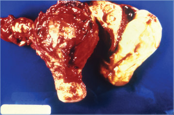

# 108. Pelvic Inflammatory Disease
> Reference: [source credits](../../SOURCE_CREDITS.md). Printed pp. 663-666; PDF pp. 677-680.
> Editorial study pathway: Syndromes and cross-cutting topics (not a part division in the source).
[Flashcards](../flashcards/108_flashcards.md) · [Quiz](../mcqs/108_mcqs.md) · [Full extraction](../../raw/chapters/108.md)

## Five study pillars

### Etiology and transmission
Neisseria gonorrhoeae and Chlamydia trachomatis are the pathogens most commonly associated with PID, although only approximately half of PID cases have evidence of these bacterial pathogens. A number of organisms other than N gonorrhoeae and C trachomatis that are present in the vaginal flora have been isolated from upper genital tract cultures of people with PID, including anaerobes (such as Prevotella species), Gardnerella vaginalis, Haemophilus influenzae, Streptococcus agalactiae, and enteric gram-negative rods.
*Printed p. 663 / PDF p. 677*

### Clinical recognition
Pelvic inflammatory disease (PID) comprises a spectrum of inflammatory disorders of the female upper genital tract, including any combination of endometritis, parametritis, salpingitis, oophoritis, tubo-ovarian abscess, and pelvic peritonitis.1 Acute PID is difficult to diagnose because of the wide variation in symptoms and signs. Symptoms of acute PID include unilateral or bilateral lower abdominal or pelvic pain, fever, vomiting, abnormal vaginal discharge, irregular vaginal bleeding, and pain with intercourse.
*Printed p. 663 / PDF p. 677*

### Diagnostic workup
Centers for Disease Control and Prevention (CDC) criteria for clinical diagnosis and presumptive treatment of PID are presented in Table 108.1. Many individuals with PID have subtle or nonspecific symptoms or are asymptomatic, and a diagnosis of PID usually is based on imprecise clinical findings.
*Printed p. 664 / PDF p. 678*

### Treatment in the atlas
A sexually active female adolescent or young adult with lower abdominal pain who exhibits uterine, adnexal, or cervical motion tenderness on bimanual examination should be treated for PID if no other cause is identified. To minimize risks of progressive infection and subsequent infertility, treatment should be initiated at the time of clinical diagnosis, and therapy should be completed, regardless of the STI test results.
*Printed p. 665 / PDF p. 679*

### Prevention and infection control
Standard precautions are recommended.
*Printed p. 666 / PDF p. 680*

## Clinical search tags
Fever, Vomiting, Hepatitis / jaundice, Abscess / soft tissue

## Full text, original tables, and images

# 108. Pelvic Inflammatory Disease
> Private study reference ([source credits](../../SOURCE_CREDITS.md)). PDF pages 677-680; printed pages 663-666.

## PDF page 677 | printed page 663

### CLINICAL MANIFESTATIONS

Pelvic inflammatory disease (PID) comprises a spectrum of inflammatory disorders of the female upper genital tract, including any combination of endometritis, parametritis, salpingitis, oophoritis, tubo-ovarian abscess, and pelvic peritonitis.1 Acute PID is difficult to diagnose because of the wide variation in symptoms and signs. Symptoms of acute PID include unilateral or bilateral lower abdominal or pelvic pain, fever, vomiting, abnormal vaginal discharge, irregular vaginal bleeding, and pain with intercourse. The severity of symptoms varies widely and may range from indolent to severe. Patients occasionally present with right upper quadrant abdominal pain resulting from peritoneal adhesions related to perihepatitis (Fitz-Hugh-Curtis syndrome). Many episodes of PID go undiagnosed and untreated because the patient and/or health care professional fails to recognize the implications of mild or nonspecific symptoms and signs. Subclinical PID is defined as inflammation of the upper reproductive tract in the absence of signs and symptoms of acute PID, and there is a growing body of evidence that this represents a large proportion of all PID cases. In both clinically apparent and subclinical PID, inflammation occurs within the reproductive tract, which scars or damages the fallopian tubes or surrounding structures. Clinicians should maintain a high degree of suspicion for PID when female patients of reproductive age present with mild or nonspecific findings.

Examination findings vary but may include oral temperature >101°F (>38.3°C), lower abdominal tenderness with or without peritoneal signs, abnormal cervical or vaginal discharge, tenderness with lateral motion of the cervix, cervical friability, uterine tenderness, unilateral or bilateral adnexal tenderness, and adnexal fullness. Pyuria (presence of white blood cells [WBCs] on urine microscopy), abundant WBCs on saline microscopy of vaginal fluid, an elevated erythrocyte sedimentation rate, elevated C-reactive protein, and/or an adnexal mass demonstrated by abdominal or transvaginal ultrasonography are findings that support a diagnosis of PID.

Complications of PID include perihepatitis (Fitz-Hugh-Curtis syndrome) and tubo-ovarian abscess/complex formation. Long-term sequelae include tubal scarring that can cause infertility in an estimated 10% to 20% of affected individuals, ectopic pregnancy in an estimated 9%, and chronic pelvic pain in an estimated 18%. Factors that may increase the likelihood of infertility are delay in diagnosis or in initiation of antimicrobial therapy, younger age at time of infection, chlamydial infection, recurrent PID, and PID determined to be severe by laparoscopic examination.

Any prepubertal child with PID needs to be assessed for sexual abuse. Mandatory reporters should follow their state’s regulations for reporting.

### ETIOLOGY

Neisseria gonorrhoeae and Chlamydia trachomatis are the pathogens most commonly associated with PID, although only approximately half of PID cases have evidence of these bacterial pathogens. A number of organisms other than N gonorrhoeae and C trachomatis that are present in the vaginal flora have been isolated from upper genital tract cultures of people with PID, including anaerobes (such as Prevotella species), Gardnerella vaginalis, Haemophilus influenzae, Streptococcus agalactiae, and enteric gram-negative rods. Additionally, cytomegalovirus, Mycoplasma hominis, and Ureaplasma urealyticum might be associated with some instances of PID. Therefore, PID is managed as a polymicrobial infection. In more than half of cases, however, no organism is identified from routine lower genital tract swab specimens (ie, endocervical or vaginal swab specimens). Mycoplasma genitalium also has been implicated in the etiology of PID in some studies, although the natural history of M genitalium in females remains unclear. PID may also be secondary to other causes of peritonitis, such as ruptured appendicitis.

### EPIDEMIOLOGY

Although many of the issues pertaining to highrisk sexual behavior and acquisition of sexually transmitted infections (STIs) are common to both adolescents and adults, they often are intensified among adolescents because of both behavioral and biological predispositions. Female adolescents and young adults can be at higher risk of STIs and

## PDF page 678 | printed page 664

PID because of behavioral factors such as inconsistent barrier contraceptive use, douching, greater number of concurrent sex partners, and use of alcohol and other substances that may impair judgment while engaging in sexual activity. Use of condoms may reduce the risk of PID. Female adolescents and young adults also have an increased biologic susceptibility to STIs. Cervical ectopy increases risk of chlamydia and gonorrhea infection by exposing columnar epithelium to a potential infectious inoculum.

An incubation period for PID is undefined.

### DIAGNOSTIC TESTS2

Centers for Disease Control and Prevention (CDC) criteria for clinical diagnosis and presumptive treatment of PID are presented in Table 108.1. Many individuals with PID have subtle or nonspecific symptoms or are asymptomatic, and a diagnosis of PID usually is based on imprecise clinical findings. A clinical diagnosis of symptomatic PID

Table 108.1 Criteria for Clinical Diagnosis and Presumptive Treatment of Pelvic Inflammatory Disease (PID)a

Minimum Criteria

Presumptive treatment for PID should be initiated in sexually active female adolescents and young adults at risk for STIs if they are experiencing pelvic or lower abdominal pain, if no cause for the illness other than PID can be identified, or if one or more of the following minimum clinical criteria are present on pelvic examination:

• Cervical motion tenderness or • Uterine tenderness or • Adnexal tenderness

One or more of the following additional criteria can be used to enhance the specificity of the minimum clinical criteria and support a diagnosis of PID:

• Oral temperature >101°F (>38.3°C); • Abnormal cervical mucopurulent discharge or cervical friability; • Presence of abundant numbers of WBCs on saline microscopy of vaginal fluid; • Elevated erythrocyte sedimentation rate; • Elevated C-reactive protein; and • Laboratory documentation of cervical infection with Neisseria gonorrhoeae or Chlamydia trachomatis.

Most people with PID have either mucopurulent cervical discharge or evidence of WBCs on a microscopic evaluation of a saline preparation of vaginal fluid (ie, wet prep). If the cervical discharge appears normal and no WBCs are observed on the wet prep of vaginal fluid, the diagnosis of PID is unlikely, and alternative causes of pain should be considered. A wet prep of vaginal fluid also can detect the presence of concomitant infections (eg, bacterial vaginosis and trichomoniasis).

a Adapted from Centers for Disease Control and Prevention. Sexually transmitted infections treatment guidelines, 2021. MMWR Recomm Rep. 2021;70(RR-4):1–187.

Available at: www.cdc.gov/std/treatment-guidelines/pid.htm.

has a positive predictive value for salpingitis of 65% to 90% compared with laparoscopy. No single historical, physical, or laboratory finding is both sensitive and specific for the diagnosis of acute PID. Because of the difficulty of diagnosis and the potential for damage to reproductive health, providers should maintain a low threshold for the clinical diagnosis of PID.

A cervical or vaginal swab specimen should be obtained from individuals with suspected PID to perform a nucleic acid amplification test (NAAT) for C trachomatis and N gonorrhoeae. A swab specimen for culture of N gonorrhoeae may be collected from the cervix or vagina to allow susceptibility testing to be performed. The most specific criteria for diagnosing PID include endometrial biopsy with histopathologic evidence of endometritis; transvaginal ultrasonography or magnetic resonance imaging techniques showing thickened, fluid-filled tubes with or without free pelvic fluid or tubo-ovarian complex or Doppler ultrasonography

## PDF page 679 | printed page 665

suggesting pelvic infection (eg, tubal hyperemia); or laparoscopic findings consistent with PID. A diagnostic evaluation that includes some of these more extensive procedures might be warranted in some cases. Endometrial biopsy is warranted in patients undergoing laparoscopy who do not have visual evidence of salpingitis, because endometritis may be the only sign of PID.

In addition to determining whether WBCs are present in cervicovaginal secretions, a wet mount or NAAT of vaginal fluid will assist in the identification of trichomoniasis or bacterial vaginosis. Serologic testing for HIV and syphilis also should be performed. The possibility of coexisting early pregnancy must always be assessed in patients who are being evaluated for PID.

### TREATMENT3

A sexually active female adolescent or young adult with lower abdominal pain who exhibits uterine, adnexal, or cervical motion tenderness on bimanual examination should be treated for PID if no other cause is identified. To minimize risks of progressive infection and subsequent infertility, treatment should be initiated at the time of clinical diagnosis, and therapy should be completed, regardless of the STI test results.

Among patients with mild to moderate PID, there is no difference in clinical course, recurrent PID, chronic pelvic pain, or infertility rates between those hospitalized and those treated on an outpatient basis for PID. The decision to hospitalize adolescent or young adult patients with acute PID should be based on the provider’s judgment and whether any of the following suggested criteria are relevant:

• Surgical emergencies (eg, appendicitis) cannot be excluded;

• The patient has tubo-ovarian abscess;

• The patient is pregnant;

• The patient has severe illness, nausea and vomiting, or high fever;

• The patient is unable to follow or tolerate an outpatient oral regimen; or

• There is no clinical response to oral antimicrobial therapy.

Whether the treatment is on an inpatient or outpatient basis, the antimicrobial regimen chosen should provide empiric, broad-spectrum coverage directed against the most common causative agents, including N gonorrhoeae and C trachomatis, and anaerobic organisms, even if these pathogens are not identified in lower genital tract specimens. If an N gonorrhoeae culture is positive, antimicrobial susceptibility testing should guide subsequent therapy. Addition of metronidazole to the PID regimen can effectively eradicate anaerobic organisms from the upper genital tract.

In patients with tubo-ovarian abscesses, at least 24 hours of inpatient observation is recommended. Because of the pain associated with intravenous (IV) infusion, doxycycline should be administered orally when possible. Oral and IV administration of doxycycline and metronidazole provide similar bioavailability. Intramuscular/oral therapy can be considered for individuals with mild to moderately severe acute PID who can be managed in the outpatient setting from the outset, because the clinical outcomes among patients treated with these regimens are similar to those treated with IV therapy. Patients who do not respond to intramuscular/oral therapy within 72 hours should be reevaluated to confirm the diagnosis and be administered IV therapy. Patients should demonstrate clinical improvement (eg, defervescence; reduction in direct or rebound abdominal tenderness; and reduction in uterine, adnexal, cervical motion tenderness) within 3 days after initiation of therapy. If no clinical improvement has occurred within 72 hours after outpatient intramuscular/oral therapy, hospitalization, assessment of the antimicrobial regimen, and additional diagnostics (including consideration of diagnostic laparoscopy for alternative diagnoses) are recommended.

If a person with an intrauterine device (IUD) receives a diagnosis of PID, the IUD does not need to be removed. However, the patient should have close clinical follow-up, and if there is no clinical improvement 48 to 72 hours after treatment initiation, removal of the IUD may be considered.

Pregnancy

Pregnant people with suspected PID are at high risk for morbidity and preterm delivery. These patients should be hospitalized and treated with IV antimicrobials in consultation with an infectious disease specialist.

## PDF page 680 | printed page 666

### INFECTION PREVENTION AND CONTROL MEASURES IN HEALTH CARE SETTINGS

Standard precautions are recommended.

### CONTROL MEASURES

• All individuals who have received a diagnosis of chlamydial or gonococcal PID should be retested 3 months after treatment, regardless of whether their sex partners were treated. If retesting at 3 months is not possible, retest whenever the patient next presents for medical care in the 12 months following treatment.

• Male sexual partners of a person with PID during the 60 days preceding the onset of symptoms should be evaluated, tested, and presumptively treated for chlamydia and gonorrhea, regardless of the etiology of PID or pathogens isolated from the patient with PID. If the last sexual intercourse was >60 days before onset of symptoms or diagnosis, the most recent sex partner should be treated.

• To minimize disease transmission, patients should be instructed to abstain from sexual intercourse until therapy is completed, symptoms have resolved, and sex partners have been adequately treated.

Image 108.1 A uterus and ovary that had been excised because of an ovarian abscess in a case of pelvic inflammatory disease, which had been caused by an undisclosed anaerobic bacterium. Courtesy of Centers for Disease Control and Prevention.

• The patient and sexual partner(s) should be encouraged to use condoms consistently and correctly.

• The patient should be screened for other

STIs, including HIV, gonorrhea, chlamydia, and syphilis.

• Unimmunized or incompletely immunized patients should complete the immunization series for human papillomavirus and hepatitis B (https://redbook.solutions.aap.org/SS/ Immunization_Schedules.aspx).

• The diagnosis of PID provides an opportunity to educate the adolescent about STI prevention, including abstinence, consistent use of barrier methods of protection, immunization, and the importance of receiving periodic STI screening.

1 The terms female, woman/women, and male refer to sex assigned at birth. 2 Centers for Disease Control and Prevention. Sexually transmitted infections treatment guidelines, 2021. MMWR Recomm Rep. 2021;70(RR-4):1–187. Available at: www.cdc.gov/std/ treatment-guidelines/pid.htm 3 Centers for Disease Control and Prevention. Sexually transmitted infections treatment guidelines, 2021. MMWR Recomm Rep. 2021;70(RR-4):1–187. Available at: www.cdc.gov/std/ treatment-guidelines/pid.htm

Image 108.2 A colposcopic view of a female patient’s cervix, which had manifested signs of erosion and erythema, because of a Chlamydia trachomatis infection. If left untreated, chlamydial infection can cause severe, costly reproductive and other health problems. Both short- and long-term consequences can ensue, including pelvic inflammatory disease, infertility, and potentially fatal tubal ectopic pregnancies. Courtesy of Centers for Disease Control and Prevention.

