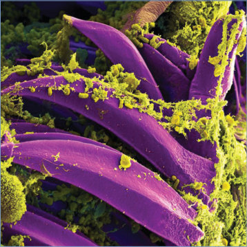
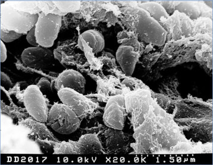
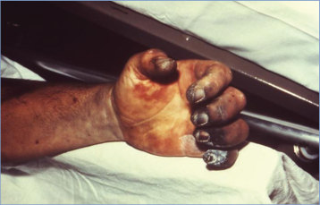
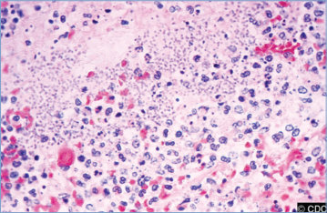
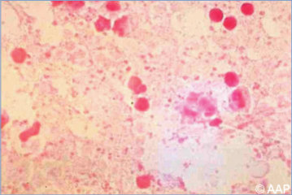
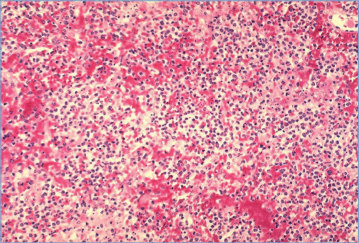

# 112. Plague
> Reference: [source credits](../../SOURCE_CREDITS.md). Printed pp. 686-694; PDF pp. 700-708.
> Editorial study pathway: Bacterial infections (not a part division in the source).
[Flashcards](../flashcards/112_flashcards.md) · [Quiz](../mcqs/112_mcqs.md) · [Full extraction](../../raw/chapters/112.md)

## Five study pillars

### Etiology and transmission
Plague is caused by Yersinia pestis, a pleomorphic, bipolar-staining (with Giemsa, Wright, and Wayson stains), facultative intracellular gram-negative coccobacillus. Y pestis is a member of the Enterobacterales order, along with more common Yersinia species and other enteric bacteria.
*Printed p. 686 / PDF p. 700*

### Clinical recognition
Naturally acquired plague most commonly presents in the primary bubonic form, with fever and a painful swollen regional lymph node (bubo). Buboes develop most commonly in the inguinal region but also occur in axillary or cervical areas.
*Printed p. 686 / PDF p. 700*

### Diagnostic workup
Diagnosis of plague usually is confirmed by culture of Y pestis from blood, bubo aspirate, sputum, or another clinical specimen. The organism is slow growing but not fastidious and can be isolated on sheep blood agar with typical “fried egg” colonies appearing after 48 to 72 hours of incubation.
*Printed p. 686 / PDF p. 700*

### Treatment in the atlas
After obtaining diagnostic specimens, appropriate antibiotic therapy should be started immediately for any patient suspected of having plague.
*Printed p. 687 / PDF p. 701*

### Prevention and infection control
For patients with bubonic or septicemic plague, standard precautions are recommended. If aspiration of a bubo or another procedure that may generate sprays or splashes is performed, contact and droplet precautions should be used; health care personnel should wear appropriate personal protective equipment including a mask, eye protection (such as googles or face shield), gown, and gloves.
*Printed p. 687 / PDF p. 701*

## Clinical search tags
Fever, Petechiae / purpura, Lymphadenopathy, Pharyngitis, Cough, Sepsis / shock, Tick / arthropod exposure, Animal exposure, Travel / endemic setting

## Full text, original tables, and images

# 112. Plague
> Private study reference ([source credits](../../SOURCE_CREDITS.md)). PDF pages 700-708; printed pages 686-694.

## PDF page 700 | printed page 686

### CLINICAL MANIFESTATIONS

Naturally acquired plague most commonly presents in the primary bubonic form, with fever and a painful swollen regional lymph node (bubo). Buboes develop most commonly in the inguinal region but also occur in axillary or cervical areas. Less commonly, plague manifests in the primary septicemic form without localizing signs (fever, hypotension, purpuric skin lesions, intravascular coagulopathy, organ failure) or as primary pneumonic plague (cough, fever, dyspnea, and hemoptysis) and rarely as meningitic, pharyngeal, cutaneous, ocular, or gastrointestinal plague. Occasionally, patients present with mild lymphadenitis or prominent gastrointestinal tract symptoms, which may obscure the correct diagnosis. Secondary pneumonic or other forms of plague can occur via hematogenous dissemination of bacteria. Untreated, plague often progresses to overwhelming sepsis and death. Plague was known as the Black Death in 14th century Europe because of the tissue necrosis that it induces.

### ETIOLOGY

Plague is caused by Yersinia pestis, a pleomorphic, bipolar-staining (with Giemsa, Wright, and Wayson stains), facultative intracellular gram-negative coccobacillus. Y pestis is a member of the Enterobacterales order, along with more common Yersinia species and other enteric bacteria.

### EPIDEMIOLOGY

Plague is a zoonotic infection primarily maintained in rodents and their fleas. Humans are incidental hosts who develop bubonic or primary septicemic manifestations, typically through the bite of infected rodent fleas or through direct contact with tissues of infected animals. Primary pneumonic plague is acquired by inhalation of respiratory tract droplets from a human or animal with pneumonic plague. Only the pneumonic form has been shown to be transmitted from person to person. Plague enzootic foci are found in parts of Asia, Africa, and the Americas. Most human plague cases are reported from rural, underdeveloped areas and mainly occur as isolated cases or in small, focal clusters. In the United States,

plague is endemic in western states, with most cases reported from New Mexico, Colorado, Arizona, and California.1 Cases of plague in states without endemic plague have been identified in travelers returning from these states.

Y pestis has also been identified as a potential bioterrorism agent, particularly through widespread dispersal of an aerosolized form. Such an event would have potential for a large number of pneumonic plague cases. Contamination of food and water with Y pestis would be expected to result in cases of pharyngeal or gastrointestinal plague, and release of infected fleas would be expected to produce a range of illness similar to naturally occurring plague, but with a higher number of cases.

The incubation period is 2 to 8 days for bubonic plague and 1 to 6 days for primary pneumonic plague.

### DIAGNOSTIC TESTS

Diagnosis of plague usually is confirmed by culture of Y pestis from blood, bubo aspirate, sputum, or another clinical specimen. The organism is slow growing but not fastidious and can be isolated on sheep blood agar with typical “fried egg” colonies appearing after 48 to 72 hours of incubation. Y pestis has a bipolar (safety pin) appearance when stained with Wright-Giemsa or Wayson stains. Neither automated, commercially available biochemical identification systems nor matrixassisted laser desorption/ionization–time-of-flight mass spectrometry are reliable for identification of Y pestis, as they may misidentify the organism. Identification of suspected isolates of Y pestis should be based on guidelines recommended for “sentinel level” clinical microbiology laboratories using preliminary characterization tests, followed by definitive identification performed at the state or federal public health laboratory. Nucleic acid amplification tests (NAATs) and immunohistochemical (IHC) staining for rapid diagnosis of Y pestis are available in some reference and public health laboratories.

Presumptive laboratory evidence of plague includes detection of Y pestis by NAAT or IHC staining from a clinical specimen or a positive serum antibody titer from a single specimen. Confirmatory laboratory evidence of plague includes isolation of the organism in culture with

## PDF page 701 | printed page 687

positive identification by Y pestis bacteriophage lysis or seroconversion, defined as a fourfold or greater increase in serum antibody to the F1 antigen between paired specimens obtained 4 to 6 weeks apart.

Laboratory-acquired cases, including fatal cases, have been reported. Biosafety level 3 practices, containment equipment, and facilities are recommended for all manipulation of suspect cultures. Isolates suspected as Y pestis should be reported immediately to the state health department.

### TREATMENT

After obtaining diagnostic specimens, appropriate antibiotic therapy should be started immediately for any patient suspected of having plague. Pediatric treatment recommendations2 are as follows (see also Table 112.1):

• Monotherapy with gentamicin, streptomycin, ciprofloxacin, or levofloxacin is recommended for naturally acquired primary bubonic or pharyngeal plague without signs of sepsis or secondary pneumonic plague and for early/mild primary pneumonic or septicemic plague.

• Doxycycline is a first-line option for treatment of naturally acquired bubonic or pharyngeal plague but is an alternative antibiotic for naturally acquired pneumonic plague.

• Dual therapy with 2 distinct antibiotic classes is recommended for initial treatment of patients with naturally acquired severe septicemic or pneumonic plague, or for infection following intentional release of Y pestis (eg, acts of bioterrorism). Dual therapy can be considered for patients with naturally acquired primary bubonic disease with large buboes. The recommended drugs are those listed in the first bullet.

• Alternative antibiotics for pneumonic, septicemic, bubonic, or pharyngeal plague are listed in the Centers for Disease Control and Prevention (CDC) plague guidance.

• Dual therapy with 2 distinct antibiotic classes is recommended for initial treatment of patients who present with signs of meningitis or who are later found to have meningitis. The recommended antibiotics are chloramphenicol in combination with moxifloxacin or levofloxacin. If chloramphenicol is unavailable, a first-line or

alternative nonfluoroquinolone antibiotic for the treatment of primary pneumonic or septicemic plague should be substituted as part of a dual class regimen that includes moxifloxacin or levofloxacin.

• Because of the potential for engineered antimicrobial resistance, if bioterrorism is suspected, dual therapy with 2 distinct classes of antibiotics should be used for all patients until susceptibility patterns are known.

A neonate born to a person infected with plague at or around the time of delivery should be treated if the infant is symptomatic, using the antibiotic regimens described (levofloxacin may be considered rather than chloramphenicol in the case of meningitis because of the toxicity of chloramphenicol in neonates; consultation with an expert in pediatric infectious diseases is recommended). An asymptomatic neonate born to a person infected with Y pestis within 7 days of delivery should receive antimicrobial prophylaxis (see Care of Exposed People) if the birthing person is untreated or has only recently begun treatment (<48 hours before delivery). If the neonate is asymptomatic and the birthing person has been sufficiently treated and is improving, observation of the infant is acceptable.

The duration of antibiotic treatment for all forms of plague, including meningitis, is 10 to 14 days; treatment duration can be extended for patients with ongoing fever or other concerning signs or symptoms. Drainage of abscessed buboes may be necessary; drainage material is considered infectious.

### INFECTION PREVENTION AND CONTROL MEASURES IN HEALTH CARE SETTINGS

For patients with bubonic or septicemic plague, standard precautions are recommended. If aspiration of a bubo or another procedure that may generate sprays or splashes is performed, contact and droplet precautions should be used; health care personnel should wear appropriate personal protective equipment including a mask, eye protection (such as googles or face shield), gown, and gloves. For patients with suspected pneumonic plague, respiratory droplet precautions in addition to standard precautions should be initiated immediately and continued for 48 hours after initiation

## PDF page 702 | printed page 688

Table 112.1 Antimicrobial Dosing for Treatment of Plague in Children and Neonatesa

Drug Dosage per kg per Day Ciprofloxacinb 20–30 mg/kg, divided in 2 or 3 doses IV (maximum 400 mg/dose IV) 30–45 mg/kg, divided in 2 or 3 doses PO (maximum 500 mg/dose TID or 750 mg/dose BID) Neonates 20–30 mg/kg, divided in 2 or 3 doses IV Levofloxacinb <50 kg: 16 mg/kg, divided in 2 doses IV/PO (maximum 250 mg/dose) ≥50 kg: 500–750 mg once daily IV/PO Neonates 20 mg/kg, divided in 2 doses IV Gentamicinc 4.5-7.5 mg/kg once daily IV/IM Neonates ≤7 days: 4 mg/kg once daily IV/IM 8–28 days: 5 mg/kg once daily IV/IM Streptomycind 30 mg/kg, divided in 2 doses IV/IM (maximum dose 1 g/dose) Neonates 30 mg/kg, divided in 2 doses IV/IM Doxycyclineb <45 kg: 4.4 mg/kg load, then 4.4 mg/kg, divided in 2 doses IV/PO ≥45 kg: 200 mg load, then 200 mg divided in 2 doses IV/PO Neonates 4.4 mg/kg load, then 4.4 mg/kg, divided in 2 doses IV Chloramphenicolc,e 50–100 mg/kg, divided in 4 doses IV (maximum 1 g/dose) Meningitis ≥29 days to ≥17 years: 100 mg/kg, divided in 4 doses IV (maximum 1 g/dose) Neonates: Meningitis 8–28 days: 50 mg/kg, divided in 2 doses IV ≤7 days: 25 mg/kg once daily IV All other forms ≤14 days: 25 mg/kg, divided in 4 doses IV/IM 15–28 days: 50 mg/kg, divided into 4 doses IV/IM Moxifloxacinb ≥3 months to ≤23 months: 12 mg/kg, divided in 2 doses IV/PO 2 to 5 years: 10 mg/kg, divided in 2 doses IV/PO 6 to 11 years: 8 mg/kg, divided in 2 doses IV/PO 12 to ≤17 years, <45 kg: 8 mg/kg, divided in 2 doses IV/PO (maximum 200 mg/dose) 12 to ≤17 years, ≥45 kg: 400 mg once daily IV/PO

BID indicates twice per day; IM, intramuscular; IV, intravenous; PO, oral; TID, three times per day. All dosages are applicable for all forms of disease, except for chloramphenicol, which is dosed as above.

a Adapted from Nelson CA, Meaney-Delman D, Fleck-Derderian S, Cooley KM, Yu PA, Mead PS. Antimicrobial treatment and prophylaxis of plague: recommendations for naturally acquired infections and bioterrorism response. MMWR Morb Mortal Wkly Rep. 2021;70(3):1–27. b Data on use in neonates are extremely limited. c Not currently approved by the U.S. Food and Drug Administration (FDA) for the treatment of plague. d The intramuscular formulation of streptomycin has been given intravenously in an off-label use (the intravenous formulation is not approved by FDA). e Chloramphenicol is generally contraindicated for infants aged <6 months because of the risk for serious blood dyscrasias or circulatory collapse (gray baby syndrome); because of the severity of meningitis, it is still a treatment option. Levofloxacin can be used for treatment of plague meningitis in neonates and older children and moxifloxacin for plague meningitis for infants ≥3 months of age. After clinical improvement, chloramphenicol can be reduced to a lower dose of 12.5 mg/kg every 6 hours in adults and administered orally. Serum concentration monitoring should be performed when available, especially in children. Chloramphenicol is not considered a first-line drug for nonmeningitis forms of plague; rather, it is considered an alternative drug.

of effective antibiotic treatment and until clinical improvement with decreased sputum production is documented.

### CONTROL MEASURES

Care of Exposed People

All people with exposure to a known or suspected source of plague, such as Y pestis-infected fleas or infectious tissues, in the previous 6 days, should be offered antibiotic prophylaxis or be cautioned to report fever greater than 38.3°C (101.0°F) or

other illness to their physician. Postexposure prophylaxis is recommended for people with close and sustained exposure (less than 2 meters) to a patient with pneumonic plague, who were not wearing adequate personal protective equipment (per standard and droplet precautions). Pneumonic transmission typically occurs in the later stages of disease in patients with hemoptysis, thereby placing caregivers and health care professionals at higher risk. Isolation of exposed, asymptomatic people is not recommended. For children, including those younger than 8 years,

### Geometry-detected table

|Drug|Dosage per kg per Day|
|---|---|
|Ciprofoxacinb|20–30 mg/kg, divided in 2 or 3 doses IV (maximum 400 mg/dose IV) 30–45 mg/kg, divided in 2 or 3 doses PO (maximum 500 mg/dose TID or 750 mg/dose BID) Neonates 20–30 mg/kg, divided in 2 or 3 doses IV|
|Levofoxacinb|<50 kg: 16 mg/kg, divided in 2 doses IV/PO (maximum 250 mg/dose) ≥50 kg: 500–750 mg once daily IV/PO Neonates 20 mg/kg, divided in 2 doses IV|
|Gentamicinc|4.5-7.5 mg/kg once daily IV/IM Neonates≤7 days: 4 mg/kg once daily IV/IM 8–28 days: 5 mg/kg once daily IV/IM|
|Streptomycind|30 mg/kg, divided in 2 doses IV/IM (maximum dose 1 g/dose) Neonates 30 mg/kg, divided in 2 doses IV/IM|
|Doxycyclineb|<45 kg: 4.4 mg/kg load, then 4.4 mg/kg, divided in 2 doses IV/PO ≥45 kg: 200 mg load, then 200 mg divided in 2 doses IV/PO Neonates 4.4 mg/kg load, then 4.4 mg/kg, divided in 2 doses IV|
|Chloramphenicolc,e|50–100 mg/kg, divided in 4 doses IV (maximum 1 g/dose) Meningitis≥29 days to≥17 years: 100 mg/kg, divided in 4 doses IV (maximum 1 g/dose) Neonates: Meningitis 8–28 days: 50 mg/kg, divided in 2 doses IV ≤7 days: 25 mg/kg once daily IV All other forms≤14 days: 25 mg/kg, divided in 4 doses IV/IM 15–28 days: 50 mg/kg, divided into 4 doses IV/IM|
|Moxifoxacinb|≥3 months to≤23 months: 12 mg/kg, divided in 2 doses IV/PO 2 to 5 years: 10 mg/kg, divided in 2 doses IV/PO 6 to 11 years: 8 mg/kg, divided in 2 doses IV/PO 12 to≤17 years,<45 kg: 8 mg/kg, divided in 2 doses IV/PO (maximum 200 mg/dose) 12 to≤17years,≥45 kg: 400 mg once daily IV/PO|

[View original table](../../tables/ch112_p0702_1.jpg)

## PDF page 703 | printed page 689

doxycycline, levofloxacin, or ciprofloxacin is recommended. The benefits of prophylactic therapy should be weighed against the risks. Prophylaxis is administered for 7 days (see Table 112.2). In the case of an intentional release of Y pestis, postexposure prophylaxis should be started rapidly for exposed persons; specific recommendations regarding appropriate antibiotics will be issued by the public health authority. Recommendations will be guided by what is known about the strain. For further discussion, including alternative agents, see www.cdc.gov/mmwr/volumes/70/rr/ rr7003a1.htm.

Breastfeeding

There are no reports of suspected Y pestis transmission from human milk, and the risk is believed to be low. Breastfeeding parents with bubonic or septicemic plague and those taking antibiotic prophylaxis after exposure to Y pestis can continue to breastfeed their infants. A breastfeeding parent with pneumonic plague may continue to breastfeed if receiving antibiotic treatment and the infant is receiving antibiotic treatment or postexposure prophylaxis for Y pestis. Because of the risk of person-to-person transmission of pneumonic plague, a parent with primary or secondary pneumonic plague whose infant is not receiving antibiotic treatment or prophylaxis should avoid direct breastfeeding until the parent has received antibiotic treatment for ≥48 hours and demonstrated clinical improvement. The parent’s expressed milk may be fed to the infant. The CDC has guidance about breastfeeding and drugs or metabolites

Table 112.2 Antimicrobial Dosing for Postexposure Prophylaxis for Plague in Neonates and Childrena

Drug Dosage per kg per Day Ciprofloxacinb 30 mg/kg, divided in 2 doses PO (maximum 750 mg/dose) Neonates 30 mg/kg, divided in 2 doses PO Levofloxacinb <50 kg: 16 mg/kg, divided in 2 doses PO (maximum 250 mg/dose) ≥50 kg: 500–750 mg once daily PO Neonates 20 mg/kg, divided in 2 doses PO Doxycyclineb <45 kg: 4.4 mg/kg, divided in 2 doses PO ≥45 kg: 200 mg divided in 2 doses PO Neonates 4.4 mg/kg, divided in 2 doses PO

PO indicates oral.

a Adapted from Nelson CA, Meaney-Delman D, Fleck-Derderian S, Cooley KM, Yu PA, Mead PS. Antimicrobial treatment and prophylaxis of plague: recommendations for naturally acquired infections and bioterrorism response. MMWR Morb Mortal Wkly Rep. 2021;70(3):1–27. b Data on use in neonates are extremely limited.

present in human milk, potential consequences to infants, and specific recommendations regarding antibiotics.3

Other Measures

People living in areas with endemic plague should be informed about the importance of eliminating sources of rodent food and harborage near residences, the role of dogs and cats in bringing plague-infected rodent fleas into peridomestic environments, the need for flea control and confinement of pets, and the importance of avoiding contact with sick and dead animals. Other preventive measures include surveillance of rodent populations and use of rodent control measures and insecticides by health authorities when surveillance indicates the occurrence of plague epizootics. For additional information on laboratory safety, see the CDC Biosafety in Microbiological and Biomedical Laboratories manual (www.cdc. gov/labs/pdf/SF__19_308133-A_BMBL6_00- BOOK-WEB-final-3.pdf).

Vaccine

There is no vaccine currently licensed for use in the United States. New vaccines based on recombinant capsular subunit protein F1 and the lowcalcium response V antigen are under evaluation.

Public Health Reporting

Infection with Y pestis is nationally reportable. In the United States, Y pestis is classified as a select agent, and the possession and transport of the organism requires adherence to strict federal

### Geometry-detected table

|Drug|Dosage per kg per Day|
|---|---|
|Ciprofoxacinb|30 mg/kg, divided in 2 doses PO (maximum 750 mg/dose) Neonates 30 mg/kg, divided in 2 doses PO|
|Levofoxacinb|<50 kg: 16 mg/kg, divided in 2 doses PO (maximum 250 mg/dose) ≥50 kg: 500–750 mg once daily PO Neonates 20 mg/kg, divided in 2 doses PO|
|Doxycyclineb|<45 kg: 4.4 mg/kg, divided in 2 doses PO ≥45 kg: 200 mg divided in 2 doses PO Neonates 4.4 mg/kg, divided in 2 doses PO|

[View original table](../../tables/ch112_p0703_1.jpg)

## PDF page 704 | printed page 690

guidelines. State public health authorities should be notified immediately of any suspected cases of human plague.

1 Kwit N, Nelson C, Kugeler K, et al. Human plague—United States, 2015. MMWR Morb Mortal Wkly Rep. 2015;64(33): 918–919 2 Nelson CA, Meaney-Delman D, Fleck-Derderian S, Cooley KM, Yu PA, Mead PS. Antimicrobial treatment and prophylaxis of

Image 112.1 Scanning electron micrograph of Yersinia pestis, which causes bubonic plague, on proventricular spines of a Xenopsylla cheopis flea. Courtesy of National Institute of Allergy and Infectious Diseases.

Image 112.3 Inguinal plague buboes in an 8-year-old boy. If left untreated, bubonic plague often becomes septicemic, with meningitis occurring in 6% of cases.

plague: recommendations for naturally acquired infections and bioterrorism response. MMWR Morb Mortal Wkly Rep. 2021;70(3):1–27 3 Nelson CA, Meaney-Delman D, Fleck-Derderian S, Cooley KM, Yu PA, Mead PS. Antimicrobial treatment and prophylaxis of plague: recommendations for naturally acquired infections and bioterrorism response. MMWR Morb Mortal Wkly Rep. 2021;70(3):1–27

Image 112.2 Scanning electron micrograph depicting a mass of Yersinia pestis bacteria (the cause of bubonic plague) in the foregut of the flea vector. Courtesy of National Institute of Allergy and Infectious Diseases.

## PDF page 705 | printed page 691

Image 112.4 Dark-stained bipolar ends of Yersinia pestis can clearly be observed in this Wright stain of blood from an individual with plague. The actual cause of the disease is the plague bacillus, Y pestis. It is a nonmotile, nonspore-forming, gram-negative, nonlactose-fermenting, bipolar, ovoid, safety pin–shaped bacterium. Courtesy of Centers for Disease Control and Prevention.

Image 112.6 This patient acquired a plague infection through abrasions on his upper right leg. Bubonic plague is transmitted through the bite of an infected flea or, as in this case, exposure to inoculated material through a break in the skin. Symptoms include swollen, tender lymph glands known as buboes. Courtesy of Centers for Disease Control and Prevention.

Image 112.5 Close-up view of inguinal buboes of the patient in Image 112.3. Surgical excision of infected lymph nodes without appropriate antimicrobial treatment may result in septicemic plague. When left untreated, plague often progresses to overwhelming sepsis and death.

Image 112.7 This patient presented with symptoms of plague that included gangrene of the right hand, causing necrosis of the fingers. Courtesy of Centers for Disease Control and Prevention.

Image 112.8 This anteroposterior radiograph demonstrates bilaterally progressive plague infection involving both lung fields. The first signs of plague are fever, headache, weakness, and rapidly developing pneumonia with shortness of breath, chest pain, cough, and, sometimes, bloody or watery sputum, eventually progressing for 2 to 4 days into respiratory failure and shock. Courtesy of Centers for Disease Control and Prevention.

## PDF page 706 | printed page 692

Image 112.9 Photomicrograph of lung tissue (Giemsa stain) from a patient with fatal human plague, revealing pneumonia and an abundance of Yersinia pestis organisms. Courtesy of Centers for Disease Control and Prevention.

Image 112.11 This photomicrograph depicts the histopathologic changes in splenic tissue in a case of fatal human plague (hematoxylin-eosin stain, magnification 3400). Note the presence of general arteriolar inflammation, or arteriolitis, and an accompanying surrounding hemorrhage indicative of an acute infection associated with fatal human plague. Courtesy of Centers for Disease Control and Prevention.

Image 112.13 Yersinia pestis is a small (0.5 3 1.0-mm) gram-negative bacillus (magnification 31,000). Bipolar staining occurs when using Wayson, Wright, Giemsa, or methylene blue stain and may occasionally be observed in Gram-stained preparations. Courtesy of Centers for Disease Control and Prevention.

Image 112.10 Histopathologic features of lung in fatal human plague. Area of marked fibrinopurulent pneumonia. Courtesy of Centers for Disease Control and Prevention.

Image 112.12 Bubo aspirate (Gram stain) showing many gram-negative bacilli, Yersinia pestis.

## PDF page 707 | printed page 693

Image 112.14 Yersinia pestis on sheep blood agar, 72 hours. Y pestis grows well on most standard laboratory media, after 48 to 72 hours, with gray-white to slightly yellow, opaque, raised, irregular, “fried egg” morphological features; alternatively, colonies may have a “hammered copper” shiny surface. Courtesy of Centers for Disease Control and Prevention.

Image 112.16 This photograph depicts an adult male Diamanus montana flea, formerly known as Oropsylla montana. This flea is a common ectoparasite of the rock squirrel, Citellus variegatus, and in the western United States, it is an important vector for the bacterium Yersinia pestis, the pathogen responsible for causing plague. Courtesy of Centers for Disease Control and Prevention.

Image 112.15 This photograph depicts the colonial morphological features displayed by gram-negative Yersinia pestis bacteria, which were grown on a medium of sheep blood agar for a 48-hour period at a temperature of 37°C (98.6°F). There is a tenacious nature of these colonies when touched by an inoculation loop, and they tend to form stringy, sticky strands. Morphological characteristics after 48 hours of Y pestis colonial growth include an average colonial diameter of 1.0 to 2.0 mm and an opaque coloration that ranges from gray-white to yellowish. If permitted to continue growing, Y pestis colonies take on what is referred to as a “fried egg” appearance, which becomes more prominent as the colonies age. Older colonies also display what is termed a “hammered copper” texture to their surfaces. Courtesy of Centers for Disease Control and Prevention.

![Image 112.15 This photograph depicts the colonial morphological features displayed by gram-negative Yersinia pestis bacteria, which were grown on a medium of sheep blood agar for a 48-hour period at a temperature of 37°C (98.6°F). There is a tenacious nature of these colonies when touched by an inoculation loop, and they tend to form stringy, sticky strands. Morphological characteristics after 48 hours of Y pestis colonial growth include an average colonial diameter of 1.0 to 2.0 mm and an opaque coloration that ranges from gray-white to yellowish. If permitted to continue growing, Y pestis colonies take on what is referred to as a “fried egg” appearance, which becomes more prominent as the colonies age. Older colonies also display what is termed a “hammered copper” texture to their surfaces. Courtesy of Centers for Disease Control and Prevention.](../../figures/ch112_p0707_02.jpg)

## PDF page 708 | printed page 694

Image 112.17 This photograph shows a ground squirrel that died because of plague, Yersinia pestis. Field rodents, such as western ground squirrels and prairie dogs, may be a threat when their burrows are beside labor camps and residential areas because they and their fleas are carriers of the plague bacteria. Courtesy of Centers for Disease Control and Prevention.

Image 112.18 The bobcat, Felis rufus, can be a source of plague infection for humans. People involved in trapping and skinning wild carnivores, especially bobcats, should be extremely cautious about exposure to Yersinia pestis vectors. Courtesy of Centers for Disease Control and Prevention.

Image 112.19 The bushy-tailed wood rat, Neotoma cinerea, is known to carry fleas inoculated with the plague bacteria Yersinia pestis. All wood rat species are quick to occupy and construct nests in human habitations or outbuildings within their range, thereby bringing vector fleas into close contact with humans and their pets. Courtesy of Centers for Disease Control and Prevention.

