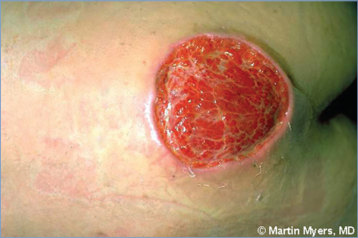
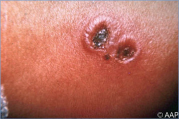
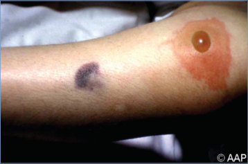
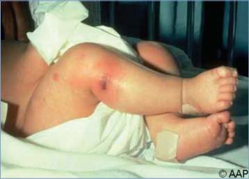
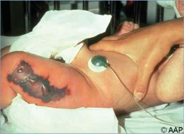

# 117. Pseudomonas aeruginosa Infections
> Reference: [source credits](../../SOURCE_CREDITS.md). Printed pp. 720-722; PDF pp. 734-736.
> Editorial study pathway: Bacterial infections (not a part division in the source).
[Flashcards](../flashcards/117_flashcards.md) · [Quiz](../mcqs/117_mcqs.md) · [Full extraction](../../raw/chapters/117.md)

## Five study pillars

### Etiology and transmission
P aeruginosa is an aerobic, gram-negative, nonfermenting bacillus that is commonly found in the environment. It is a member of the Pseudomonas genus and the Pseudomonadaceae family.
*Printed p. 720 / PDF p. 734*

### Clinical recognition
Pseudomonas aeruginosa causes a variety of localized and systemic infections including otitis externa, mastoiditis, folliculitis, cellulitis, ecthyma gangrenosum, wound infection, ocular infection, pneumonia, osteomyelitis, bacteremia, endocarditis, meningitis, peritonitis, and urinary tract infection. It is a common cause of health care-associated infections (particularly in the presence of invasive devices), infections in immunocompromised children, pulmonary infections in children with cystic fibrosis, and infections in children with burns.
*Printed p. 720 / PDF p. 734*

### Diagnostic workup
Diagnosis is established by growth of P aeruginosa from culture of clinical specimens. Isolates may be identified by traditional biochemical tests, by a variety of commercially available biochemical test systems, by matrix-assisted laser desorption/ ionization–time-of-flight mass spectrometry of bacterial cell components, or by molecular methods.
*Printed p. 720 / PDF p. 734*

### Treatment in the atlas
• Empiric combination therapy from different antimicrobial classes (eg, adding a fluoroquinolone or an aminoglycoside to an antipseudomonal b-lactam) may be indicated in severe sepsis, in patients with neutropenia, in patients who recently received broad-spectrum b-lactams, or in settings where antibiotic resistance is high to increase the probability of covering the infecting organism prior to knowing its identification and susceptibility.
*Printed p. 720 / PDF p. 734*

### Prevention and infection control
Standard precautions for routine patients are recommended. For carbapenemase-producing organisms, contact precautions are indicated.1 The Cystic Fibrosis Foundation recommends implementation of contact precautions in addition to standard precautions for care of all patients with cystic fibrosis in inpatient or ambulatory care settings, regardless of respiratory tract cultures.
*Printed p. 721 / PDF p. 735*

## Clinical search tags
Conjunctivitis, Pneumonia, Meningitis, Arthritis / bone pain, Abscess / soft tissue, Sepsis / shock, Immunocompromised host, Water exposure

## Full text, original tables, and images

# 117. Pseudomonas aeruginosa Infections
> Private study reference ([source credits](../../SOURCE_CREDITS.md)). PDF pages 734-736; printed pages 720-722.

## PDF page 734 | printed page 720

### CLINICAL MANIFESTATIONS

Pseudomonas aeruginosa causes a variety of localized and systemic infections including otitis externa, mastoiditis, folliculitis, cellulitis, ecthyma gangrenosum, wound infection, ocular infection, pneumonia, osteomyelitis, bacteremia, endocarditis, meningitis, peritonitis, and urinary tract infection. It is a common cause of health care-associated infections (particularly in the presence of invasive devices), infections in immunocompromised children, pulmonary infections in children with cystic fibrosis, and infections in children with burns. Pseudomonas ophthalmia occurs predominantly in preterm infants and presents with eyelid edema and erythema, purulent discharge, and pannus formation. It can progress to corneal perforation, endophthalmitis, sepsis, and meningitis.

### ETIOLOGY

P aeruginosa is an aerobic, gram-negative, nonfermenting bacillus that is commonly found in the environment. It is a member of the Pseudomonas genus and the Pseudomonadaceae family. The organism has multiple virulence factors, including the ability to form biofilms. P aeruginosa can convert to a mucoid phenotype, particularly in the setting of prolonged colonization, such as in individuals with cystic fibrosis.

### EPIDEMIOLOGY

P aeruginosa is an opportunistic pathogen, causing infections in immunocompromised hosts (particularly those with neutropenia or poor granulocyte function) and those with indwelling devices, burns, or cystic fibrosis. Children with cystic fibrosis commonly develop chronic endobronchial colonization with P aeruginosa, which is often associated with a more rapid decline in pulmonary function. Children with cystic fibrosis can share epidemic strains of P aeruginosa. Hospital-acquired P aeruginosa infections include ventilator-associated pneumonia, catheter-associated urinary tract infections, surgical site infections, and peritonitis associated with peritoneal dialysis. Community-associated infections include “hot tub” folliculitis, otitis externa after swimming in

fresh water, osteomyelitis after a puncture wound (particularly through a sneaker), and endocarditis in people who inject drugs. It is a common cause of “contact lens” keratitis. Auricular chondritis has occurred after upper ear piercing. Outbreaks of infection have occurred from contaminated bronchoscopes.

P aeruginosa has intrinsic resistance to a variety of antibiotics, and circulating strains are often multidrug resistant. Resistance may emerge during therapy. Production of b-lactamases, loss of outer membrane proteins, and multidrug efflux pumps are common. Carbapenemase-producing strains (most commonly IMP and VIM) also occur.

The incubation period is variable depending on the host and site of colonization/infection. The incubation period for folliculitis following immersion in a whirlpool is a few hours to several days after exposure.

### DIAGNOSTIC TESTS

Diagnosis is established by growth of P aeruginosa from culture of clinical specimens. Isolates may be identified by traditional biochemical tests, by a variety of commercially available biochemical test systems, by matrix-assisted laser desorption/ ionization–time-of-flight mass spectrometry of bacterial cell components, or by molecular methods.

### TREATMENT

• Empiric combination therapy from different antimicrobial classes (eg, adding a fluoroquinolone or an aminoglycoside to an antipseudomonal b-lactam) may be indicated in severe sepsis, in patients with neutropenia, in patients who recently received broad-spectrum b-lactams, or in settings where antibiotic resistance is high to increase the probability of covering the infecting organism prior to knowing its identification and susceptibility.

• Cultures and susceptibilities should be sent prior to initiation of empiric therapy and therapy adjusted as per susceptibility data. In most patients, therapy can be simplified to a single active agent; there are no data to support continuation of combination therapy for an isolate susceptible to an appropriate antipseudomonal drug (see below). When the clinical course is complicated or when there is multidrug

## PDF page 735 | printed page 721

resistance to commonly used antipseudomonal agents (eg, antipseudomonal b-lactam agents), it is recommended that an expert in infectious diseases assist in the management, particularly in the setting of carbapenem resistance.

• An important component of treatment is timely source control (ie, removal of catheters and devices, drainage of abscesses).

• Antimicrobial agents that have activity against P aeruginosa include piperacillin-tazobactam, ceftazidime, cefepime, aztreonam, ciprofloxacin, levofloxacin, meropenem, and imipenem/ cilastatin; however, susceptibility patterns vary regionally, and local epidemiology and individual patient antibiotic exposure history should inform empiric therapy. Aminoglycosides are often used as adjunctive therapy (but not as monotherapy beyond urinary tract infections). Polymyxins (ie, colistin and polymyxin B) can be considered in the setting of highly resistant organisms but should not be used as first-line treatments if newer agents (eg, imipenem/ cilastatin-relebactam, ceftazidime-avibactam, ceftolozane-tazobactam, or cefiderocol [experience for this agent is limited in children]) are available because of the general lower effectiveness and higher adverse event rates of polymyxins compared with these newer agents.

• Management of children with cystic fibrosis should occur in conjunction with an expert in cystic fibrosis. Treatment for pulmonary exacerbation often includes 2 antipseudomonal agents in patients known to be chronically colonized with P aeruginosa. The Cystic Fibrosis Foundation recommends early eradication of P aeruginosa with inhaled tobramycin (300 mg twice daily for 28 days). Once P aeruginosa becomes established, it can persist for years. Chronic suppressive treatment with inhaled antibiotics can decrease the bacterial burden. Inhaled antibiotics are generally not indicated for pulmonary exacerbations.

• Management of Pseudomonas neonatal ophthalmia urgently requires a combination of

systemic and topical therapy, because systemic antibiotics alone have poor penetration in the anterior chamber of the eye. The diagnosis should be suspected when Gram-stained specimens of exudate contain gram-negative bacilli and should be confirmed by culture. Ophthalmology consultation is recommended.

• Duration of therapy is based on clinical and bacteriologic response of the patient and the site(s) of infection. Most bloodstream infections, ventilator-associated pneumonias, and urinary tract infections in immunocompetent people beyond the neonatal period can be treated with 7 days of antibiotic therapy if source control is achieved. In immunocompromised hosts (eg, those with neutropenia) and neonates, the duration of antibiotic therapy is usually 10 to 14 days.

### INFECTION PREVENTION AND CONTROL MEASURES IN HEALTH CARE SETTINGS

Standard precautions for routine patients are recommended. For carbapenemase-producing organisms, contact precautions are indicated.1 The Cystic Fibrosis Foundation recommends implementation of contact precautions in addition to standard precautions for care of all patients with cystic fibrosis in inpatient or ambulatory care settings, regardless of respiratory tract cultures.

### CONTROL MEASURES

The Cystic Fibrosis Foundation recommends that all cystic fibrosis care centers limit contact between patients. This includes inpatient, outpatient, and social settings. When in a health care setting, patients with cystic fibrosis should wear a mask while outside of a clinic examination room or a hospital room. Education of patients and families about hand hygiene and appropriate personal hygiene is recommended.

1 Centers for Disease Control and Prevention. Facility Guidance for Control of Carbapenem Resistant Enterobacteriaceae (CRE) November 2015 Update. Available at: www.cdc.gov/hai/ pdfs/cre/CRE-guidance-508.pdf

## PDF page 736 | printed page 722

Image 117.1 Rapidly progressive necrotizing Pseudomonas lesion (ecthyma gangrenosum). Copyright Martin G. Myers, MD.

Image 117.3 Skin lesions caused by Pseudomonas aeruginosa in a child with neutropenia and septicemia.

Image 117.5 Sepsis caused by Pseudomonas aeruginosa with rapidly progressing ecthyma gangrenosum.

Image 117.2 Bullous, necrotic, umbilicated lesions in an infant with septicemia caused by Pseudomonas aeruginosa.

Image 117.4 Sepsis caused by Pseudomonas aeruginosa with early ecthyma gangrenosum.

