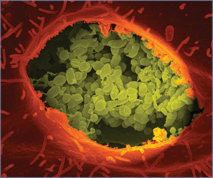
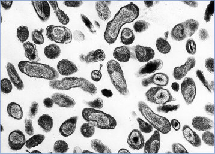

# 118. Q Fever (Coxiella burnetii Infection)
> Reference: [source credits](../../SOURCE_CREDITS.md). Printed pp. 723-726; PDF pp. 737-740.
> Editorial study pathway: Bacterial infections (not a part division in the source).
[Flashcards](../flashcards/118_flashcards.md) · [Quiz](../mcqs/118_mcqs.md) · [Full extraction](../../raw/chapters/118.md)

## Five study pillars

### Etiology and transmission
Coxiella burnetii, the cause of Q fever, previously was considered to be a rickettsial organism but is a gram-negative intracellular bacterium that belongs to the order Legionellales, family Coxiellaceae. It shares many features, including relatedness of several virulence genes, with Legionella pneumophila.
*Printed p. 723 / PDF p. 737*

### Clinical recognition
Approximately half of acute Q fever infections result in symptoms. Acute and chronic forms of the disease exist, and both can present as fever of unknown origin.
*Printed p. 723 / PDF p. 737*

### Diagnostic workup
Serologic evidence of a fourfold increase in phase II immunoglobulin (Ig) G via immunofluorescent assays (IFAs) between paired sera obtained 3 to 6 weeks apart is the most commonly used method to diagnose acute Q fever. A single high serum phase II IgG titer (≥1:128) by IFA in the convalescent stage may be considered as evidence of probable infection.
*Printed p. 723 / PDF p. 737*

### Treatment in the atlas
Acute Q fever generally is a self-limited illness, and many patients recover without antimicrobial therapy. However, early treatment is effective in shortening illness duration and symptom severity and should be initiated in all symptomatic patients.
*Printed p. 724 / PDF p. 738*

### Prevention and infection control
Standard precautions are recommended for routine care. Airborne precautions should be used for patients who are undergoing procedures that could cause aerosolization or for pregnant people with Q fever who are delivering.
*Printed p. 724 / PDF p. 738*

## Clinical search tags
Fever, Lymphadenopathy, Cough, Pneumonia, Diarrhea, Vomiting, Hepatitis / jaundice, Meningitis, Encephalitis / seizures, Weakness / paralysis, Arthritis / bone pain, Anemia / hemolysis, Immunocompromised host, Tick / arthropod exposure, Animal exposure, Travel / endemic setting

## Full text, original tables, and images

# 118. Q Fever (Coxiella burnetii Infection)
> Private study reference ([source credits](../../SOURCE_CREDITS.md)). PDF pages 737-740; printed pages 723-726.

## PDF page 737 | printed page 723

### CLINICAL MANIFESTATIONS

Approximately half of acute Q fever infections result in symptoms. Acute and chronic forms of the disease exist, and both can present as fever of unknown origin. Q fever is rare in children. Acute Q fever is typically characterized by abrupt onset of fever and is often accompanied by chills, headache, weakness, cough, and other nonspecific systemic symptoms. Illness typically is self-limited, although a relapsing febrile illness lasting for several months has been documented in children. Gastrointestinal tract symptoms, such as diarrhea, vomiting, abdominal pain, and anorexia, are reported in 50% to 80% of children. Rash has been observed in some patients. Q fever pneumonia usually manifests with a mild cough and shortness of breath but can progress to respiratory distress. Chest radiographic patterns are variable. In immunocompromised patients, a nodular pattern accompanied by a halo of ground-glass opacification and vessel connection, or findings suggestive of a necrotizing process, may be seen. More severe manifestations of acute Q fever include hepatitis, hemolytic uremic syndrome, myocarditis, pericarditis, encephalitis, meningitis, hemophagocytosis, lymphadenitis, cholecystitis, and rhabdomyolysis. The presence of anticardiolipin antibodies during acute Q fever has been associated with severe complications in adults. People who are infected during pregnancy may be at risk for miscarriage or preterm delivery. Chronic (persistent, localized) Q fever can present as blood culture-negative endocarditis, vascular infection, chronic relapsing or multifocal osteomyelitis, chronic hepatitis, or infection of the reproductive organs. Osteomyelitis is a common presentation of chronic Q fever in children. Children who are immunocompromised or have underlying valvular heart disease may be at higher risk of chronic Q fever.

### ETIOLOGY

Coxiella burnetii, the cause of Q fever, previously was considered to be a rickettsial organism but is a gram-negative intracellular bacterium that belongs to the order Legionellales, family Coxiellaceae. It shares many features, including

relatedness of several virulence genes, with Legionella pneumophila. The infectious form of C burnetii is highly resistant to heat, desiccation, and disinfectant chemicals and can persist for long periods of time in the environment. C burnetii is classified as a category B bioterrorism agent by the Centers for Disease Control and Prevention (CDC).

### EPIDEMIOLOGY

Q fever is a zoonotic infection that has been reported worldwide, including in every state in the United States. The “Q” comes from “query” fever, the name of the disease until its etiologic agent was identified in the 1930s. C burnetii infection usually is asymptomatic in animals, but can cause abortions when introduced into naïve herds, particularly in goats. Many different species can be infected, although cattle, sheep, and goats are the primary reservoirs for human infection. Tick vectors may be important for maintaining animal and bird reservoirs but are not believed to be important in transmission to humans. Humans most often acquire infection by inhalation of fine-particle aerosols of C burnetii generated from birthing fluids or other excreta of infected animals or through inhalation of dust contaminated by these materials. Infection can occur by exposure to contaminated materials, such as wool, straw, bedding, or laundry. Wind-borne particles containing infectious organisms can travel long distances, contributing to sporadic cases for which no apparent animal contact can be demonstrated. Unpasteurized dairy products also can contain the organism.1 Seasonal trends occur in farming areas with predictable frequency, and the disease often coincides with the livestock birthing season in spring.

The incubation period is 14 to 22 days, with a range from 9 to 39 days, depending on the inoculum size. Chronic Q fever can develop months to years after initial infection.

### DIAGNOSTIC TESTS

Serologic evidence of a fourfold increase in phase II immunoglobulin (Ig) G via immunofluorescent assays (IFAs) between paired sera obtained 3 to 6 weeks apart is the most commonly used method to diagnose acute Q fever. A single high serum phase II IgG titer (≥1:128) by IFA in the convalescent stage may be considered as evidence of

## PDF page 738 | printed page 724

probable infection. Confirmation of persistent (chronic) Q fever is based on an increasing phase I IgG titer (typically ≥1:1,024) and an identifiable nidus of infection (eg, endocarditis, vascular infection, osteomyelitis, chronic hepatitis). Use of a nucleic acid amplification test (NAAT) on whole blood or serum may be useful in the first 2 weeks of symptom onset and before antimicrobial administration. Although a positive NAAT result can confirm the diagnosis, a negative NAAT result does not rule out Q fever. NAATs and serologic testing for C burnetii are available through state public health laboratories and from some commercial diagnostic laboratories. Detection of C burnetii in tissues (eg, heart valve) by immunohistochemistry or NAAT can also confirm a diagnosis of chronic Q fever. However, NAAT results may be negative in up to 66% of patients with endocarditis attributable to Q fever. Isolation of C burnetii from blood or tissue using tissue culture, embryonated eggs, or animal inoculation can be performed only in special laboratories with biosafety level 3 facilities because of the potential hazard to laboratory workers.

### TREATMENT

Acute Q fever generally is a self-limited illness, and many patients recover without antimicrobial therapy. However, early treatment is effective in shortening illness duration and symptom severity and should be initiated in all symptomatic patients. For symptomatic patients with suspected Q fever, immediate empiric therapy should be given because laboratory results are often negative early in the illness onset before the production of quantifiable antibody. Doxycycline administered for 14 days is the drug of choice for patients with severe infections and can be used for acute Q fever regardless of patient age. Pregnant people and patients allergic to doxycycline can be treated with trimethoprim-sulfamethoxazole.

Chronic Q fever is much more difficult to treat, and relapses can occur despite appropriate therapy, necessitating repeated courses of therapy. For Q fever endocarditis in adults, the recommended therapy is a combination of doxycycline and hydroxychloroquine for a minimum of 18 months. There are limited data available on effective treatment of chronic Q fever in children, and in some cases, surgical replacement of infected tissue and/ or surgical débridement may be required. In the

few cases of pediatric chronic Q fever in the published literature, the combination of doxycycline plus hydroxychloroquine has been the most commonly used treatment.

### INFECTION PREVENTION AND CONTROL MEASURES IN HEALTH CARE SETTINGS

Standard precautions are recommended for routine care. Airborne precautions should be used for patients who are undergoing procedures that could cause aerosolization or for pregnant people with Q fever who are delivering.

### CONTROL MEASURES

Strict adherence to proper hygiene when handling infected parturient animals or their excreta can help decrease the risk of infection in the farm setting, as can ensuring that people do not consume unpasteurized milk and milk products.2 Improved prescreening of animal herds used by research facilities may decrease the risk of infection. Biosafety level 2 practices and facilities are recommended for nonpropagative laboratory procedures involving C burnetii and biosafety level 3 practices for all propagative procedures and necropsy of infected animals. Special safety practices are recommended during high-risk worker exposures in biomedical facilities that house sheep and goats. Vaccines for domestic animals and people working in high-risk occupations have been developed but are not licensed in the United States. A small number of high-risk children in Australia have safely received the vaccine.

Additional information about Q fever is available on the CDC website (www.cdc.gov/qfever/ index.html).

Public Health Reporting

Q fever is a nationally notifiable disease, and all human cases should be reported to the state or local health department.

1 American Academy of Pediatrics, Committee on Infectious Diseases, Committee on Nutrition. Consumption of raw or unpasteurized milk and milk products by pregnant women and children. Pediatrics. 2014;133(1):175–179 (Reaffirmed November 2019) 2 American Academy of Pediatrics, Committee on Infectious Diseases, Committee on Nutrition. Consumption of raw or unpasteurized milk and milk products by pregnant women and children. Pediatrics. 2014;133(1):175–179 (Reaffirmed November 2019)

## PDF page 739 | printed page 725

Image 118.1 Coxiella burnetii, the bacteria that cause Q fever. A dry fracture of a Vero cell is exposing the contents of a vacuole where C burnetii are growing. Courtesy of National Institute of Allergy and Infectious Diseases.

Image 118.3 Chest radiograph of a patient at admission to the hospital, before intubation, demonstrating extensive bilateral airspace disease. The first cases of Q fever in Nova Scotia were recognized in 1979 during a study of atypical pneumonia. This observation led to a series of studies that showed Q fever was common in Nova Scotia (50–60 cases per year in a population of approximately 950,000) and the epidemiological finding was unique; exposure to infected parturient cats or newborn kittens was the major risk factor for infection. At about the same time, cat-related outbreaks were noted in neighboring Prince Edward Island and New Brunswick. In the early 1990s, cases began to decline, but to our knowledge, since 1999, Q fever in this area has not been systematically studied. Courtesy of Emerging Infectious Diseases.

Image 118.2 Coxiella burnetii, the bacteria that cause Q fever. Courtesy of National Institute of Allergy and Infectious Diseases.

![Image 118.3 Chest radiograph of a patient at admission to the hospital, before intubation, demonstrating extensive bilateral airspace disease. The first cases of Q fever in Nova Scotia were recognized in 1979 during a study of atypical pneumonia. This observation led to a series of studies that showed Q fever was common in Nova Scotia (50–60 cases per year in a population of approximately 950,000) and the epidemiological finding was unique; exposure to infected parturient cats or newborn kittens was the major risk factor for infection. At about the same time, cat-related outbreaks were noted in neighboring Prince Edward Island and New Brunswick. In the early 1990s, cases began to decline, but to our knowledge, since 1999, Q fever in this area has not been systematically studied. Courtesy of Emerging Infectious Diseases.](../../figures/ch118_p0739_03.jpg)

## PDF page 740 | printed page 726

Image 118.4 Annual incidence (per million population) of reported Q fever—United States, 2019. NN indicates not notifiable. Courtesy of Centers for Disease Control and Prevention.

Image 118.5 These domestic sheep were lying on a hillside in Glencolumbkille, County Donegal, Ireland, with the Atlantic Ocean in the background. In 2004, Ireland had almost 7 million domestic sheep. That year, the Irish state exported approximately 51,500 tons of sheep meat valued at 165 million euros. Although important to national economies, livestock industries can present health hazards for producers and consumers. Diseases that can be transmitted from animals to humans are called zoonoses. Q fever, Coxiella burnetii, is a disease passed to humans from sheep. People working around domestic sheep should consider getting immunized against this disease. The disease can be acquired from the inhalation of aerosolized barnyard dust should it contain infected dried urine, manure particles, or dried fluids from the birth of calves or lambs. Domestic animals present problems not only for their handlers (ie, farmers) but for consumers when animals are used for food. Food products made from animals include not only meat but meat derivatives that are added to sweets and other foods and, therefore, are less obvious to consumers. Courtesy of Centers for Disease Control and Prevention/Edwin P. Ewing Jr, MD.

NN 0 0 to <0.40 0.40 to <0.94 0.94 to <2.19 2.19+

![Image 118.5 These domestic sheep were lying on a hillside in Glencolumbkille, County Donegal, Ireland, with the Atlantic Ocean in the background. In 2004, Ireland had almost 7 million domestic sheep. That year, the Irish state exported approximately 51,500 tons of sheep meat valued at 165 million euros. Although important to national economies, livestock industries can present health hazards for producers and consumers. Diseases that can be transmitted from animals to humans are called zoonoses. Q fever, Coxiella burnetii, is a disease passed to humans from sheep. People working around domestic sheep should consider getting immunized against this disease. The disease can be acquired from the inhalation of aerosolized barnyard dust should it contain infected dried urine, manure particles, or dried fluids from the birth of calves or lambs. Domestic animals present problems not only for their handlers (ie, farmers) but for consumers when animals are used for food. Food products made from animals include not only meat but meat derivatives that are added to sweets and other foods and, therefore, are less obvious to consumers. Courtesy of Centers for Disease Control and Prevention/Edwin P. Ewing Jr, MD.](../../figures/ch118_p0740_02.jpg)
