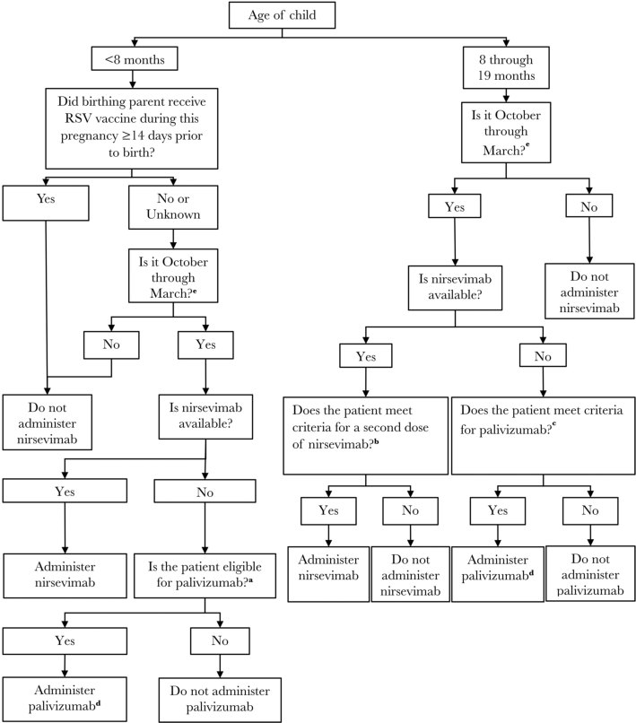
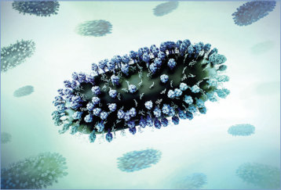
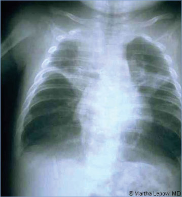
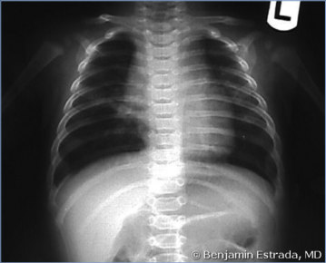
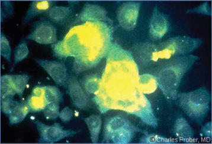
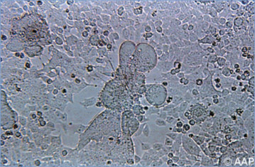

# 121. Respiratory Syncytial Virus
> Reference: [source credits](../../SOURCE_CREDITS.md). Printed pp. 743-751; PDF pp. 757-765.
> Editorial study pathway: Viral infections (not a part division in the source).
[Flashcards](../flashcards/121_flashcards.md) · [Quiz](../mcqs/121_mcqs.md) · [Full extraction](../../raw/chapters/121.md)

## Five study pillars

### Etiology and transmission
RSV is an enveloped, nonsegmented, negativestrand RNA virus of the genus Orthopneumovirus of the family Pneumoviridae. Human RSV exists as 2 antigenic subgroups, A and B, and often these cocirculate during the same RSV season.
*Printed p. 743 / PDF p. 757*

### Clinical recognition
Respiratory syncytial virus (RSV) causes acute respiratory tract infections in people of all ages and is one of the most common diseases of early childhood. Most infants infected with RSV experience upper respiratory tract symptoms, and 20% to 30% develop lower respiratory tract disease (LRTD; eg, bronchiolitis and/or pneumonia) with the first infection.
*Printed p. 743 / PDF p. 757*

### Diagnostic workup
Molecular diagnostic tests using reverse transcriptase-polymerase chain reaction (RT-PCR) assays have largely replaced viral isolation and antigen detection assays. Some commercially available assays are designed as multiplex assays to facilitate testing for multiple respiratory viruses from a single nasopharyngeal specimen.
*Printed p. 744 / PDF p. 758*

### Treatment in the atlas
No available treatment shortens the course of bronchiolitis or hastens the resolution of symptoms. Management of young children hospitalized with bronchiolitis is supportive and should include hydration and careful assessment of respiratory status.
*Printed p. 744 / PDF p. 758*

### Prevention and infection control
In addition to standard precautions, contact and droplet precautions are recommended for the duration of RSV-associated illness. In immunocompromised patients, the duration of precautions should be extended because of possible prolonged shedding.
*Printed p. 745 / PDF p. 759*

## Clinical search tags
Fever, Cough, Pneumonia, Wheeze / bronchiolitis, Congenital / neonatal, Immunocompromised host

## Full text, original tables, and images

# 121. Respiratory Syncytial Virus
> Private study reference ([source credits](../../SOURCE_CREDITS.md)). PDF pages 757-765; printed pages 743-751.

## PDF page 757 | printed page 743

### CLINICAL MANIFESTATIONS

Respiratory syncytial virus (RSV) causes acute respiratory tract infections in people of all ages and is one of the most common diseases of early childhood. Most infants infected with RSV experience upper respiratory tract symptoms, and 20% to 30% develop lower respiratory tract disease (LRTD; eg, bronchiolitis and/or pneumonia) with the first infection. Signs and symptoms of bronchiolitis typically begin with rhinitis and cough, which may progress to increased respiratory effort with tachypnea, wheezing, rales, intercostal and/ or subcostal retractions, grunting, and nasal flaring. Fever may, but does not always, occur. Infection with RSV during the first few weeks of life, particularly among preterm infants, may present with more general symptoms such as lethargy, irritability, and poor feeding, accompanied by minimal respiratory tract symptoms; these infants are at risk of developing apnea, even in the absence of other respiratory symptoms.

Most previously healthy infants who develop RSV bronchiolitis do not require hospitalization, and most who are hospitalized improve with supportive care and are discharged after 2 or 3 days. However, approximately 1% to 3% of all children in the first 12 months of life will be hospitalized because of severe RSV LRTD, with the highest rate of RSV hospitalizations occurring in the first 6 months of life. Factors that increase the risk of severe RSV lower respiratory tract illness include preterm birth, especially birth before 29 weeks of gestation; chronic lung disease of prematurity (CLD [formerly called bronchopulmonary dysplasia]); certain types of hemodynamically significant congenital heart disease, especially conditions associated with pulmonary hypertension; certain immunodeficiency states; and neurologic and neuromuscular conditions. Other risk factors with a more limited correlation with disease severity include low birth weight, maternal smoking during pregnancy, exposure to secondhand smoke in the household, family history of atopy, lack of breastfeeding, and household crowding. Mortality is rare when supportive care is available.

Children hospitalized for RSV bronchiolitis in infancy are at increased risk of recurrent wheezing in early childhood. The association between RSV infection early in life and subsequent asthma, however, remains incompletely understood. Infants who experience severe LRTD (eg, bronchiolitis or pneumonia) from RSV have an increased risk of developing asthma later in life. This association is also seen with other respiratory viral infections, particularly those caused by rhinoviruses. The unresolved question is whether the association between severe infection and reactive airway disease is causal and attributable to direct damage caused by viral replication and the host’s response. Alternatively, the association may reflect a common genotype, indicating the same anatomic or immunologic abnormalities that predispose to asthma also predispose to severe viral LRTD. Results from 2 randomized, placebo-controlled trials demonstrated that providing RSV immunoprophylaxis with palivizumab to term and preterm infants had no measurable effect on medically attended wheezing, physician-diagnosed asthma, or lung function at 3 to 6 years of age.

Almost all children are infected by RSV at least once by 24 months of age, and reinfection throughout life is common. Particularly among otherwise healthy older children and adults, recurrent RSV infection manifests as mild upper respiratory tract illness and seldom involves the lower respiratory tract. However, serious disease involving the lower respiratory tract may develop in older children and adults, especially in immunocompromised people and elderly people, particularly those with cardiopulmonary comorbidities. Each year in the United States, the burden of RSV disease in adults ≥65 years of age includes approximately 2,200,000 symptomatic illnesses, approximately 177,000 hospitalizations, and approximately 14,000 deaths. This is comparable to influenza disease burden in this older age group.

### ETIOLOGY

RSV is an enveloped, nonsegmented, negativestrand RNA virus of the genus Orthopneumovirus of the family Pneumoviridae. Human RSV exists as 2 antigenic subgroups, A and B, and often these cocirculate during the same RSV season. A consistent correlation between RSV subgroup and

## PDF page 758 | printed page 744

disease severity is unclear. The RSV envelope contains 3 surface glycoproteins: glycoprotein G, fusion protein F, and a small hydrophobic protein. Antibodies directed against F and G are neutralizing and protective. G protein is involved in viral attachment to the cell and assists in the ability of the virus to evade host immunity. F protein enables viral penetration of the epithelial cell once viral attachment occurs. In contrast to G protein, F protein is relatively conserved, making it an attractive target for vaccine and monoclonal antibody development.

### EPIDEMIOLOGY

Humans are the only source of infection. RSV usually is transmitted by direct or close contact with contaminated secretions, which may occur from exposure to large-particle droplets at short distances (typically <6 feet) or by self-inoculation after touching contaminated surfaces or fomites. Viable RSV can persist on environmental surfaces for several hours and for 30 minutes or more on hands.

RSV typically occurs in annual epidemics beginning in fall and continuing through early spring in temperate climates, although RSV seasonality was unusual during the COVID-19 pandemic and included significant circulation during the summer.1 Spread among households and people in child care facilities, including adults, is common. Spread also can occur in the health care setting. The relationship between the presence of infectious virus and the duration of positive molecular testing is unclear. Most infections occur within 7 days of household exposure. The usual period of viral detection by molecular testing is 11 to 14 days, but it may be longer, especially in young infants, who may have positive test results for 3 to 4 weeks, and in immunosuppressed children, who may have positive test results for several months or longer.

The incubation period ranges from 2 to 8 days; 4 to 6 days is most common.

### DIAGNOSTIC TESTS

Molecular diagnostic tests using reverse transcriptase-polymerase chain reaction (RT-PCR) assays have largely replaced viral isolation and antigen detection assays. Some commercially available assays are designed as multiplex assays to

facilitate testing for multiple respiratory viruses from a single nasopharyngeal specimen. Some complex multiplex tests can distinguish between RSV A and B subgroups. Using RT-PCR assays, as many as 30% of symptomatic children will demonstrate the presence of a viral coinfection with 2 or more respiratory viruses. Whether symptomatic children who are coinfected with more than one virus experience more severe or even less severe disease is not clear.

Testing for seroconversion with acute and convalescent serum specimens is rarely performed for the purposes of diagnosing RSV infection and may not be reliable in infants because the immune response to RSV infection may be limited.

Rapid diagnostic assays, including direct fluorescent antibody assays and enzyme or chromatographic immunoassays, are available for detection of viral antigen in nasopharyngeal specimens and are reliable in infants and young children. The sensitivity of these tests is lower than for the molecular diagnostics. As with all antigen detection assays, the predictive value is high during the peak season, but false-positive test results are more likely to occur when the incidence of disease is low, such as in the summer in temperate areas.

In most outpatient settings for children with bronchiolitis, routine specific respiratory viral testing has little effect on management and is not recommended.2 Among hospitalized children with bronchiolitis, testing for viral etiology is not routinely recommended, although it can aid in limiting unnecessary antibiotics. Additionally, if patient cohorting is necessary, identification of the specific viral etiology of a respiratory infection will aid hospital infection prevention efforts.

### TREATMENT3

No available treatment shortens the course of bronchiolitis or hastens the resolution of symptoms. Management of young children hospitalized with bronchiolitis is supportive and should include hydration and careful assessment of respiratory status. Supplemental oxygen is recommended only when oxyhemoglobin saturation persistently decreases below 90% in a previously healthy infant. Data support the use of heated humidified high-flow nasal cannula treatment as rescue therapy in infants who have continued hypoxemia

## PDF page 759 | printed page 745

despite standard oxygen therapy. Nasal continuous positive airway pressure and heliox have been used for respiratory support in hospitalized infants with bronchiolitis who are at risk for progression to respiratory failure. Only limited data are available on the effectiveness of these therapies in bronchiolitis specifically caused by RSV. Because these therapies, as well as intubation and ventilation, typically are used in severely or critically ill infants with bronchiolitis, they should be used only in consultation with a critical care or pulmonary specialist.

Early studies with aerosolized ribavirin therapy demonstrated a small increase in oxygen saturation in small clinical trials; however, a decrease in the need for mechanical ventilation or a decrease in the length of stay was not shown. Because of limited evidence for a clinically relevant benefit, potential toxic effects, and high cost, routine use of aerosolized ribavirin is not recommended.

a- and b-Adrenergic Agents

b-Adrenergic agents are not recommended for care of wheezing associated with RSV bronchiolitis, and a trial of albuterol no longer is included as a recommended option in the management of RSV bronchiolitis.4 Evidence does not support the use of nebulized epinephrine in children hospitalized with bronchiolitis.

Glucocorticoid Therapy

Controlled clinical trials among children with bronchiolitis have demonstrated that corticosteroids do not reduce hospital admissions and do not reduce length of stay for inpatients. Corticosteroid treatment should not be used for infants and children with RSV bronchiolitis.

Antimicrobial Therapy

Antimicrobial therapy is not indicated for infants with RSV bronchiolitis or pneumonia unless there is evidence of concurrent bacterial infection. A young child with a distinct viral lower respiratory tract infection (bronchiolitis) has a low risk (<1%) of bacterial meningitis. Bacterial lung infections and bacteremia are uncommon in this setting. Acute otitis media (AOM) caused by RSV or bacterial superinfection may occur in infants with RSV bronchiolitis. Oral antimicrobial therapy for treatment of otitis media may be considered if bulging of the tympanic membrane is present.5

### INFECTION PREVENTION AND CONTROL MEASURES IN HEALTH CARE SETTINGS

In addition to standard precautions, contact and droplet precautions are recommended for the duration of RSV-associated illness. In immunocompromised patients, the duration of precautions should be extended because of possible prolonged shedding. In addition, a variety of measures have been demonstrated to reduce the risk of health care-associated transmission, including: (1) placing in single rooms or cohorting of symptomatic patients with dedicated staff; (2) emphasizing hand hygiene before and after direct contact with patients, after contact with inanimate objects in the direct vicinity of patients because of the likelihood of skin contamination from contact with respiratory secretions (alcohol-based gels and antibacterial hand soaps rapidly inactivate RSV), and after glove removal; (3) excluding visitors with current or recent respiratory tract infections from health care settings; and (4) limiting young children visiting during the RSV season.

### PREVENTION OF RSV INFECTIONS

Active Immunization

Two RSV vaccines have been approved by the U.S. Food and Drug Administration (FDA) for use in adults ≥60 years of age. Both are recombinant stabilized prefusion F protein vaccines.6 One of these products is also approved for use during pregnancy to prevent LRTD and severe LRTD caused by RSV in infants from birth through 6 months of age. The vaccine is administered to the pregnant person as a single intramuscular injection at 32 through 36 weeks’ gestation. In clinical trials, vaccine effectiveness for prevention of severe RSV-associated LRTD within 90 days after birth was 81.8% (99.5% confidence interval [CI]: 40.6%, 96.3%) and within 180 days after birth was 69.4% (97.6% CI: 44.3%, 84.1%). Safety assessments for both the pregnant and infant populations were similar for vaccine and placebo recipients. A slightly higher percentage of preterm births occurred in the vaccine recipients compared with placebo recipients (5.6% [95% CI: 4.9%, 6.4%] versus 4.7% [95% CI: 4.1%, 5.5%]), but this did not reach statistical significance and was seen 30 days or more following vaccine administration. The vaccine is recommended for use in all

## PDF page 760 | printed page 746

pregnant people at 32 through 36 weeks’ gestation, using seasonal administration, to prevent RSV lower respiratory tract infection in infants.

Passive Immunization

Two monoclonal antibodies against RSV have been licensed by the FDA, palivizumab and nirsevimab. Nirsevimab’s long half-life allows for administration of a single dose that provides protection across the entire RSV season, while palivizumab requires monthly administration. Nirsevimab is recommended for universal use in all infants under 8 months of age to prevent RSV-associated LRTD (see Nirsevimab Recommendations for First RSV Season, below). It also is recommended for high-risk infants 8 through 19 months of age to prevent RSV LRTD during their second RSV season. Infants in certain risk categories are recommended to receive palivizumab if nirsevimab is not available (see Nirsevimab Recommendations for Second RSV Season, below).

In clinical trials, nirsevimab’s pooled effectiveness in preventing medically attended RSV-associated LRTD was 79.0% (95% CI: 68.5%, 86.1%), effectiveness in preventing RSV-associated LRTD with hospitalization was 80.6% (95% CI: 62.3%, 90.1%), and effectiveness in preventing RSVassociated LRTD with ICU admission was 90.0% (95% CI: 16.4%, 98.8%).

Nirsevimab Recommendations for First RSV Season

Recommendations for use of nirsevimab for the infant’s first RSV season are dependent on whether the infant’s birth parent received the RSV vaccine during pregnancy and the timing of administration of that vaccine (if given) relative to birth. If the birth parent: (1) either did not receive RSV vaccine during pregnancy ≥14 days prior to birth or maternal RSV vaccine status is unknown; AND (2) the time of year is during October through March (see Timing of Nirsevimab Administration, below); AND (3) the infant is <8 months of age, then the infant is recommended to receive 1 dose of nirsevimab for protection during the first RSV season.7 The nirsevimab dose is 50 mg for infants weighing <5 kg and 100 mg for infants weighing ≥5 kg. If nirsevimab is administered, palivizumab should

not be administered later that season. An algorithm that details which infants under 8 months of age should receive nirsevimab is provided in Figure 121.1.

Nirsevimab Recommendations for Second RSV Season

In addition, 1 dose of nirsevimab is recommended for infants and children 8 months through 19 months of age who are at increased risk for severe RSV disease and are entering their second RSV season (see Timing of Nirsevimab Administration, below). The dose for these older infants is 200 mg, administered as two 100-mg injections given at the same time at different injection sites. Nirsevimab is recommended for use during the second RSV season for patients in the following risk categories:

• Children with CLD who required medical support (chronic corticosteroid therapy, diuretic therapy, or supplemental oxygen) anytime during the 6-month period before the start of the second RSV season

• Children with severe immunocompromise

• Children with cystic fibrosis who have either:

8 Manifestations of severe lung disease (previous hospitalization for pulmonary exacerbation in the first year of life or abnormalities on chest imaging that persist when stable), or

8 Weight-for-length <10th percentile

• American Indian or Alaska Native children

An algorithm that details which infants 8 months through 19 months of age should receive nirsevimab is provided in Figure 121.1.

Timing of Nirsevimab Administration8

Nirsevimab should be administered to eligible infants and children beginning shortly before the start of the RSV season, which in most of the continental United States is from October through the end of March. Infants born shortly before or during the RSV season should receive nirsevimab within 1 week of birth. Nirsevimab administration can occur during the birth hospitalization or in the outpatient setting. Optimal timing for nirsevimab administration is shortly before the RSV season begins; however, nirsevimab may be administered

## PDF page 761 | printed page 747

Figure 121.1 Respiratory syncytial virus (RSV) monoclonal antibody prophylaxis decision algorithm for infants <8 months and 8 through 19 months of age

a Preterm infants with chronic lung disease of prematurity (CLD); infants with hemodynamically significant congenital heart disease (CHD); preterm infants without CLD or CHD but born before 29 weeks, 0 days’ gestation who are younger than 12 months at the start of the RSV season; children with anatomic pulmonary abnormalities or neuromuscular disorder; immunocompromised children; children with cystic fibrosis. b Children with CLD who required medical support (chronic corticosteroid therapy, diuretic therapy, or supplemental oxygen) any time during the 6-month period before the start of the second RSV season; severe immunocompromise; cystic fibrosis who have either (1) manifestations of severe lung disease (previous hospitalization for pulmonary exacerbation in the first year of life or abnormalities on chest imaging that persist when stable), or (2) weight-for-length <10th percentile; American Indian or Alaska Native children. c Preterm infants with CLD requiring medical support (chronic corticosteroid therapy, diuretic therapy, or supplemental oxygen) during the 6-month period before the start of the second RSV season; immunocompromised children; children with cystic fibrosis with manifestations of severe lung disease (previous hospitalization for pulmonary exacerbation in the first year or abnormalities on chest radiography or chest computed tomography that persist when stable) or weight-for-length <10th percentile.

(footnotes continue)

## PDF page 762 | printed page 748

Figure 121.1 (continued)

d For recommendations on use of palivizumab, see Ralston SL, Lieberthal AS, Meissner HC, et al. Clinical practice guideline: the diagnosis, management, and prevention of bronchiolitis. Pediatrics. 2014;134(5):e1474–e1502; and Caserta MT, O’Leary ST, Munoz FM, Ralston SL; American Academy of Pediatrics, Committee on Infectious Diseases. Technical report. Palivizumab prophylaxis in infants and young children at increased risk of hospitalization for respiratory syncytial virus infection. Pediatrics. 2023;152(1):e20230618. e In jurisdictions with seasonality that differs from most of the continental United States (eg, Alaska, jurisdictions with tropical climates), providers should follow state, local, or territorial guidance on timing of administration.

to age-eligible infants and children who have not yet received a dose at any time during the season. Only a single dose of nirsevimab is recommended for an RSV season.

Infants with prolonged birth hospitalizations related to prematurity or other causes should receive nirsevimab shortly before or promptly after hospital discharge. No evidence is available to support use of nirsevimab for prevention of hospital-acquired RSV infection, and nirsevimab is not recommended for this indication.

Because the timing of the onset, peak, and decline of RSV activity might vary geographically, administration schedules can be adjusted based on local epidemiology. RSV seasonality in tropical climates (including southern Florida, Guam, Hawaii, Puerto Rico, U.S.-affiliated Pacific Islands, and U.S. Virgin Islands) might differ from that of most of the continental United States or be unpredictable. In Alaska, RSV seasonality is less predictable, and the duration of RSV activity is often longer than the national average duration. Providers in these jurisdictions should consult state, local, or territorial guidance on timing of nirsevimab administration.

Coadministration With Other Vaccines

Nirsevimab is not expected to interfere with the immune response to other routine childhood immunizations, and simultaneous administration of nirsevimab with age-appropriate vaccines is recommended.

Palivizumab

If nirsevimab is not available, palivizumab may be used in high-risk patients in their first or second RSV seasons (see Figure 121.1 for definitions of who qualifies). If nirsevimab becomes available during the course of the season and before the fifth dose of palivizumab, a single dose should be administered and no additional palivizumab doses should be given.

Use of Nirsevimab in Children Who Already Have Had RSV in That Season

Nirsevimab should be administered for the first (or if high-risk patients, the second) RSV season regardless of whether the infant has already had an RSV infection at any time previously, including during the current season. Reinfection with RSV, even during the same season, can occur. If there is a shortage of nirsevimab, this recommendation for its use regardless of prior RSV infection may need to be modified until the shortage is resolved. Children who are moderately or severely ill with or without fever including those who have known current RSV infection should defer nirsevimab until recovery from the acute illness.

Cardiopulmonary Bypass

Children undergoing cardiac surgery with cardiopulmonary bypass should receive an additional dose of nirsevimab after surgery during RSV season if age eligible.

For the first RSV season, if cardiac surgery with cardiopulmonary bypass is performed within 90 days after receiving nirsevimab, an additional dose should be administered based on body weight at the time of the additional dose (50 mg if less than 5 kg and 100 mg if ≥5 kg). If cardiac surgery with cardiopulmonary bypass is performed more than 90 days after receiving nirsevimab, an additional dose of 50 mg, regardless of body weight, should be administered.

For the second RSV season, if cardiac surgery with cardiopulmonary bypass is performed within 90 days after receiving nirsevimab, an additional dose of 200 mg, regardless of body weight, should be administered. If cardiac surgery with cardiopulmonary bypass is performed more than 90 days after receiving nirsevimab, an additional dose of 100 mg, regardless of body weight, should be administered.

## PDF page 763 | printed page 749

Contraindications and Adverse Event Reporting9

Nirsevimab is contraindicated in persons with a history of severe allergic reaction (eg, anaphylaxis) after a previous dose or to a product component. Adverse reactions might occur after administration of nirsevimab alone, and should be reported to MedWatch online (www.fda.gov/medwatch), by fax, by mail, or by contacting the FDA at 1-800-FDA-1088. Adverse reactions also might occur after the coadministration of nirsevimab with a vaccine, and these reactions should be reported to the Vaccine Adverse Event Reporting System (VAERS), with reports specifying that the patient received nirsevimab on the VAERS form (https://vaers.hhs.gov; 1-800-822-7967). When adverse reactions that occur after the coadministration of nirsevimab with a vaccine are reported to VAERS, additional reporting of the same adverse reactions to MedWatch is not necessary.

### CONTROL MEASURES

A critical aspect of RSV prevention among highrisk infants is education of parents and other caregivers about the importance of decreasing exposure to and transmission of RSV. Preventive measures include limiting, where feasible, exposure to contagious settings (eg, child care centers); emphasis on hand hygiene in all settings, including the home, especially during periods when contacts of high-risk children have respiratory

tract infections; and limiting exposure to secondhand smoke.

1 Hamid S, Winn A, Parikh R, et al. Seasonality of respiratory syncytial virus-United States, 2017–2023. MMWR Morb Mortal Wkly Rep. 2023;72(14):355–361 2 Ralston SL, Lieberthal AS, Meissner HC, et al. Clinical practice guideline: the diagnosis, management, and prevention of bronchiolitis. Pediatrics. 2014;134(5):e1474–e1502 3 Ralston SL, Lieberthal AS, Meissner HC, et al. Clinical practice guideline: the diagnosis, management, and prevention of bronchiolitis. Pediatrics. 2014;134(5):e1474–e1502 4 Ralston SL, Lieberthal AS, Meissner HC, et al. Clinical practice guideline: the diagnosis, management, and prevention of bronchiolitis. Pediatrics. 2014;134(5):e1474–e1502 5 Lieberthal AS, Carroll AE, Chonmaitree T, et al. Clinical practice guideline: the diagnosis and management of acute otitis media. Pediatrics. 2013;131(3):e964–e999 6 Melgar M, Britton A, Roper LE, et al. Use of respiratory syncytial virus vaccines in older adults: recommendations of the Advisory Committee on Immunization Practices- United States, 2023. MMWR Morb Mortal Wkly Rep. 2023;72(29):793–801 7 Jones JM, Fleming-Dutra KE, Prill MM, et al. Use of nirsevimab for the prevention of respiratory syncytial virus disease among infants and young children: recommendations of the Advisory Committee on Immunization Practices-United States, 2023. MMWR Morb Mortal Wkly Rep. 2023;72(34):920–925 8 Jones JM, Fleming-Dutra KE, Prill MM, et al. Use of nirsevimab for the prevention of respiratory syncytial virus disease among infants and young children: recommendations of the Advisory Committee on Immunization Practices-United States, 2023. MMWR Morb Mortal Wkly Rep. 2023;72(34):920–925 9 Jones JM, Fleming-Dutra KE, Prill MM, et al. Use of nirsevimab for the prevention of respiratory syncytial virus disease among infants and young children: recommendations of the Advisory Committee on Immunization Practices- United States, 2023. MMWR Morb Mortal Wkly Rep. 2023;72(34):920–925

## PDF page 764 | printed page 750

Image 121.1 Three-dimensional renderings of respiratory syncytial virus, a common contagious virus that infects the human respiratory tract. Courtesy of National Institute of Allergy and Infectious Diseases.

Image 121.3 Scanning electron micrograph of human respiratory syncytial virus (RSV). Virions (colorized gold) are labeled with anti-RSV F protein/gold antibodies (colorized yellow) shedding from the surface of human lung epithelial A549 cells. RSV is a common contagious virus that infects the human respiratory tract. Courtesy of National Institute of Allergy and Infectious Diseases.

Image 121.2 Respiratory syncytial virus in cross section landing on the surface of a human respiratory endothelial cell. Single stranded RNA (glowing/colorized pink) is shown wrapped around a nuclear protein core capped by large L proteins. M2-1 and M proteins line the inside of the virion, and F and G proteins populate the outer surface of the virion. F proteins are represented as drumstick-like structures, and G proteins are represented as tangled tubular structures. Courtesy of National Institute of Allergy and Infectious Diseases.

Image 121.4 Respiratory syncytial virus bronchiolitis and pneumonia. Note the bilateral infiltrates and striking hyperaeration. Copyright Martha Lepow, MD.

![Image 121.2 Respiratory syncytial virus in cross section landing on the surface of a human respiratory endothelial cell. Single stranded RNA (glowing/colorized pink) is shown wrapped around a nuclear protein core capped by large L proteins. M2-1 and M proteins line the inside of the virion, and F and G proteins populate the outer surface of the virion. F proteins are represented as drumstick-like structures, and G proteins are represented as tangled tubular structures. Courtesy of National Institute of Allergy and Infectious Diseases.](../../figures/ch121_p0764_02.jpg)

## PDF page 765 | printed page 751

Image 121.5 An anteroposterior radiograph of a 2-month-old girl with respiratory syncytial virus bronchiolitis. Note the wide intercostal spaces, hyperaeration of the lung fields, and flattening of the diaphragm. Courtesy of Benjamin Estrada, MD.

Image 121.7 The characteristic cytopathic effect of respiratory syncytial virus in tissue culture includes the formation of large multinucleated syncytial cells.

Image 121.6 Direct fluorescent antibody staining of respiratory syncytial virus in cell culture. Copyright Charles Prober, MD.

Image 121.8 Electron micrograph of a respiratory syncytial virus. The virion is variable in shape and size (average diameter between 120 and 300 nm). Respiratory syncytial virus is the most common cause of bronchiolitis and pneumonia in infants <1 year of age. Courtesy of Centers for Disease Control and Prevention.

