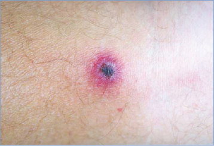
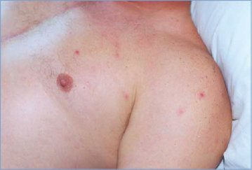
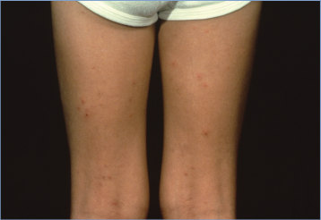

# 124. Rickettsialpox
> Reference: [source credits](../../SOURCE_CREDITS.md). Printed pp. 757-758; PDF pp. 771-772.
> Editorial study pathway: Bacterial infections (not a part division in the source).
[Flashcards](../flashcards/124_flashcards.md) · [Quiz](../mcqs/124_mcqs.md) · [Full extraction](../../raw/chapters/124.md)

## Five study pillars

### Etiology and transmission
Rickettsialpox is caused by Rickettsia akari, a gram-negative intracellular bacillus now classified with Rickettsia felis and Rickettsia australis within the transitional group of the genus Rickettsia, so named because they have features of both the spotted fever and typhus groups.
*Printed p. 757 / PDF p. 771*

### Clinical recognition
Rickettsialpox is a febrile, eschar-associated illness characterized by generalized, relatively sparse, erythematous, papulovesicular eruptions on the trunk, face, extremities (less often on palms and soles), and occasionally involving the oral mucous membranes. The rash may resemble chickenpox and develops 1 to 4 days after onset of fever and 3 to 10 days after appearance of an eschar at the site of the bite of an infected house mouse mite.
*Printed p. 757 / PDF p. 771*

### Diagnostic workup
Serologic tests for antibodies reactive with spotted fever group rickettsial antigens are the most frequently used diagnostic assays. Immunoglobulin (Ig) M and IgG are generally detected 7 to 15 days after illness onset.
*Printed p. 757 / PDF p. 771*

### Treatment in the atlas
Doxycycline is the drug of choice in all age groups. The minimum course of therapy is 5 days.
*Printed p. 757 / PDF p. 771*

### Prevention and infection control
Person-to-person spread of rickettsialpox has not been reported. Standard precautions are recommended.
*Printed p. 758 / PDF p. 772*

## Clinical search tags
Fever, Vesicles, Ulcers / eschar, Conjunctivitis, Vomiting, Hepatitis / jaundice

## Full text, original tables, and images

# 124. Rickettsialpox
> Private study reference ([source credits](../../SOURCE_CREDITS.md)). PDF pages 771-772; printed pages 757-758.

## PDF page 771 | printed page 757

### CLINICAL MANIFESTATIONS

Rickettsialpox is a febrile, eschar-associated illness characterized by generalized, relatively sparse, erythematous, papulovesicular eruptions on the trunk, face, extremities (less often on palms and soles), and occasionally involving the oral mucous membranes. The rash may resemble chickenpox and develops 1 to 4 days after onset of fever and 3 to 10 days after appearance of an eschar at the site of the bite of an infected house mouse mite. Eschars are generally 0.5 to 2.5 cm, are most frequently found on the extremities and torso, and may be nontender or mildly tender. Regional lymph nodes proximal to the inoculation eschar often become enlarged and tender. Without specific antimicrobial therapy, systemic disease lasts approximately 7 to 14 days; manifestations include fever, headache, malaise, and myalgia. Less frequent manifestations include anorexia, vomiting, conjunctivitis, hepatitis, nuchal rigidity, and photophobia. The disease is mild compared with Rocky Mountain spotted fever, and although no rickettsialpox-associated deaths have been described, disease occasionally is severe enough to warrant hospitalization.

### ETIOLOGY

Rickettsialpox is caused by Rickettsia akari, a gram-negative intracellular bacillus now classified with Rickettsia felis and Rickettsia australis within the transitional group of the genus Rickettsia, so named because they have features of both the spotted fever and typhus groups.

### EPIDEMIOLOGY

The natural host for R akari in the United States is Mus musculus, the common house mouse. The organism is transmitted by the bite of the house mouse mite, Liponyssoides sanguineus. Disease risk is heightened in areas infested with house mice. The disease can occur wherever the hosts, pathogens, and humans coexist but most frequently is reported in large urban settings. In the United States, rickettsialpox has been described predominantly in metropolitan centers, especially in New York City, as well as Boston, Baltimore, and other large cities along the Atlantic coast. It

has been confirmed in many other countries, including the Netherlands, Croatia, Ukraine, Turkey, Russia, South Korea, South Africa, and Mexico. All age groups can be affected. No seasonal pattern of disease occurs. The disease is not communicable but occurs occasionally among families or people cohabiting in a house mouse mite-infested dwelling.

The incubation period is 6 to 15 days.

### DIAGNOSTIC TESTS

Serologic tests for antibodies reactive with spotted fever group rickettsial antigens are the most frequently used diagnostic assays. Immunoglobulin (Ig) M and IgG are generally detected 7 to 15 days after illness onset. R akari can be isolated in cell culture from blood and eschar biopsy specimens during the acute stage of disease, but culture is not attempted routinely. Because antigens of R akari have extensive crossreactivity with antigens of Rickettsia rickettsii (the cause of Rocky Mountain spotted fever) and other spotted fever-group rickettsiae, an indirect immunofluorescence antibody assay for R rickettsii can be used to demonstrate a fourfold or greater change in antibody titers between acute and convalescent serum specimens obtained 2 to 6 weeks apart. Use of R akari antigen is recommended for a more accurate diagnosis but may be available only in specialized research laboratories. Immunohistochemical testing of formalin-fixed, paraffin-embedded eschars or papulovesicle biopsy specimens at specialized reference laboratories can also detect rickettsiae in the samples and are useful diagnostic techniques, but because of antigenic cross-reactivity these assays are not able to confirm the etiologic agent. A polymerase chain reaction assay for detection of rickettsial DNA with subsequent sequence identification can confirm R akari infection but currently is not cleared by the U.S. Food and Drug Administration for use in the United States.

### TREATMENT

Doxycycline is the drug of choice in all age groups. The minimum course of therapy is 5 days. Treatment is continued for at least 3 days after resolution of fever and until there is clinical improvement. Doxycycline shortens the course of disease, and symptoms typically resolve within

## PDF page 772 | printed page 758

12 to 48 hours after initiation of therapy. Chloramphenicol is an alternative drug but carries a risk of serious adverse events and is not available as an oral formulation in the United States. Use of chloramphenicol should be considered only in rare cases, such as for patients with an absolute contraindication to receiving doxycycline, because rickettsialpox usually is mild and self-limited. Untreated rickettsialpox usually resolves within 2 weeks.

### INFECTION PREVENTION AND CONTROL MEASURES IN HEALTH CARE SETTINGS

Person-to-person spread of rickettsialpox has not been reported. Standard precautions are recommended.

Image 124.1 Eschar on the posterior right calf of patient with rickettsialpox. This type of lesion is not encountered with Rocky Mountain spotted fever. Courtesy of Emerging Infectious Diseases.

Image 124.3 Rickettsialpox on the legs. Copyright James Brien, DO.

### CONTROL MEASURES

Application of residual acaricides can be used in heavily mite-infested environments to eliminate the vector. Rodent-control measures are important in limiting or eliminating spread of rickettsialpox but they should be conducted only in conjunction with acaricide application to ensure vector control. No specific management of exposed people is necessary.

Image 124.2 Multiple papulovesicular lesions involving the upper trunk of a patient with rickettsialpox. Courtesy of Emerging Infectious Diseases.

