# 127. Rubella
> Reference: [source credits](../../SOURCE_CREDITS.md). Printed pp. 770-779; PDF pp. 784-793.
> Editorial study pathway: Viral infections (not a part division in the source).
[Flashcards](../flashcards/127_flashcards.md) · [Quiz](../mcqs/127_mcqs.md) · [Full extraction](../../raw/chapters/127.md)

## Five study pillars

### Etiology and transmission
Rubella virus is an enveloped, positive-stranded RNA virus classified as a Rubivirus in the Matonaviridae family.
*Printed p. 770 / PDF p. 784*

### Clinical recognition
Postnatal Rubella Many cases of postnatal rubella are subclinical, with 25% to 50% of adults being asymptomatic. Clinical disease usually is mild and characterized by a generalized erythematous maculopapular rash, lymphadenopathy, and slight fever.
*Printed p. 770 / PDF p. 784*

### Diagnostic workup
Rubella infection can be confirmed by: (1) detection of rubella viral RNA by reverse transcriptasepolymerase chain reaction (RT-PCR); (2) detection of rubella virus-specific immunoglobulin (Ig) M; (3) a fourfold increase in rubella IgG antibody titer in paired acute and convalescent serum specimens (collected at least 10 days apart); or (4) isolation of rubella virus in cell culture. Neonates in whom there is concern for CRS should have both virologic and serologic testing performed.
*Printed p. 771 / PDF p. 785*

### Prevention and infection control
In addition to standard precautions, for postnatal rubella, droplet precautions are recommended for 7 days after onset of the rash. Contact isolation is indicated for children with proven or suspected congenital rubella until they are at least 1 year of age, unless rubella RT-PCR testing of 2 sets of clinical specimens (eg, throat/nasal swab and urine specimen) obtained 1 month apart after 3 months of age do not detect rubella virus RNA.
*Printed p. 771 / PDF p. 785*

## Clinical search tags
Fever, Maculopapular rash, Lymphadenopathy, Conjunctivitis, Pharyngitis, Cough, Pneumonia, Hepatosplenomegaly, Encephalitis / seizures, Arthritis / bone pain, Cytopenia, Congenital / neonatal, Travel / endemic setting

## Full text, original tables, and images

# 127. Rubella
> Private study reference ([source credits](../../SOURCE_CREDITS.md)). PDF pages 784-793; printed pages 770-779.

## PDF page 784 | printed page 770

### CLINICAL MANIFESTATIONS

Postnatal Rubella

Many cases of postnatal rubella are subclinical, with 25% to 50% of adults being asymptomatic. Clinical disease usually is mild and characterized by a generalized erythematous maculopapular rash, lymphadenopathy, and slight fever. The rash starts on the face, becomes generalized in 24 hours, and lasts a median of 3 days. Lymphadenopathy, which may precede rash, often involves posterior auricular or suboccipital lymph nodes, can be generalized, and lasts between 5 and 8 days. In addition, conjunctivitis, cough, headache, coryza, and palatal enanthema may occur 1 to 5 days prior to the rash. Transient polyarthralgia and polyarthritis rarely occur in children but are common in adolescents and adults, especially among females. Encephalitis (1 in 6,000 cases) and thrombocytopenia (1 in 3,000 cases) are complications.

Congenital Rubella Syndrome

Maternal rubella during pregnancy can result in miscarriage, fetal death, or a constellation of congenital anomalies (congenital rubella syndrome [CRS]). The most commonly described anomalies/ manifestations associated with CRS are ophthalmologic (cataracts, pigmentary retinopathy, microphthalmos, congenital glaucoma), cardiac (patent ductus arteriosus, peripheral pulmonary artery stenosis), auditory (sensorineural hearing impairment), or neurologic (behavioral disorders, meningoencephalitis, microcephaly, developmental disabilities). Neonatal manifestations of CRS include growth restriction, interstitial pneumonitis, radiolucent bone disease, hepatosplenomegaly, thrombocytopenia, and dermal erythropoiesis (so-called blueberry muffin lesions). Mild forms of the disease can be associated with few or no obvious clinical manifestations at birth. Congenital defects primarily occur in the infants of people infected during the first trimester of pregnancy. CRS is one of the few known causes of autism.

### ETIOLOGY

Rubella virus is an enveloped, positive-stranded RNA virus classified as a Rubivirus in the Matonaviridae family.

### EPIDEMIOLOGY

Humans are the only natural host. Postnatal rubella is transmitted primarily through direct or droplet contact from nasopharyngeal secretions. The peak incidence of infection is during late winter and early spring. Immunity from wild-type or vaccine virus usually is lifelong, but reinfection on rare occasions has been demonstrated and rarely has resulted in CRS.

Rubella virus has been recovered from lens aspirates in children with congenital cataracts for several years, and a small proportion of infants with congenital rubella continue to shed virus in nasopharyngeal secretions and urine for 1 year or more, with transmission to susceptible contacts being possible (see Infection Prevention and Control Measures in Health Care Settings and Control Measures).

Persistent infection of rubella virus has been associated with Fuchs uveitis, encephalitis, and granulomas, sometimes decades after the initial infection and/or vaccination. Both wild-type and vaccine viruses can persist for decades subclinically before disease emerges. Most cases occur among patients with various primary immunodeficiencies.

Before widespread use of rubella vaccine, rubella was an epidemic disease, occurring in 6- to 9-year cycles, with most cases occurring in children. In the postvaccine era, most cases in the mid-1970s and 1980s occurred in young unimmunized adults in outbreaks on college campuses and in occupational settings. More recent outbreaks have occurred in people born outside the United States or among unimmunized populations. The incidence of rubella in the United States has decreased by more than 99% from the prevaccine era.

Rubella was declared eliminated from the United States in 2004, and since 2012 all rubella cases reported in the United States had evidence that the patients contracted virus outside the United States. In addition, mothers of most children with CRS reported since 1998 were born outside the United States. A national serologic survey from 2009–2010 indicated that among children and adolescents 6 through 19 years of age, rubella seroprevalence was >97%. In 2003, the Pan American Health Organization (PAHO) adopted a

## PDF page 785 | printed page 771

resolution calling for elimination of rubella and CRS in the Americas by the year 2010. The strategy consisted of achieving high levels of measlesrubella vaccination coverage in the routine immunization program and in the supplemental vaccination campaigns, including adults, to rapidly reduce the number of people in the country susceptible to acute infection. This goal was accomplished while simultaneously strengthening epidemiologic surveillance to monitor impact. The last confirmed endemic rubella case in the Americas was diagnosed in Argentina in February 2009, and the last confirmed endemic CRS case was reported in Brazil in August 2009. In April 2015, the PAHO International Expert Committee for Verification of Measles and Rubella Elimination verified that the region of the Americas had achieved the rubella and CRS elimination goals.

The average incubation period of rubella virus is 17 days, with a range of 12 to 23 days. People infected with rubella are most contagious a week before and after the appearance of rash.

### DIAGNOSTIC TESTS

Rubella infection can be confirmed by: (1) detection of rubella viral RNA by reverse transcriptasepolymerase chain reaction (RT-PCR); (2) detection of rubella virus-specific immunoglobulin (Ig) M; (3) a fourfold increase in rubella IgG antibody titer in paired acute and convalescent serum specimens (collected at least 10 days apart); or (4) isolation of rubella virus in cell culture. Neonates in whom there is concern for CRS should have both virologic and serologic testing performed.

Currently, the most reliable method of rubella diagnosis is detection of rubella virus RNA by RT-PCR. In most postnatal cases, viral RNA is detectable by RT-PCR within 3 days of rash onset, and in most congenital cases, viral detection is possible at birth and in some cases for up to 12 months. Nasopharyngeal and throat swab specimens are the preferred specimens for detecting rubella RNA in both suspected CRS and postnatal cases. Viral RNA also may be detectable in blood, urine, and cataract specimens, particularly in infants with congenital infection. Collection of 2 or more specimen types, for example nasopharyngeal swab and urine samples, can increase the likelihood of diagnosis. Genotyping, typically only available

in public health laboratories, is critical for tracking the source of infection.

Detection of rubella-specific IgM antibody usually indicates primary infection. Most postnatal rubella cases are IgM-positive by 5 days after symptom onset. A second sample collected 10 days following the first is necessary to confirm or rule out rubella if the day 5 serum specimen is negative. For diagnosis of postnatally acquired rubella, a fourfold or greater increase in antibody titer between acute and convalescent periods or seroconversion between acute and convalescent IgG serum titers also indicates infection. Acute serum must be collected as close to rash onset as possible, preferably in the first 3 days after symptom onset. CRS can be confirmed by detection of rubella-specific IgM antibody usually within the first 6 months of life. Congenital infection also can be confirmed by stable or increasing serum concentrations of rubella-specific IgG over the first 7 to 11 months of life. Diagnosis of congenital rubella infection in children older than 1 year is difficult because of routine vaccination with measles, mumps, and rubella (MMR) vaccine.

Rubella virus can be isolated most consistently from throat or nasal swab specimens (and less consistently from urine) by inoculation of appropriate cell culture. Virus isolation is usually conducted to confirm virus shedding from patients. Laboratory personnel should be notified immediately that rubella is suspected, because specialized cell culture methods are required to isolate and identify the virus. Blood, urine, and cataract specimens also may yield virus, particularly in infants with congenital infection.

### TREATMENT

Management is supportive.

### INFECTION PREVENTION AND CONTROL MEASURES IN HEALTH CARE SETTINGS

In addition to standard precautions, for postnatal rubella, droplet precautions are recommended for 7 days after onset of the rash. Contact isolation is indicated for children with proven or suspected congenital rubella until they are at least 1 year of age, unless rubella RT-PCR testing of 2 sets of clinical specimens (eg, throat/nasal swab and urine specimen) obtained 1 month apart after

## PDF page 786 | printed page 772

3 months of age do not detect rubella virus RNA. In addition, droplet precautions can be considered if the infant has a respiratory illness or an aerosolgenerating procedure is being performed. Infection control precautions should be considered in children with CRS up to 3 years of age who are hospitalized for congenital cataract extraction.

### CONTROL MEASURES

School and Child Care

Children with postnatal rubella should be excluded from school or child care for 7 days after onset of the rash. During an outbreak, children without evidence of immunity should be immunized or excluded for 21 days after onset of rash of the last case in the outbreak. Children with CRS should be considered contagious as indicated in the section above on Infection Prevention and Control Measures in Health Care Settings. When infants with CRS who are still potentially contagious are considered for placement in a group child care setting, public health authorities should be contacted for guidance. Caregivers of these infants should be made aware of the potential hazard of the infants to susceptible pregnant contacts. Rubella is an enveloped virus; alcohol-based hand rubs are generally effective against enveloped viruses. Surfaces and items contaminated with potentially infectious material should be disinfected. A 1% bleach solution or 70% ethanol are effective at inactivating rubella virus.

Care of Exposed People

Evidence of rubella immunity consists of documented receipt of at least 1 dose of rubellacontaining vaccine on or after the first birthday or serologic evidence of immunity. People born prior to 1957 can be considered immune. Documented evidence of rubella immunity is especially important for people who could become pregnant. Prenatal IgG serologic screening for rubella immunity should be performed for all pregnant people. The cutoff value for rubella immunity is set at 10 IU/mL. People whose levels of rubella-specific IgG antibody are ≥10 IU/mL can be considered to have adequate evidence of rubella immunity. Those with rubella-specific IgG titer less than 10 IU/mL should receive rubella vaccine during the immediate postpartum period before discharge from the hospital. Vaccinated people capable of becoming pregnant who have received 1 or

2 doses of rubella-containing vaccine with rubella serum IgG titers less than 10 IU/mL should receive 1 additional dose of MMR vaccine (maximum of 3 doses) and do not need to be retested thereafter for serologic evidence of rubella immunity. When a pregnant person with unknown rubella immunity is exposed to rubella, a blood specimen should be obtained as soon as possible and tested for rubella antibody (IgG and IgM). An aliquot of frozen serum should be stored for possible repeated testing at a later time. The presence of rubella-specific IgG antibody at the time of exposure indicates that the person most likely is immune. If antibody is not detectable, a second blood specimen should be obtained 2 to 3 weeks later and tested concurrently with the frozen first specimen. If the second test result is negative, another blood specimen should be obtained 6 weeks after the exposure and also tested concurrently with the frozen first specimen; a negative test result in both the second and third specimens indicates that infection has not occurred, and a positive test result in the second or third specimen but not the first (seroconversion) indicates recent infection.

Immunoglobulin

Administration of immunoglobulin (IG) to susceptible people experimentally exposed to rubella virus can prevent clinical rubella. However, there have also been many reports of the failure of IG to prevent the anomalies of congenital rubella. For this reason, the routine use of IG intramuscular for the prevention of rubella in an exposed pregnant person is not recommended.

Vaccine

Rubella vaccine administered after exposure has not been demonstrated to prevent illness. Immunization of exposed nonpregnant people may be indicated, because if the exposure did not result in infection, then immunization will protect these people in the future. Immunization of a person who is incubating natural rubella or who already is immune is not associated with an increased risk of adverse reactions.

Rubella Vaccine1,2

The only rubella vaccines licensed in the United States are live attenuated strains. Rubella vaccine is only available in the United States as

## PDF page 787 | printed page 773

combination formulations, which include MMR (M-M-R II manufactured by Merck, and Priorix manufactured by GSK) and measles, mumps, rubella, and varicella (MMRV) vaccines. Both vaccines contain the rubella RA 27/3 strain. Vaccine can be administered simultaneously with other vaccines. Serum antibody to rubella is induced in more than 95% of recipients after a single dose at 12 months or older. Clinical effectiveness and challenge studies have demonstrated that 1 dose confers long-term immunity against clinical and asymptomatic infection in more than 90% of immunized people. However, both symptomatic (rare) and asymptomatic reinfection have occurred in immunized people.

Because of the 2-dose recommendations for measles- and mumps-containing vaccine (as MMR) and varicella vaccine (as MMRV), 2 doses of rubella vaccine are administered routinely. The 2-dose series provides an added safeguard against primary vaccine failures.

Vaccine Recommendations

At least 1 dose of live attenuated rubellacontaining vaccine is recommended for people 12 months or older. The first dose is usually given at 12 through 15 months of age, with a second dose of MMR or MMRV at school entry at 4 through 6 years of age or sooner. People who have not received the dose at school entry should receive their second dose as soon as possible but optimally no later than 11 through 12 years of age.

Special emphasis must continue to be placed on the immunization of at-risk postpubertal individuals, especially college students, military recruits, recent immigrants, health care professionals, teachers, and child care providers. People who were born in 1957 or after and who have not received at least 1 dose of vaccine or who have no serologic evidence of immunity to rubella are considered susceptible and should be immunized with MMR vaccine. Clinical diagnosis of infection is unreliable and should not be accepted as evidence of immunity.

Specific recommendations are as follows:

• People capable of becoming pregnant who lack documentation of presumptive evidence of rubella immunity should be immunized unless they are pregnant. Rubella-containing vaccine

recipients should be advised not to become pregnant for 28 days after vaccination. Routine serologic testing before immunization of people who are capable of becoming pregnant is unnecessary and is a potential impediment to protection against rubella, because it requires 2 visits.

• During annual health care examinations, family planning visits, and visits to sexually transmitted infection clinics, people capable of becoming pregnant should be assessed for rubella susceptibility and, if deemed susceptible, should be immunized with MMR vaccine.

• Routine prenatal IgG screening for rubella immunity should be performed. If a pregnant person is found to be susceptible, rubella vaccine should be administered during the immediate postpartum period before discharge from the hospital.

• People who have rubella-specific IgG titers of ≥10 IU/mL can be considered to have adequate evidence of rubella immunity. Except for people capable of becoming pregnant, people who have an equivocal serologic test result should be considered susceptible to rubella unless they have documented receipt of 1 dose of rubellacontaining vaccine or subsequent serologic test results indicate rubella immunity.

• Vaccinated people capable of becoming pregnant who have rubella serum IgG less than 10 IU/mL should receive 1 additional dose of MMR vaccine (maximum of 3 doses) and do not need to be retested thereafter for serologic evidence of rubella immunity.

• Breastfeeding is not a contraindication to postpartum immunization of the birthing parent.

• All susceptible health care personnel who may be exposed to patients with rubella or who provide care for pregnant patients, as well as people who work in educational institutions or provide child care, should be immunized to prevent infection for themselves and to prevent transmission of rubella to pregnant people.3

Adverse Reactions

• Of susceptible children who receive MMR or MMRV vaccines, fever develops in 5% to 15% from 6 to 12 days after immunization. Rash

## PDF page 788 | printed page 774

occurs in approximately 5% of immunized people. Mild lymphadenopathy occurs commonly. Febrile seizures occur slightly more frequently among children 12 through 23 months of age after administration of MMRV vaccine compared with MMR and varicella administered as separate injections during the same visit.

• Joint pain, usually in small peripheral joints, has been reported in approximately 0.5% of young children following vaccination with a rubella-containing vaccine. Arthralgia and transient arthritis tend to be more common in susceptible postmenarcheal vaccine recipients, occurring in approximately 25% and 10%, respectively. Joint involvement usually begins 7 to 21 days after immunization and generally is transient. The incidence of joint manifestations after immunization is lower than after wild-type virus infection at the corresponding age.

• Transient paresthesia and pain in the arms and legs have rarely been reported.

• Central nervous system manifestations have been reported, but no causal relationship with rubella vaccine has been established.

• Other reactions that occur after immunization with MMR or MMRV are associated with the measles, mumps, and varicella components of the vaccine.

Precautions and Contraindications

• Pregnancy. Rubella vaccine should not be administered to pregnant people. If vaccine is administered to an unknowingly pregnant person or the pregnancy occurs within 28 days of immunization, the patient should be counseled on the theoretical risks to the fetus. The theoretical maximum risk for CRS after vaccine administration is 0.2%, which is considerably lower than the risk with wild rubella virus or risk of non–CRS-induced congenital defects in pregnancy. Of the 2,931 people immunized while pregnant who have been followed globally, 3.3% of offspring had subclinical infection, none had congenital defects, and 96.7% were not infected. In view of these observations, receipt of rubella vaccine during pregnancy is not an indication for termination of pregnancy.

• Children of pregnant people. Immunizing susceptible children who have a parent or other household contact who is pregnant does not pose a risk. Most immunized people intermittently shed small amounts of virus from the pharynx 7 to 28 days after immunization, but no evidence of transmission of the vaccine virus from immunized children has been found.

• Febrile illness. Children with minor illnesses, such as upper respiratory tract infection, may be immunized. Fever is not a contraindication to immunization. However, if other manifestations suggest a more serious illness, the child should not be immunized until recovery has occurred.

• Recent administration of IG. IG preparations interfere with immune response to measles vaccine and theoretically may interfere with the serologic response to rubella vaccine. If rubella vaccine is indicated postpartum for a person who has received anti-Rho (D) IG or blood products, suggested intervals are the same as used between IG administration and measles immunization.

• Altered immunity. Immunocompromised patients with disorders associated with increased severity of viral infections should not receive live-virus rubella vaccine. Exceptions are patients with HIV infection who are not severely immunocompromised. MMR vaccine is recommended for all people ≥12 months of age with HIV who do not have evidence of severe immunosuppression. For vaccination purposes, severe immunosuppression for people ≤5 years of age is defined as a CD4+ T-lymphocyte percentage <15%, and for people > 5 years of age is defined as a CD4+ T-lymphocyte percentage <15% or a CD4+ T-lymphocyte count <200 lymphocytes/mm3. Severely immunocompromised HIV-infected infants, children, adolescents, and young adults should not receive MMR. MMRV vaccine should not be administered to any infant or child with HIV, regardless of degree of immunosuppression, because of lack of safety data in this population. If possible, children receiving biologic response modifiers, such as anti-tumor necrosis factor alpha, should be immunized before initiating treatment.

## PDF page 789 | printed page 775

• Household contacts of immunocompromised people. The risk of rubella exposure for patients with altered immunity is decreased by immunizing susceptible contacts. Although small amounts of vaccine virus may be isolated from the pharynx, no evidence of transmission of rubella vaccine virus from immunized children to immunocompromised contacts has been found. Precautions and contraindications appropriate for the measles, mumps, and varicella components of MMR or MMRV vaccines also should be reviewed before administration.

• Corticosteroids. For patients who have received high doses of corticosteroids (2 mg/kg or greater or more than 20 mg/day) for 14 days or more and who otherwise are not immunocompromised, the recommended interval between stopping the steroids and immunization is at least 4 weeks after steroids have been discontinued.

Tuberculosis

Tuberculin skin testing or interferon gamma release assay (IGRA) testing is not a prerequisite for MMR immunization. Antituberculosis therapy should be initiated before administering MMR vaccine to people with untreated tuberculosis infection or disease. Tuberculin skin or IGRA testing, if

Image 127.1 This 5-year-old Hawaiian boy developed the fine macular rash noted on his face and chest. He had serologically confirmed rubella. Courtesy of Neal Halsey, MD.

otherwise indicated, can be performed on the day of immunization with MMR vaccine. Otherwise, tuberculin skin or IGRA testing should be postponed for 4 to 6 weeks, because measles immunization temporarily may suppress tuberculin skin test reactivity and possibly affect IGRA testing.

Public Health Reporting

Accurate diagnosis and reporting of CRS are extremely important in assessing control of rubella. All birth defects in which rubella infection is suspected etiologically should be investigated thoroughly and reported to the Centers for Disease Control and Prevention through local or state health departments.

1 Centers for Disease Control and Prevention. Prevention of measles, rubella, congenital rubella syndrome, and mumps, 2013 summary: recommendations of the Advisory Committee on Immunization Practices (ACIP). MMWR Recomm Rep. 2013;62(RR-4):1–34 2 Krow-Lucal E, Marin M, Shepersky L, Bahta L, Loehr J, Dooling K. Measles, mumps, rubella vaccine (PRIORIX): recommendations of the Advisory Committee on Immunization Practices- United States, 2022. MMWR Morb Mortal Wkly Rep. 2022;71(46):1465–1470 3 Centers for Disease Control and Prevention. Immunization of health-care personnel: recommendations of the Advisory Committee on Immunization Practices (ACIP). MMWR Recomm Rep. 2011;60(RR-7):1–45

Image 127.2 This patient presented with a generalized rash on the abdomen caused by rubella. The rash usually lasts about 3 days and may be accompanied by a low-grade fever. Rubella is caused by a different virus than the one that causes regular measles. Immunity to rubella does not protect a person from measles or vice versa. Courtesy of Centers for Disease Control and Prevention

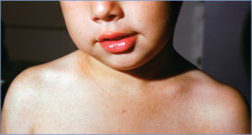

## PDF page 790 | printed page 776

Image 127.3 Rubella rash (face) in a previously unimmunized female patient. Adenovirus and enterovirus infections can cause exanthema that mimics rubella. Serological testing is important if the patient is pregnant.

Image 127.5 Postauricular lymphadenopathy in the same 17-year-old with rubella as in Image 127.4. Courtesy of George Nankervis, MD.

Image 127.4 A generalized, nonpruritic rash of rubella over the posterior trunk and arms of a 17-year-old boy with rubella. Courtesy of George Nankervis, MD.

Image 127.6 Infant boy with congenital rubella with microcephaly. Copyright Charles Prober, MD.

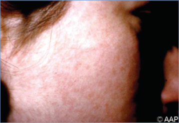

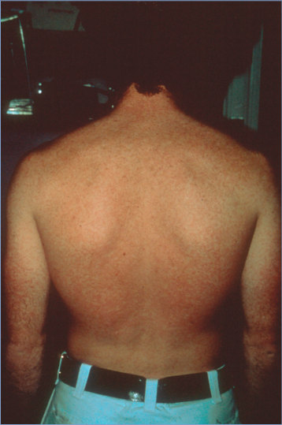

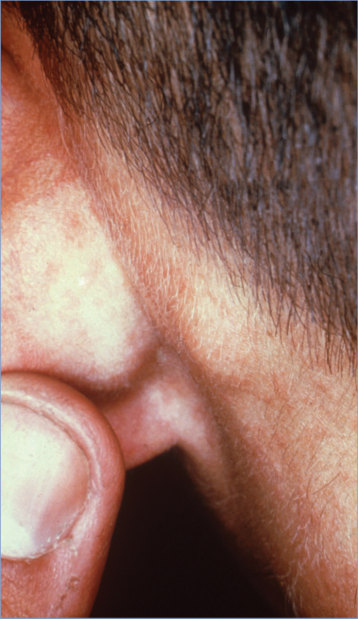

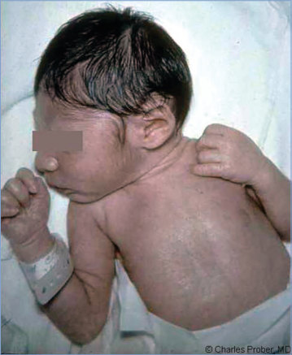

## PDF page 791 | printed page 777

Image 127.7 Newborn with congenital rubella rash. Courtesy of Immunization Action Coalition.

Image 127.9 A 4-year-old boy with congenital rubella syndrome with unilateral microphthalmos and cataract formation in the left eye.

Image 127.11 Rubella rash on a child’s back. The distribution is similar to that of measles, although the lesions are less intensely red. Courtesy of Centers for Disease Control and Prevention.

Image 127.8 This photograph shows the cataracts in an infant’s eyes caused by congenital rubella syndrome. Rubella is a viral disease that can affect susceptible people of any age. Although rubella generally produces a mild rash, if it is contracted in early pregnancy, there can be a high rate of fetal wastage or birth defects, known as congenital rubella syndrome. Courtesy of Centers for Disease Control and Prevention.

Image 127.10 Radiograph of the chest and upper abdomen of an infant with congenital rubella pneumonia with hepatosplenomegaly.

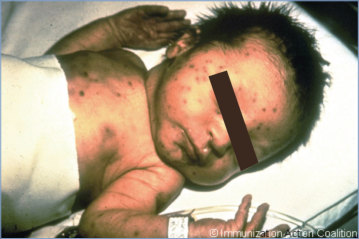

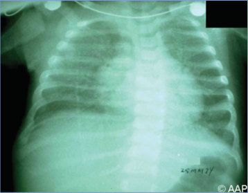

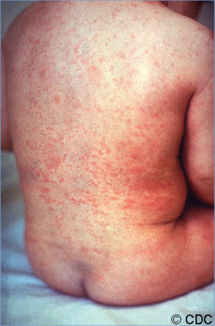

## PDF page 792 | printed page 778

Image 127.12 A 1-month-old with congenital rubella syndrome with bilateral cataracts. Courtesy of Larry Frenkel, MD.

Image 127.14 Transmission electron micrograph of rubella virus. Rubella virus is an enveloped, positive-stranded RNA virus classified as a Rubivirus in the Togaviridae family. Courtesy of Centers for Disease Control and Prevention.

Image 127.13 Rubella on the neck. Courtesy of James Brien, DO.

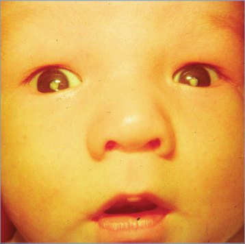

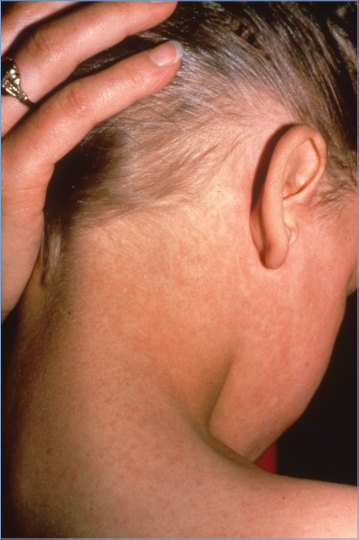

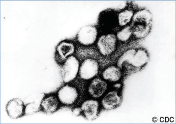

## PDF page 793 | printed page 779

Image 127.15 Rubella. Incidence, by year—United States, 1982–2012. Since 2012, <10 people in the United States are reported to have rubella each year. Courtesy of Morbidity and Mortality Weekly Report.

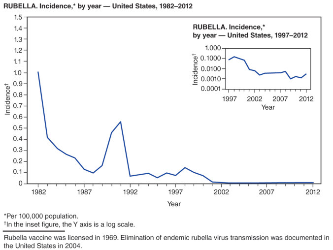
